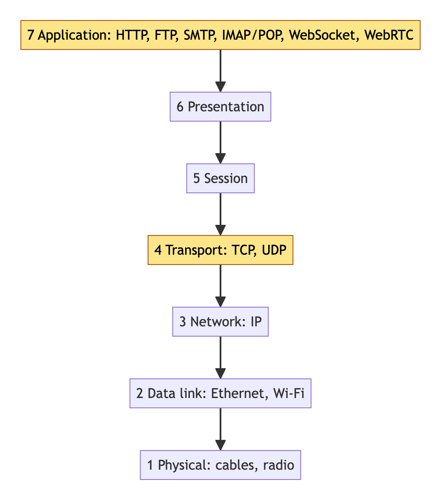
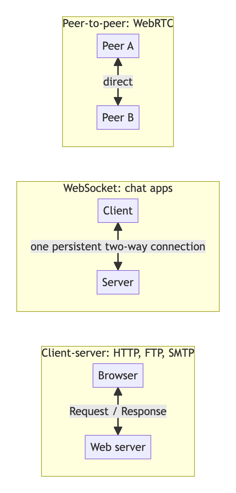
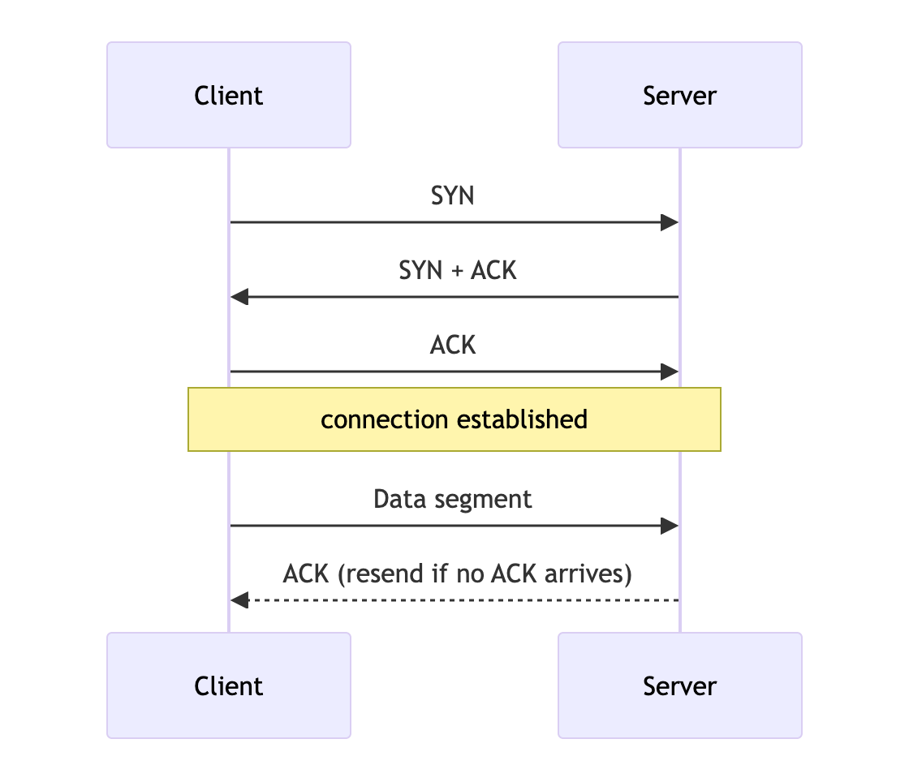
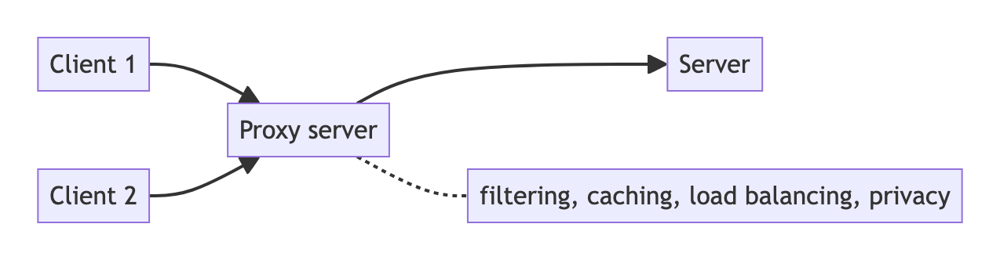

# Network Protocols (HLD #1 – Lecture 39)

<!-- nav -->
[Index](00_HLD_Index.md) · [02 CAP Theorem](02_CAP_Theorem_Notes.md) ➡
<!-- nav -->

Source (handwritten, pages 1–4 of the 36-page PDF): https://drive.google.com/file/d/1iegvlzgcLJtcGvbjJbPqF4hZaB5u_nrh/view?usp=drive_link

---

## What are network protocols?
- They **ensure efficient data transmission.** Network protocols are a **set of rules and conventions that govern communication and data exchange between different devices on a network**; they define standards for **data encoding, transmission and reception**, ensuring devices can **understand and interpret each other's messages** (like a common language between two computers).
- Common ones: **TCP/IP, HTTP.**
- **It impacts:**
  - **Interoperability** – provides a way to share info.
  - **Reliability** – it won't change over time.
  - **Efficiency** – optimizes data transmission by minimizing latency and packet loss.
  - **Scalability** – well-designed protocols help in scaling the system.
  - **Security** – SSL/TLS encrypt data during transmission.

<!-- isw:01-0 -->
**In simple words**

A network protocol is **a set of rules for how devices on a network talk to each other.** The rules say how data is **encoded, sent and received**, so that two devices can understand each other's messages, like a common language between two computers. Well-known examples in the notes are **TCP/IP and HTTP.**

The notes list five things a good protocol gives you: **interoperability** (a way for different systems to share information), **reliability** (it does not change over time), **efficiency** (less delay and less packet loss), **scalability** (it helps the system to grow) and **security** (SSL/TLS encrypt the data while it travels).
<!-- /isw:01-0 -->

## OSI layers

<!-- diagram:01-0 -->
**Diagram – OSI layers and where the protocols live**

<!-- /diagram:01-0 -->

Application · Presentation · Session · **Transport** · Network · Data Link · Physical. The two that matter here: **Application (L7)** and **Transport (L4).**

### Transport layer – TCP/IP vs UDP
- **TCP** – connection-oriented, reliable (sending ↔ ACK; ordered; slower).
- **UDP** – connectionless, **fast, unordered, no guarantee.**

<!-- isw:01-2 -->
**In simple words**

At the transport layer there are two choices. **TCP** is **connection-oriented and reliable**: data that is sent is acknowledged (ACK), arrives in order, but it is slower. **UDP** is **connectionless**: it is **fast but has no ordering and no guarantee** that data arrives.
<!-- /isw:01-2 -->

### Application layer – communication models

<!-- diagram:01-1 -->
**Diagram – Three communication models**

<!-- /diagram:01-1 -->

1. **Client–server** (connection-oriented): **HTTP, FTP, SMTP** (sending: 2 connections – control connection + data connection (temp)), **IMAP + POP** (receiving mail).
2. **Peer-to-peer** → **WebRTC** (clients communicate directly with each other).
- Web browser ⇄ web server: `Req / Res` over HTTP / FTP / SMTP.
- **WebSocket (messaging apps):** a persistent two-way connection between client and server (client ⇄ server, bi-directional `Req/Res`) – peer-to-peer is not used.

<!-- isw:01-1 -->
**In simple words**

The notes list the seven OSI layers: Application, Presentation, Session, Transport, Network, Data Link and Physical. Only two matter for this lecture: the **Application layer (L7)** and the **Transport layer (L4)**.
<!-- /isw:01-1 -->

<!-- isw:01-3 -->
**In simple words**

At the application layer the notes show two models:
1. **Client–server (connection-oriented):** **HTTP, FTP, SMTP** and, for receiving mail, **IMAP and POP**. For SMTP, sending mail uses **two connections: a control connection and a temporary data connection.** A web browser and a web server exchange a request and a response over HTTP / FTP / SMTP.
2. **Peer-to-peer:** **WebRTC**, where the clients communicate directly with each other.

**WebSocket** is used by messaging apps: it is a **persistent two-way connection between the client and the server** (both sides can send requests and responses at any time). Peer-to-peer is not used there.
<!-- /isw:01-3 -->

## 1. TCP – Transmission Control Protocol

<!-- diagram:01-2 -->
**Diagram – TCP three-way handshake**

<!-- /diagram:01-2 -->

- **Role:** one of the **core protocols of the Internet protocol suite**; provides **reliable, connection-oriented communication between devices on a network**; operates at the **transport layer of OSI**.
- **Functionality:** **establishes a connection earlier than data transfer** – the **3-way handshake**: client sends **SYN segment** → server replies **SYN + ACK segment** → client sends **ACK segment**; then it **ensures the receipt of packets** and **retransmits if there is any loss of data.**
- **Use cases:** widely used where **data integrity and sequencing are critical** along with data transfer – **email delivery, web browsing, file transfer.**

<!-- isw:01-4 -->
**In simple words**

TCP (Transmission Control Protocol) is one of the core protocols of the Internet and gives **reliable, connection-oriented communication between devices.** It works at the transport layer of OSI. **Before any data moves, it sets up a connection with the 3-way handshake:** the client sends a **SYN** segment, the server replies **SYN + ACK**, and the client sends an **ACK**. After that TCP **makes sure every packet is received and sends it again if data is lost.** It is used where **data integrity and order matter**: email delivery, web browsing and file transfer.
<!-- /isw:01-4 -->

## 2. IP – Internet Protocol
- **Role:** responsible for **addressing and routing packets through networks.**
- **Functionality:** assigns a **complete unique IP address to each device** and determines **the best suitable path for data packets to reach their destinations.**
- **Use cases:** fundamental to all networked systems; used together with other protocols for data transmission.

<!-- isw:01-5 -->
**In simple words**

IP (Internet Protocol) is responsible for **addressing and routing packets through networks.** It gives **each device a unique IP address** and decides **the best path for the packets** to reach their destination. It is fundamental to every networked system and is used together with the other protocols.
<!-- /isw:01-5 -->

## 3. UDP – User Datagram Protocol
- **Role:** same family as TCP but **not reliable and connectionless** – a **simpler, connectionless protocol with minimal services** ("**fire and forget**").
- **Functionality:** **doesn't guarantee delivery or order of packets / sequencing.**
- **Use cases:** **real-time apps – VoIP, online gaming, live video streaming** – where **low latency matters most.**

<!-- isw:01-6 -->
**In simple words**

UDP belongs to the same family as TCP but is **not reliable and connectionless.** It is a simpler protocol with minimal services, described as **"fire and forget"**: it **does not guarantee delivery, order or sequencing.** It is used for **real-time applications such as VoIP, online gaming and live video streaming**, where low delay matters most.
<!-- /isw:01-6 -->

## 4. HTTP and HTTPS
- **HTTP – role:** used for **transferring hypertext files on the WWW.** **Functionality:** defines how messages are **formatted and transmitted between web servers and clients.** **Use cases:** web browsers to **retrieve and display web pages.**
- **HTTPS** adds a **layer of security through encryption** (**Secure Socket Layer**): provides a **stable and secure connection**, **encrypts information during transmission**, ensuring **confidentiality and integrity.**

<!-- isw:01-7 -->
**In simple words**

**HTTP** is used for **transferring hypertext files on the World Wide Web.** It defines how messages are **formatted and sent between web servers and clients**, and browsers use it to fetch and show web pages. **HTTPS** adds a **layer of security through encryption (SSL):** it gives a stable and secure connection and **encrypts the information while it travels**, ensuring confidentiality and integrity.
<!-- /isw:01-7 -->

## 5. FTP and SMTP
- **FTP (File Transfer Protocol):** used for **transferring documents between a client and server on a network**; allows users to **upload, download and manipulate files on a remote server.**
- **SMTP (Simple Mail Transfer Protocol):** used for **sending email**; **IMAP and POP3** are used for **receiving** email.

<!-- isw:01-8 -->
**In simple words**

**FTP (File Transfer Protocol)** moves files between a client and a server: you can **upload, download and manage files on a remote server.** **SMTP (Simple Mail Transfer Protocol)** is used for **sending email**, while **IMAP and POP3** are used for **receiving** it.
<!-- /isw:01-8 -->

## 6. Proxy servers

<!-- diagram:01-3 -->
**Diagram – A proxy sits between clients and servers**

<!-- /diagram:01-3 -->

A **proxy server acts as an intermediary between client devices and servers.**
- **Purposes:** content filtering · privacy/anonymity · security and access protocol · load balancing · caching.
- **Types:** forward · reverse · web proxy · public proxy.
- **Advantages:** enhanced security, improved performance, content control, load balancing.
- **Disadvantages:** latency, configuration complexity.
(See [17_Proxy_vs_Reverse_Proxy_Notes.md](17_Proxy_vs_Reverse_Proxy_Notes.md).)

<!-- isw:01-9 -->
**In simple words**

A **proxy server sits between client devices and servers.** The notes list its **purposes** (content filtering, privacy / anonymity, security and access protocol, load balancing, caching), its **types** (forward, reverse, web proxy, public proxy), its **advantages** (enhanced security, improved performance, content control, load balancing) and its **disadvantages** (latency, configuration complexity). The details are in the [Proxy vs Reverse Proxy](17_Proxy_vs_Reverse_Proxy_Notes.md) note.
<!-- /isw:01-9 -->

---

## Quick revision
- **TCP** (reliable, 3-way handshake, ordered) vs **UDP** (fast, fire-and-forget) vs **HTTP/HTTPS** (web, TLS) · **FTP/SMTP/IMAP/POP** · **proxy** types.

---

<!-- nav -->
[Index](00_HLD_Index.md) · [02 CAP Theorem](02_CAP_Theorem_Notes.md) ➡
<!-- nav -->
