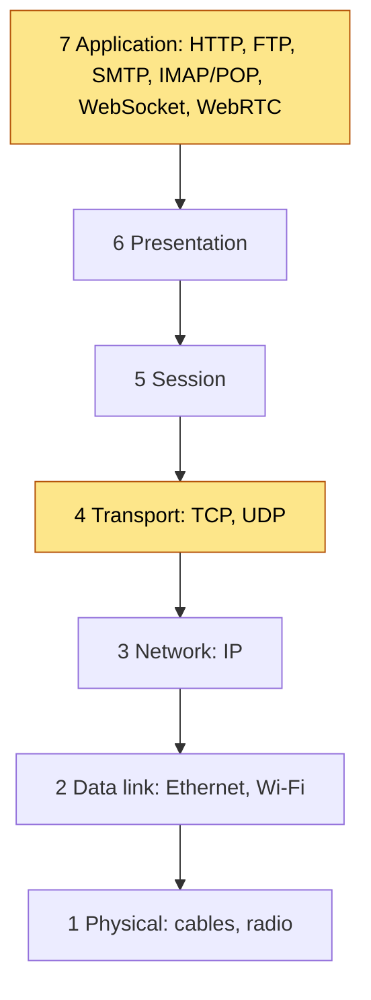
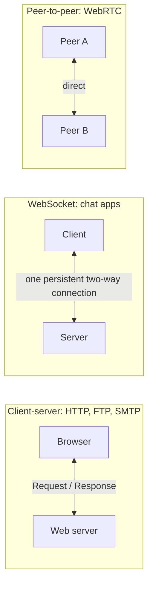
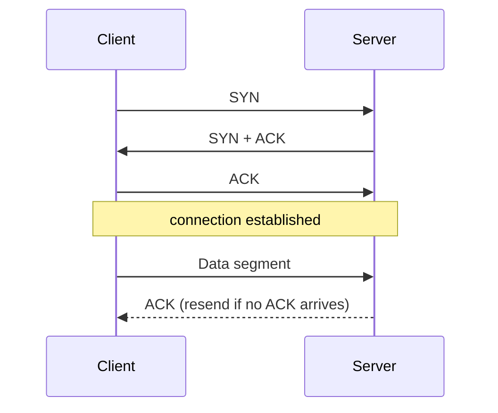
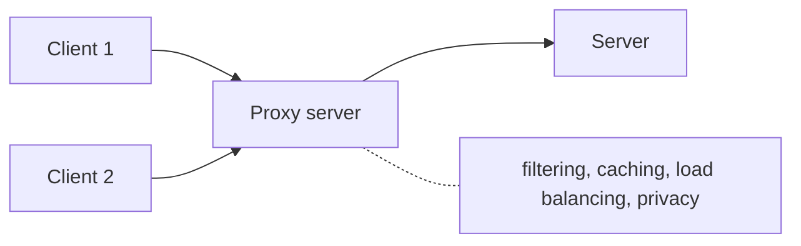

# Network Protocols (HLD #1 – Lecture 39)

<!-- nav -->
[Index](00_HLD_Index.md) · [02 CAP Theorem](02_CAP_Theorem_Notes.md) ➡
<!-- nav -->

Source (handwritten, pages 1–4 of the 36-page PDF): https://drive.google.com/file/d/1iegvlzgcLJtcGvbjJbPqF4hZaB5u_nrh/view?usp=drive_link

---

<!-- simple-explanation -->
## In simple words – network protocols (the basics)

A **protocol** is a set of agreed rules so that two computers can understand each other, like a common language. Good protocols give **interoperability** (different systems work together), **reliability**, **efficiency**, **scalability** and **security** (SSL/TLS encrypt data).

Network communication is organised in **layers** (the OSI model). Two matter most for system design:
- **Transport layer (L4):** how data is delivered.
  - **TCP** – *reliable*. It first sets up a connection with a **3-way handshake** (client sends SYN → server replies SYN+ACK → client sends ACK), then numbers packets, confirms receipt and re-sends anything lost. Data arrives complete and in order, but it is slower. Used for web pages, email, file transfer.
  - **UDP** – *fast, no guarantees*. "Fire and forget": no connection, no confirmation, no ordering. Used where speed beats perfection: video calls (VoIP), online games, live streaming.
- **Application layer (L7):** the rules apps use.
  - **HTTP** – the web's request/response protocol; **HTTPS** is HTTP plus encryption so that data can't be read or altered in transit.
  - **FTP** – transferring files to/from a server. **SMTP** – *sending* email; **IMAP/POP3** – *receiving* email.
  - **WebSocket** – a connection that stays open so that **both sides can send at any time** (used by chat apps). **WebRTC** – direct peer-to-peer connections (video calls).
- **IP** – gives every device an address and finds a route for packets across networks.
- **Proxy server** – a middleman between clients and servers for privacy, security, caching and load balancing (see [Proxy vs Reverse Proxy](17_Proxy_vs_Reverse_Proxy_Notes.md)).
<!-- simple-explanation -->

## What are network protocols?
- They **ensure efficient data transmission.** Network protocols are a **set of rules and conventions that govern communication and data exchange between different devices on a network**; they define standards for **data encoding, transmission and reception**, ensuring devices can **understand and interpret each other's messages** (like a common language between two computers).
- Common ones: **TCP/IP, HTTP.**
- **It impacts:**
  - **Interoperability** – provides a way to share info.
  - **Reliability** – it won't change over time.
  - **Efficiency** – optimizes data transmission by minimizing latency and packet loss.
  - **Scalability** – well-designed protocols help in scaling the system.
  - **Security** – SSL/TLS encrypt data during transmission.

## OSI layers

<!-- diagram:01-0 -->
**Diagram – OSI layers and where the protocols live**

<!-- /diagram:01-0 -->

Application · Presentation · Session · **Transport** · Network · Data Link · Physical. The two that matter here: **Application (L7)** and **Transport (L4).**

### Transport layer – TCP/IP vs UDP
- **TCP** – connection-oriented, reliable (sending ↔ ACK; ordered; slower).
- **UDP** – connectionless, **fast, unordered, no guarantee.**

### Application layer – communication models

<!-- diagram:01-1 -->
**Diagram – Three communication models**

<!-- /diagram:01-1 -->

1. **Client–server** (connection-oriented): **HTTP, FTP, SMTP** (sending: 2 connections – control connection + data connection (temp)), **IMAP + POP** (receiving mail).
2. **Peer-to-peer** → **WebRTC** (clients communicate directly with each other).
- Web browser ⇄ web server: `Req / Res` over HTTP / FTP / SMTP.
- **WebSocket (messaging apps):** a persistent two-way connection between client and server (client ⇄ server, bi-directional `Req/Res`) – peer-to-peer is not used.

## 1. TCP – Transmission Control Protocol

<!-- diagram:01-2 -->
**Diagram – TCP three-way handshake**

<!-- /diagram:01-2 -->

- **Role:** one of the **core protocols of the Internet protocol suite**; provides **reliable, connection-oriented communication between devices on a network**; operates at the **transport layer of OSI**.
- **Functionality:** **establishes a connection earlier than data transfer** – the **3-way handshake**: client sends **SYN segment** → server replies **SYN + ACK segment** → client sends **ACK segment**; then it **ensures the receipt of packets** and **retransmits if there is any loss of data.**
- **Use cases:** widely used where **data integrity and sequencing are critical** along with data transfer – **email delivery, web browsing, file transfer.**

## 2. IP – Internet Protocol
- **Role:** responsible for **addressing and routing packets through networks.**
- **Functionality:** assigns a **complete unique IP address to each device** and determines **the best suitable path for data packets to reach their destinations.**
- **Use cases:** fundamental to all networked systems; used together with other protocols for data transmission.

## 3. UDP – User Datagram Protocol
- **Role:** same family as TCP but **not reliable and connectionless** – a **simpler, connectionless protocol with minimal services** ("**fire and forget**").
- **Functionality:** **doesn't guarantee delivery or order of packets / sequencing.**
- **Use cases:** **real-time apps – VoIP, online gaming, live video streaming** – where **low latency matters most.**

## 4. HTTP and HTTPS
- **HTTP – role:** used for **transferring hypertext files on the WWW.** **Functionality:** defines how messages are **formatted and transmitted between web servers and clients.** **Use cases:** web browsers to **retrieve and display web pages.**
- **HTTPS** adds a **layer of security through encryption** (**Secure Socket Layer**): provides a **stable and secure connection**, **encrypts information during transmission**, ensuring **confidentiality and integrity.**

## 5. FTP and SMTP
- **FTP (File Transfer Protocol):** used for **transferring documents between a client and server on a network**; allows users to **upload, download and manipulate files on a remote server.**
- **SMTP (Simple Mail Transfer Protocol):** used for **sending email**; **IMAP and POP3** are used for **receiving** email.

## 6. Proxy servers

<!-- diagram:01-3 -->
**Diagram – A proxy sits between clients and servers**

<!-- /diagram:01-3 -->

A **proxy server acts as an intermediary between client devices and servers.**
- **Purposes:** content filtering · privacy/anonymity · security and access protocol · load balancing · caching.
- **Types:** forward · reverse · web proxy · public proxy.
- **Advantages:** enhanced security, improved performance, content control, load balancing.
- **Disadvantages:** latency, configuration complexity.
(See [17_Proxy_vs_Reverse_Proxy_Notes.md](17_Proxy_vs_Reverse_Proxy_Notes.md).)

---

## Quick revision
- **TCP** (reliable, 3-way handshake, ordered) vs **UDP** (fast, fire-and-forget) vs **HTTP/HTTPS** (web, TLS) · **FTP/SMTP/IMAP/POP** · **proxy** types.

---

<!-- nav -->
[Index](00_HLD_Index.md) · [02 CAP Theorem](02_CAP_Theorem_Notes.md) ➡
<!-- nav -->
