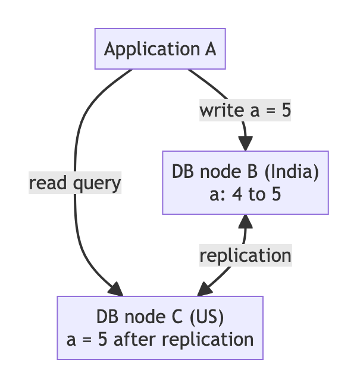
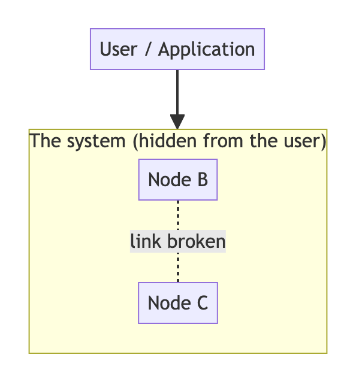
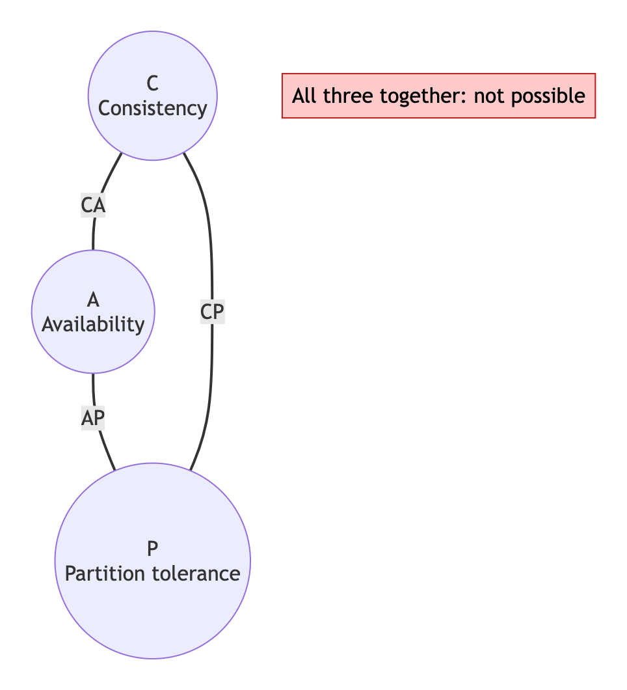
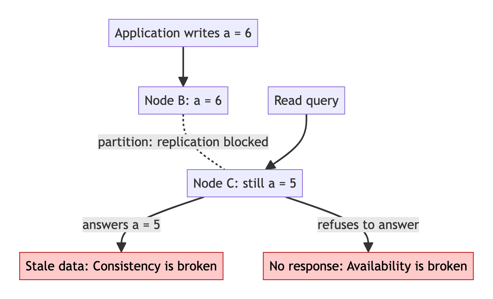

# CAP Theorem (HLD #2 – Lecture 40)

<!-- nav -->
⬅ [01 Network Protocols](01_Network_Protocols_Notes.md) · [Index](00_HLD_Index.md) · [03 & 04 Microservices Design Patterns](03_04_Microservices_Design_Patterns_Notes.md) ➡
<!-- nav -->

Source: https://drive.google.com/file/d/1rEs7p_Hrgdu57xakTyxgO1k3Zyp3zu-C/view?usp=drive_link

---

## 1. What is the CAP Theorem?
- CAP describes the **desirable properties of a distributed system with replicated data**.
  - Example: a **Master DB** replicating to a **Slave DB**.
- The three properties:

| Letter | Property |
|---|---|
| **C** | Consistency |
| **A** | Availability |
| **P** | Partition Tolerance |

- **Key rule:** we **can't use all three together; we can use only two** → **CA, CP, or AP**.
  - Venn diagram in notes: three overlapping circles C, A, P; the pairwise overlaps are CA, CP, AP. The centre (all three) is crossed out / marked as the "unique part" that is not achievable.

<!-- isw:02-0 -->
**In simple words**

CAP is about a **distributed system with replicated data**: the same data is kept on more than one database (for example a **Master DB** that copies its data to a **Slave DB**). Such a system has three properties we would like to have: **C** (Consistency), **A** (Availability) and **P** (Partition tolerance).

The key rule is that **we cannot use all three together, we can only use two of them**, so the possible choices are **CA, CP or AP**. Think of a Venn diagram with three overlapping circles: each overlap of two circles is one of these pairs, and the middle part where all three meet is crossed out because it cannot be achieved.
<!-- /isw:02-0 -->


---

## 2. Running example used throughout

<!-- diagram:02-0 -->
**Three nodes with replicated data**


<!-- /diagram:02-0 -->


Three nodes holding the same data, replicated:

```
                 Application (A)
                 /            \
        write a=5              read query
               /                \
     DB node B (India)  <---->  DB node C (US)
        (a = 4 → 5)          (a = 4 → 5 after replication)
```

- **A** = the application node issuing queries.
- **B** = DB node in **India**, **C** = DB node in **US**.
- B and C replicate data between each other (the dashed arrow B → C).

<!-- isw:02-1 -->
**In simple words**

One example is used throughout: an **application A** and two database nodes that hold the same data. **Node B is in India** and **node C is in the US**. B and C copy data to each other (replication). The data item in the example is `a`: it starts as `4` and is updated to `5` (and later `6`). Keep this setup in mind for the next sections.
<!-- /isw:02-1 -->


---

## 3. C – Consistency
- **Scenario:** Suppose node B has data `a = 4`.
  1. Application **writes** an update query: `a = 5` to node B.
  2. B updates its data `a = 4 → a = 5`.
  3. B **replicates** the data to node C.
- **Definition:** Consistency means:
  - the application **writes** the data to **node B**, and
  - a later **query to read** the data from **node C**
  - **always finds the updated data** (`a = 5`).
- In short: *every read sees the most recent write, regardless of which node serves it.*

<!-- isw:02-2 -->
**In simple words**

Take node B holding `a = 4`. The application writes the update `a = 5` to B. B changes its copy to 5 and then **replicates** the change to node C.

*Consistency* means: after the application has written to node B, a later **read from node C always finds the updated value (`a = 5`)**. In other words, **every read sees the most recent write, no matter which node answers.**
<!-- /isw:02-2 -->


---

## 4. A – Availability
- **Both node B or C – at least one response.**
- **All nodes should respond – at least a success or a failure.**
  - i.e. every request to a working node gets a response (it can't hang/ignore); the response may be success or failure, but there must be one.
- App A is connected to B and C; a query to either node gets a response.

<!-- isw:02-3 -->
**In simple words**

*Availability* means that **a request gets a response from at least one of the nodes (B or C)**, and that **every node should respond**, with either a success or a failure. A working node may not hang or stay silent. The answer may be "success" or "failure", but there must be an answer.
<!-- /isw:02-3 -->


---

## 5. P – Partition Tolerance
<!-- diagram:02-1 -->
**The system keeps working when the B–C link breaks**


<!-- /diagram:02-1 -->


- **System is up** even though the network between nodes is broken.
- The system is **hidden** from the user:
  - The user **doesn't know** data is replicated (or not).
  - The user only knows they are **querying "the system"**.
- The DB nodes B and C sit inside a "hidden" box; the application talks to the box. The B–C link can **break**.
- **Definition:** Partition tolerance tells us that **if B and C have a communication break, even then the application continues querying** → that is partition tolerance.

<!-- isw:02-4 -->
**In simple words**

*Partition tolerance* means **the system stays up even though the network between the nodes is broken.** B and C sit inside a "hidden" box: the user does not know that the data is replicated, the user only knows they are querying "the system". The link between B and C can break.

So if B and C cannot talk to each other, the application can **still send its queries and the system keeps working**. That is partition tolerance.
<!-- /isw:02-4 -->


---

## 6. Which combinations are possible?
<!-- diagram:02-2 -->
**The CAP triangle: pick any two**


<!-- /diagram:02-2 -->


| Combination | Possible? | Note |
|---|---|---|
| **CA** | ✅ Possible | (system up – i.e. only when there is no partition) |
| **CP** | ✅ Possible | |
| **AP** | ✅ Possible | |
| **CAP** (all three) | ❌ Not possible | cannot have C, A and P together |

<!-- isw:02-5 -->
**In simple words**

The table says that **CA, CP and AP are each possible**, but **all three together (CAP) are not possible**. CA means "system up": it is possible only as long as the system is up, that is, when there is no network break between the nodes.
<!-- /isw:02-5 -->


---

## 7. Why can't C, A and P co-exist?
<!-- diagram:02-3 -->
**During a partition C must choose: stale answer or no answer**


<!-- /diagram:02-3 -->


Setup: A writes `a = 6`; the link between B and C is **broken** (a partition).

- B gets the write → `a = 6`.
- C could not receive the replication → still `a = 5`.

Now a **read query** hits C (**Available + Partition Tolerance** case):

- If C **answers (success)** with `a = 5` → the answer is **stale → Consistency is broken**.
- If C **refuses (failure)** to avoid returning stale data → it is **not responding with data → Availability is broken**.

So during a partition you must **give up either C or A**. You can't keep all three.

<!-- isw:02-6 -->
**In simple words**

Example: the application writes `a = 6`, but the **link between B and C is broken**.
- **B** receives the write, so B has `a = 6`.
- **C** could not receive the replication, so it still has `a = 5`.

Now a read arrives at **C**. C has two choices:
1. **Answer with `a = 5`.** C responds (so it is available and survives the break), but the value is old, so **consistency is broken**.
2. **Refuse to answer** so that it does not return old data. Then there is no value for the user, so **availability is broken**.

There is no third option, because C simply does not have the new value. That is why, during a partition, **you must give up either C or A**, and all three cannot exist together.
<!-- /isw:02-6 -->


---

## 8. Pairs in practice
### CP-style loss example – "I do not lose consistency"
- Write `d = 6` goes to B; C is **down** (still has `d = 5`).
- With C down and a failed replication, the system has to sacrifice something: **CAP → ✗** (not all three). When a node can't be reached you can't have everything.

### "I do Consistency and Availability" → **CA**
- The link between B and C is broken (✗).
- CA = consistent + available, but **no partition tolerance**; it works only while the network between nodes is healthy.

<!-- isw:02-7 -->
**In simple words**

**First case:** the write `d = 6` goes to B while C is down and still has `d = 5`. That is marked "CAP ✗": when a node cannot be reached you cannot have everything. **Second case ("I do Consistency and Availability" → CA):** the link between B and C is broken (✗). This is the CA pair: it gives consistency and availability, but it works only while the network between the nodes is healthy, so it does not tolerate a partition.
<!-- /isw:02-7 -->


---

## 9. Trade-off conclusion
- **"We never trade off partition tolerance."**
  - In a real distributed system, network partitions *will* happen, so **P is mandatory**.
  - Therefore the real choice is between:
    - **CP** – keep consistency, sacrifice availability during a partition.
    - **AP** – keep availability, sacrifice consistency during a partition.
  - `CP` and `AP` are the practical choices; `CA` is the option that drops P.

<!-- isw:02-8 -->
**In simple words**

The conclusion is **"we never trade off partition tolerance."** The reasoning is that in a real distributed system the network between nodes *will* break at some point, so partition tolerance is always needed. That leaves a real choice between **CP** (keep consistency and give up availability during a partition) and **AP** (keep availability and give up consistency during a partition). CP and AP are the practical choices; CA is the option that drops partition tolerance.
<!-- /isw:02-8 -->


---

## 10. Quick revision sheet

- **C** – every read returns the latest write.
- **A** – every request to a live node gets a (success/failure) response.
- **P** – system keeps working when nodes can't talk to each other.
- Only **2 of 3** at a time → **CA / CP / AP**.
- Partition tolerance is non-negotiable in distributed systems → choose **CP vs AP**.
- Proof: A writes `a=6` to B, B–C link breaks, C still has `a=5`; reading from C must either return stale data (lose C) or refuse (lose A).

---

## More points on CAP

- **CAP** = desirable properties of a **distributed system with replicated data**: **C**onsistency, **A**vailability, **P**artition tolerance (Venn: CA, CP, AP).
- **In a distributed system we can't use all 3 properties.** Causes: (1) if we make the application consistent and available, a **partition is not possible**, because to be consistent the DB instances must be connected; (2) if you partition, then **forget about consistency or availability.**
- **Consistency:** B (a=4) and A writes on B (a=5) → B replicates the same value to C (a=5) – the changes must be done at each place in one shot.
- **Availability:** all nodes must be responsive, even though data is inconsistent.
- **Partition:** B and C are not connected, yet A still gets a response → that's fault tolerance.
- *"Always compromise between consistency & availability" – **Brewer's theorem.***

**ACID** (SQL): **Atomicity** – a transaction must happen in one shot; **Consistency** – data must be the same on all nodes; **Isolation** – instances must work individually; **Durability** – instances must be backed up.
**BASE (AP databases):** **BA**sically **A**vailable · **S**oft state · **E**ventually consistent.

**Examples**
- **PostgreSQL (CA):** uses SQL; follows ACID; used in **banking** where consistency and availability are crucial; provides **foreign data wrappers** that allow multiple DBs to communicate.
- **MongoDB (CP):** primarily BASE-oriented (document store), but now it is adopting ACID.
- **Cassandra (AP):** sacrifices consistency at the cost of availability; it is **peer-to-peer.**

---

<!-- nav -->
⬅ [01 Network Protocols](01_Network_Protocols_Notes.md) · [Index](00_HLD_Index.md) · [03 & 04 Microservices Design Patterns](03_04_Microservices_Design_Patterns_Notes.md) ➡
<!-- nav -->
