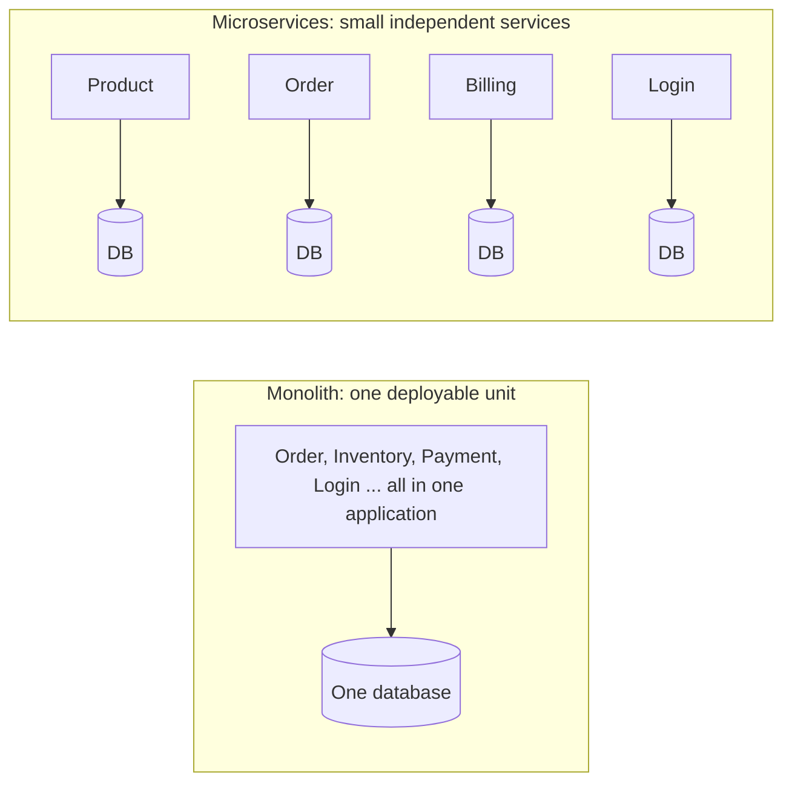
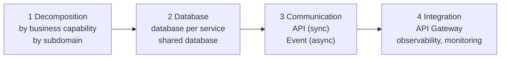
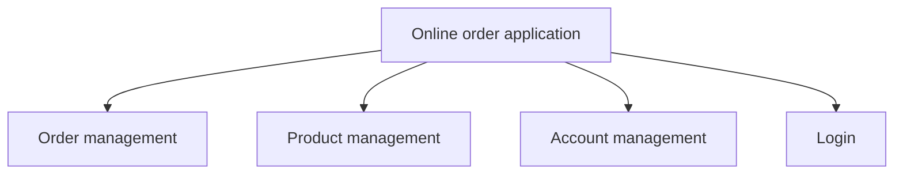
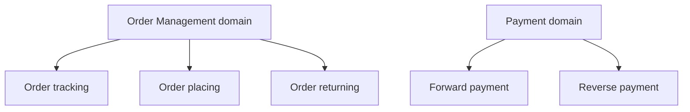
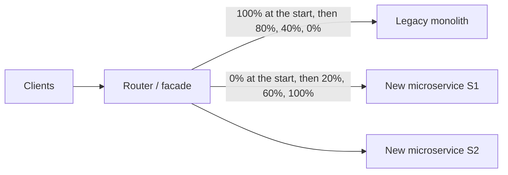
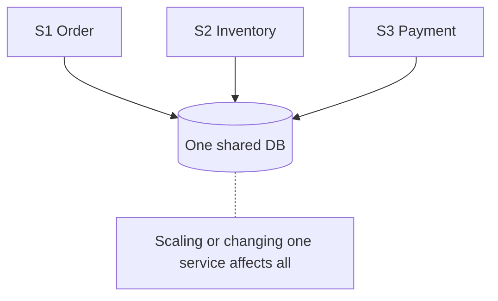
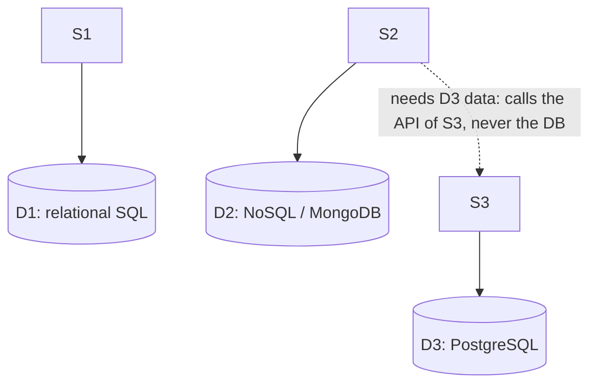
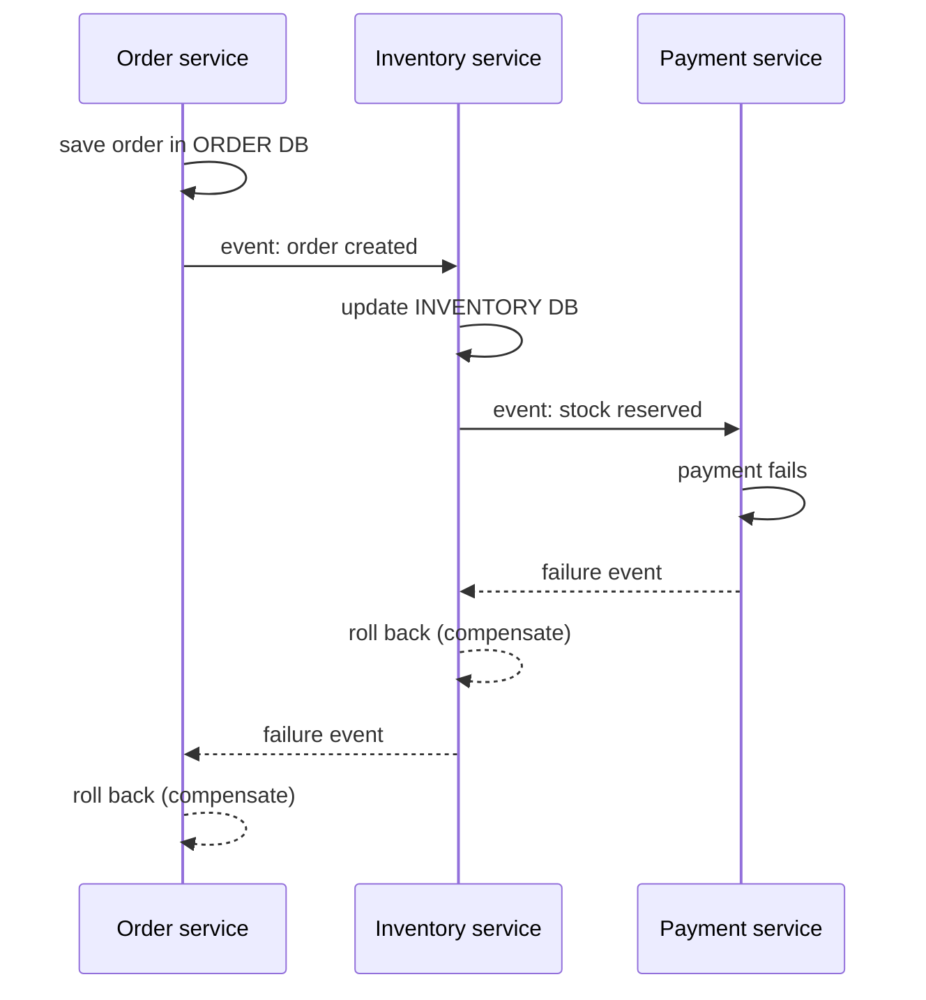
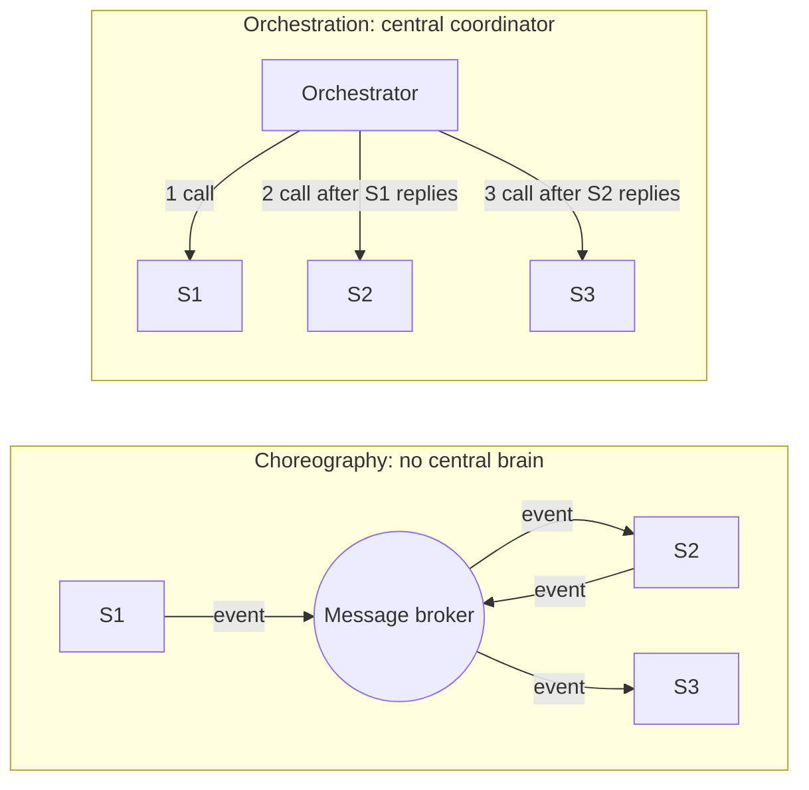
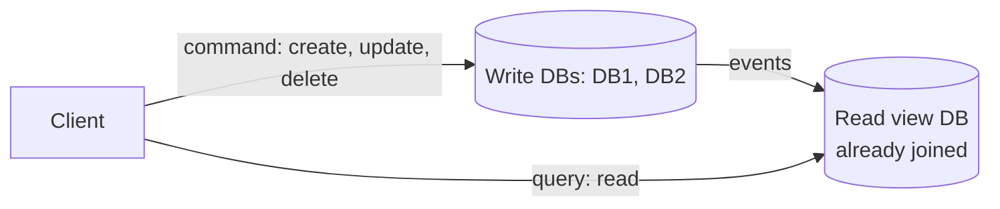

# Microservices Design Patterns – Part 1 & Part 2 (HLD #3 and #4 – Lecture 41)

<!-- nav -->
⬅ [02 CAP Theorem](02_CAP_Theorem_Notes.md) · [Index](00_HLD_Index.md) · [05 Scale from Zero to Million Users](05_Scale_from_Zero_to_Million_Users_Notes.md) ➡
<!-- nav -->

Source (same PDF for both entries, handwritten, 10 pages): https://drive.google.com/file/d/1d8R5wkQo9gnCcB_e2DFKCn-TgxWoJMsd/view?usp=drive_link

---

<!-- simple-explanation -->
## In simple words – microservices and their design patterns

### Monolith vs microservices
A **monolith** is one big application that contains everything (orders, inventory, payments, login…) and is deployed as one unit.
- ❌ The code base becomes huge and slow to work with.
- ❌ **Scaling is all-or-nothing:** if only the Order part is busy you still have to scale the entire application.
- ❌ **Tightly coupled:** a small change in one area can accidentally break many others.

**Microservices** split the application into small, independent services (Product, Order, Billing, Login, Payment…).
- ✅ Each is small, so developers manage it easily.
- ✅ Each can be **scaled and deployed independently**.
- ❌ But new problems appear: services talk over the network (**latency**); a single user request passes through many services, so **debugging and monitoring are harder**; and each service has its own database, so you **lose one big ACID transaction**.

"How small is small?" There is no strict rule. That's what the patterns below help decide.

### The four phases of designing microservices
**Decomposition → Database → Communication → Integration**
(how to split, how to store data, how services talk – API calls or events – and how clients enter via an API gateway with monitoring).

### Decomposition: how to split a monolith
1. **By business capability** – one service per thing the business does: order management, product management, account management, login. You need good knowledge of the business.
2. **By subdomain (Domain-Driven Design)** – divide the business into **domains** (Order, Payment…) and break each domain into sub-domains/services. For example, the Payment domain might have a few services.

### Strangler pattern – migrating step by step
Rewriting a monolith in one go is risky. Instead, put a **routing layer (facade)** in front. At first 100 % of traffic goes to the monolith. As you rebuild each feature as a microservice, route a bit more traffic to it (0 % → 20 % → 60 % → 100 %). When nothing uses the monolith anymore, switch it off. Like a strangler vine slowly replacing a tree.

### Data management: shared vs per-service database
**Shared database** (all services use one DB):
- ✅ Easy joins and easy ACID transactions.
- ❌ Can't scale services independently (a busy Order service forces you to scale the whole DB).
- ❌ Risky schema changes: removing a column needs checking every service that uses it.

**Database per service** (each service owns its data):
- ✅ Each service picks the best database (SQL, MongoDB, PostgreSQL…), scales independently and is easy to maintain.
- Rule: service S2 must **not** query S3's database. It must **ask S3 through its API**.
- ❌ You lose cross-service joins (solved with **CQRS**, a separate read model) and cross-service transactions (solved with **SAGA**).

### SAGA – transactions across services
Example: place an order → reserve stock → take payment. Each step is a **local transaction** in its own database. If payment fails after the order and inventory were saved, we can't "roll back" normally, so the earlier services run **compensating actions** (cancel the order, release the stock).
Two styles:
- **Choreography (event-based):** there's no boss. Each service does its work, **publishes an event**, and the next service reacts. If one fails it publishes a failure event and the earlier ones undo their work. Simple for a few steps, but it becomes tangled (**cyclic dependencies**) as services multiply.
- **Orchestration:** a central **orchestrator** calls S1, then S2, then S3 in order. If S3 fails, the orchestrator tells S2 and S1 to compensate. The flow is easy to follow in one place, but the orchestrator is a central component to maintain.

See also [Distributed Transactions](20_Distributed_Transactions_Notes.md) and [Dual Write Problem](33_Dual_Write_Problem_Notes.md).
<!-- simple-explanation -->

# PART 1

## 1. Monolithic vs Microservices (p1–p2)

<!-- diagram:03_04-0 -->
**Diagram – Monolith versus microservices**

<!-- /diagram:03_04-0 -->

### Monolithic (legacy) application
One big application containing everything (Order, Inventory, Payment, … – e.g. an online store), deployed as a single unit (GB-sized).

**Disadvantages**
1. **Overloads the IDE** (huge code-base).
2. **Scaling is very hard** – e.g. if one sub-operation (the example mentions a "CI job" being fast) is fast it's easy to scale, but you must scale the **whole** application.
3. **Tightly coupled** – if we change one line it might **impact so many domains.**

### Why microservices?
Break the monolith into small services – Product, Order, Billing, Login, Account, Payment, …

**Advantages**
1. **Managing is very easy for developers** (small focused code-bases).
2. **We can scale independently.**

### Disadvantages of microservices
1. **Latency / communication** – the components are **loosely coupled** but must communicate a lot over the network → **latency issue.** (Properly broken-down services still give more inter-service communication.)
2. **Debugging is too hard** – e.g. flow S1 → S2 → S3; if there is a new code change in S3 and something breaks, **finding who the culprit is is hard.** **Monitoring is difficult.**
3. **Transaction management** – in a monolith a request runs under **one DB with ACID** (start → end/stop in one transaction). In microservices a request R1 touches **S1 (own DB), S2 (own DB)** … – each has its own transaction, so there is no single ACID transaction. *(→ SAGA, see below.)*

---

## 2. Micro-services – "how small is small?"
**Micro + Services** – services should be small, but **there is no definition of how much "micro" is.**

### Phases of microservices

<!-- diagram:03_04-1 -->
**Diagram – The four phases**

<!-- /diagram:03_04-1 -->

| # | Phase | Contents |
|---|---|---|
| 1 | **Decomposition** | decompose by **business capability**; decompose by **subdomain** |
| 2 | **Database** | **database per service**; **shared database** |
| 3 | **Communication** | **API** (synchronous); **Event** (asynchronous) |
| 4 | **Integration** | **API Gateway** → also **Observability** and **Monitoring** |

---

## 3. Decomposition patterns (p3–p5)
Question: *how much small?* Two approaches:

### ① By business capability / functionality

<!-- diagram:03_04-2 -->
**Diagram – Decompose by business capability**

<!-- /diagram:03_04-2 -->

Decompose by what the business does. Example – **Online Order Application** → **Order management, Product management, Account management, Login** …
**Challenge:** you need **knowledge of which functions exist in your business**; and **there is no definition of how much micro.**

### ② By subdomain – DDD (Domain-Driven Design)

<!-- diagram:03_04-3 -->
**Diagram – Decompose by subdomain (DDD)**

<!-- /diagram:03_04-3 -->

Use **Domain-Driven Design**: split the application into **domains**, and each domain into sub-domains/services – e.g. **Order Management domain → several services**, **Payment domain → a few services.**

---

# PART 2

## 4. Strangler Pattern (refactoring a monolith into microservices) (p6)

<!-- diagram:03_04-4 -->
**Diagram – Strangler pattern: traffic moves gradually to the new services**

<!-- /diagram:03_04-4 -->

- Put a **controller / routing layer (a facade)** in front of the **monolith** and the **new microservices** (S1, S2, …).
- Initially **all traffic (100 %) goes to the monolith.** As each module is rebuilt as a microservice, the controller **gradually shifts traffic** – e.g. **0 % → 20 % → 60 % → 100 %** to the microservices while the monolith traffic **goes down** – until the monolith can be retired. (The diagram shows an API count example: ~1000 APIs, 900 still in the monolith.)

## 5. Data management in microservices (p6)
Two options: **Database for each individual service** · **Shared database.** (SAGA / CQRS are needed with the database-per-service approach.)

### Why a shared database is not a success

<!-- diagram:03_04-5 -->
**Diagram – Shared database: services are tied together**

<!-- /diagram:03_04-5 -->

**Case 1 – can't scale independently.** S1 (Order), S2 (Inventory), S3 (Payment) share one DB. If **Order** has lots of traffic and we want to scale only the Order service, **we have to scale the whole database** → **we can't scale independently.**

**Case 2 – schema changes are risky.** One team has a common database with 10 tables; S3 wants to modify table 10 / delete a column. S3 **cannot just delete it – it must first check dependencies** on every other service.

**What *is* easy with a shared DB:**
- **Query joins** (10 tables are easy to join). *(With separate DBs, CQRS helps to solve this.)*
- **Easy to maintain the transaction property (ACID).**

> **Note:** these "easy" things become **difficult in a distributed database.** If a request spans S1, S2, S3 DBs, each only has a **local transaction (ACID)** – *"my transaction is now spanning over the distributed database"* → this challenge is **solved by the SAGA design pattern.**

### Database-per-service

<!-- diagram:03_04-6 -->
**Diagram – Database per service**

<!-- /diagram:03_04-6 -->

- S1 → D1 (relational DB / SQL), S2 → D2 (NoSQL / MongoDB), S3 → D3 (PostgreSQL) – **each service can choose its own DB type.**
- **S2 will not query DB3 directly**; if S2 wants D3's data it must **request S3 through an API** and S3 gives the data.
- **Easy to maintain a particular DB**, and **we can scale independently.**

---

## 6. SAGA pattern (p9–p10)

<!-- diagram:03_04-7 -->
**Diagram – SAGA: local transactions with compensation**

<!-- /diagram:03_04-7 -->

**Why do we need Saga?** Transaction: *Place an order → payment.* Three DBs: **ORDER** (T1, T2), **INVENTORY** (T3, T4), **PAYMENT** (T5, T6). Order row inserted successfully, inventory updated successfully, **payment fails** ✗.
- ACID tells that success is **all or none** – but it is only **local** ("Local ACID? Local Txn?"). We need to undo the earlier steps.

> **Saga = a sequence of local transactions.** Each service updates **its own DB** and **publishes an event**; the next service listens to the event. If a step fails it publishes a **failure** event, and the earlier services **roll back** (compensate).

Walk-through: *an order request arrives → Order service updates its DB and publishes an event → Inventory listens to the Order event, updates its own DB and publishes an event → Payment listens; suppose Payment fails → it generates a **failure** event → Inventory and Order roll back.*

### Two types of Saga

<!-- diagram:03_04-8 -->
**Diagram – Choreography versus orchestration**

<!-- /diagram:03_04-8 -->

**① Choreography** (event-based, no central brain)
- Services communicate through a **message broker / queues** (Q1 = success events, Q2 = failure events).
- S1 processes and sends an event; **S2 listens, does its work and publishes an event**; S3 works based on the event and, if it succeeds, publishes the next event; **if it fails it publishes a failure event** and the previous ones roll back.
- **Drawback: cyclic dependency** between services (each listens to others' events – hard to follow/maintain).

**② Orchestrator** (central coordinator)
- An **Orchestrator** calls **S1**, then **based on S1's reply calls S2**, then **based on S2's reply calls S3.** **If S3 fails, the orchestrator makes sure that the rollback (compensation) of S2, S1 is done.**
- (Single place that knows the whole flow; easier to follow, but the orchestrator is a central component.)

### CQRS

<!-- diagram:03_04-9 -->
**Diagram – CQRS: separate write side and read side**

<!-- /diagram:03_04-9 -->

Mentioned at the page edge as the companion pattern for **querying across per-service databases** (Command Query Responsibility Segregation) – see "CQRS" in the data-management section above.

---

## Quick revision
- Monolith: tight coupling, hard scaling, heavy. Microservices: independent scaling/deploys, but **latency, debugging/monitoring, distributed transactions.**
- 4 phases: **decomposition → database → communication (API/event) → integration (API gateway, observability).**
- Decompose by **business capability** or **DDD subdomain**; migrate with the **Strangler pattern** (route traffic gradually).
- **Database per service** (+ **SAGA** for transactions, **CQRS** for queries) beats a **shared database** (can't scale/change independently).
- **SAGA** = sequence of local transactions with compensations; **choreography** (events, cyclic-dependency risk) vs **orchestration** (central orchestrator).
- Related: [Distributed Transactions](20_Distributed_Transactions_Notes.md), [Dual Write Problem](33_Dual_Write_Problem_Notes.md), [API Gateway](40_41_API_Gateway_Part1_Part2_Notes.md).

---

## Extra from the 36-page handwritten compendium (pages 7–14)
These pages are in the same PDF as notes #1, #7, #9 and #11 (https://drive.google.com/file/d/1iegvlzgcLJtcGvbjJbPqF4hZaB5u_nrh/view?usp=drive_link); kept here because they belong to this topic.

- **Monolithic ("legacy"):** every functionality in a single app. **Disadvantages:** overloads the IDE, scaling is hard, deployment/CI.
- **Microservices:** each service has a **single responsibility** → **easy to scale, easy to maintain, easy to integrate and deploy.** **Disadvantages** (if services are partitioned incorrectly and still tightly connected): **latency increases**, **monitoring is difficult** (a change by anyone impacts other services), **transaction management** (if one service's transaction fails, the overall system becomes inconsistent).
- **Phases:** I. make services *micro* – decomposition by business capability, by subdomain, self-contained service, **service per team**; II. choose DB – **database per service** or **shared DB**; III. communication – **API composition**, **event sourcing**; IV. integrate – **API Gateway**.
- **Decomposition examples:** by business capability – Order, Product, Account, Login, Billing, Payment management. By subdomain (DDD) – *Order Management domain* → Order Tracking, Order Placing, Order Returning; *Payment domain* → Forward payment, Reverse payment.
- **Microservices II (post-decomposition): Strangler, SAGA, CQRS.**
- **Strangler:** *"How do you migrate a legacy monolith to microservices?"* – **modernize by incrementally developing a new application around the legacy app**; named after a vine that slowly strangles a tree. Stages **Transform → Co-exist → Eliminate** with a **router** sending traffic to legacy, to both, then to modern only. **Features:** gradual migration, co-existence, strangling behaviour.
- **SAGA:** *data management in microservices* – database per service (each ACID locally) vs shared DB (all data at one place; scaling one service impacts others; but **easy joins** and **ACID transactions**). Problem: an order affects several DBs – ACID across all is not possible → **SAGA = a sequence of local transactions**; events between local transactions; **on failure a failure event triggers rollback.**
  - **Choreography:** each local transaction **publishes domain events that trigger local transactions in other services** (Order → *Order Created* on Order event channel → Customer service → *Credit Reserved / Credit limit exceeded* on Customer event channel). "One after other" – services know what to do next.
  - **Orchestration:** **an orchestrator (object) tells the participants what local transactions to execute** (command channel & saga reply channel through a message broker); the order stays in a *pending* state until the customer service replies, then approved/rejected. Example: A pays B ₹10 → A: 100−10=90; B fails → +10 back → **rollback** to 100.
- **CQRS – Command Query Request Segregation:** segregate **commands (Create/Update/Delete)** from **queries (Select/Read)**. Writes go to DB1/DB2; **events** update a separate **read VIEW DB** – *"no need for joining; it behaves like it's joined but is independent."*

---

<!-- nav -->
⬅ [02 CAP Theorem](02_CAP_Theorem_Notes.md) · [Index](00_HLD_Index.md) · [05 Scale from Zero to Million Users](05_Scale_from_Zero_to_Million_Users_Notes.md) ➡
<!-- nav -->
