# Microservices Design Patterns – Part 1 & Part 2 (HLD #3 and #4 – Lecture 41)

<!-- nav -->
⬅ [02 CAP Theorem](02_CAP_Theorem_Notes.md) · [Index](00_HLD_Index.md) · [05 Scale from Zero to Million Users](05_Scale_from_Zero_to_Million_Users_Notes.md) ➡
<!-- nav -->

Source: https://drive.google.com/file/d/1d8R5wkQo9gnCcB_e2DFKCn-TgxWoJMsd/view?usp=drive_link

---

## 1. Monolithic and Microservices

### The monolith (legacy application)
- A **legacy / monolithic application** is one big application that contains everything: **Order, Inventory, Payment, …** (example: an **Online Store**). Its size is in **GB**.
- **Disadvantages:**
  1. **It overloads the IDE.**
  2. **Scaling is very hard.** It is tied to the **CI job** (the automated build and deploy): *"if the sub-operation (CI job) is fast, then it is easy to scale."*
  3. **A monolith is tightly coupled.** *If we change one line it might impact so much domain.*

**In simple words**
- *One big application:* all the features of the online store (orders, inventory, payments and more) live in a single code base and are built and deployed as a **single unit**. Because everything is in one place, the application grows to gigabytes.
- *Overloads the IDE:* the code base is so large that the editor becomes heavy and slow to work with.
- *Scaling is very hard:* if the unit you have to build and deploy is huge, the CI job is slow, and so is scaling. When the job is fast, scaling becomes easy. A small, separate piece gives you a fast job; a giant monolith does not.
- *Tightly coupled:* the parts of the monolith depend on each other so closely that changing even **one line** in one place can affect many other areas (domains), so every change is risky.

### Why microservices?

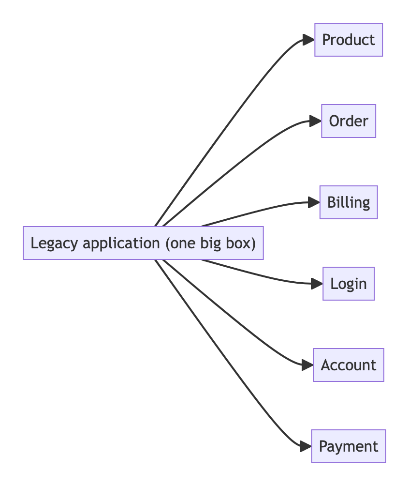

- The big box is broken into many small services: **Product, Order, Billing, Login, Account, Payment, …**
- Advantages: **1. Managing is very easy for the developer. 2. We can scale independently.**

**In simple words**
- Instead of one big box, the same application becomes **several small applications**, each doing one job (product, order, billing, login, account, payment).
- *Easy for the developer:* a developer only has to understand one small service, not the whole application.
- *Scale independently:* if only **Order** is busy, you scale just the Order service and leave the others alone.

### Disadvantages of microservices

**1. Loosely coupled, but a latency issue**

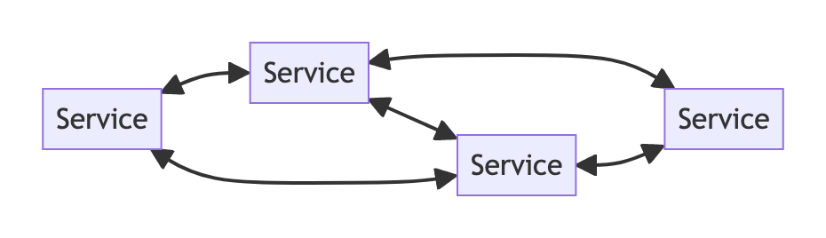

- *"We can properly break the microservices. All components are loosely coupled… we give more communication. It is a latency issue."*

**In simple words:** the services are separate (loosely coupled), but to finish one job they have to **talk to each other a lot**. Every conversation between services is a call over the network, and each call takes time. More communication means more waiting. That is the **latency issue**.

**2. Debugging is too hard**

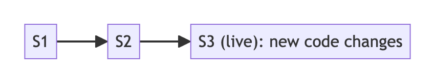

- *"Debugging is too hard. If the change is on S3, finding who is the culprit is hard."*
- *"Monitoring is difficult."*

**In simple words:** one request passes through S1, then S2, then S3. Say a **new code change** goes live in S3 and something breaks. The symptom may show up at S1 or S2, so it is hard to find **which service** (the culprit) caused it. Watching (monitoring) many services together is also difficult.

**3. Transaction management**

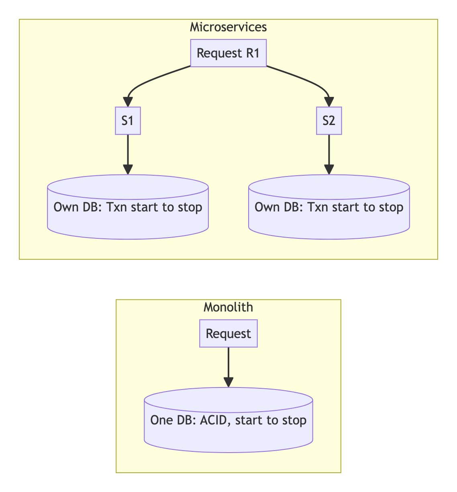

- In the monolith a request works against **one DB with ACID**, from start to stop.
- In microservices a request R1 goes to **S1 (its own DB)** and **S2 (its own DB)**, each with its own transaction start and stop.

**In simple words:** in the monolith, one request is one transaction on one database, so either everything is saved or nothing is (ACID). In microservices each service has **its own database and its own transaction**. There is no single transaction that covers S1 and S2 together. This problem is solved later with the **SAGA** pattern.

---

## 2. Micro + Services – how small?

- **Micro-service = Micro + Services**: *small – how much small??*
- **Phases of microservices:**

| # | Phase | Contents |
|---|---|---|
| 1 | **Decomposition** | decompose by **business capability**; decompose by **subdomain** |
| 2 | **Database** | **database per service**; **database shared** |
| 3 | **Communication** | **API**; **Event** |
| 4 | **Integration** | **API Gateway** → **Observability**, **Monitoring** |

- First comes **1. Decomposition** (one big box → several small boxes), then **2. Database** (small services with their databases).

**In simple words**
- The name says the services should be **small**, but how small is small? There is no fixed answer (more on this under decomposition).
- Building microservices happens in **four phases**:
  1. **Decomposition** – *how do we cut the big application into small pieces?* Two ways: by what the business does, or by subdomain.
  2. **Database** – *where does the data live?* Either each service has its own database, or all share one.
  3. **Communication** – *how do the services talk?* Through an **API** (a direct call and answer) or through an **event** (one service announces something, others react).
  4. **Integration** – *how does the outside world reach all these services?* Through an **API Gateway**, together with **observability and monitoring** to see what is happening.

---

## 3. Decomposition patterns

*How much small?* The big application is broken into small pieces in **two ways:**
1. **By business functionality / capability**
2. **By subdomain – DDD** (**Domain Driven Design**)

### 3.1 By business capability

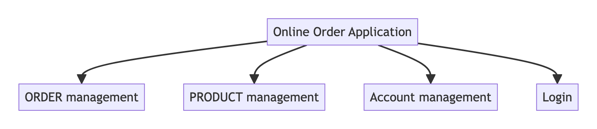

- Example – **Online Order Application:** Order management, Product management, Account management, Login.
- **Challenge:** you need **knowledge of which functions exist in your business.**
- **There is no definition of how much micro.**

**In simple words:** you look at the business and give **each business function its own service**: orders, products, accounts, login. The difficulty is that you must **know the business well** to find these functions. And because nobody defines how small a service must be, deciding where to stop is a judgement call.

### 3.2 By subdomain (DDD)

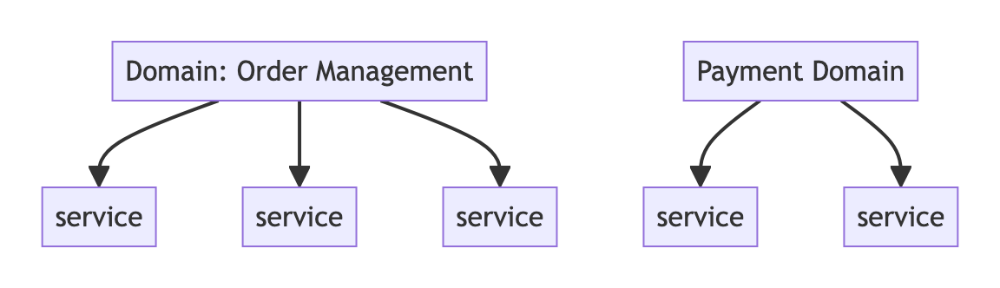

- **Domain Driven Design:** a **domain** is split into several services. For example the **Order Management** domain becomes **3** services and the **Payment** domain becomes **2**.

**In simple words:** first find the big areas of the business (**domains**), such as *Order Management* and *Payment*. Then split each domain into smaller parts (**subdomains**), and each part becomes a service. The business capability approach splits by *function*; DDD splits by *area of the business and then its parts*.

---

## 4. Strangler pattern

*Refactoring a monolith to microservices.*
- On one side is the **monolith** (with its APIs, about 1000 of them), on the other side the **new microservices** (S1 …). A **controller** sits between them and the incoming API traffic.
- The controller sends traffic either to the monolith or to the microservices. The share of traffic going to the microservices grows **0 → 20 → 60 → 100 %**, while the traffic to the monolith **goes down**.

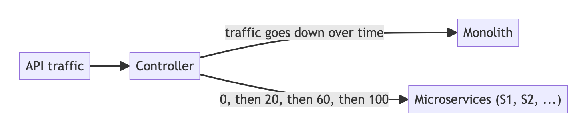

**In simple words:** this pattern is for **moving an existing monolith to microservices step by step**. A **controller** is put in front of both. At the beginning all the traffic goes to the monolith. As each feature is rebuilt as a microservice, the controller sends a bit more traffic to the new services (20 %, then 60 %, then 100 %) and the monolith gets less and less. When the microservices get all the traffic (100 %), the monolith is no longer needed. Nothing is switched off at once, so the move is gradual.

The name comes from a vine that slowly strangles a tree. The migration has three stages: **Transform → Co-exist → Eliminate**, with a router sending traffic to the legacy app, then to both, then to the modern one only. Its features are gradual migration, co-existence and the "strangling" behaviour.

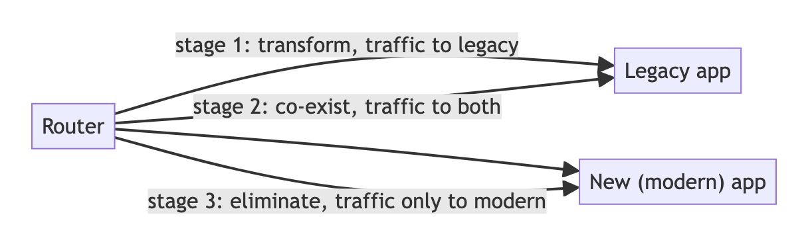

---

## 5. Data management in microservices

Two options: **database for each individual service** and **shared database.**
- With a separate database per service you need **SAGA** and **CQRS**.
- With a shared database all of S1, S2, S3 point to one database.

### 5.1 Why a shared database is not a success

**Case 1 – we can't scale independently**
- S1 = Order (scale), S2 = Inventory, S3 = Payment, all using **one database**.
- *"Suppose Order has lots of traffic. If we try to scale only the Order service, at that moment we have to scale the whole database."* → **We can't scale independently.**

**In simple words:** the Order service gets a lot of traffic and needs more power. But Order, Inventory and Payment all use the same database, so scaling Order means scaling **the whole shared database**, which also serves the other two. You cannot scale one service on its own.

**Case 2 – changing the database is risky**
- One team has a common database with **10 tables** (T1 … T10). S3 wants a modification in table 10, for example to **delete a column**.
- *"S3 will not delete the column. First it checks the dependency."*

**In simple words:** because the tables are shared, other services may use that same column. So S3 cannot simply delete it. It first has to check which other services depend on it. Changing the shared database always needs this checking.

**What is easy with a shared database**
- **Query join** – *10 tables, easy to join* (CQRS helps to solve this when the databases are split).
- **Easy to maintain the transaction properly (ACID).**

**In simple words:** the shared database has real benefits. All the tables are in one place, so joining them in a query is easy, and one transaction can safely change several tables at once (ACID).

**The easy task becomes difficult in a distributed database**

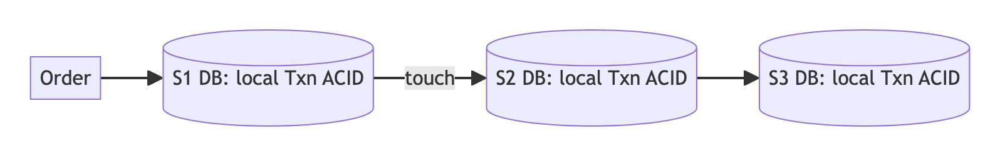

- *"Now my transaction is spanning over the distributed database. Challenge."*
- **This challenge is solved by the SAGA design pattern.**

**In simple words:** once each service has its own database, one request touches several databases. Each database guarantees ACID only **for itself** (a *local* transaction). Our one business transaction now spans all of them, and no database guarantees it as a whole. That is the challenge, and SAGA (next section) is the answer.

### 5.2 Database per service

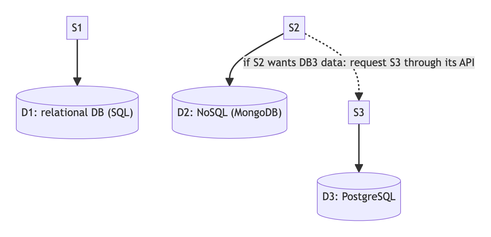

- **S1 → D1** (relational DB, SQL), **S2 → D2** (NoSQL, MongoDB), **S3 → D3** (Postgres).
- *"S2 will not query DB3. If S2 wants DB3 data, S2 will first request S3 through an API. S3 has to give the data."*
- *"Easy to maintain a particular DB."* · *"We can scale independently."*

**In simple words:** every service owns its own database, and **each can use a different type** (SQL, MongoDB, Postgres). A service never reads another service's database. If S2 needs data that lives in D3, it **asks service S3 through its API**, and S3 reads its own database and returns the data. The benefits are that each database is easy to maintain and each service can scale on its own.

---

## 6. SAGA pattern

### Why we need SAGA
- Transaction: **place an order → payment.** Three databases:
  - **ORDER** (T1, T2) – *order row successful*
  - **INVENTORY** (T3, T4) – *inventory successful*
  - **PAYMENT** (T5, T6) – *failed ✗*
- *"The ACID property tells that success will be **all or none**."* But it is **local ACID, a local transaction** – *that's why we need a Saga.*

**In simple words:** the order was saved and the inventory was updated, but the **payment failed**. ACID says "all or nothing", but ACID only works **inside one database** (local). Here the first two steps are already saved in their own databases, and nothing automatically undoes them when the payment fails. We need another way to undo them, and that is a **Saga**.

### What a Saga is
- **Saga means a sequence of local transactions.**
- *"Suppose one Order request comes. Order updates its DB and publishes an event. Inventory listens to the Order event, and on that basis updates its own DB and generates an event. Payment listens to the event. Suppose Payment has failed…"* – then **failure events travel back** and the databases that already changed are **rolled back**.

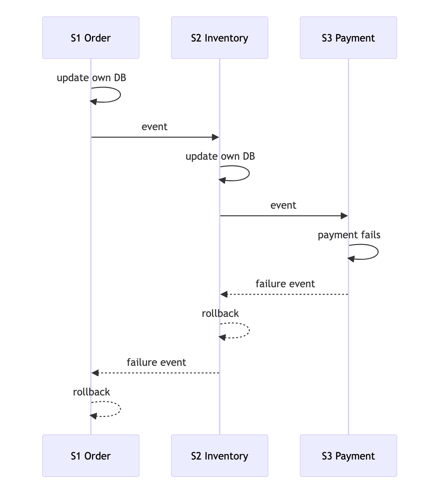

**In simple words:** a Saga breaks the big business transaction into **small local transactions, one per service**. Each service does its own work in its own database and then publishes an **event** to tell the next service. The next service listens, does its part and announces its own event. If one service fails (payment), it sends a **failure event backwards** and each earlier service **rolls back** (undoes) what it did. So instead of one big transaction there is a chain of small ones that can undo each other.

**Example:** A pays B ₹10 → A: 100 − 10 = 90; B's step fails → +10 back to A → rollback to 100.

### The two types of Saga

**① Choreography**
- Services talk through a **message event queue**: **Q1 for success** events and a second queue for **failure** events.
- **S1:** *"Service 1 has processed and sent the event."*
- **S2:** *"S2 has listened and done its work, and S2 has done the work and published an event."*
- **S3:** *"S3 works based on the event. If it succeeds it publishes the event. If it fails…"* (rollback goes back to S2).
- **Drawback: cyclic dependency.**
- Each local transaction publishes domain events that trigger local transactions in other services: *Order → "Order Created" on the Order event channel → Customer service → "Credit Reserved" or "Credit limit exceeded" on the Customer event channel.* One after the other; each service knows what to do next.

**In simple words:** in choreography **there is no boss**. Each service reacts to the event it receives and then publishes the next event, like dancers who each know their next move. Success events go on the success queue, failures on the failure queue, and a failure makes the earlier services roll back. In the example, the Order service publishes **Order Created**, the Customer service hears it and publishes either **Credit Reserved** or **Credit limit exceeded**. The drawback is **cyclic dependency**: the services depend on one another's events, so the flow is hard to follow and maintain.

**② Orchestrator**

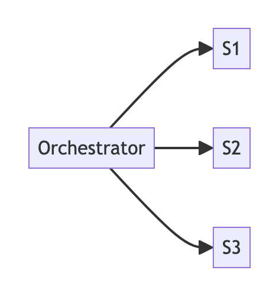

- *"The orchestrator is the one who calls S1. Based on the reply from S1 the orchestrator calls S2. The orchestrator again calls S3 based on S2. Suppose S3 fails, the orchestrator has to make sure that the rollback of S2 and S1 is done."*
- The orchestrator (an object) tells the participants which local transactions to execute (through a **command channel**, and the **saga reply channel** through a message broker). The order stays in a **pending** state until the customer service replies, then it is approved or rejected.

**In simple words:** in the orchestrator type **one central controller runs the show.** It calls S1 and waits for the reply, then calls S2, then S3. The services do not call each other, only the orchestrator calls them. If S3 fails, the **orchestrator is responsible for rolling back S2 and S1**. Until the customer service answers, the order stays pending.

---

## 7. CQRS – Command Query Responsibility Segregation

*Segregate commands (create / update / delete) from queries (select / read).* Writes go to DB1 / DB2; events update a separate **read VIEW DB**: *"no need for joining; it behaves like it's joined but is independent."*

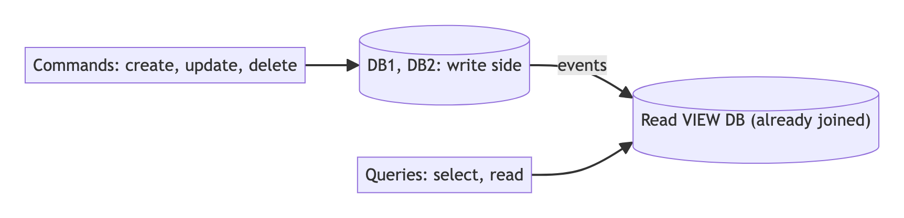

**In simple words:** this pattern **splits writing from reading**. Create, update and delete requests (commands) go to the normal databases. Each change also sends an **event** that updates a separate **read database (a view)**, which already holds the joined data. Reading then needs no joins across services, and the read side can be scaled separately. It fixes the "easy join" problem of the shared database.

---

## 8. More points on microservices

**Monolith and microservices.** *Monolithic ("legacy"): every functionality in a single app; disadvantages are that it overloads the IDE, scaling is hard, and deployment/CI. Microservices: each service has a single responsibility, so it is easy to scale, easy to maintain, easy to integrate and deploy. Disadvantages (if services are partitioned incorrectly and still tightly connected): latency increases, monitoring is difficult (a change by anyone impacts other services), and transaction management (if one service's transaction fails, the overall system becomes inconsistent).*

**Phases.** *I. Make services micro – decomposition by business capability, by subdomain, self-contained service, service per team. II. Choose the DB – database per service or shared DB. III. Communication – API composition, event sourcing. IV. Integrate – API Gateway.*

**In simple words:** the same four phases as above, with a few extra ideas named: a **self-contained service**, **one service per team**, **API composition** (one call that collects data from several services) and **event sourcing** (storing the changes as events).

**Decomposition examples.** *By business capability – Order, Product, Account, Login, Billing, Payment management. By subdomain (DDD) – the Order Management domain → Order Tracking, Order Placing, Order Returning; the Payment domain → Forward payment, Reverse payment.*

---

## Quick revision
- **Monolith:** one big GB-sized application; overloads the IDE, hard to scale (CI job), tightly coupled.
- **Microservices:** easy for the developer, scale independently; but latency, hard debugging and monitoring, and transaction management.
- **Four phases:** Decomposition → Database → Communication → Integration (API Gateway, observability, monitoring).
- **Decomposition:** by business capability or by subdomain (DDD). No definition of how micro.
- **Strangler:** a controller moves the traffic gradually (0 → 20 → 60 → 100) from the monolith to the microservices.
- **Shared database:** can't scale independently, changing a column needs a dependency check; easy joins and ACID. **Database per service:** own DB type per service, ask another service through its API, scale independently.
- **SAGA:** a sequence of local transactions with rollback on failure; **choreography** (events, cycle dependency) or **orchestrator** (one caller that also does the rollback).
- **CQRS:** commands go to the write DBs, a separate read view DB serves queries.
- Related: [Distributed Transactions](20_Distributed_Transactions_Notes.md), [Dual Write Problem](33_Dual_Write_Problem_Notes.md), [API Gateway](40_41_API_Gateway_Part1_Part2_Notes.md).

---

<!-- nav -->
⬅ [02 CAP Theorem](02_CAP_Theorem_Notes.md) · [Index](00_HLD_Index.md) · [05 Scale from Zero to Million Users](05_Scale_from_Zero_to_Million_Users_Notes.md) ➡
<!-- nav -->
