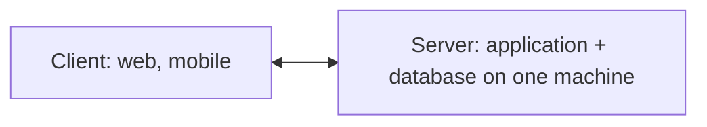
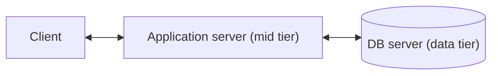
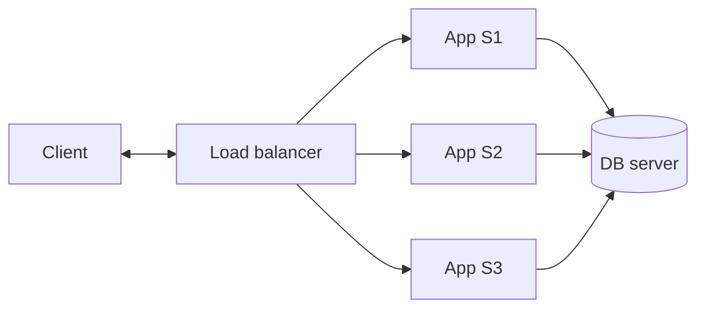
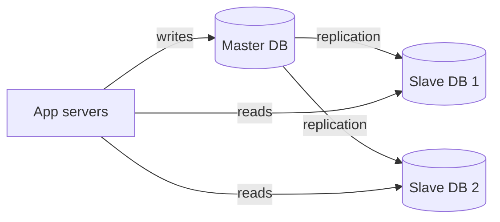
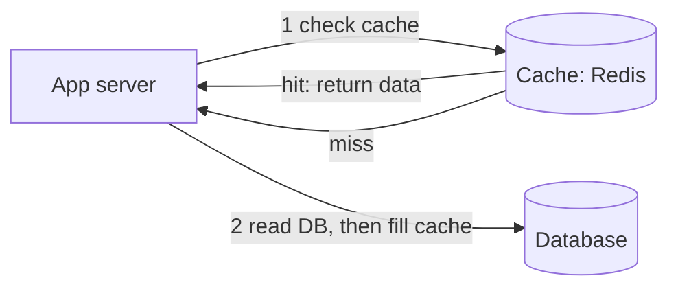
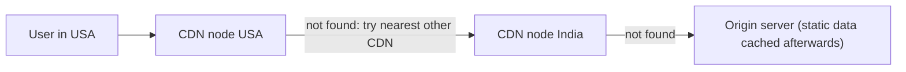
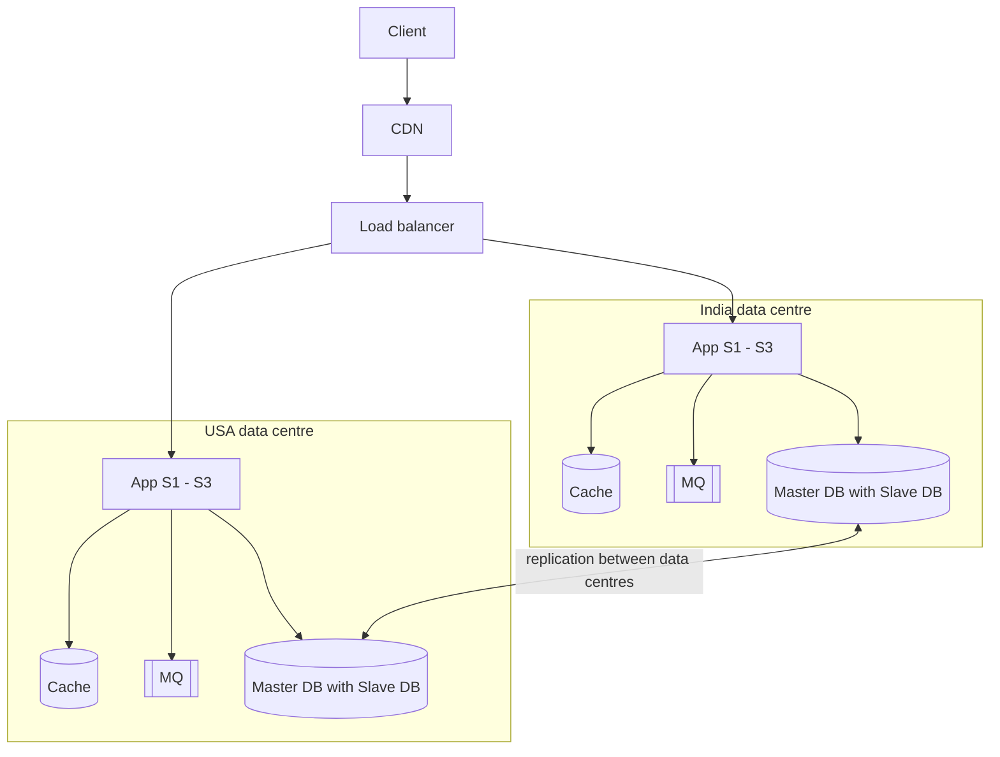
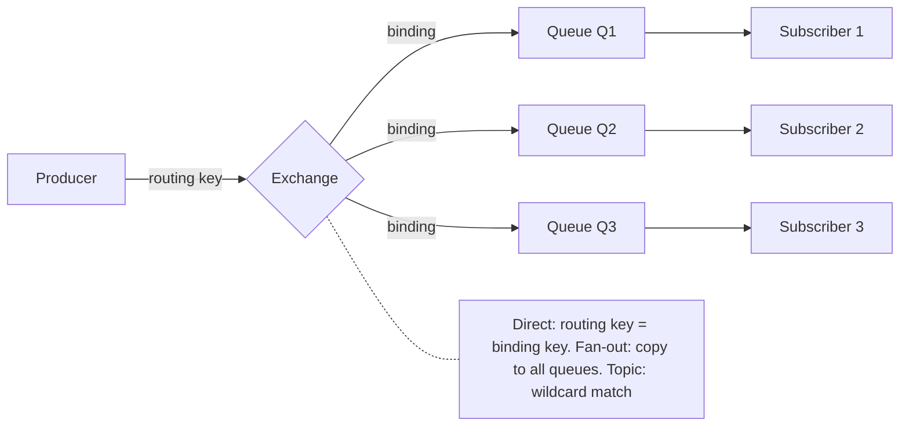
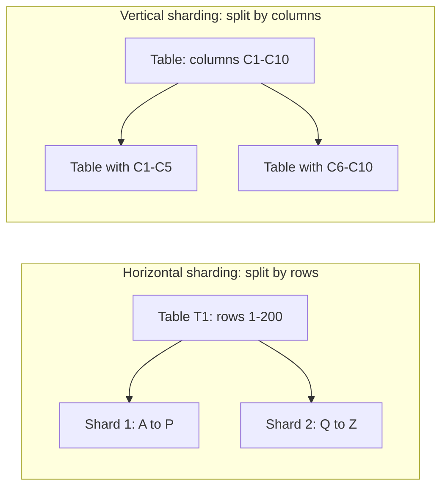

# Scale from Zero to Million Users (HLD #5 – Lecture 43)

<!-- nav -->
⬅ [03 & 04 Microservices Design Patterns](03_04_Microservices_Design_Patterns_Notes.md) · [Index](00_HLD_Index.md) · [06 Consistent Hashing](06_Consistent_Hashing_Notes.md) ➡
<!-- nav -->

Source (handwritten, 9 pages): https://drive.google.com/file/d/16FIwh_zZ2nowjFh_vzeUq7nAwoaQct6f/view?usp=drive_link

## Roadmap – the 9 steps
1. Single server
2. Application & DB server separation
3. Load balancer + multiple app servers
4. Database replication
5. Cache
6. CDN
7. Data centre
8. Messaging queue
9. Database scaling

<!-- isw:05-0 -->
**In simple words**

The notes list nine steps in the order in which a system grows. Each step adds one new part to fix a problem of the previous step: a single server, then separate application and database servers, a load balancer with several app servers, database replication, a cache, a CDN, data centres, a messaging queue and finally database scaling. The sections below take them one by one.
<!-- /isw:05-0 -->


---

## 1. Single server

<!-- diagram:05-0 -->
**Diagram – Step 1: single server**


<!-- /diagram:05-0 -->


`Client (web, mobile) ⇄ Server (Application + DB on the same machine)`.

<!-- isw:05-1 -->
**In simple words**

In the simplest setup the **client** (web or mobile) talks to **one server**, and the **application and the database both run on that same machine**.
<!-- /isw:05-1 -->


## 2. Application & DB server separation

<!-- diagram:05-1 -->
**Diagram – Step 2: separate application and database servers**


<!-- /diagram:05-1 -->


`Client ⇄ Application server (mid tier) ⇄ DB server (data / DB tier)` – the app and the database now run on separate machines so each can be scaled/managed independently.

<!-- isw:05-2 -->
**In simple words**

The application and the database are moved to **separate servers**: the client talks to the **application server (mid tier)**, and the application server talks to the **DB server (data tier)**. Now each tier is a machine of its own, so the application and the database can be handled separately.
<!-- /isw:05-2 -->


## 3. Load balancer + multiple app servers

<!-- diagram:05-2 -->
**Diagram – Step 3: load balancer and several app servers**


<!-- /diagram:05-2 -->


```
 Client ⇄ LOAD BALANCER ──► App S1 | App S2 | App S3   (mid tier, private IPs)
                                   ⇅
                               DB server (data / DB tier)
```
- The **client can only talk to the load balancer**; the LB decides **to whom to forward the request.**
- The LB brings **security and privacy** – **the LB and app servers talk only over private IPs.**
- The LB can **equally divide the traffic/requests.**

<!-- isw:05-3 -->
**In simple words**

Now there are **several app servers (S1, S2, S3)** and a **load balancer** in front of them. The notes give three points:
- The **client can talk only to the load balancer**; the load balancer decides **to which server a request is forwarded**.
- The load balancer brings **security and privacy**: the load balancer and the app servers talk to each other **only over private IP addresses**, so the app servers are not directly reachable by the client.
- The load balancer can **divide the traffic equally** between the servers.
<!-- /isw:05-3 -->


## 4. Database replication (to handle the failure issue)

<!-- diagram:05-3 -->
**Diagram – Step 4: master–slave replication**


<!-- /diagram:05-3 -->


`App servers → Master DB (writes) ⇄ replication ⇄ Slave DB(s) (reads)`
- **Write requests go to the master; read requests go to the slave(s).**
- If one slave is down (damaged), **another DB node is up and should handle the request.**
- If the **master DB fails, any slave DB can get promoted to master.**

<!-- isw:05-4 -->
**In simple words**

The notes use **replication to handle failure**: there is a **master DB** and one or more **slave DBs** that copy the master.
- **Write requests go to the master and read requests go to the slaves.**
- If one slave is damaged, **another DB node is up and handles the request.**
- If the **master DB fails, any slave DB can be promoted to master.**
<!-- /isw:05-4 -->


## 5. Cache (performance improvement)

<!-- diagram:05-4 -->
**Diagram – Step 5: cache in front of the database**


<!-- /diagram:05-4 -->


- Every time the application server talks to the DB it is a **network call – it takes a lot of time; an expensive call.**
- Add a cache (e.g. **Redis**) next to the app servers.
- **Always check the cache before going to the DB:** data present in cache = **cache hit**; not present = **cache miss** (then read from DB and populate the cache).
- **TTL (Time To Live)** – how long an entry stays in cache; chosen **depending upon the application requirement.**

<!-- isw:05-5 -->
**In simple words**

The reasoning in the notes: every time the application server talks to the DB it is a **network call, and that takes a lot of time (an expensive call).** So a cache (for example **Redis**) is placed next to the app servers.
- **Always check the cache before going to the DB.** If the data is in the cache it is a **cache hit**; if not it is a **cache miss**, and then the data is read from the DB and the cache is filled.
- Each entry has a **TTL (Time To Live)**, which says how long it stays in the cache. The TTL is chosen **depending on the application requirement.**
<!-- /isw:05-5 -->


## 6. CDN (Content Delivery Network)

<!-- diagram:05-5 -->
**Diagram – Step 6: CDN serves static content near the user**


<!-- /diagram:05-5 -->


- **CDN does caching – but not everything that does caching is a CDN.**
- Problem: an origin **data centre in India** is far from users: India user ≈ **1 ms**, SA ≈ **2 ms**, USA ≈ **3 ms**, Japan ≈ **4 ms** (latency grows with distance → **latency issue**) – a **CDN solves this.**
- **CDN does caching of static data** (HTML / video / CSS / images). CDN nodes sit near users (USA, India, France, Japan…).
- **Request flow:** the user's request first goes to **their own (nearest) CDN node**; if the data is there → done; if not present it goes to **another nearest CDN**; if still not present, it goes to the **original server** (and is cached).
- Benefits: **performance increases, security enhanced, cost cutting.**

<!-- isw:05-6 -->
**In simple words**

The notes first say: **a CDN does caching, but not everything that does caching is a CDN.**

*The problem:* the origin data centre is in India, so users far away are slower. The example numbers are: India user about **1 ms**, South Africa **2 ms**, USA **3 ms**, Japan **4 ms**; the farther the user, the higher the latency. That is the **latency issue** a CDN solves.

*How it works:* the CDN **caches static data (HTML, video, CSS, images)** on nodes placed near the users (USA, India, France, Japan, …). A user's request first goes to **their own (nearest) CDN node**. If the data is there, we are done. If not, the request goes to **another nearest CDN node**, and if it is still not found it goes to the **original server** (and the data is cached).

*Benefits in the notes:* **performance increases, security is enhanced, and cost is cut.**
<!-- /isw:05-6 -->


## 7. Data centre

<!-- diagram:05-6 -->
**Diagram – Step 7: two data centres with replication**


<!-- /diagram:05-6 -->


```
 Client ⇄ CDN
   │
   LB ──► India DC: App S1-S3, Cache, MQ, Master DB ⇄ Slave DB
      └─► USA  DC: App S1-S3, Cache, MQ, Master DB ⇄ Slave DB     (replication between the two DCs)
```
**Advantage:** if the India data centre is down, the **load balancer can fulfil the requirement from the USA data centre.**
**Problem:** when India is down and requests are served by USA, **only USA data will be found** (India's data isn't there). **Solution: replication** between data centres.

<!-- isw:05-7 -->
**In simple words**

Here the system runs in **two data centres** (an India DC and a USA DC), each with its own app servers, cache, message queue and master and slave DB, all behind the CDN and a load balancer.
- **Advantage:** if the India data centre is down, the **load balancer can serve the request from the USA data centre.**
- **Problem:** when India is down and the USA serves the requests, **only the USA's data will be found**, because India's data is not there.
- **Solution:** **replication between the two data centres**, so both have the same data.
<!-- /isw:05-7 -->


## 8. Messaging queue (RabbitMQ, Kafka)
- Brings **asynchronous nature** in the codebase: **Producer → Messaging Queue (queue/topic) → Subscriber (consumer)**; failed messages can go to a **requeue**.

### Terminology (RabbitMQ)

<!-- diagram:05-7 -->
**Diagram – Producer, exchange, queues, subscribers**


<!-- /diagram:05-7 -->


`Producer ──(routing key)──► Exchange ──(binding)──► Queue Q1 / Q2 / … ──► Subscriber Su1 / Su2 / Su3`

Exchange types:
1. **Direct** – **routing key == binding key** (message goes to the queue whose binding key matches exactly).
2. **Fan-out** – the exchange **copies the message to all bound queues** (Q1, Q2, Q3, Q4).
3. **Topic** – routing by **wildcard** pattern (e.g. `*`) matching.

<!-- isw:05-8 -->
**In simple words**

A messaging queue brings an **asynchronous nature** to the code. The flow is **Producer → Messaging queue (queue / topic) → Subscriber (consumer)**, and failed messages can go to a **requeue**.
<!-- /isw:05-8 -->

<!-- isw:05-9 -->
**In simple words**

In RabbitMQ the **producer** sends a message with a **routing key** to an **exchange**. The exchange sends it, according to the **binding**, to one or more **queues (Q1, Q2, …)**, and each queue delivers it to its **subscriber (Su1, Su2, Su3)**. The notes name three exchange types:
1. **Direct** – the message goes to the queue whose binding key is **exactly equal to the routing key**.
2. **Fan-out** – the exchange **copies the message to all the queues** bound to it (Q1 to Q4 in the picture).
3. **Topic** – routing by a **wildcard** pattern match (for example `*`).
<!-- /isw:05-9 -->


## 9. Database scaling
Two types: **① Vertical** and **② Horizontal.**

### ① Vertical scaling
Increase the capacity of the existing DB server – **more CPU and RAM**, because when more requests come, CPU and RAM take care.
**Disadvantage:** **there is always a limit** – you cannot increase CPU/RAM beyond a point.

<!-- isw:05-11 -->
**In simple words**

Vertical scaling means **adding more power to the existing DB server: more CPU and more RAM**, because when more requests come, CPU and RAM take care of them. The notes' **disadvantage: there is always a limit**; you cannot increase CPU and RAM beyond a point.
<!-- /isw:05-11 -->


### ② Horizontal scaling

<!-- diagram:05-8 -->
**Diagram – Sharding by rows and by columns**


<!-- /diagram:05-8 -->


**Add more nodes.** Implemented through **SHARDING**, which is of two kinds:

**Horizontal sharding** – a table is **divided into multiple tables based on rows**: e.g. table T1 with rows 1–100 → Shard T1 (R1–R100 …) and Shard T2 (R101–…); another example by name: A–P → ST1, Q–Z → ST2.
**Vertical sharding** – a table is **divided into multiple tables based on columns**: e.g. columns C1–C10 → table with C1–C5 and table with C6–C10.

<!-- isw:05-12 -->
**In simple words**

Horizontal scaling means **adding more nodes**, and it is done through **sharding**, which has two kinds:
- **Horizontal sharding:** a table is **divided into several tables by rows**. For example rows 1–100 go to shard 1 and the next rows to shard 2, or by name: A–P to shard ST1 and Q–Z to ST2.
- **Vertical sharding:** a table is **divided into several tables by columns**. For example columns C1–C10 are split into a table with C1–C5 and a table with C6–C10.
<!-- /isw:05-12 -->


### Drawbacks of sharding
1. **Hot shard / re-sharding:** if the "A" set is very large and "A to P" is going on ST1, ST1 **immediately fills up** → we **shard again** (ST1(1), ST1(2)…). In sharding, **a "tree" of shards should be possible.** *Tree can solve with **consistent hashing**.* (See [Consistent Hashing](06_Consistent_Hashing_Notes.md).)
2. **Joins:** once rows are divided, **we can't JOIN** across shards – we can solve it with **denormalization.**

<!-- isw:05-10 -->
**In simple words**

There are **two types of database scaling**: **vertical** and **horizontal**. They are explained below.
<!-- /isw:05-10 -->

<!-- isw:05-13 -->
**In simple words**

Two drawbacks are listed:
1. **Hot shard / re-sharding:** if there are very many names starting with "A", the shard holding "A to P" (ST1) **fills up immediately**, so we have to **shard again** (ST1(1), ST1(2), …). The notes say a "tree" of shards should be possible, and that this *can be solved with consistent hashing* (see the [Consistent Hashing](06_Consistent_Hashing_Notes.md) note).
2. **Joins:** once rows are divided into different shards, **we can no longer JOIN** across them. The notes' answer is **denormalization**.
<!-- /isw:05-13 -->


---

## Quick revision
| Step | Component | Why |
|---|---|---|
| 2 | Separate app & DB tiers | independent scaling |
| 3 | LB + many app servers | spread load, hide servers (private IPs) |
| 4 | Master–slave replication | failure handling, read scaling |
| 5 | Cache (Redis, TTL) | avoid expensive DB calls |
| 6 | CDN | cache static content near users, lower latency |
| 7 | Multiple data centres | availability / geo failover (needs replication) |
| 8 | Message queue | async processing, decoupling |
| 9 | DB scaling | vertical (limited) vs horizontal (sharding: by rows/columns; consistent hashing; denormalize for joins) |

---

## Extra from the 36-page handwritten compendium (pages 14–18)
These pages are in the same PDF as notes #1, #7, #9 and #11 (https://drive.google.com/file/d/1iegvlzgcLJtcGvbjJbPqF4hZaB5u_nrh/view?usp=drive_link); kept here because they belong to this topic.


**Database scaling (page 18):** **Vertical** – increase hardware (RAM, ROM, processor). **Horizontal** – add multiple instances; implementation is **sharding**:
- **Horizontal sharding** – divide into multiple tables on the basis of **rows** (T1 → A–P, T2 → Q–Z).
- **Vertical sharding** – divide into multiple tables by **columns** (T1 → C1–C6, T2 → C7–C10).
- It can become **hierarchical**, and **joining isn't possible** → remove redundancy/dependency and **make the table normalized/denormalized**; hierarchical sharding is solved with **consistent hashing.**

---

<!-- nav -->
⬅ [03 & 04 Microservices Design Patterns](03_04_Microservices_Design_Patterns_Notes.md) · [Index](00_HLD_Index.md) · [06 Consistent Hashing](06_Consistent_Hashing_Notes.md) ➡
<!-- nav -->
