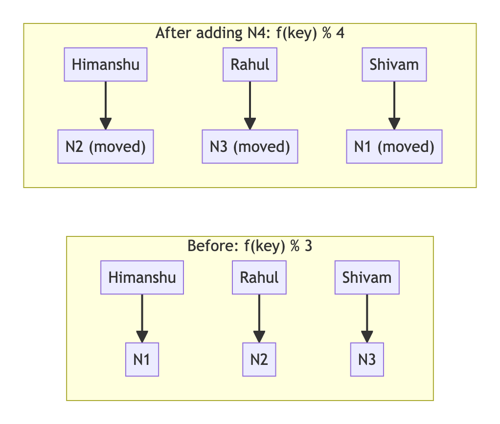
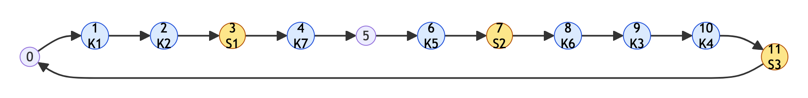
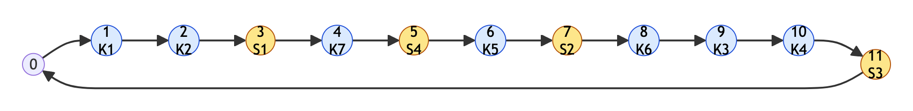
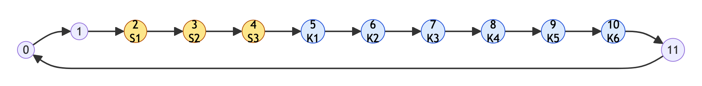
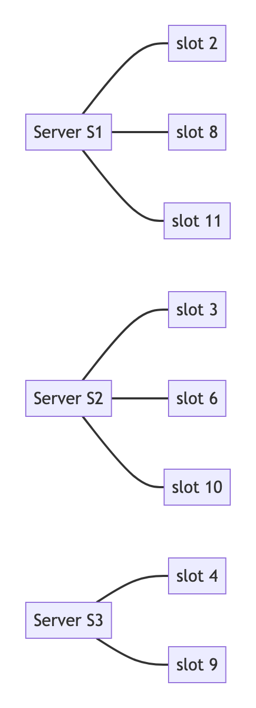

# Consistent Hashing (HLD #6 – Lecture 44)

<!-- nav -->
⬅ [05 Scale from Zero to Million Users](05_Scale_from_Zero_to_Million_Users_Notes.md) · [Index](00_HLD_Index.md) · [07 URL Shortener](07_URL_Shortener_Notes.md) ➡
<!-- nav -->

Source (handwritten, 5 pages): https://drive.google.com/file/d/1dMSY_fHaKwADw_zeQJfoWQUiHwgwDL6H/view?usp=drive_link

---

## 1. Hashing basics (p1)
- **Hash function** takes a **key of arbitrary length** (e.g. `"Himanshu"`) and produces a **fixed-length** value.
  Example: `f("Himanshu") ⇒ 14321 % 6 ⇒ 2` → stored at **index 2** of a fixed-size table (size 6).
- This is **mod hashing**: `hash(key) % N`, N = table size / number of nodes.

### What is the problem?
- If the **mod hashing size is fixed**, there is **no problem**.
- Otherwise – when the **size is not fixed** – the problem occurs.

Two places where size changes:
1. **Load balancing for the application server**
2. **Horizontal sharding**

### 1) Load balancing for application servers
```
 key/request → LB: f(key) % 3 → App1 | App2 | App3        (the node count is dynamic:
                                                           one app goes down, or a new node is added)
```
**Note:** the load balancer should **divide the traffic equally** across my app servers so that **only one server doesn't carry all the load** (e.g. 10 requests are spread evenly).

<!-- isw:06-1 -->
**In simple words**

The load balancer picks the app server using `f(key) % 3` (App1, App2 or App3). The number of servers is **dynamic**: one app can go down or a new node can be added. The note repeats the load balancer's job: **divide the traffic equally so that one server does not carry all the load.**
<!-- /isw:06-1 -->


### 2) Horizontal sharding
- Example: 100 rows split by name range → **A–P → DB1 (50 rows), Q–Z → DB2 (50 rows)**.
- Problem: if **many names start with "A"**, DB1 fills early → **load is not equally divided**.
- With mod hashing instead: `LB: f(Himanshu) % 3 = 1 → Node 1`, `f(Rahul) % 3 = 2 → Node 2`, `f(Shivam) % 3 = 3 → Node 3` – evenly spread **as long as the node count stays 3.**

<!-- isw:06-0 -->
**In simple words**

A **hash function** takes a **key of any length** (for example the string `"Himanshu"`) and produces a **fixed-length value**. In the notes' example `f("Himanshu")` gives `14321`, and `14321 % 6` gives `2`, so the item is stored at **index 2** of a table of size 6. Using the remainder of a division like this is called **mod hashing**: `hash(key) % N`, where N is the table size or the number of nodes.

The notes then ask *what is the problem?* **If the size used for the mod is fixed there is no problem. If the size is not fixed, the problem starts.** The size changes in two places: **load balancing for application servers** and **horizontal sharding**.
<!-- /isw:06-0 -->

<!-- isw:06-2 -->
**In simple words**

With 100 rows split **by name range** (A–P to DB1 with 50 rows, Q–Z to DB2 with 50 rows), the problem is that **if many names start with "A", DB1 fills early** and the load is not divided equally. With mod hashing instead, `f(Himanshu) % 3 = 1` goes to Node 1, `f(Rahul) % 3 = 2` to Node 2 and `f(Shivam) % 3 = 3` to Node 3, which spreads evenly **as long as the node count stays at 3.**
<!-- /isw:06-2 -->


---

## 2. Use case: increase the servers/nodes (p3)

<!-- diagram:06-0 -->
**Diagram – Mod hashing: adding a node moves almost every key**


<!-- /diagram:06-0 -->


Nodes N1, N2, N3 with `f(key) % 3`. **Add a new node N4** → formula becomes `f(key) % 4`:
- e.g. `Himanshu` was on N1 and now maps to **N2** → **almost all keys get a new location.**
- **Rebalancing = moving millions of DB entries.** Very costly.

<!-- isw:06-3 -->
**In simple words**

Nodes N1, N2, N3 use `f(key) % 3`. When **a new node N4 is added**, the formula becomes `f(key) % 4`. For example `Himanshu` was on N1 and now maps to **N2**, and the same happens to almost every key. So **almost all keys get a new location**, and **rebalancing means moving millions of DB entries, which is very costly.**
<!-- /isw:06-3 -->


---

## 3. Consistent Hashing – the idea
- In consistent hashing, **rebalancing occurs when nodes (servers) are added or removed**. The **goal is to minimize the number of keys that need to be reassigned while maintaining uniform distribution.**
- The **main motto: when nodes are added or removed, keep rebalancing minimal.**
- Rebalancing moves only about **1/N of the total number of keys** (N = number of nodes) – "good".
  - e.g. N1 holds keys K1–K10, N2 holds K…, N3 (removed) – only its keys move.

<!-- isw:06-4 -->
**In simple words**

The notes define the goal: in consistent hashing, **rebalancing happens when nodes (servers) are added or removed**, and the aim is **to minimise the number of keys that must be reassigned while keeping the distribution uniform.** The main motto: *when nodes are added or removed, keep the rebalancing minimal.* Only about **1/N of the total number of keys** has to move (N is the number of nodes), which the notes call "good".
<!-- /isw:06-4 -->


---

## 4. How does Consistent Hashing work? (p4)

### ① Virtual ring

<!-- diagram:06-1 -->
**Diagram – Ring with 12 slots (clockwise): keys go to the next server**


<!-- /diagram:06-1 -->


- Take a **virtual ring** with slots (example: **0–11, i.e. mod 12**), traversed **clockwise**.
- **Servers** are placed on the ring using mod hash:
  - `S1 = hash(server1) % 12` → slot **3**
  - `S2 = hash(server2) % 12` → slot **7**
  - `S3 = hash(server3) % 12` → slot **11**
- **Keys** are placed the same way: `Key1 = hash(key1) % 12`, … (K1 at 1, K2 at 2, K7 at 4, K5 at 6, K6 at 8, K3 at 9, K4 at 10).
- **Rule:** a key is handled by the **first server found moving clockwise** from the key's position.

**Whose server handles which key?**
- `S1 = K1, K2`
- `S2 = K5, K7`
- `S3 = K6, K3, K4`

<!-- isw:06-5 -->
**In simple words**

The notes take a **virtual ring** with slots **0 to 11 (mod 12)**, read **clockwise**. The **servers are placed on the ring with mod hashing**: `S1 = hash(server1) % 12` gives slot 3, S2 gives slot 7, S3 gives slot 11. The **keys are placed the same way** (K1 at slot 1, K2 at 2, K7 at 4, K5 at 6, K6 at 8, K3 at 9, K4 at 10).

**The rule:** a key is handled by **the first server found going clockwise from the key's position.** So the notes get: S1 handles K1 and K2; S2 handles K5 and K7; S3 handles K6, K3 and K4.
<!-- /isw:06-5 -->


### Addition of servers

<!-- diagram:06-2 -->
**Diagram – After adding S4 at slot 5 only K7 moves (S2 to S4)**


<!-- /diagram:06-2 -->


Add **S4 at slot 5**:
- K7 (slot 4) now finds **S4** first instead of S2.
- `S1 = K1, K2` · `S2 = K5` · `S3 = K6, K3, K4` · **`S4 = K7`**
- ✱ **We can rebalance only a limited number of keys** (only the keys between the previous server and the new one move).
- (Removing a server works the same way in reverse: only that server's keys move to the next server clockwise.)

<!-- isw:06-6 -->
**In simple words**

Now **S4 is added at slot 5.** Key K7 (slot 4) now finds S4 first, so only K7 moves from S2 to S4; the other keys stay where they were: S1 = K1, K2 · S2 = K5 · S3 = K6, K3, K4 · S4 = K7. The notes underline that **only a limited number of keys has to be rebalanced** (the keys between the previous server and the new one).
<!-- /isw:06-6 -->


---

## 5. Disadvantages of consistent hashing (p5)

<!-- diagram:06-3 -->
**Diagram – Skewed servers: S1 takes almost all keys**


<!-- /diagram:06-3 -->


- Example ring where servers are clustered close together: **S1 at 2, S2 at 3, S3 at 4**. Keys K1–K6 are spread around the ring but **all of them walk clockwise to S1** (the next server) → S1 takes almost all the load.
- So consistent hashing **fails to divide the load equally** when server positions are skewed.

### Solution: create virtual nodes (virtual objects)

<!-- diagram:06-4 -->
**Diagram – Virtual nodes spread each server over the ring**


<!-- /diagram:06-4 -->


- **Replicate each server at different points on the ring.**
- Example: **S1 → slots 2, 8, 11; S2 → slots 3, 6, 10; S3 → slots 4, 9.**
- Result in the example: `S3 = K2, K1`; `S2 = K6, K7`; `S1 = K5, K4, K3` – a much more even spread.
- More virtual nodes per server ⇒ smoother distribution (and when a server leaves, its load is shared among many servers).

<!-- isw:06-7 -->
**In simple words**

The notes show a ring where the servers sit close together: **S1 at 2, S2 at 3, S3 at 4.** The keys K1–K6 are spread around the ring but **all of them walk clockwise to S1** (the next server), so S1 takes almost all the load. So consistent hashing **can fail to divide the load equally** when the servers' positions are uneven.
<!-- /isw:06-7 -->

<!-- isw:06-8 -->
**In simple words**

The fix is to **replicate each server at several points of the ring**. In the notes' example **S1 sits at slots 2, 8 and 11, S2 at 3, 6 and 10, and S3 at 4 and 9.** The result is a much more even split: S3 = K2, K1; S2 = K6, K7; S1 = K5, K4, K3. **More virtual nodes per server give a smoother distribution**, and when a server leaves, its load is shared among many servers.
<!-- /isw:06-8 -->


---

## Quick revision
- `hash % N` breaks when **N changes** (nodes added/removed) → nearly all keys move.
- **Consistent hashing:** hash servers **and** keys onto a **ring**; key → **next server clockwise**; adding/removing a node moves only **~1/N of keys**.
- Weakness: **uneven distribution** if servers land close together → fix with **virtual nodes** (each physical server placed at many ring points).
- Used for: load balancing app servers, sharding DBs, distributed caches, key-value stores.

---

## Extra from the 36-page handwritten compendium (pages 18–19)
These pages are in the same PDF as notes #1, #7, #9 and #11 (https://drive.google.com/file/d/1iegvlzgcLJtcGvbjJbPqF4hZaB5u_nrh/view?usp=drive_link); kept here because they belong to this topic.

- **Hashing** converts arbitrary-length values to a **fixed-length** value (for fast data access); **mod hashing** places data in a fixed place (array length 7: hash 1451 → 1451 % 7 = **2**).
- Hashing is used mainly in two places: **load-balancing application servers** and **load-balancing database sharding.**
- **Problem – rebalancing:** whenever the array size changes (3 instances → 4 instances) values must be re-placed on different nodes (e.g. 25%3, 20%3, 39%3 vs 25%4, 20%4, 39%4, 52%4) – with millions of records that is huge.
- **Solution: consistent hashing** – only **~1/n of keys** need rebalancing ("good"). A **virtual ring**: servers placed by mod hashing; **each key is served by the next server clockwise**; since servers are continuous this can be unbalanced → **virtual replication of servers** (S1, S2, S3 placed at several ring points).

---

<!-- nav -->
⬅ [05 Scale from Zero to Million Users](05_Scale_from_Zero_to_Million_Users_Notes.md) · [Index](00_HLD_Index.md) · [07 URL Shortener](07_URL_Shortener_Notes.md) ➡
<!-- nav -->
