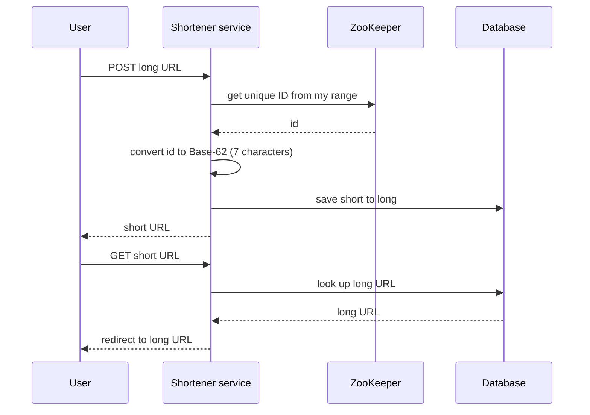
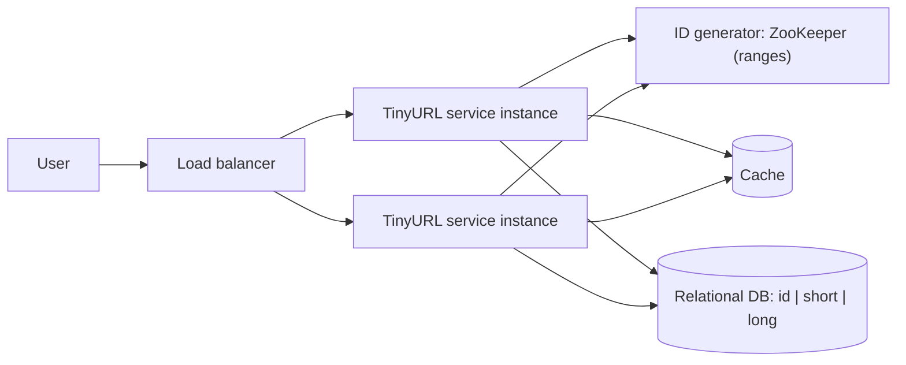

# Design a URL Shortener (HLD #7)

<!-- nav -->
⬅ [06 Consistent Hashing](06_Consistent_Hashing_Notes.md) · [Index](00_HLD_Index.md) · [08 Back of the Envelope Estimation](08_Back_of_the_Envelope_Estimation_Notes.md) ➡
<!-- nav -->

Source (handwritten, pages 20–23 of the 36-page PDF): https://drive.google.com/file/d/1iegvlzgcLJtcGvbjJbPqF4hZaB5u_nrh/view?usp=drive_link

---

<!-- simple-explanation -->
## In simple words – URL shortener

**Goal:** turn a long link into a tiny one (like `tiny.url/aB3xK9Q`) and redirect visitors to the original.
**Basic flow:** `POST long URL` → service creates a short key → saves `short → long` in a database. `GET short URL` → look it up → redirect to the long URL.

<!-- diagram:07-1 -->
**Diagram – Create and open a short URL**

<!-- /diagram:07-1 -->

**How short should it be? (the maths)**
- Traffic: 10 million new URLs a day ≈ 3.65 billion a year; keep each for 100 years ≈ **365 billion URLs**.
- Allowed characters: 0–9, a–z, A–Z = **62**. With 6 characters: 62⁶ ≈ 56 billion (not enough). With **7 characters: 62⁷ ≈ 3.5 trillion (plenty)**. So **7 characters**.

**How do we generate the key?**
- Hashing the long URL (MD5 = 32 hex characters) gives something **too long**, and truncating it risks collisions.
- Better: give each URL a **unique number ID** and convert it to **Base-62** (digits and letters), which yields short strings.
- **Who creates the unique IDs?**
  1. *Ticket server:* one server issues IDs, but it's a **single point of failure**.
  2. *Snowflake* (timestamp-based IDs): may clash when many are generated at the same instant.
  3. **ZooKeeper (best):** hands each app server a **range** of numbers (e.g. 1 to 1 million). The server uses them locally with no coordination, and asks for a new range when finished.

**Architecture:** user → load balancer → many URL-shortener servers → ID generator (ZooKeeper), a **cache** for popular links and a database table (`id | short | long`).
<!-- simple-explanation -->

**Goal:** generate a **short URL** through which the main (long path / many params) link can be accessed.

**Rough idea:** `POST URL → Shortener (business logic to make it short) → save to DB (map: key → value)`; `GET shortened URL → Shortener → take value from DB → redirect`.

**Requirement analysis**
- How short? **As short as you can.** Decide the traffic: **10 M URLs/day ⇒ 3650 M URLs/year**; each link should live for **100 years ⇒ 365,000 M = 365×10⁹ URLs.**
- Characters: **0–9, a–z, A–Z = 10 + 26 + 26 = 62.** `62⁶ ≈ 56 billion`, **`62⁷ ≈ 3.5 trillion` ⇒ finalized: 7 characters.**

**How to generate the hashed value?**
- **Hash functions (MD5, SHA-1)** → MD5 = **128 bit = 16 bytes**; in hex each byte gives 2 hex digits ⇒ 16×2 = **32 chars – too long**; SHA-1 uses **160 bits.** ⇒ so we use **Base-62.**
- Base-62 needs an **ID generator** (length can differ). Problem: **can't store/issue all ids from a single DB.** Options:
  1. **Ticket server** – a single server was the disadvantage → **single point of failure.**
  2. **Snowflake** (timestamp-based) – generating at the same time was a disadvantage.
  3. **ZooKeeper** ⭐ *(best solution)* – distributed applications coordinate reliably; **hands out ranges of values** (e.g. Range 1 → 1 to 1 M) to each app server, which then converts the numeric id to Base-62.

**Architecture:** `User → Load Balancer → TinyURL service instances (many) → ID generator (ZooKeeper) · Cache · Relational DB table (id | short | long)`.

<!-- diagram:07-0 -->
**Diagram – URL shortener architecture**

<!-- /diagram:07-0 -->

---

## Quick revision
- **URL shortener:** 7-char **Base-62** (62⁷ ≈ 3.5 T), IDs from **ZooKeeper ranges**, cache + DB, LB in front.

---

<!-- nav -->
⬅ [06 Consistent Hashing](06_Consistent_Hashing_Notes.md) · [Index](00_HLD_Index.md) · [08 Back of the Envelope Estimation](08_Back_of_the_Envelope_Estimation_Notes.md) ➡
<!-- nav -->
