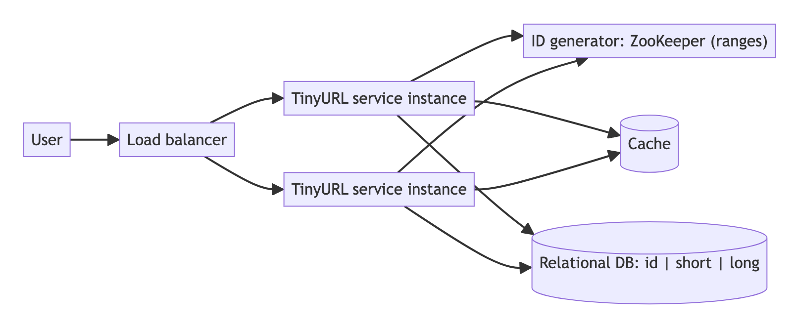

# Design a URL Shortener (HLD #7)

<!-- nav -->
⬅ [06 Consistent Hashing](06_Consistent_Hashing_Notes.md) · [Index](00_HLD_Index.md) · [08 Back of the Envelope Estimation](08_Back_of_the_Envelope_Estimation_Notes.md) ➡
<!-- nav -->

Source: https://drive.google.com/file/d/1iegvlzgcLJtcGvbjJbPqF4hZaB5u_nrh/view?usp=drive_link

---

**Goal:** generate a **short URL** through which the main (long path / many params) link can be accessed.

<!-- isw:07-0 -->
**In simple words**

The aim is a **short link that opens the original long link** (a link with a long path and many parameters).
<!-- /isw:07-0 -->

**Rough idea:** `POST URL → Shortener (business logic to make it short) → save to DB (map: key → value)`; `GET shortened URL → Shortener → take value from DB → redirect`.

<!-- isw:07-1 -->
**In simple words**

The first rough design has two flows. **Creating:** the client sends a `POST` with the long URL; the **shortener** (the business logic that makes it short) creates the short form and **saves it in the DB as a map (key → value).** **Opening:** a `GET` with the short URL goes to the shortener, which **takes the value from the DB and redirects** to the long URL.
<!-- /isw:07-1 -->

**Requirement analysis**
- How short? **As short as you can.** Decide the traffic: **10 M URLs/day ⇒ 3650 M URLs/year**; each link should live for **100 years ⇒ 365,000 M = 365×10⁹ URLs.**
- Characters: **0–9, a–z, A–Z = 10 + 26 + 26 = 62.** `62⁶ ≈ 56 billion`, **`62⁷ ≈ 3.5 trillion` ⇒ finalized: 7 characters.**

<!-- isw:07-2 -->
**In simple words**

The size is decided from the traffic. **How short? As short as possible.** The assumption is **10 million URLs per day = 3650 million per year**, and **each link must live for 100 years = 365,000 million = 365 × 10⁹ URLs.**

For the characters we use **0–9, a–z and A–Z = 10 + 26 + 26 = 62 characters.** With 6 characters `62⁶` is about 56 billion, which is too few. With **7 characters `62⁷` is about 3.5 trillion**, which is enough, so **the length is fixed at 7 characters.**
<!-- /isw:07-2 -->

**How to generate the hashed value?**
- **Hash functions (MD5, SHA-1)** → MD5 = **128 bit = 16 bytes**; in hex each byte gives 2 hex digits ⇒ 16×2 = **32 chars – too long**; SHA-1 uses **160 bits.** ⇒ so we use **Base-62.**
- Base-62 needs an **ID generator** (length can differ). Problem: **can't store/issue all ids from a single DB.** Options:
  1. **Ticket server** – a single server was the disadvantage → **single point of failure.**
  2. **Snowflake** (timestamp-based) – generating at the same time was a disadvantage.
  3. **ZooKeeper** ⭐ *(best solution)* – distributed applications coordinate reliably; **hands out ranges of values** (e.g. Range 1 → 1 to 1 M) to each app server, which then converts the numeric id to Base-62.

<!-- isw:07-3 -->
**In simple words**

First idea: use a hash function. **MD5 gives 128 bits = 16 bytes**; in hex each byte is 2 characters, so 16 × 2 = **32 characters, which is too long** (SHA-1 uses 160 bits, even longer). So we choose **Base-62**.

Base-62 needs a **number (an ID) to convert**, so we need an **ID generator.** The problem is that **all IDs cannot come from a single DB.** Three options are listed:
1. **Ticket server** – its disadvantage is that a single server is a **single point of failure.**
2. **Snowflake** (timestamp-based) – its disadvantage is that IDs generated at the same moment can clash.
3. **ZooKeeper – the best solution.** It helps distributed applications coordinate reliably and **gives each app server a range of numbers** (for example "Range 1 = 1 to 1 M"). The app server then converts each number in its range to Base-62.
<!-- /isw:07-3 -->

**Architecture:** `User → Load Balancer → TinyURL service instances (many) → ID generator (ZooKeeper) · Cache · Relational DB table (id | short | long)`.

<!-- isw:07-4 -->
**In simple words**

The flow is: the **user** reaches a **load balancer**, which sends the request to one of many **TinyURL service instances.** Each instance gets numbers from the **ID generator (ZooKeeper)**, uses a **cache**, and stores the data in a **relational DB table with the columns id, short and long.**
<!-- /isw:07-4 -->

<!-- diagram:07-0 -->
**URL shortener architecture**

<!-- /diagram:07-0 -->

---

## Quick revision
- **URL shortener:** 7-char **Base-62** (62⁷ ≈ 3.5 T), IDs from **ZooKeeper ranges**, cache + DB, LB in front.

---

<!-- nav -->
⬅ [06 Consistent Hashing](06_Consistent_Hashing_Notes.md) · [Index](00_HLD_Index.md) · [08 Back of the Envelope Estimation](08_Back_of_the_Envelope_Estimation_Notes.md) ➡
<!-- nav -->
