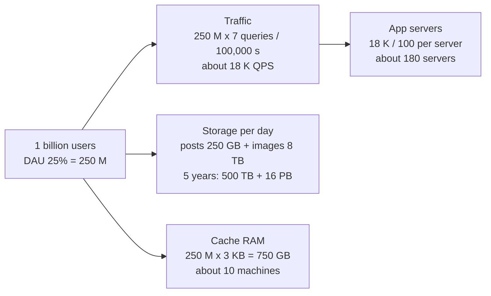

# Back-of-the-Envelope Estimation (HLD #8 – Lecture 46)

<!-- nav -->
⬅ [07 URL Shortener](07_URL_Shortener_Notes.md) · [Index](00_HLD_Index.md) · [09 Key Value DB](09_Key_Value_DB_Notes.md) ➡
<!-- nav -->

Source (handwritten, 6 pages): https://drive.google.com/file/d/1AH37a-iSXNquC01PUIi14yDO8jscnaA6/view?usp=drive_link

---

<!-- simple-explanation -->
## In simple words – back-of-the-envelope estimation

### What is it and why do we do it?
Before designing a system you need a rough idea of its **size**: how many requests per second will it get, how much data will it store, how much memory should the cache have, how many servers are needed? Doing this quickly on "the back of an envelope" with **round numbers** is called back-of-the-envelope estimation. The goal is **not** an exact answer. The goal is to know whether you need 2 servers or 200, 1 GB or 1 PB, because that changes the whole design.

Rules of thumb: keep it rough, don't spend long on it, and round numbers so the maths is easy (275 million → "about 300 million").

### The only table you need to remember
Every step of 3 zeros is a new unit: **Thousand (KB) → Million (MB) → Billion (GB) → Trillion (TB) → Quadrillion (PB)**.
So to multiply, just multiply the small numbers and **add the zeros**.
Example: 5 million users × 2 KB each → `5 × 2 = 10`, zeros = `6 + 3 = 9` → **10 GB**.

Handy sizes: a character ≈ 2 bytes, a long ≈ 8 bytes, an average image ≈ 300 KB, a day ≈ 100,000 seconds (really 86,400, but 100,000 is easier).

### The Facebook example, step by step
**1. Traffic (how many requests per second?)**
- 1 billion total users, but only about 25 % use it each day → **250 million daily active users (DAU)**.
- Assume each does 7 actions a day (5 reads + 2 writes) → 250 M × 7 = 1.75 billion requests a day.
- Spread over ~100,000 seconds → **about 18,000 requests per second (QPS)**.

**2. Storage (how much disk?)**
- Posts: 2 posts per user × 250 characters × 2 bytes = ~1 KB per user per day. 250 M users × 1 KB = **~250 GB per day**.
- Images: say 10 % of users upload one 300 KB image → 25 M × 300 KB ≈ **~8 TB per day**.
- For 5 years (~2000 days): posts ≈ **500 TB**, images ≈ **16 PB**. This tells you images dominate and need cheap object storage, not a normal database.

**3. Cache memory (how much RAM?)**
- Keep each active user's last 5 posts in memory: 5 × 500 bytes ≈ 3 KB per user. 250 M × 3 KB ≈ **750 GB**.
- If one machine holds ~75 GB, you need **about 10 cache machines**.

**4. Application servers (how many?)**
- Goal: 95 % of requests finish within 500 ms, so one thread handles about 2 requests per second.
- A server with 50 threads handles ~100 requests per second.
- 18,000 ÷ 100 = **about 180 servers**.

### Takeaway
You get a full picture of the system – 18 K QPS, 8 TB/day, 16 PB in 5 years, 10 cache nodes, 180 servers – in a few minutes, using just multiplication and rounding. Interviewers care about your **reasoning and assumptions**, not exact numbers.
<!-- simple-explanation -->

## 1. What is back-of-the-envelope estimation? (p1)
Rough capacity estimation used to **drive design decisions** for a system. Typical questions the diagram raises:
- **How many servers do we need?**
- **Capacity** of the database? **Storage size?**
- How big should the **cache** be? Do we need a **CDN**? What load does the **load balancer** see?

### Considerations
- Do a **rough ("T-shirt size") estimation.**
- **Do not spend much time** on it.
- **Keep the assumption values simple** – round numbers (e.g. 275 mil → treat as ~ 10 m / 100 m / 1000 m scale; 435 mil → round it).

---

## 2. Cheat sheet – "everything is a multiple of 3 zeros" (p2)
| Zeros | Traffic | Storage |
|---|---|---|
| 3 | Thousand | **KB** |
| 6 | Million | **MB** |
| 9 | Billion | **GB** |
| 12 | Trillion | **TB** |
| 15 | Quadrillion | **PB** (Peta Byte) |

**Data sizes to remember (as written in the notes)**
- `char` → **2 bytes** (ASCII = 1 byte, Unicode = 2 bytes)
- `long` / `double` → **8 bytes**
- `Integer` → **16 bytes** *(object size as noted; a primitive int is 4 bytes)*
- **Average image = 300 KB**

After you "come up with data" you then estimate: **No. of servers? RAM? Storage capacity?** – and discuss the **trade-offs (CAP)**.

**Formula (p3):** `X million users (6 zeros) × Y MB (6 zeros) ⇒ XY TB (12 zeros)` – i.e. just add the zeros.
Example: `5 million users × 2 KB ⇒ 5 × 2 = 10`, zeros `6 + 3 = 9` ⇒ **10 GB**.

---

## 3. Worked example – estimating Facebook (p3–p5)

<!-- diagram:08-0 -->
**Diagram – Estimation flow for the Facebook example**

<!-- /diagram:08-0 -->

### ① Traffic estimation
- **Total users:** 1 billion
- **Daily Active Users (DAU):** 25 % of total = **250 million**
- Estimate daily queries: assume **read + write = 5 + 2 = 7 queries per user per day**.
- `QPS = (250 million DAU × 7 queries) / 100,000 seconds`
  (a day = 60 × 60 × 24 = 86,400 s ≈ **100,000 s**, rounded for easy math)
- ⇒ **≈ 18 K queries per second.**

### ② Storage assumption
Assumptions:
1. Every user (DAU) makes **2 posts**, each post = **250 characters**.
2. **10 % of users upload 1 image** (**300 KB**).

**Posts**
- 1 post = 250 chars × 2 bytes = **500 bytes**
- 2 posts = 500 × 2 = 1000 bytes ⇒ **1 KB**
- `250 million users × 1 KB` (6 zeros + 3 zeros = 9 zeros) ⇒ **≈ 250 GB / day**

**Images**
- `25 million users × 300 KB` (6 zeros + 3 zeros) ≈ 7,500 GB ≈ 7 × 1000 GB ⇒ **≈ 8 TB / day**

**To store the data for 5 years:** 5 years = 1825 days ≈ **2000 days**
- Posts: 2000 × 250 GB ≈ **500 TB**
- Images: 2000 × 8 TB ≈ **16 PB**

### ③ RAM (cache) estimation
- Keep the **last 5 posts of each user (DAU) in cache.**
- 1 post = 500 bytes → 5 posts = 2500 bytes ≈ **3000 bytes (3 K)**
- `250 million (DAU) × 3 K` (6 zeros + 3 zeros) ⇒ **≈ 750 GB of memory space**
- **1 machine holds ~75 GB in memory** ⇒ **~10 machines for caching (cache nodes).**

### ④ Latency → number of application servers
- **Latency target:** **95 % of requests within 500 ms** → one request takes ~500 ms, so **1 thread serves 2 requests / second**.
- **1 server → 50 threads ⇒ ≈ 100 requests / second.**
- Load = **18 K requests / second** ⇒ 18,000 / 100 = **≈ 180 servers.**

---

## 4. CAP theorem trade-off (p6)
The last page only sketches the CAP Venn diagram (**CA, CP, AP**) and a broken link between two nodes, with the remark: *"This topic is not fully clear – any one-time practice."* (See the CAP notes: [02_CAP_Theorem_Notes.md](02_CAP_Theorem_Notes.md).)

---

## Quick revision
- Round everything; think in **powers of 1000** (K, M, B, T, quadrillion ↔ KB, MB, GB, TB, PB).
- **QPS** = DAU × queries/user ÷ ~100 K seconds/day.
- **Storage/day** = users × size per user; × ~2000 days for 5 years.
- **Cache RAM** = users × (items cached × item size); divide by RAM per machine → #cache nodes.
- **Servers** = QPS ÷ (threads × 1/latency).
- Facebook example result: **~18 K QPS, ~250 GB posts + ~8 TB images per day, ~500 TB + ~16 PB over 5 years, ~750 GB cache (~10 nodes), ~180 app servers.**

---

## Extra from the 36-page handwritten compendium (pages 24–26)
These pages are in the same PDF as notes #1, #7, #9 and #11 (https://drive.google.com/file/d/1iegvlzgcLJtcGvbjJbPqF4hZaB5u_nrh/view?usp=drive_link); kept here because they belong to this topic.

- Traffic: 1 B users, DAU 25 % = 250 M; 5 reads + 2 writes = 7 queries → `250 M × 7 / ~100,000 s` ≈ **~10 K QPS** (≈18 K in the other note).
- Storage: 2 posts/user × 250 chars × 2 B = 1 KB → **250 GB/day posts**; 10 % of users upload a 300 KB image → 25 M × 300 KB = 7,500 GB ≈ **7.5 TB/day**; 5 years ≈ 2000 days → **~500 TB posts + ~16 PB images.**
- RAM: last 5 posts per DAU in cache → 250 M × 2500 B ≈ **625 GB** (≈750 GB with rounding); one machine holds 75 GB ⇒ **~10 machines.**
- Latency: 95 % within 500 ms → 1 server with 50 threads ⇒ 100 req/s; for ~10 K req/s ⇒ **~100 servers** (≈180 for 18 K). Summary: **servers ≈ 100, RAM ≈ 750 GB ⇒ 10 machines, storage ≈ 17 PB.** Then decide **CAP** – *here we compromise on consistency.*

---

<!-- nav -->
⬅ [07 URL Shortener](07_URL_Shortener_Notes.md) · [Index](00_HLD_Index.md) · [09 Key Value DB](09_Key_Value_DB_Notes.md) ➡
<!-- nav -->
