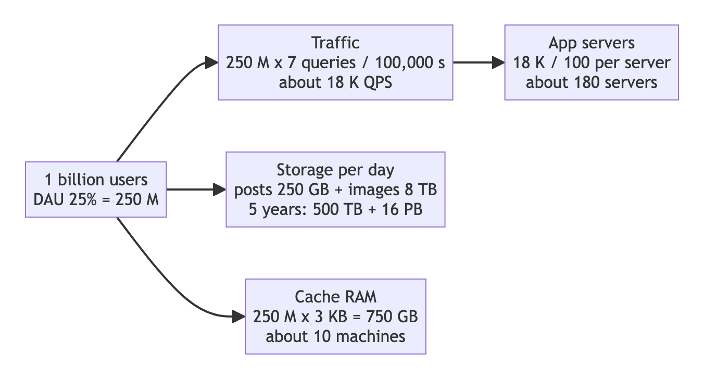

# Back-of-the-Envelope Estimation (HLD #8 – Lecture 46)

<!-- nav -->
⬅ [07 URL Shortener](07_URL_Shortener_Notes.md) · [Index](00_HLD_Index.md) · [09 Key Value DB](09_Key_Value_DB_Notes.md) ➡
<!-- nav -->

Source (handwritten, 6 pages): https://drive.google.com/file/d/1AH37a-iSXNquC01PUIi14yDO8jscnaA6/view?usp=drive_link

---

## 1. What is back-of-the-envelope estimation? (p1)
Rough capacity estimation used to **drive design decisions** for a system. Typical questions the diagram raises:
- **How many servers do we need?**
- **Capacity** of the database? **Storage size?**
- How big should the **cache** be? Do we need a **CDN**? What load does the **load balancer** see?

### Considerations
- Do a **rough ("T-shirt size") estimation.**
- **Do not spend much time** on it.
- **Keep the assumption values simple** – round numbers (e.g. 275 mil → treat as ~ 10 m / 100 m / 1000 m scale; 435 mil → round it).

<!-- isw:08-0 -->
**In simple words**

It is a **rough estimate of the size of a system, used to drive design decisions.** The questions it answers: **how many servers do we need? what is the capacity of the database? how much storage? how big should the cache be? do we need a CDN? what load does the load balancer see?**
<!-- /isw:08-0 -->

<!-- isw:08-1 -->
**In simple words**

Three rules: do a **rough ("T-shirt size") estimation**, **do not spend much time** on it, and **keep the assumption values simple** by using round numbers (for example treat 275 million as roughly 300 million).
<!-- /isw:08-1 -->

---

## 2. Cheat sheet – "everything is a multiple of 3 zeros" (p2)
| Zeros | Traffic | Storage |
|---|---|---|
| 3 | Thousand | **KB** |
| 6 | Million | **MB** |
| 9 | Billion | **GB** |
| 12 | Trillion | **TB** |
| 15 | Quadrillion | **PB** (Peta Byte) |

**Data sizes to remember (as written in the notes)**
- `char` → **2 bytes** (ASCII = 1 byte, Unicode = 2 bytes)
- `long` / `double` → **8 bytes**
- `Integer` → **16 bytes** *(object size as noted; a primitive int is 4 bytes)*
- **Average image = 300 KB**

After you "come up with data" you then estimate: **No. of servers? RAM? Storage capacity?** – and discuss the **trade-offs (CAP)**.

**Formula (p3):** `X million users (6 zeros) × Y MB (6 zeros) ⇒ XY TB (12 zeros)` – i.e. just add the zeros.
Example: `5 million users × 2 KB ⇒ 5 × 2 = 10`, zeros `6 + 3 = 9` ⇒ **10 GB**.

<!-- isw:08-2 -->
**In simple words**

Everything goes in steps of **three zeros**: 3 zeros is **thousand (KB)**, 6 zeros **million (MB)**, 9 zeros **billion (GB)**, 12 zeros **trillion (TB)**, 15 zeros **quadrillion (PB)**.

The notes also list **data sizes to remember:** a `char` is 2 bytes (ASCII 1 byte, Unicode 2 bytes), a `long` or `double` is 8 bytes, an `Integer` is 16 bytes (as noted; the note remarks that a primitive int is 4 bytes), and an **average image is 300 KB**.

After you come up with the data, you estimate the **number of servers, the RAM and the storage capacity**, and then discuss the trade-offs (CAP).

**The formula** is to just add the zeros: *X million users (6 zeros) × Y MB (6 zeros) = XY TB (12 zeros)*. Example: 5 million users × 2 KB gives `5 × 2 = 10`, with `6 + 3 = 9` zeros, so **10 GB**.
<!-- /isw:08-2 -->

---

## 3. Worked example – estimating Facebook (p3–p5)

<!-- diagram:08-0 -->
**Diagram – Estimation flow for the Facebook example**

<!-- /diagram:08-0 -->

### ① Traffic estimation
- **Total users:** 1 billion
- **Daily Active Users (DAU):** 25 % of total = **250 million**
- Estimate daily queries: assume **read + write = 5 + 2 = 7 queries per user per day**.
- `QPS = (250 million DAU × 7 queries) / 100,000 seconds`
  (a day = 60 × 60 × 24 = 86,400 s ≈ **100,000 s**, rounded for easy math)
- ⇒ **≈ 18 K queries per second.**

<!-- isw:08-3 -->
**In simple words**

The Facebook example starts with **1 billion total users**, of which **25 % are daily active users (DAU) = 250 million**. Each user is assumed to make **5 reads + 2 writes = 7 queries per day**. The queries per second are `(250 million × 7) / 100,000` seconds, where a day (86,400 s) is rounded to **100,000 s** to keep the maths easy. The result is **about 18 K queries per second.**
<!-- /isw:08-3 -->

### ② Storage assumption
Assumptions:
1. Every user (DAU) makes **2 posts**, each post = **250 characters**.
2. **10 % of users upload 1 image** (**300 KB**).

**Posts**
- 1 post = 250 chars × 2 bytes = **500 bytes**
- 2 posts = 500 × 2 = 1000 bytes ⇒ **1 KB**
- `250 million users × 1 KB` (6 zeros + 3 zeros = 9 zeros) ⇒ **≈ 250 GB / day**

**Images**
- `25 million users × 300 KB` (6 zeros + 3 zeros) ≈ 7,500 GB ≈ 7 × 1000 GB ⇒ **≈ 8 TB / day**

**To store the data for 5 years:** 5 years = 1825 days ≈ **2000 days**
- Posts: 2000 × 250 GB ≈ **500 TB**
- Images: 2000 × 8 TB ≈ **16 PB**

<!-- isw:08-4 -->
**In simple words**

Assumptions: every DAU makes **2 posts of 250 characters**, and **10 % of the users upload 1 image of 300 KB**.
- **Posts:** one post is 250 chars × 2 bytes = **500 bytes**; 2 posts = 1000 bytes = **1 KB**; for 250 million users that is **about 250 GB per day.**
- **Images:** 25 million users × 300 KB is about 7,500 GB, roughly **8 TB per day.**
- **For 5 years** (1825 days, rounded to **2000 days**): posts about **500 TB** and images about **16 PB.**
<!-- /isw:08-4 -->

### ③ RAM (cache) estimation
- Keep the **last 5 posts of each user (DAU) in cache.**
- 1 post = 500 bytes → 5 posts = 2500 bytes ≈ **3000 bytes (3 K)**
- `250 million (DAU) × 3 K` (6 zeros + 3 zeros) ⇒ **≈ 750 GB of memory space**
- **1 machine holds ~75 GB in memory** ⇒ **~10 machines for caching (cache nodes).**

<!-- isw:08-5 -->
**In simple words**

The cache keeps **the last 5 posts of every DAU.** One post is 500 bytes, so 5 posts are 2500 bytes, rounded to **3000 bytes (3 K)**. For 250 million users that is about **750 GB of memory.** If **one machine holds about 75 GB**, we need **about 10 machines** for the cache.
<!-- /isw:08-5 -->

### ④ Latency → number of application servers
- **Latency target:** **95 % of requests within 500 ms** → one request takes ~500 ms, so **1 thread serves 2 requests / second**.
- **1 server → 50 threads ⇒ ≈ 100 requests / second.**
- Load = **18 K requests / second** ⇒ 18,000 / 100 = **≈ 180 servers.**

<!-- isw:08-6 -->
**In simple words**

The latency target is **95 % of requests within 500 ms**, so one request takes about 500 ms and **one thread serves 2 requests per second.** **One server has 50 threads, so about 100 requests per second.** With a load of **18 K requests per second**, 18,000 / 100 gives **about 180 servers.**
<!-- /isw:08-6 -->

---

## 4. CAP theorem trade-off (p6)
The last page only sketches the CAP Venn diagram (**CA, CP, AP**) and a broken link between two nodes, with the remark: *"This topic is not fully clear – any one-time practice."* (See the CAP notes: [02_CAP_Theorem_Notes.md](02_CAP_Theorem_Notes.md).)

<!-- isw:08-7 -->
**In simple words**

The last page only sketches the CAP Venn diagram (CA, CP, AP) and a broken link between two nodes. The notes themselves remark: *"This topic is not fully clear, any one-time practice."* See the [CAP note](02_CAP_Theorem_Notes.md).
<!-- /isw:08-7 -->

---

## Quick revision
- Round everything; think in **powers of 1000** (K, M, B, T, quadrillion ↔ KB, MB, GB, TB, PB).
- **QPS** = DAU × queries/user ÷ ~100 K seconds/day.
- **Storage/day** = users × size per user; × ~2000 days for 5 years.
- **Cache RAM** = users × (items cached × item size); divide by RAM per machine → #cache nodes.
- **Servers** = QPS ÷ (threads × 1/latency).
- Facebook example result: **~18 K QPS, ~250 GB posts + ~8 TB images per day, ~500 TB + ~16 PB over 5 years, ~750 GB cache (~10 nodes), ~180 app servers.**

---

## Extra from the 36-page handwritten compendium (pages 24–26)
These pages are in the same PDF as notes #1, #7, #9 and #11 (https://drive.google.com/file/d/1iegvlzgcLJtcGvbjJbPqF4hZaB5u_nrh/view?usp=drive_link); kept here because they belong to this topic.

- Traffic: 1 B users, DAU 25 % = 250 M; 5 reads + 2 writes = 7 queries → `250 M × 7 / ~100,000 s` ≈ **~10 K QPS** (≈18 K in the other note).
- Storage: 2 posts/user × 250 chars × 2 B = 1 KB → **250 GB/day posts**; 10 % of users upload a 300 KB image → 25 M × 300 KB = 7,500 GB ≈ **7.5 TB/day**; 5 years ≈ 2000 days → **~500 TB posts + ~16 PB images.**
- RAM: last 5 posts per DAU in cache → 250 M × 2500 B ≈ **625 GB** (≈750 GB with rounding); one machine holds 75 GB ⇒ **~10 machines.**
- Latency: 95 % within 500 ms → 1 server with 50 threads ⇒ 100 req/s; for ~10 K req/s ⇒ **~100 servers** (≈180 for 18 K). Summary: **servers ≈ 100, RAM ≈ 750 GB ⇒ 10 machines, storage ≈ 17 PB.** Then decide **CAP** – *here we compromise on consistency.*

---

<!-- nav -->
⬅ [07 URL Shortener](07_URL_Shortener_Notes.md) · [Index](00_HLD_Index.md) · [09 Key Value DB](09_Key_Value_DB_Notes.md) ➡
<!-- nav -->
