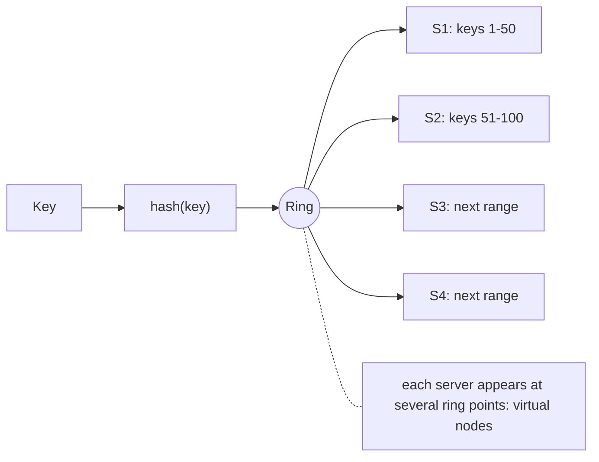
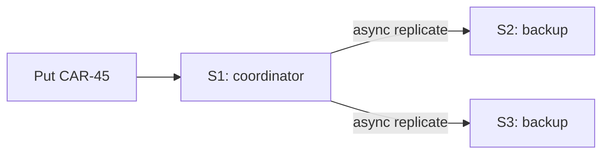
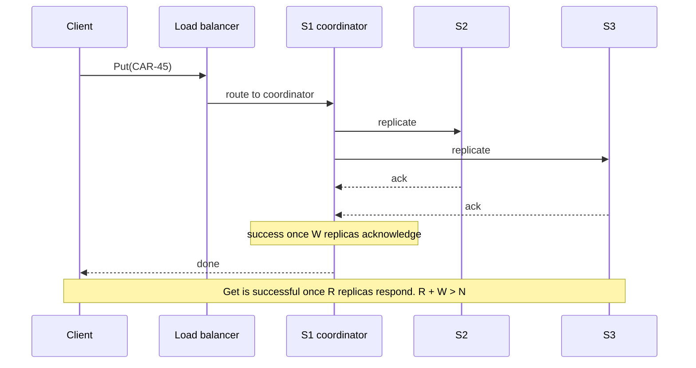
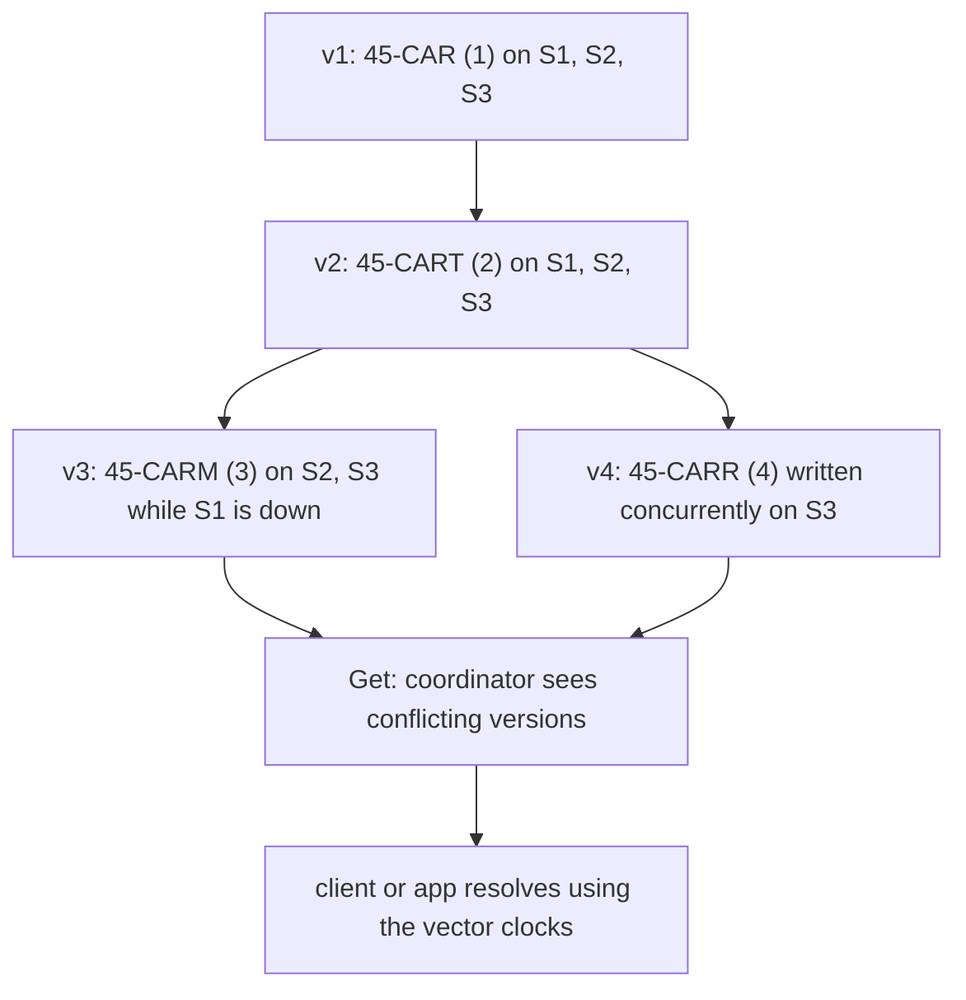

# Design a Key-Value Database / DynamoDB (HLD #9)

<!-- nav -->
⬅ [08 Back of the Envelope Estimation](08_Back_of_the_Envelope_Estimation_Notes.md) · [Index](00_HLD_Index.md) · [10 SQL vs NoSQL](10_SQL_vs_NoSQL_Notes.md) ➡
<!-- nav -->

Source (handwritten, pages 27–30 of the 36-page PDF): https://drive.google.com/file/d/1iegvlzgcLJtcGvbjJbPqF4hZaB5u_nrh/view?usp=drive_link

---

**Amazon uses DynamoDB in the "Add to cart" feature.** Goals: **1. Scalability · 2. Decentralization · 3. Eventual consistency.**
**Steps:** 1. **Partition** · 2. **Replication** · 3. **Get & Put operations** · 4. **Data versioning** · 5. **Gossip protocol.**

<!-- isw:09-0 -->
**In simple words**

The lecture designs a key-value database like **DynamoDB**, which Amazon uses for its **"Add to cart" feature.** The three goals are **scalability, decentralization and eventual consistency.** The design is built in five steps: **partition, replication, get and put operations, data versioning and the gossip protocol.**
<!-- /isw:09-0 -->

### 1. Partition

<!-- diagram:09-0 -->
**Diagram – Partitioning with a ring and virtual nodes**

<!-- /diagram:09-0 -->

A plain mapping (person → cart list) doesn't scale: when users grow we can't hold all users' data in one place, and the mapping itself would have to be stored on multiple systems. **Solution: partition requests with consistent hashing** – a **virtual ring** to handle **ranges** (S1 → keys 1–50, S2 → 51–100, S3, S4 …). To **prevent bombarding only one server → virtual nodes** (each server appears at several ring points).

<!-- isw:09-1 -->
**In simple words**

A simple map (person → cart list) **does not scale**: as users grow we cannot keep all the data in one place, and the map itself would have to be stored on several systems. The **solution is to partition the requests with consistent hashing**: a **virtual ring** handles **ranges** (S1 takes keys 1–50, S2 takes 51–100, then S3, S4, …). To **avoid bombarding only one server**, the notes use **virtual nodes**, so each server appears at several points on the ring. (See the [Consistent Hashing](06_Consistent_Hashing_Notes.md) note.)
<!-- /isw:09-1 -->

### 2. Replication (avoid single point of failure)

<!-- diagram:09-1 -->
**Diagram – Replication: coordinator and backups (preference list)**

<!-- /diagram:09-1 -->

Example: key **CAR-45** is served by **S1 (coordinator)**; to maintain availability replicate to **N−1** other servers (copies on **S2 and S3**) – kept on **different data centres.** The **preference list**: S1 = coordinator, S2/S3 = backups.

<!-- isw:09-2 -->
**In simple words**

To avoid a single point of failure, the data is copied. In the example the key **CAR-45** is served by **S1, the coordinator.** To keep it available, it is **replicated to N − 1 other servers** (copies on S2 and S3), kept in **different data centres.** The list of servers for a key is the **preference list:** S1 is the coordinator and S2 and S3 are the backups.
<!-- /isw:09-2 -->

### 3. Get & Put operations

<!-- diagram:09-2 -->
**Diagram – Quorum: R + W > N**

<!-- /diagram:09-2 -->

- **Put(CAR) → find key (45)** → stored in **S1**, which keeps it and **replicates asynchronously** to S2, S3 (`45-car` placed in S1, S2, S3). **Quorum rule: R + W > N** – wait for the required number of success responses (**W** for writes, **R** for reads, **N** = number of replica nodes).
- **Get:** a request reaches a **load balancer** that must route it – **① Generic LB** (simple to implement but **high latency** – may hit any server; then the **preference list** works and the **coordinator** serves; if the coordinator is down, the next nodes on the preference list take over) or **② Partition-aware LB** (**low latency**, routes straight to the right node).
- **R + W > N → Get returns a successful response only if R nodes respond; a Put is successful only if W nodes acknowledge.**

<!-- isw:09-3 -->
**In simple words**

**Put:** `Put(CAR)` finds the key (45) and stores it in **S1**, which keeps it and **replicates asynchronously** to S2 and S3. The notes use a **quorum rule: R + W > N** – wait for the required number of successful responses (**W for writes, R for reads, N = the number of replica nodes**). A **Put is successful only if W nodes acknowledge**, and a **Get returns a successful response only if R nodes respond.**

**Get:** a request reaches a **load balancer** that must route it. Two kinds:
1. **Generic load balancer** – simple to build but has **high latency**: it may send the request to any server, and then the **preference list** applies and the **coordinator** serves it; if the coordinator is down, the next nodes on the preference list take over.
2. **Partition-aware load balancer** – **low latency**, because it routes straight to the right node.
<!-- /isw:09-3 -->

### 4. Data versioning

<!-- diagram:09-3 -->
**Diagram – Versions with vector clocks**

<!-- /diagram:09-3 -->

Why: (1) `Put(CAR-45)` → S1 `[45-CAR]`, replicated to S2, S3. (2) `Put(CART-45)` → S1 is **down now**, so it goes to the next on the preference list, S2. (3) Server S1 comes back and a Get arrives: S1 still has `[45-CAR]` (**not updated**) – it must **talk with all** (S2, S3) to reconcile. **To implement it: Vector Clock (server, counter)** per version – example: v1 `[45-CAR]-1` on all; v2 `[45-CART]-2` on all; v3 `[45-CARM]-3` on S2 & S3 while S1 is down; v4 `[45-CARR]-4` concurrently on S3; on Get the coordinator sees CART(2), CARM(3), CARR(4) – **conflicting concurrent versions** – and **"eventual consistency – because here we can't compromise availability & partition tolerance, so we compromise consistency" (AP)**; the conflicts are resolved by the client/app via vector clocks.

<!-- isw:09-4 -->
**In simple words**

The notes explain why versions are needed with an example. (1) `Put(CAR-45)` goes to S1 and is replicated to S2 and S3. (2) `Put(CART-45)` arrives while **S1 is down**, so it goes to the next server on the preference list, S2. (3) S1 comes back and a Get arrives: S1 still holds the old value `[45-CAR]` (not updated), so it **must talk to all** (S2, S3) to reconcile.

To do this the notes use a **vector clock** (a server and a counter) for each version. Example: v1 `[45-CAR]-1` on all; v2 `[45-CART]-2` on all; v3 `[45-CARM]-3` on S2 and S3 while S1 is down; v4 `[45-CARR]-4` written at the same time on S3. On a Get the coordinator sees CART (2), CARM (3) and CARR (4): **conflicting concurrent versions.** The notes conclude: *"eventual consistency – because here we can't compromise availability and partition tolerance, so we compromise consistency (AP)"*, and the conflicts are resolved by the client or application using the vector clocks.
<!-- /isw:09-4 -->

### 5. Gossip protocol
(Named in the steps list – nodes periodically exchange state with random peers to detect failures and learn membership; the pages don't elaborate.)

<!-- isw:09-5 -->
**In simple words**

The notes only name the gossip protocol in the list of steps and do not explain it on these pages.
<!-- /isw:09-5 -->

---

## Quick revision
- **Key-value DB (Dynamo):** consistent-hashing ring + virtual nodes, **N replicas with R+W>N quorum**, **vector clocks** for versioning, **gossip** for membership – AP/eventual consistency.

---

<!-- nav -->
⬅ [08 Back of the Envelope Estimation](08_Back_of_the_Envelope_Estimation_Notes.md) · [Index](00_HLD_Index.md) · [10 SQL vs NoSQL](10_SQL_vs_NoSQL_Notes.md) ➡
<!-- nav -->
