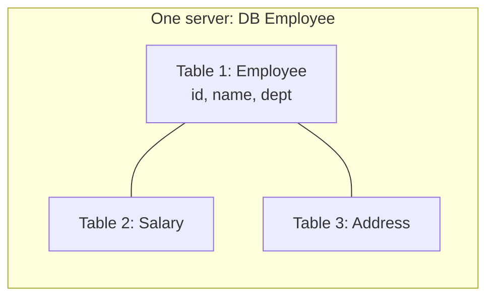
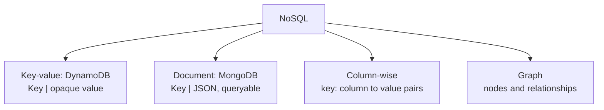
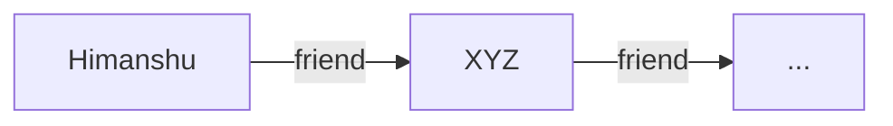
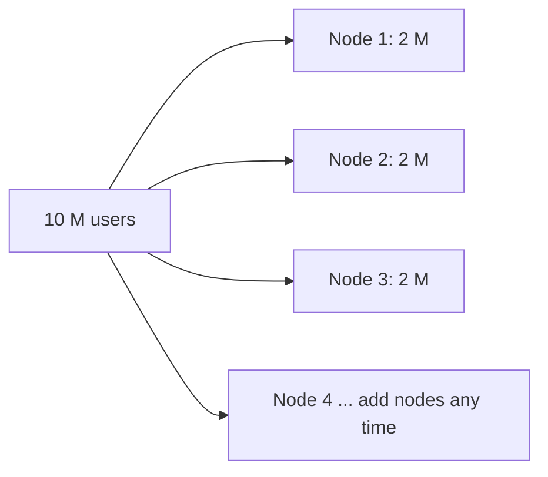

# SQL vs NoSQL (HLD #10 – Lecture 48)

<!-- nav -->
⬅ [09 Key Value DB](09_Key_Value_DB_Notes.md) · [Index](00_HLD_Index.md) · [11 Design WhatsApp Chat App](11_Design_WhatsApp_Chat_App_Notes.md) ➡
<!-- nav -->

Source (handwritten, 7 pages): https://drive.google.com/file/d/1CuxKzs00W6meH_6PdF2la8xBkXnyvhcO/view?usp=drive_link

**Compared on 4 dimensions:** 1. **Structure** · 2. **Nature** · 3. **Scalability** · 4. **Properties**

---

# PART A – SQL

**SQL (Structured Query Language)** is used to **query / manage a Relational Database Management System (RDBMS)** – with `SELECT`, `INSERT`, `UPDATE` – over **tables → rows → columns**. Tables can be related (**Parent → Child** via relations).

## 1. Structure
1. Data lives in **tables, rows and columns**.
2. **Predetermined schema** – the schema must be defined **before you start using it** (e.g. `Table(name: String, roll: Number(20))`).
3. **We plan the schema before the insert/update operations.**

<!-- isw:10-0 -->
**In simple words**

For SQL the notes say three things about structure: data is stored in **tables, rows and columns**; the **schema is predetermined**, which means it must be defined **before you start using it** (for example `Table(name: String, roll: Number(20))`); and **we plan the schema before the insert and update operations.**
<!-- /isw:10-0 -->

## 2. Nature – *concentrated / centralized*

<!-- diagram:10-0 -->
**Diagram – SQL: all data of an employee sits on one server**

<!-- /diagram:10-0 -->

- Example: DB **Employee** with Table 1 (employee id, name, dept e.g. `1, IT`), Table 2 (**Salary**), Table 3 (**Address**) – related to each other.
- For a particular user/employee (e.g. "Himanshu") **the whole data is present in one server.**
- ⇒ Nature: **concentrated / centralized.**

<!-- isw:10-1 -->
**In simple words**

The example is a DB **Employee** with Table 1 (employee id, name, department such as `1, IT`), Table 2 (**Salary**) and Table 3 (**Address**), all related to each other. For one employee (for example "Himanshu") **the whole data is present in one server**, so the nature of SQL is **concentrated / centralized.**
<!-- /isw:10-1 -->

## 3. Scalability
We want to scale a `User` table with e.g. **10 million users**:
1. **Vertical scaling** – increase **RAM, storage capacity** of the machine. **Vertical fits SQL much better.**
2. **Horizontal scaling (sharding)** – based on rows and columns. **Not well supported in SQL.**

<!-- isw:10-2 -->
**In simple words**

The notes want to scale a `User` table with, for example, **10 million users**. Two options: **(1) vertical scaling**, which means increasing the machine's **RAM and storage capacity**; the notes say vertical scaling **fits SQL much better**. **(2) horizontal scaling (sharding)**, by rows and columns, which is **not well supported in SQL.**
<!-- /isw:10-2 -->

## 4. Properties – **ACID**
**A**tomicity, **C**onsistency, **I**solation, **D**urability → together they **make sure data integrity** (consistency).

<!-- isw:10-3 -->
**In simple words**

SQL follows **ACID**: **A**tomicity, **C**onsistency, **I**solation, **D**urability. Together they **make sure of data integrity** (consistency).
<!-- /isw:10-3 -->

---

# PART B – NoSQL
**NoSQL = "Non-relational", "Not only SQL".**

## 1. Structure

<!-- diagram:10-1 -->
**Diagram – The four NoSQL types**

<!-- /diagram:10-1 -->

NoSQL **works on unstructured data.** Four types:

### ① Key–Value DB (e.g. **DynamoDB**)
- Table of `Key | Value`; the value can be a **String / Integer / JSON**.
- The value is **opaque** to the DB – **you search / query only on the key.**

<!-- isw:10-5 -->
**In simple words**

A table of `Key | Value`, where the value can be a string, an integer or JSON. The value is **opaque to the DB**, so **you can search or query only on the key.**
<!-- /isw:10-5 -->

### ② Document DB (e.g. **MongoDB**)
- `Key | Value` where the value is a **JSON (or XML) document**.
- **Search based on the key, and we can also query on the value** (fields inside the document).

<!-- isw:10-6 -->
**In simple words**

Again `Key | Value`, but the value is a **JSON (or XML) document.** Here **you can search on the key, and you can also query on the value** (the fields inside the document).
<!-- /isw:10-6 -->

### ③ Column-wise DB
- Each **key** maps to a set of **column → value** pairs; different keys can have different columns.
- Example:
  - key `1001` → `first-name: Himansh`, `department: IT`, `interest: BasketBall`
  - key `1002` → `first-name: Raj`, `department: Sales`

<!-- isw:10-7 -->
**In simple words**

Each **key** maps to a set of **column → value pairs**, and different keys can have different columns. In the example, key `1001` has first-name Himansh, department IT and interest BasketBall, while key `1002` has only first-name Raj and department Sales.
<!-- /isw:10-7 -->

### ④ Graph DB

<!-- diagram:10-2 -->
**Diagram – Graph database example**

<!-- /diagram:10-2 -->

- Stores data as **Nodes and Edges (relationships)**.
- Example: `Himanshu —friend→ XYZ —friend→ …`.
- Used by **social networking, recommendation engines.**
- It is **very, very fast.** SQL also has relationships (joins) but they are costly (**SQL has to scan fully**), while a **Graph DB has the relationship directly.**

<!-- isw:10-4 -->
**In simple words**

NoSQL works on **unstructured data**, and the notes list four types, explained next.
<!-- /isw:10-4 -->

<!-- isw:10-8 -->
**In simple words**

Data is stored as **nodes and edges (relationships)**, for example `Himanshu —friend→ XYZ —friend→ …`. It is used by **social networking and recommendation engines**, and it is **very, very fast.** SQL also has relationships (joins) but they are costly because **SQL has to scan fully**, whereas a **graph DB holds the relationship directly.**
<!-- /isw:10-8 -->

## 2. Nature – *distributed*

<!-- diagram:10-3 -->
**Diagram – NoSQL: data spread across nodes**

<!-- /diagram:10-3 -->

- Data is **distributed across nodes** – e.g. 10 M users spread as **Node 1 = 2 M, Node 2 = 2 M, Node 3 = 2 M, …**

<!-- isw:10-9 -->
**In simple words**

In NoSQL the data is **distributed across nodes.** For example 10 million users are spread as **Node 1 = 2 M, Node 2 = 2 M, Node 3 = 2 M, …**
<!-- /isw:10-9 -->

## 3. Scalability – *horizontal*
- "My user table is growing fast (1 M, …)" → **we can add any number of nodes to store user data.**

<!-- isw:10-10 -->
**In simple words**

If "my user table is growing fast", then **we can add any number of nodes to store the user data.** That is horizontal scaling.
<!-- /isw:10-10 -->

## 4. Properties – **BASE** (not ACID)
| Letter | Meaning | Explanation |
|---|---|---|
| **BA** | **Basically Available** | highly available DB – if one node (e.g. the one holding "Sha…") is down, another replica/node still serves the data |
| **S** | **Soft state** (written as "Safe state") | the **state of data can change without interaction** – replicas (N1/S1, N2/S2, N3/S3, e.g. `Him : 1 : S1`) sync among themselves in the background |
| **E** | **Eventual consistency** | a query right after a write may return **stale** data; **after some time** the replicas converge and the **latest** value is returned |

<!-- isw:10-11 -->
**In simple words**

NoSQL follows **BASE** instead of ACID. The table explains each letter:
- **BA – Basically Available:** a highly available DB; if one node is down, another replica or node still serves the data.
- **S – Soft state:** the **state of the data can change without interaction**, because the replicas sync among themselves in the background.
- **E – Eventual consistency:** a query right after a write may return **old (stale) data**; **after some time the replicas become equal** and the **latest** value is returned.
<!-- /isw:10-11 -->

---

# PART C – When to use what?

| | **SQL** | **NoSQL** |
|---|---|---|
| 1 | **Flexible query functionality** needed | ✗ – only **basic query / search**, or you must know in advance **which column needs search capability** |
| 2 | Data is **relational in nature** (parent–child) | – |
| 3 | **Data integrity (ACID) / consistency** is required | ✗ ACID – **NoSQL is developed to handle large amounts of data**; choose it for **high availability, high performance / search (query) with some consistency (eventual)** |

<!-- isw:10-12 -->
**In simple words**

The notes compare the two. Choose **SQL** when you need **flexible query functionality**, when the data is **relational in nature** (parent–child) and when you need **data integrity (ACID)**. NoSQL has **only basic query and search** (or you must know in advance which column needs search capability) and does not give ACID; the notes say **NoSQL was developed to handle large amounts of data**, so choose it for **high availability, high performance, search (query) with some (eventual) consistency.**
<!-- /isw:10-12 -->

---

## Quick revision
| Dimension | SQL | NoSQL |
|---|---|---|
| Structure | tables/rows/columns, predefined schema | unstructured – key-value, document, column-family, graph |
| Nature | centralized (data of an entity on one server) | distributed |
| Scalability | mainly **vertical** (sharding poorly supported) | **horizontal** (add nodes) |
| Properties | **ACID** | **BASE** (Basically Available, Soft state, Eventual consistency) |
| Examples | MySQL / Postgres (RDBMS) | DynamoDB (KV), MongoDB (document), column-wise stores, Graph DBs |

---

## Extra from the 36-page handwritten compendium (pages 30–32)
These pages are in the same PDF as notes #1, #7, #9 and #11 (https://drive.google.com/file/d/1iegvlzgcLJtcGvbjJbPqF4hZaB5u_nrh/view?usp=drive_link); kept here because they belong to this topic.

(Full version: [10_SQL_vs_NoSQL_Notes.md](10_SQL_vs_NoSQL_Notes.md).)
- **SQL (RDBMS):** tables (row-column) with relationships; **predetermined schema**; **centralized/concentrated** – complete data placed on one server; **scalability** – vertical (RAM, storage) – horizontal isn't well supported; **ACID** → data integrity/consistency (same at every place).
- **NoSQL:** non-relational / "not only SQL"; **unstructured data** – **① Key-value** (opaque value – *you can't query on the value*, e.g. string/JSON), **② Document DB** (`Key | JSON` – can **query through values**, e.g. value > 30), **③ Column-wise** (column–value pairs, e.g. Name: Sujal Sharma), **④ Graph DB** (node + edge/relationship, e.g. Sujal —learning→ SD); **distributed** nature; **horizontal** scalability; **BASE** (Basically available, Soft state, Eventual consistency).
- **When to use:** SQL – flexible query functionality, relational, data integrity (ACID); availability is lower, "just to provide consistent data." NoSQL – no complex queries, non-relational, no strict consistency; **high availability / performance / search queries / less consistency.**

---

<!-- nav -->
⬅ [09 Key Value DB](09_Key_Value_DB_Notes.md) · [Index](00_HLD_Index.md) · [11 Design WhatsApp Chat App](11_Design_WhatsApp_Chat_App_Notes.md) ➡
<!-- nav -->
