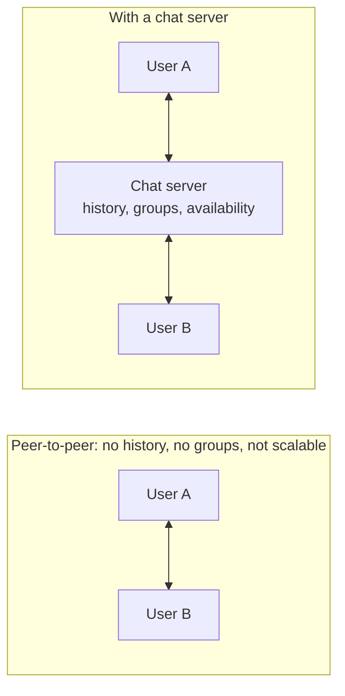
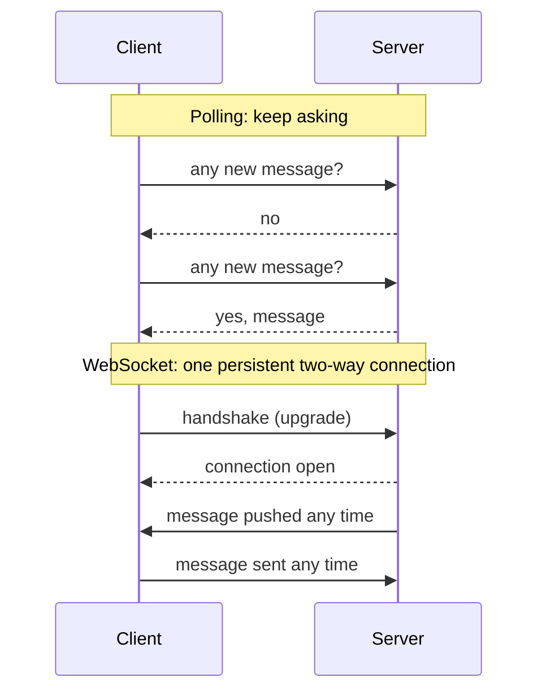
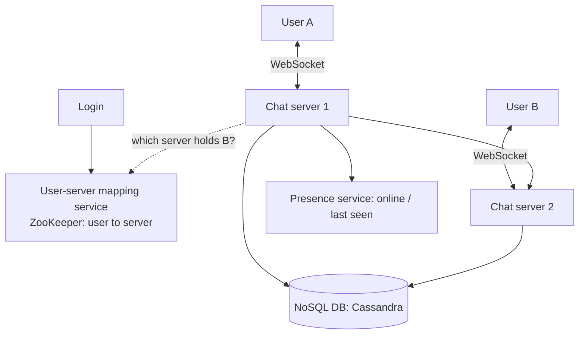

# Design a Chat App – WhatsApp, Discord, Telegram, Slack (HLD #11)

<!-- nav -->
⬅ [10 SQL vs NoSQL](10_SQL_vs_NoSQL_Notes.md) · [Index](00_HLD_Index.md) · [12 & 36 Rate Limiter](12_36_Rate_Limiter_Notes.md) ➡
<!-- nav -->

Source (handwritten, pages 33–36 of the 36-page PDF): https://drive.google.com/file/d/1iegvlzgcLJtcGvbjJbPqF4hZaB5u_nrh/view?usp=drive_link

---

<!-- simple-explanation -->
## In simple words – chat app (WhatsApp, Telegram, Slack…)

**Requirements.** Functional: 1-to-1 messages, group messages, last-seen/online status, login. Non-functional: scalable, low latency, highly available.
**Estimate:** 50 M daily users × (10 messages × 4 people) = 2 billion messages/day × 100 bytes ≈ **200 GB/day**, about **730 TB in 10 years**.

**Why not connect users directly (peer-to-peer)?** No chat history, no groups, doesn't scale, and a user who's offline can't receive anything. So we use **chat servers** in the middle.

**How does the receiver get messages? (HTTP only lets the client ask)**
1. **Polling:** keep asking "any new messages?" every second. Simple but wasteful.
2. **Long polling:** ask, and the server holds the request open until there is something (or a timeout). Fewer wasted calls.
3. **WebSocket (best):** open one persistent two-way connection after the handshake; the server can **push** messages instantly. Used by chat apps.

**Architecture.** Users connect by WebSocket to any **chat server**. Since the sender and receiver may be connected to *different* servers, a **user→server mapping service** (backed by ZooKeeper) records which server each user is on. A message request carries `(from, to, message, type)` where type is 1-to-1 or group; the sender's server looks up the receiver's server and forwards it.

**Storing messages.** No complex joins are needed and we need fast reads/writes at huge scale, so use **NoSQL, a column-family store like Cassandra**: a table of `message id | from | to | timestamp`, partitioned by the user pair (and by **group ID** for groups) with message IDs for ordering.

**Failures and presence.** If a chat server dies or a user is offline: on login, the system checks the mapping, assigns a new server if needed, and that server **fetches any pending messages from the database** and delivers them. **Last seen/online** comes from a **presence service** that tracks activity through the chat servers.
<!-- simple-explanation -->


### 1. Requirements
- **Functional:** ① 1-to-1 send/receive messages (text) ② **group message** support ③ **last seen / online / offline** ④ **user login / authentication.**
- **Non-functional:** ① **scalability** (huge traffic) ② **low latency** ③ **availability.**

### Back-of-the-envelope
- Total users **2 billion**; **DAU = 50 M**; one user sends **10 messages to 4 people a day** ⇒ `50 M × 40 = 2000 M ≈ 2 B messages/day`.
- 1 message ≈ **100 bytes** ⇒ `2 B × 100 B ≈ 200 GB/day`.
- 10 years ⇒ ~2 TB × 365 ⇒ **~730 TB.**

### 2. Why not direct peer-to-peer?

<!-- diagram:11-0 -->
**Diagram – Peer-to-peer versus a chat server**


<!-- /diagram:11-0 -->


User A and User B (each with an IP address) could talk directly peer-to-peer, **but: no chat history, not scalable, no group, not fully available.** → we need a **common place (chat server)** to hold the details and take care of everything.

### 3. Protocol – HTTP fails for receiving

<!-- diagram:11-1 -->
**Diagram – Polling versus WebSocket**


<!-- /diagram:11-1 -->


Normally HTTP = send a request, get a response, terminate. User A → Chat Server → User B: **receiving is not possible without asking (a request).** Improved protocols to **receive** messages:
1. **Polling** – the client keeps sending requests (e.g. every 1 s); most return "no" – wasteful (1 sec → lots of calls).
2. **Long polling / pushing** – the request stays open until the server has data (then the client re-requests) – REST-based, fewer wasted calls.
3. **WebSocket (bi-directional)** ⭐ – **connection-oriented** (SYN/ACK handshake) then a **bi-directional persistent connection** – used for chat.

### 4. Architecture

<!-- diagram:11-2 -->
**Diagram – Chat architecture**


<!-- /diagram:11-2 -->


```
 Login ─► User–Server mapping service (ZooKeeper: user → server table)
 User-n ◄── WebSocket ──► Chat Server 1 | Chat Server 2 | Chat Server 3 … ──► NoSQL DB
```
- **Any user can connect to any chat server.** When a client sends a message to another client, how does the sender's server know **which server holds the receiver's connection?** → create **one more service for mapping** (**user ↔ server**, ZooKeeper-backed). Now a request can be sent by address: **`sendReq(from, to, message, type)`** where type = **Group / 1-1.**

### 5. Chat history & database choice
Storage question: **SQL or NoSQL?** Reads: user can see user 2, **group history, group members, user profile.** Writes: **send message, update profile pic.**
- **Any complex joins? No. Search → low latency ⇒ NoSQL.**
- Chat/messaging services use a **column-wise DB (Cassandra).** Table: `Message Id | From | To | Timestamp`.
  - **Partition based on `from` → `to`**, **ordering to place in nodes using Message Id**; with multiple partitions take care of **unique IDs.**
- **Groups:** **GroupId = partition key**; columns: `Message Id | Group Id | Sender user | Message | Timestamp`.

### 6. Failures & presence
- **When a chat server is down or the user is offline:** on login, the login checks the **user mapping**; if no server is assigned, it **assigns a new one**; after mapping, the server **checks the DB for any pending data** for that user and delivers it.
- **Last seen:** a **Presence system** that **frequently checks (through the chat servers) whether the user is online or not.**

---

## Quick revision
- **Chat app:** **WebSocket** + **chat servers** + **user→server mapping (ZooKeeper)** + **Cassandra** (partition by user pair / group id) + **presence service**; ~2 B msgs/day ≈ 200 GB/day ≈ 730 TB/10 yr.

---

<!-- nav -->
⬅ [10 SQL vs NoSQL](10_SQL_vs_NoSQL_Notes.md) · [Index](00_HLD_Index.md) · [12 & 36 Rate Limiter](12_36_Rate_Limiter_Notes.md) ➡
<!-- nav -->
