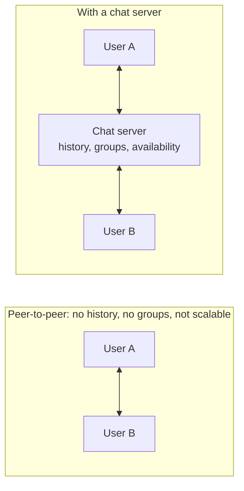
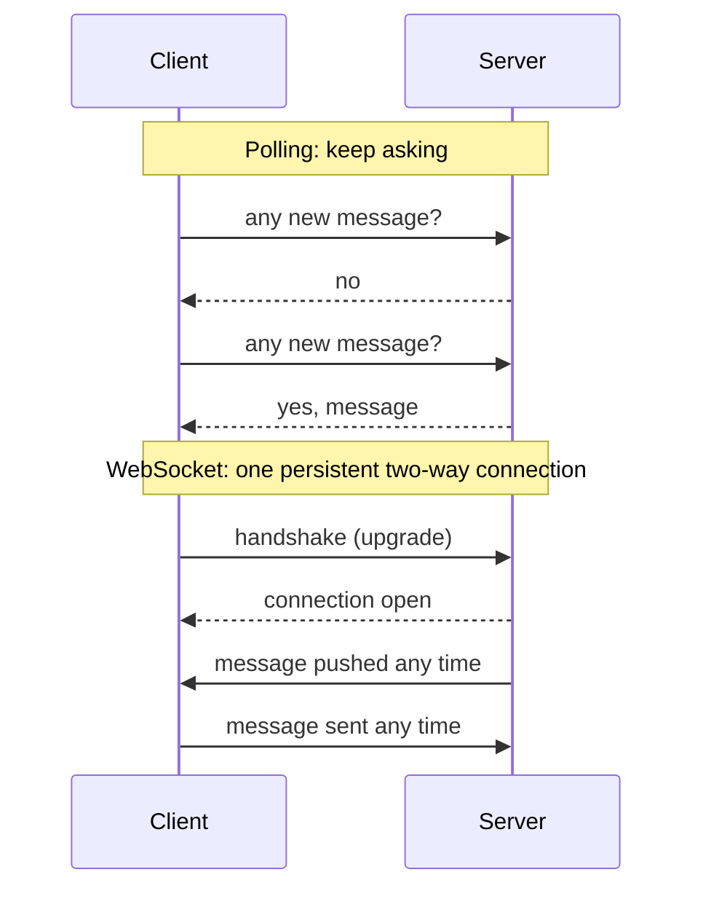
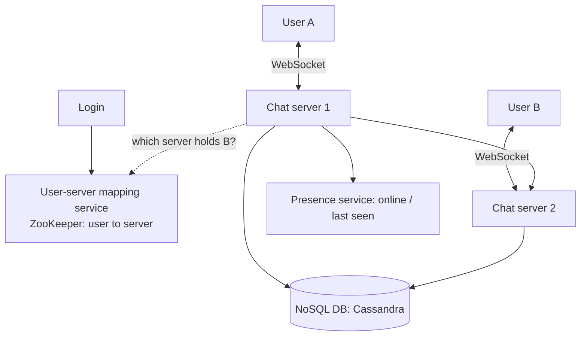

# Design a Chat App – WhatsApp, Discord, Telegram, Slack (HLD #11)

<!-- nav -->
⬅ [10 SQL vs NoSQL](10_SQL_vs_NoSQL_Notes.md) · [Index](00_HLD_Index.md) · [12 & 36 Rate Limiter](12_36_Rate_Limiter_Notes.md) ➡
<!-- nav -->

Source (handwritten, pages 33–36 of the 36-page PDF): https://drive.google.com/file/d/1iegvlzgcLJtcGvbjJbPqF4hZaB5u_nrh/view?usp=drive_link

---

### 1. Requirements
- **Functional:** ① 1-to-1 send/receive messages (text) ② **group message** support ③ **last seen / online / offline** ④ **user login / authentication.**
- **Non-functional:** ① **scalability** (huge traffic) ② **low latency** ③ **availability.**

<!-- isw:11-0 -->
**In simple words**

**Functional requirements:** (1) one-to-one send and receive of text messages, (2) group messages, (3) last seen / online / offline, (4) user login and authentication. **Non-functional requirements:** (1) scalability for huge traffic, (2) low latency, (3) availability.
<!-- /isw:11-0 -->


### Back-of-the-envelope
- Total users **2 billion**; **DAU = 50 M**; one user sends **10 messages to 4 people a day** ⇒ `50 M × 40 = 2000 M ≈ 2 B messages/day`.
- 1 message ≈ **100 bytes** ⇒ `2 B × 100 B ≈ 200 GB/day`.
- 10 years ⇒ ~2 TB × 365 ⇒ **~730 TB.**

<!-- isw:11-1 -->
**In simple words**

The numbers: **2 billion total users**, **DAU = 50 million**, and one user sends **10 messages to 4 people a day**, so `50 M × 40 = 2000 M ≈ 2 billion messages per day.** One message is about **100 bytes**, so `2 B × 100 B ≈ 200 GB per day`. For 10 years that is about 2 TB × 365, roughly **730 TB.**
<!-- /isw:11-1 -->


### 2. Why not direct peer-to-peer?

<!-- diagram:11-0 -->
**Diagram – Peer-to-peer versus a chat server**


<!-- /diagram:11-0 -->


User A and User B (each with an IP address) could talk directly peer-to-peer, **but: no chat history, not scalable, no group, not fully available.** → we need a **common place (chat server)** to hold the details and take care of everything.

<!-- isw:11-2 -->
**In simple words**

User A and User B each have an IP address, so they could talk directly. But the notes list what goes wrong: **no chat history, not scalable, no groups, not fully available.** So a **common place, a chat server,** is needed to hold the details and take care of everything.
<!-- /isw:11-2 -->


### 3. Protocol – HTTP fails for receiving

<!-- diagram:11-1 -->
**Diagram – Polling versus WebSocket**


<!-- /diagram:11-1 -->


Normally HTTP = send a request, get a response, terminate. User A → Chat Server → User B: **receiving is not possible without asking (a request).** Improved protocols to **receive** messages:
1. **Polling** – the client keeps sending requests (e.g. every 1 s); most return "no" – wasteful (1 sec → lots of calls).
2. **Long polling / pushing** – the request stays open until the server has data (then the client re-requests) – REST-based, fewer wasted calls.
3. **WebSocket (bi-directional)** ⭐ – **connection-oriented** (SYN/ACK handshake) then a **bi-directional persistent connection** – used for chat.

<!-- isw:11-3 -->
**In simple words**

With normal HTTP the client sends a request, gets a response and the connection ends. With User A → Chat server → User B, **receiving is not possible without asking (sending a request).** The notes list three better ways to **receive** messages:
1. **Polling** – the client keeps sending requests (for example every second); most answers are "no", which is wasteful.
2. **Long polling / pushing** – the request stays open until the server has data, then the client asks again; REST-based and fewer wasted calls.
3. **WebSocket (bi-directional)** – **connection-oriented** (SYN/ACK handshake), then a **persistent two-way connection.** This is the one used for chat.
<!-- /isw:11-3 -->


### 4. Architecture

<!-- diagram:11-2 -->
**Diagram – Chat architecture**


<!-- /diagram:11-2 -->


```
 Login ─► User–Server mapping service (ZooKeeper: user → server table)
 User-n ◄── WebSocket ──► Chat Server 1 | Chat Server 2 | Chat Server 3 … ──► NoSQL DB
```
- **Any user can connect to any chat server.** When a client sends a message to another client, how does the sender's server know **which server holds the receiver's connection?** → create **one more service for mapping** (**user ↔ server**, ZooKeeper-backed). Now a request can be sent by address: **`sendReq(from, to, message, type)`** where type = **Group / 1-1.**

<!-- isw:11-4 -->
**In simple words**

Users log in and connect over **WebSocket** to **chat servers (1, 2, 3, …)**, which store messages in a **NoSQL DB.** **Any user can connect to any chat server.** The question is how the sender's server finds **which server holds the receiver's connection.** The answer is **one more service for mapping, user ↔ server** (backed by ZooKeeper, a table of user → server). With it a message can be sent by address: **`sendReq(from, to, message, type)`**, where the type is **group or 1-1.**
<!-- /isw:11-4 -->


### 5. Chat history & database choice
Storage question: **SQL or NoSQL?** Reads: user can see user 2, **group history, group members, user profile.** Writes: **send message, update profile pic.**
- **Any complex joins? No. Search → low latency ⇒ NoSQL.**
- Chat/messaging services use a **column-wise DB (Cassandra).** Table: `Message Id | From | To | Timestamp`.
  - **Partition based on `from` → `to`**, **ordering to place in nodes using Message Id**; with multiple partitions take care of **unique IDs.**
- **Groups:** **GroupId = partition key**; columns: `Message Id | Group Id | Sender user | Message | Timestamp`.

<!-- isw:11-5 -->
**In simple words**

The question is SQL or NoSQL. The reads are: a user sees user 2's chat, the group history, the group members and the user profile. The writes are: send a message and update the profile picture. **There are no complex joins, and the search needs low latency, so NoSQL.** Chat services use a **column-wise DB (Cassandra)** with the table `Message Id | From | To | Timestamp`, **partitioned by `from` → `to`**, with the **Message Id used for ordering** inside nodes (with several partitions the IDs must stay unique). For **groups**, the **GroupId is the partition key** and the columns are `Message Id | Group Id | Sender user | Message | Timestamp`.
<!-- /isw:11-5 -->


### 6. Failures & presence
- **When a chat server is down or the user is offline:** on login, the login checks the **user mapping**; if no server is assigned, it **assigns a new one**; after mapping, the server **checks the DB for any pending data** for that user and delivers it.
- **Last seen:** a **Presence system** that **frequently checks (through the chat servers) whether the user is online or not.**

<!-- isw:11-6 -->
**In simple words**

**If a chat server is down or the user is offline:** on login, the login checks the **user mapping**; if no server is assigned, it **assigns a new one.** After the mapping the server **checks the DB for any pending data** for that user and delivers it. **Last seen:** a **presence system** that **frequently checks, through the chat servers, whether the user is online.**
<!-- /isw:11-6 -->


---

## Quick revision
- **Chat app:** **WebSocket** + **chat servers** + **user→server mapping (ZooKeeper)** + **Cassandra** (partition by user pair / group id) + **presence service**; ~2 B msgs/day ≈ 200 GB/day ≈ 730 TB/10 yr.

---

<!-- nav -->
⬅ [10 SQL vs NoSQL](10_SQL_vs_NoSQL_Notes.md) · [Index](00_HLD_Index.md) · [12 & 36 Rate Limiter](12_36_Rate_Limiter_Notes.md) ➡
<!-- nav -->
