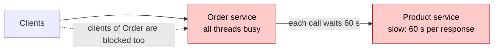
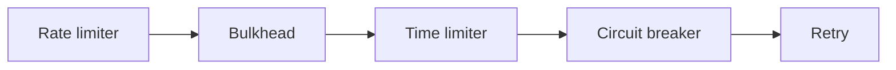
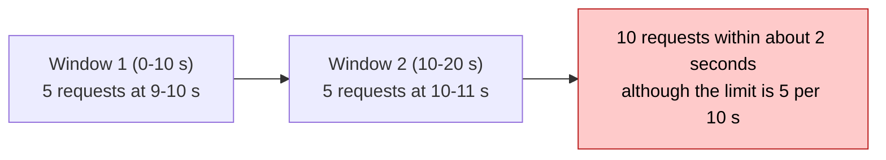
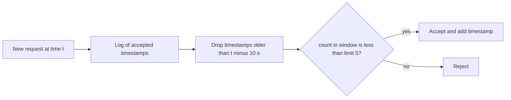
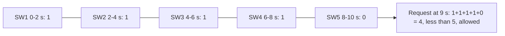
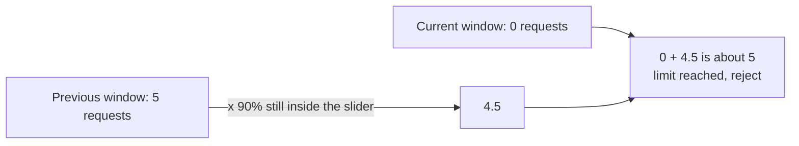
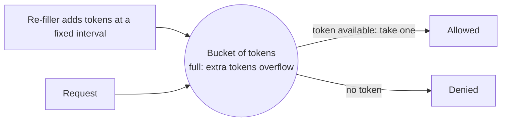
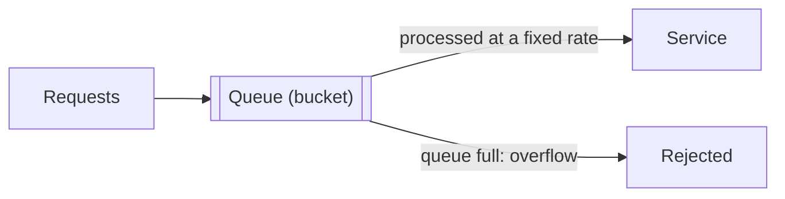

# Rate Limiter – Fault-Tolerant Microservice Part-1 (HLD #12 and #36 / Microservices #6)

<!-- nav -->
⬅ [11 Design WhatsApp Chat App](11_Design_WhatsApp_Chat_App_Notes.md) · [Index](00_HLD_Index.md) · [14 Idempotent POST API](14_Idempotent_POST_API_Notes.md) ➡
<!-- nav -->

Source (same PDF for both entries): https://drive.google.com/file/d/1EwfhhSiBNJw87tqvoaseW5ZKUKB-YJDx/view?usp=drive_link

---

<!-- simple-explanation -->
## In simple words – fault tolerance and the rate limiter

### Why fault tolerance matters (the cascading failure story)
Services call each other over the network. Imagine the **Product** service becomes very slow (60 seconds per reply) because of a bug.
1. The **Order** service calls Product and each call **hangs for 60 s**, holding a thread.
2. A burst of requests uses up **all of Order's threads**, all stuck waiting.
3. Now Order can't serve *its* clients either, and **their** clients get stuck too.
One slow service has spread the failure to many. That's a **cascading failure**. A **fault-tolerant** service keeps working or fails gracefully when something it depends on is failing.

The standard toolbox (Resilience4j) is applied in this order: **Rate Limiter → Bulkhead → Time Limiter → Circuit Breaker → Retry**. The order matters: put the rate limiter *before* retry so retries don't flood the system with extra traffic that would be blocked anyway.

### What is a rate limiter?
It limits **how many requests a service accepts in a given time**, protecting it from sudden spikes or attacks (DDoS). Extra requests are rejected (or delayed). There are six common algorithms:

**1. Fixed Window Counter** – count requests in fixed slices of time (e.g. 5 per 10 s). Simple and cheap. ❌ Edge problem: 5 requests at the end of one window plus 5 at the start of the next = **10 requests within 1 second**, even though each window obeyed the limit.

**2. Sliding Log** – remember the **exact timestamp** of every accepted request. For each new request count how many fall in the last *N* seconds; if that's at the limit, reject. ✅ Very accurate. ❌ Uses a lot of memory and needs cleaning of old timestamps.

**3. Sliding Window Counter (sub-windows)** – split the window into small slices (e.g. 10 s window of five 2 s slices) and keep a count per slice. The window moves forward slice by slice and only active slices are summed. ✅ Smoother than fixed window. ❌ More complex and more memory than fixed window.

**4. Sliding Window Counter (weighted)** – a cheaper approximation: `requests in current window + (percentage of the previous window that still overlaps) × previous window's requests`. Example: 90 % of a previous window with 5 requests ≈ 4.5, so the effective count is already near the limit of 5 and the request is rejected. ❌ Assumes traffic was spread evenly.

**5. Token Bucket** – imagine a bucket holding tokens. **Every request takes one token**; with no tokens, the request is denied. A refiller adds tokens regularly, up to the bucket's size (extra overflow is discarded). ✅ Simple and allows short bursts. ❌ After a quiet period the bucket is full, so a big burst is allowed all at once. **Resilience4j uses this by default.**

**6. Leaky Bucket** – requests join a **queue** and are processed at a **constant rate**, like water dripping from a hole. If the queue is full, new requests are dropped. ✅ Very smooth output. ❌ Requests wait (more latency) and the queue size must be tuned.

| Algorithm | Memory | Weakness |
|---|---|---|
| Fixed window | low | spike at window edges |
| Sliding log | high | cleanup cost |
| Sliding window (sub-windows) | medium | complexity |
| Sliding window (weighted) | low | approximate |
| Token bucket | low | burst after idle |
| Leaky bucket | queue | added latency |

### Using it in Spring Boot with Resilience4j
Add the `resilience4j-spring-boot3` dependency and annotate the method that calls the other service with `@RateLimiter(name = "productRateLimiter", fallbackMethod = "rateLimitedFallback")`.
- The method must be **public** and in a **Spring bean**, because it works through AOP (a proxy wraps the method).
- The **fallback method** must have the same return type and parameters, plus a `Throwable`. It runs when the limit is exceeded and should return a friendly response.
- Configuration (token bucket): `limitForPeriod=2` (2 tokens), `limitRefreshPeriod=10s` (refill every 10 s), `timeoutDuration=1s` (wait up to 1 s for a token before giving up). So only 2 calls per 10 seconds are allowed.
- It works the same whether you call the other service via Feign, RestTemplate or RestClient.

### Custom rate limiter with AOP
You can write your own: create an annotation like `@CustomRateLimiter(limit = 5, windowInSeconds = 60)` and an `@Aspect` with `@Around` advice that checks your algorithm; if allowed it calls `pjp.proceed()` (run the real method), otherwise it rejects the call.
<!-- simple-explanation -->


## 1. What is a Fault-Tolerant Microservice?

A service that **continues to work even when a downstream system fails**. Instead of crashing or causing cascading failures, it **handles the failure gracefully**.

### Why is it required?

<!-- diagram:12_36-0 -->
**Diagram – Cascading failure: one slow service blocks the others**


<!-- /diagram:12_36-0 -->


Microservices communicate over the network, and **one service's unavailability can bring down the whole system.**

**Scenario:** because of buggy code or an infrastructure issue, *Product* service becomes very slow (60 s per response).
- Without fault tolerance, an Order → Product call **hangs for 60 s**, blocking a thread.
- A sudden **burst** of requests from Order → Product blocks **all threads** (all waiting for a response).
- Because of this, **clients of Order service also get blocked**.
- Eventually services **run out of threads and start rejecting requests**.
- This is a **CASCADING FAILURE** – the issue is in Product service but it propagates to other services too.

To avoid it we build **fault-tolerant microservices**.

### Recommended logical ordering of patterns

<!-- diagram:12_36-1 -->
**Diagram – Recommended order of the patterns**


<!-- /diagram:12_36-1 -->


```
RateLimiter → Bulkhead → TimeLimiter → CircuitBreaker → Retry
```
**Why ordering matters:** always apply RateLimiter **before** Retry, so the retry logic doesn't overwhelm the system with traffic that RateLimiter would block later anyway (otherwise you end up retrying traffic that gets blocked).

---

## 2. Rate Limiter

Controls **the number of requests allowed to a microservice in a given time window**. It protects the system from **sudden traffic spikes (e.g. DDoS attack)**.

### Algorithm 1 – Fixed Window Counter

<!-- diagram:12_36-2 -->
**Diagram – Fixed window: the edge-of-window spike**


<!-- /diagram:12_36-2 -->


- Counts requests in a **fixed window**; if the count crosses the limit → reject.
- Example: Limit = 5, Fixed Window Size = 10 s.
- **Disadvantage:** traffic at the **edge** (end of window 1 + start of window 2) can cause a sudden spike – e.g. limit is 5 per 10 s but **10 requests arrive within 1 second**.

### Algorithm 2 – Sliding Log

<!-- diagram:12_36-3 -->
**Diagram – Sliding log: count timestamps inside the window**


<!-- /diagram:12_36-3 -->


- For each **accepted** request, store its **exact timestamp**.
- For each incoming request, check **how many requests happened in the last X seconds (window size)**.
- If count reaches the LIMIT → reject.
- Example: Window = 10 s, Limit = 5. As time moves, the window slides and **only requests inside the slider window are counted**.
  - New request while window already has 5 → **rejected**.
  - New request while window has only 4 → **accepted**.
- **Disadvantages:**
  - Must keep timestamp info for **each accepted request** → more memory.
  - Extra overhead of **cleaning up expired timestamps**.

### Algorithm 3 – Sliding Window Counter (with Sub-Windows)

<!-- diagram:12_36-4 -->
**Diagram – Sliding window with sub-windows (10 s window, 2 s slices)**


<!-- /diagram:12_36-4 -->


- Main window is divided into **equal-sized sub-windows**; track the **number of requests per sub-window**.
- To decide, consider **only active sub-windows**; the main window **slides by sub-window size** over time.
- Example: Window = 10 s, Sub-window = 2 s, Limit = 5.
  - Request at **9th second**: SW1(0–2) + SW2(2–4) + SW3(4–6) + SW4(6–8) + SW5(8–10) = 1+1+1+1+0 = **4 < 5 → allowed**.
  - At the 10th second the window slides (jumps by sub-window size). Request at **11th second**: SW1(2–4) + SW2(4–6) + SW3(6–8) + SW4(8–10) + SW5(10–12) = 1+1+1+1+0 = **4 < 5 → allowed**.
- **Disadvantages:** more complex than fixed window; must maintain sub-window info + count per sub-window → more memory.

### Algorithm 4 – Sliding Window Counter (Weighted Window)

<!-- diagram:12_36-5 -->
**Diagram – Weighted sliding window**


<!-- /diagram:12_36-5 -->


- Simplifies by **removing sub-window granularity** and using **approximation**. Combines **Fixed Window + Sliding Log** concepts.
- A slider window (equal to the fixed window size, e.g. 10 s) can lie **between two fixed windows**, and uses **percentages** to decide how much of it is in the previous vs. current window.
- Formula: **Total requests in current fixed window + X% of total requests in previous window**.
- Example (Limit = 5 per slider window), request at **11th second**:
  - Current fixed window (10–20 s) = 0
  - 90 % of previous window's requests (5) = 4.5 → ceil/round to ~5
  - 0 + ~5 = 5 → limit reached → **rejected**.
  - (90 % is based on the example shown; it can differ.)
- New request at **12th second**: current window 0 + **80 %** of previous (5) = 4 → 4 < 5 → **permitted**.
- **Disadvantage:** assumes **uniform distribution** of traffic, which may not be true.

### Algorithm 5 – Token Bucket

<!-- diagram:12_36-6 -->
**Diagram – Token bucket**


<!-- /diagram:12_36-6 -->


- A limited number of **tokens** sit in a bucket; **each request consumes one token**; no token left → request **denied**.
- A **re-filler** adds tokens at a regular interval. If the bucket is full, **extra tokens overflow and are discarded**.
- **Disadvantage:** a **quick burst** is possible if capacity isn't set properly – if the system is idle, tokens accumulate; a sudden burst is then **allowed** since tokens are present.

### Algorithm 6 – Leaky Bucket

<!-- diagram:12_36-7 -->
**Diagram – Leaky bucket**


<!-- /diagram:12_36-7 -->


- Requests are **queued** and processed at a **fixed rate**. If the queue is full, incoming requests **overflow** (rejected).
- **Disadvantages:** latency increases (requests wait in queue); the **queue size is a bottleneck** and must be set properly.

| Algorithm | Memory | Burst at edges | Notes |
|---|---|---|---|
| Fixed Window | low | ❌ possible spike | simplest |
| Sliding Log | high (timestamps) | ✅ accurate | cleanup overhead |
| Sliding Window Counter (sub-window) | medium | ✅ | complex |
| Sliding Window Counter (weighted) | low | approx. | assumes uniform traffic |
| Token Bucket | low | ⚠️ burst after idle | Resilience4j default |
| Leaky Bucket | queue | smooth output | adds latency |

---

## 3. Implementation in Spring Boot (Resilience4j)

**Resilience4j applies the Token Bucket algorithm by default.**

**pom.xml**
```xml
<dependency>
  <groupId>io.github.resilience4j</groupId>
  <artifactId>resilience4j-spring-boot3</artifactId>
  <version>2.1.0</version>
</dependency>
```

**Controller**
```java
@RestController
@RequestMapping("/orders")
public class OrderController {
    @Autowired OrderService orderService;

    @GetMapping("/{id}")
    public void callProductAPI(@PathVariable String id) {
        orderService.invokeProductAPI(id);
    }
}
```

**Feign client**
```java
@FeignClient(name = "product-service")
public interface ProductClient {
    @GetMapping(value = "/products/{id}")
    String getProductById(@PathVariable("id") String id);
}
```

**Service**
```java
@Component
public class OrderService {
    @Autowired ProductClient productClient;

    /* Internally uses AOP functionality, that's why the method on which
       @RateLimiter applies must be public and a Spring managed bean. */
    @RateLimiter(name = "productRateLimiter", fallbackMethod = "rateLimitedFallback")
    public void invokeProductAPI(String id) {
        String response = productClient.getProductById(id);
        System.out.println("Response from Product api call is: " + response);
    }

    /* Fallback method: return type and parameters (additionally only Throwable
       needs to be added) must match the original method, else the default
       fallback provided by the RateLimiter framework will be invoked. */
    public void rateLimitedFallback(String id, Throwable t) {
        System.out.println("Rate limit exceeded. Try later");
        // throw exception here and handle it gracefully
    }
}
```

**application.properties**
```properties
server.port=8081
spring.application.name=order-service
eureka.client.service-url.defaultZone=http://localhost:8761/eureka

# bucket filled with 2 tokens every 10 seconds,
# if there is no token wait for 1 sec before rejecting the request
resilience4j.ratelimiter.instances.productRateLimiter.limitForPeriod=2
resilience4j.ratelimiter.instances.productRateLimiter.limitRefreshPeriod=10s
resilience4j.ratelimiter.instances.productRateLimiter.timeoutDuration=1s
```
**Output:** hitting the API frequently – after 2 calls tokens are finished and the next call gets the rate-limit message; after waiting 10 s tokens are available again and the API can be hit again.

`@RateLimiter` works the same if you use **RestTemplate or RestClient** – no change.

---

## 4. Custom rate limiting with AOP

```java
@Target(ElementType.METHOD)
@Retention(RetentionPolicy.RUNTIME)
public @interface CustomRateLimiter {
    int limit();            // max requests
    int windowInSeconds();  // sliding window duration
}

@Aspect
@Component
public class RateLimiterAspect {
    @Around("@annotation(customRateLimiter)")
    public Object rateLimit(ProceedingJoinPoint pjp,
                            CustomRateLimiter customRateLimiter) throws Throwable {
        // custom rate limiting logic, if request accepted, invoke the method
        return pjp.proceed();
    }
}

@CustomRateLimiter(limit = 5, windowInSeconds = 60)
public String getProducts() {
    // service call
    return "List of products";
}
```

**Next in series:** Bulkhead, TimeLimiter, Circuit Breaker and Retry.

---

## Quick revision
- Slow downstream → blocked threads → **cascading failure**.
- Order: **RateLimiter → Bulkhead → TimeLimiter → CircuitBreaker → Retry**.
- 6 algorithms: Fixed Window, Sliding Log, Sliding Window (sub-window), Sliding Window (weighted), Token Bucket, Leaky Bucket.
- Resilience4j default = Token Bucket: `limitForPeriod`, `limitRefreshPeriod`, `timeoutDuration`; `@RateLimiter(name, fallbackMethod)` on a public Spring-bean method.
- Custom limiter → AOP `@Around` + custom annotation.

> Note: the diagrams of each algorithm in the original PDF are not reproduced; all text, examples and code are.

---

<!-- nav -->
⬅ [11 Design WhatsApp Chat App](11_Design_WhatsApp_Chat_App_Notes.md) · [Index](00_HLD_Index.md) · [14 Idempotent POST API](14_Idempotent_POST_API_Notes.md) ➡
<!-- nav -->
