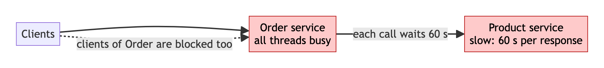
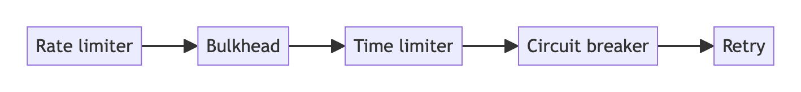
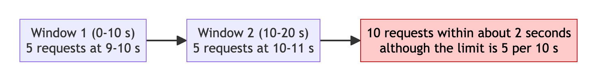
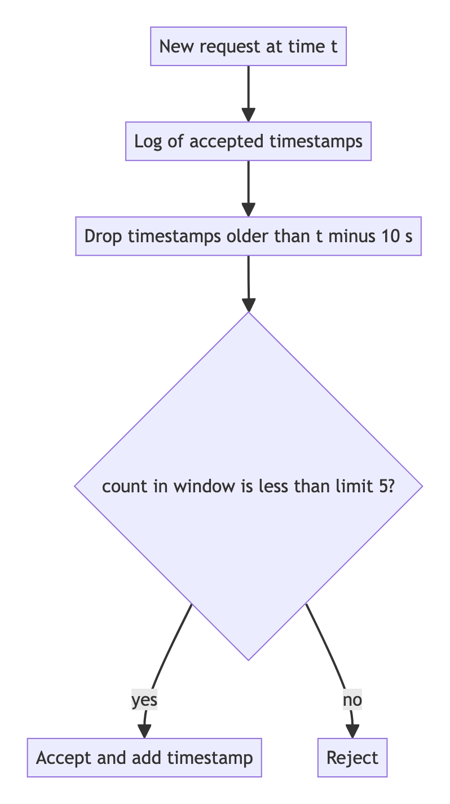
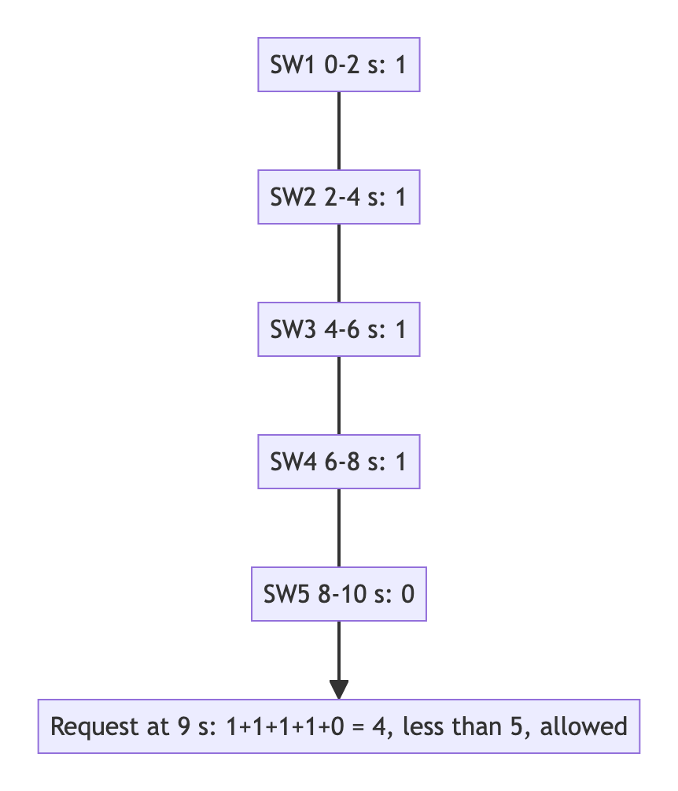
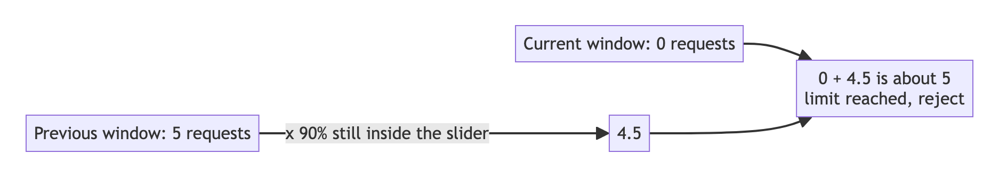
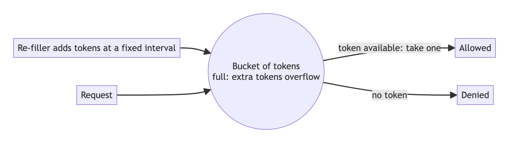
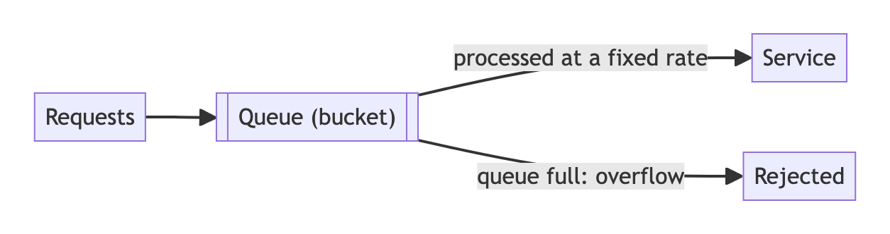

# Rate Limiter – Fault-Tolerant Microservice Part-1 (HLD #12 and #36 / Microservices #6)

<!-- nav -->
⬅ [11 Design WhatsApp Chat App](11_Design_WhatsApp_Chat_App_Notes.md) · [Index](00_HLD_Index.md) · [14 Idempotent POST API](14_Idempotent_POST_API_Notes.md) ➡
<!-- nav -->

Source: https://drive.google.com/file/d/1EwfhhSiBNJw87tqvoaseW5ZKUKB-YJDx/view?usp=drive_link

---

## 1. What is a Fault-Tolerant Microservice?

A service that **continues to work even when a downstream system fails**. Instead of crashing or causing cascading failures, it **handles the failure gracefully**.

### Why is it required?

<!-- diagram:12_36-0 -->
**Cascading failure: one slow service blocks the others**


<!-- /diagram:12_36-0 -->


Microservices communicate over the network, and **one service's unavailability can bring down the whole system.**

**Scenario:** because of buggy code or an infrastructure issue, *Product* service becomes very slow (60 s per response).
- Without fault tolerance, an Order → Product call **hangs for 60 s**, blocking a thread.
- A sudden **burst** of requests from Order → Product blocks **all threads** (all waiting for a response).
- Because of this, **clients of Order service also get blocked**.
- Eventually services **run out of threads and start rejecting requests**.
- This is a **CASCADING FAILURE** – the issue is in Product service but it propagates to other services too.

To avoid it we build **fault-tolerant microservices**.

<!-- isw:12_36-1 -->
**In simple words**

Scenario: because of buggy code or an infrastructure problem the **Product** service becomes very slow (**60 seconds per response**).
- Without fault tolerance, a call from Order to Product **hangs for 60 s and blocks a thread.**
- A sudden **burst** of calls from Order to Product **blocks all the threads**, all waiting for a response.
- Because of this, **the clients of the Order service get blocked too.**
- In the end the services **run out of threads and start rejecting requests.**

This is a **cascading failure**: the problem is only in the Product service, but it spreads to other services. To avoid it, we build fault-tolerant microservices.
<!-- /isw:12_36-1 -->


### Recommended logical ordering of patterns

<!-- diagram:12_36-1 -->
**Recommended order of the patterns**


<!-- /diagram:12_36-1 -->


```
RateLimiter → Bulkhead → TimeLimiter → CircuitBreaker → Retry
```
**Why ordering matters:** always apply RateLimiter **before** Retry, so the retry logic doesn't overwhelm the system with traffic that RateLimiter would block later anyway (otherwise you end up retrying traffic that gets blocked).

<!-- isw:12_36-0 -->
**In simple words**

A fault-tolerant microservice is one that **keeps working even when a downstream system fails.** Instead of crashing or causing a chain of failures, it **handles the failure gracefully.** It is needed because microservices talk to each other over the network, so **one service becoming unavailable can bring the whole system down.**
<!-- /isw:12_36-0 -->

<!-- isw:12_36-2 -->
**In simple words**

The recommended order is **RateLimiter → Bulkhead → TimeLimiter → CircuitBreaker → Retry.** The reason given: **always apply the RateLimiter before Retry**, so that the retry logic does not flood the system with traffic that the RateLimiter would block later anyway (otherwise you end up retrying traffic that gets blocked).
<!-- /isw:12_36-2 -->


---

## 2. Rate Limiter

Controls **the number of requests allowed to a microservice in a given time window**. It protects the system from **sudden traffic spikes (e.g. DDoS attack)**.

### Algorithm 1 – Fixed Window Counter

<!-- diagram:12_36-2 -->
**Fixed window: the edge-of-window spike**


<!-- /diagram:12_36-2 -->


- Counts requests in a **fixed window**; if the count crosses the limit → reject.
- Example: Limit = 5, Fixed Window Size = 10 s.
- **Disadvantage:** traffic at the **edge** (end of window 1 + start of window 2) can cause a sudden spike – e.g. limit is 5 per 10 s but **10 requests arrive within 1 second**.

<!-- isw:12_36-4 -->
**In simple words**

The requests are counted in a **fixed window**; when the count crosses the limit, further requests are rejected. Example: limit 5, window 10 s. The **disadvantage** is the edge of two windows: requests at the end of window 1 and the start of window 2 can create a sudden spike. For example, the limit is 5 per 10 s but **10 requests can arrive within 1 second.**
<!-- /isw:12_36-4 -->


### Algorithm 2 – Sliding Log

<!-- diagram:12_36-3 -->
**Sliding log: count timestamps inside the window**


<!-- /diagram:12_36-3 -->


- For each **accepted** request, store its **exact timestamp**.
- For each incoming request, check **how many requests happened in the last X seconds (window size)**.
- If count reaches the LIMIT → reject.
- Example: Window = 10 s, Limit = 5. As time moves, the window slides and **only requests inside the slider window are counted**.
  - New request while window already has 5 → **rejected**.
  - New request while window has only 4 → **accepted**.
- **Disadvantages:**
  - Must keep timestamp info for **each accepted request** → more memory.
  - Extra overhead of **cleaning up expired timestamps**.

<!-- isw:12_36-5 -->
**In simple words**

For every **accepted** request, the **exact timestamp** is stored. For each new request the system checks **how many requests happened in the last X seconds (the window size)**; if that count has reached the LIMIT, the request is rejected. Example: window 10 s, limit 5. As time moves the window slides and only requests inside it are counted: a new request is **rejected when the window already has 5**, and **accepted when it has only 4.** The **disadvantages:** a timestamp must be kept for every accepted request (more memory) and expired timestamps have to be cleaned up.
<!-- /isw:12_36-5 -->


### Algorithm 3 – Sliding Window Counter (with Sub-Windows)

<!-- diagram:12_36-4 -->
**Sliding window with sub-windows (10 s window, 2 s slices)**


<!-- /diagram:12_36-4 -->


- Main window is divided into **equal-sized sub-windows**; track the **number of requests per sub-window**.
- To decide, consider **only active sub-windows**; the main window **slides by sub-window size** over time.
- Example: Window = 10 s, Sub-window = 2 s, Limit = 5.
  - Request at **9th second**: SW1(0–2) + SW2(2–4) + SW3(4–6) + SW4(6–8) + SW5(8–10) = 1+1+1+1+0 = **4 < 5 → allowed**.
  - At the 10th second the window slides (jumps by sub-window size). Request at **11th second**: SW1(2–4) + SW2(4–6) + SW3(6–8) + SW4(8–10) + SW5(10–12) = 1+1+1+1+0 = **4 < 5 → allowed**.
- **Disadvantages:** more complex than fixed window; must maintain sub-window info + count per sub-window → more memory.

<!-- isw:12_36-6 -->
**In simple words**

The main window is divided into **equal sub-windows**, and the number of requests in each sub-window is tracked. Only the **active sub-windows** are counted, and the window **slides by the sub-window size.** Example: window 10 s, sub-window 2 s, limit 5. A request at the 9th second sums SW1 + SW2 + SW3 + SW4 + SW5 = 1+1+1+1+0 = **4, which is less than 5, so it is allowed.** At the 10th second the window moves; a request at the 11th second again gives 1+1+1+1+0 = 4, so it is allowed. The **disadvantages:** it is more complex than the fixed window and needs a count per sub-window (more memory).
<!-- /isw:12_36-6 -->


### Algorithm 4 – Sliding Window Counter (Weighted Window)

<!-- diagram:12_36-5 -->
**Weighted sliding window**


<!-- /diagram:12_36-5 -->


- Simplifies by **removing sub-window granularity** and using **approximation**. Combines **Fixed Window + Sliding Log** concepts.
- A slider window (equal to the fixed window size, e.g. 10 s) can lie **between two fixed windows**, and uses **percentages** to decide how much of it is in the previous vs. current window.
- Formula: **Total requests in current fixed window + X% of total requests in previous window**.
- Example (Limit = 5 per slider window), request at **11th second**:
  - Current fixed window (10–20 s) = 0
  - 90 % of previous window's requests (5) = 4.5 → ceil/round to ~5
  - 0 + ~5 = 5 → limit reached → **rejected**.
  - (90 % is based on the example shown; it can differ.)
- New request at **12th second**: current window 0 + **80 %** of previous (5) = 4 → 4 < 5 → **permitted**.
- **Disadvantage:** assumes **uniform distribution** of traffic, which may not be true.

<!-- isw:12_36-7 -->
**In simple words**

This simplifies the previous one by **removing the sub-windows and using an approximation.** It combines the fixed window and sliding log ideas. A slider window of the same size as the fixed window (10 s) lies **between two fixed windows**, and a **percentage** decides how much of it is in the previous window and how much in the current one.

**Formula:** requests in the current fixed window **+ X % of the requests in the previous window.** Example (limit 5), request at the **11th second:** the current window (10–20 s) has 0; 90 % of the previous window's 5 requests = 4.5, roughly 5; so 0 + about 5 = 5, the **limit is reached and the request is rejected.** For a request at the 12th second: 0 + **80 %** of 5 = 4, which is below 5, so it is **permitted.** The **disadvantage:** it assumes the traffic is spread **uniformly**, which may not be true.
<!-- /isw:12_36-7 -->


### Algorithm 5 – Token Bucket

<!-- diagram:12_36-6 -->
**Token bucket**


<!-- /diagram:12_36-6 -->


- A limited number of **tokens** sit in a bucket; **each request consumes one token**; no token left → request **denied**.
- A **re-filler** adds tokens at a regular interval. If the bucket is full, **extra tokens overflow and are discarded**.
- **Disadvantage:** a **quick burst** is possible if capacity isn't set properly – if the system is idle, tokens accumulate; a sudden burst is then **allowed** since tokens are present.

<!-- isw:12_36-8 -->
**In simple words**

A bucket holds a limited number of **tokens.** **Each request uses one token**, and when no token is left the request is **denied.** A **re-filler adds tokens at a regular interval**; if the bucket is full, the extra tokens **overflow and are discarded.** The **disadvantage:** a **quick burst** is possible if the capacity is not set properly. If the system is idle, tokens pile up, and a sudden burst is then **allowed** because tokens are available.
<!-- /isw:12_36-8 -->


### Algorithm 6 – Leaky Bucket

<!-- diagram:12_36-7 -->
**Leaky bucket**


<!-- /diagram:12_36-7 -->


- Requests are **queued** and processed at a **fixed rate**. If the queue is full, incoming requests **overflow** (rejected).
- **Disadvantages:** latency increases (requests wait in queue); the **queue size is a bottleneck** and must be set properly.

| Algorithm | Memory | Burst at edges | Notes |
|---|---|---|---|
| Fixed Window | low | ❌ possible spike | simplest |
| Sliding Log | high (timestamps) | ✅ accurate | cleanup overhead |
| Sliding Window Counter (sub-window) | medium | ✅ | complex |
| Sliding Window Counter (weighted) | low | approx. | assumes uniform traffic |
| Token Bucket | low | ⚠️ burst after idle | Resilience4j default |
| Leaky Bucket | queue | smooth output | adds latency |

<!-- isw:12_36-3 -->
**In simple words**

A rate limiter **controls how many requests a microservice accepts in a given time window.** It protects the system from **sudden traffic spikes, for example a DDoS attack.** There are six algorithms for doing this.
<!-- /isw:12_36-3 -->

<!-- isw:12_36-9 -->
**In simple words**

Requests are put in a **queue** and processed at a **fixed rate.** If the queue is full, incoming requests **overflow** and are rejected. The **disadvantages:** latency increases (requests wait in the queue) and the **queue size is a bottleneck** and must be set properly.
<!-- /isw:12_36-9 -->


---

## 3. Implementation in Spring Boot (Resilience4j)

**Resilience4j applies the Token Bucket algorithm by default.**

**pom.xml**
```xml
<dependency>
  <groupId>io.github.resilience4j</groupId>
  <artifactId>resilience4j-spring-boot3</artifactId>
  <version>2.1.0</version>
</dependency>
```

**Controller**
```java
@RestController
@RequestMapping("/orders")
public class OrderController {
    @Autowired OrderService orderService;

    @GetMapping("/{id}")
    public void callProductAPI(@PathVariable String id) {
        orderService.invokeProductAPI(id);
    }
}
```

**Feign client**
```java
@FeignClient(name = "product-service")
public interface ProductClient {
    @GetMapping(value = "/products/{id}")
    String getProductById(@PathVariable("id") String id);
}
```

**Service**
```java
@Component
public class OrderService {
    @Autowired ProductClient productClient;

    /* Internally uses AOP functionality, that's why the method on which
       @RateLimiter applies must be public and a Spring managed bean. */
    @RateLimiter(name = "productRateLimiter", fallbackMethod = "rateLimitedFallback")
    public void invokeProductAPI(String id) {
        String response = productClient.getProductById(id);
        System.out.println("Response from Product api call is: " + response);
    }

    /* Fallback method: return type and parameters (additionally only Throwable
       needs to be added) must match the original method, else the default
       fallback provided by the RateLimiter framework will be invoked. */
    public void rateLimitedFallback(String id, Throwable t) {
        System.out.println("Rate limit exceeded. Try later");
        // throw exception here and handle it gracefully
    }
}
```

**application.properties**
```properties
server.port=8081
spring.application.name=order-service
eureka.client.service-url.defaultZone=http://localhost:8761/eureka

# bucket filled with 2 tokens every 10 seconds,
# if there is no token wait for 1 sec before rejecting the request
resilience4j.ratelimiter.instances.productRateLimiter.limitForPeriod=2
resilience4j.ratelimiter.instances.productRateLimiter.limitRefreshPeriod=10s
resilience4j.ratelimiter.instances.productRateLimiter.timeoutDuration=1s
```
**Output:** hitting the API frequently – after 2 calls tokens are finished and the next call gets the rate-limit message; after waiting 10 s tokens are available again and the API can be hit again.

`@RateLimiter` works the same if you use **RestTemplate or RestClient** – no change.

<!-- isw:12_36-10 -->
**In simple words**

**Resilience4j applies the Token Bucket algorithm by default.** The pieces are: the `resilience4j-spring-boot3` dependency, a controller that calls `orderService.invokeProductAPI(id)`, a Feign client for the product service, and the service method annotated with `@RateLimiter(name = "productRateLimiter", fallbackMethod = "rateLimitedFallback")`.

Two points from the code comments: the annotation works through **AOP, so the method must be public and the class must be a Spring-managed bean.** The **fallback method** must have the **same return type and parameters, plus a `Throwable`**; otherwise the framework's default fallback is invoked.

The properties mean: **the bucket is filled with 2 tokens every 10 seconds** (`limitForPeriod=2`, `limitRefreshPeriod=10s`), and **if there is no token the request waits 1 second before it is rejected** (`timeoutDuration=1s`). **Output:** hit the API quickly, and after 2 calls the tokens are finished, so the next call gets the rate-limit message; after waiting 10 s the tokens are back. `@RateLimiter` works the same with **RestTemplate or RestClient.**
<!-- /isw:12_36-10 -->


---

## 4. Custom rate limiting with AOP

```java
@Target(ElementType.METHOD)
@Retention(RetentionPolicy.RUNTIME)
public @interface CustomRateLimiter {
    int limit();            // max requests
    int windowInSeconds();  // sliding window duration
}

@Aspect
@Component
public class RateLimiterAspect {
    @Around("@annotation(customRateLimiter)")
    public Object rateLimit(ProceedingJoinPoint pjp,
                            CustomRateLimiter customRateLimiter) throws Throwable {
        // custom rate limiting logic, if request accepted, invoke the method
        return pjp.proceed();
    }
}

@CustomRateLimiter(limit = 5, windowInSeconds = 60)
public String getProducts() {
    // service call
    return "List of products";
}
```

**Next in series:** Bulkhead, TimeLimiter, Circuit Breaker and Retry.

<!-- isw:12_36-11 -->
**In simple words**

You can write your own limiter: a custom annotation `@CustomRateLimiter(limit, windowInSeconds)` and an `@Aspect` with an `@Around` method that runs your own limiting logic; **if the request is accepted it calls the real method (`pjp.proceed()`).** The example applies it with `limit = 5, windowInSeconds = 60`. The next topics in the series are Bulkhead, TimeLimiter, Circuit Breaker and Retry.
<!-- /isw:12_36-11 -->


---

## Quick revision
- Slow downstream → blocked threads → **cascading failure**.
- Order: **RateLimiter → Bulkhead → TimeLimiter → CircuitBreaker → Retry**.
- 6 algorithms: Fixed Window, Sliding Log, Sliding Window (sub-window), Sliding Window (weighted), Token Bucket, Leaky Bucket.
- Resilience4j default = Token Bucket: `limitForPeriod`, `limitRefreshPeriod`, `timeoutDuration`; `@RateLimiter(name, fallbackMethod)` on a public Spring-bean method.
- Custom limiter → AOP `@Around` + custom annotation.

---

<!-- nav -->
⬅ [11 Design WhatsApp Chat App](11_Design_WhatsApp_Chat_App_Notes.md) · [Index](00_HLD_Index.md) · [14 Idempotent POST API](14_Idempotent_POST_API_Notes.md) ➡
<!-- nav -->
