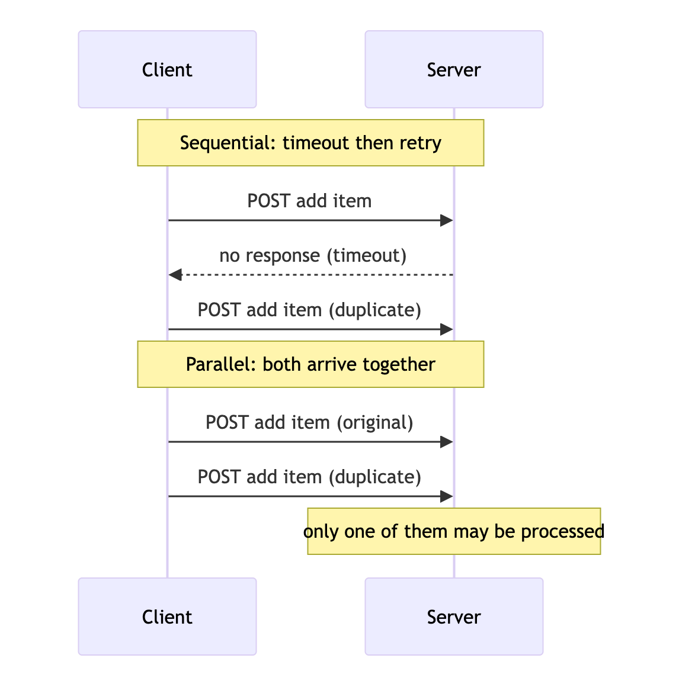
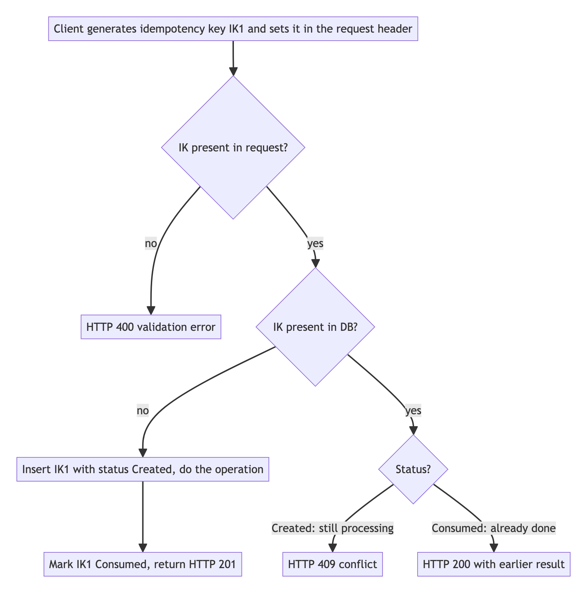
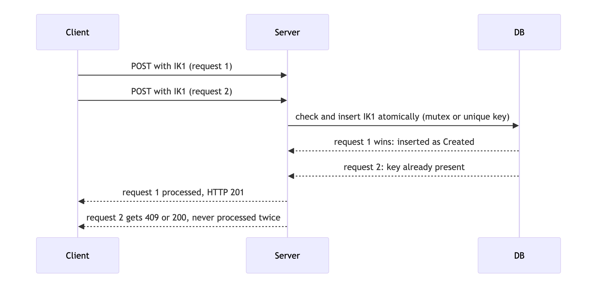

# Design Idempotency Handler – Idempotent POST API (HLD #14 – Lecture 51)

<!-- nav -->
⬅ [12 & 36 Rate Limiter](12_36_Rate_Limiter_Notes.md) · [Index](00_HLD_Index.md) · [15 High Availability Architecture](15_High_Availability_Architecture_Notes.md) ➡
<!-- nav -->

Source (handwritten, 4 pages): https://drive.google.com/file/d/1pzl_Pr0iUD3jyRUtS58Sq9DyCsrr2dmE/view?usp=drive_link

---

## 1. Idempotency vs Concurrency
- **Concurrency** – many requests (R) hitting the **same resource** at the same time (example in notes: **BookMyShow** seat).
- **Idempotency** helps to **take care of duplicate requests**.
- ✱ It enables clients to **safely retry an operation without worrying about the side effect** the operation can cause.

Example operation: **adding an item into a cart** – `POST` followed by a duplicate `POST` would **create another row**.

<!-- isw:14-0 -->
**In simple words**

**Concurrency** means many requests reach the **same resource at the same time** (the notes' example is a BookMyShow seat). **Idempotency** is about **duplicate requests**: it lets a client **safely retry an operation without worrying about the side effects.** The example operation is **adding an item to a cart**: a `POST` followed by a duplicate `POST` would **create another row.**
<!-- /isw:14-0 -->

---

## 2. Which HTTP methods are idempotent?
1. **By default GET, PUT and DELETE are idempotent in nature.**
2. **POST is NOT idempotent**, and **we have to make it idempotent.**

| Method | Behaviour on repeats |
|---|---|
| **GET** | Repeated `GET`s – **no side effect**; any time the client sends a GET the server returns the data. |
| **PUT** | e.g. "update name HS → Himanshu": repeating the same PUT many times leaves the **same final state** (name = Himanshu). |
| **POST** | Not idempotent. Example – payment **HS → Hardik ₹10**: 1st time: HS −10, Hardik +10. A repeated POST debits HS another −10 and credits Hardik another +10, and so on. **Money is moved multiple times.** |

<!-- isw:14-1 -->
**In simple words**

**GET, PUT and DELETE are idempotent by default; POST is not, and we have to make it idempotent.** The table explains why:
- **GET:** repeating it has **no side effect**; the server just returns the data.
- **PUT:** for example "update name HS → Himanshu": repeating the same PUT many times leaves the **same final state** (name = Himanshu).
- **POST:** for example a payment HS → Hardik ₹10: the first time HS −10 and Hardik +10; a repeated POST debits HS another 10 and credits Hardik another 10, and so on. **The money is moved many times.**
<!-- /isw:14-1 -->

---

## 3. How can duplicate POSTs come? (two types of side effect)

<!-- diagram:14-0 -->
**Diagram – Sequential and parallel duplicates**

<!-- /diagram:14-0 -->

1. **Sequential** – client sends `POST` (e.g. "add item to cart"), the call **times out**, client sends a **duplicate/retry POST**. Server may already have processed the first one → *how do we handle this?*
2. **Parallel** – the **original POST** and a **duplicate POST** arrive at (almost) the same time → *how to handle? Only **one** request should be processed.*

<!-- isw:14-2 -->
**In simple words**

Duplicates come in two ways:
1. **Sequential:** the client sends a `POST` (for example "add item to cart"), the call **times out**, and the client sends a **duplicate / retry POST.** The server may already have processed the first one, so how do we handle this?
2. **Parallel:** the **original POST and the duplicate arrive at almost the same time.** Only **one** of them should be processed.
<!-- /isw:14-2 -->

---

## 4. Approach: Idempotency Key (IK)
Use an **Idempotency Key** – a **unique UUID**, appended/associated with the operation.

**Agreement with clients**
1. The **client should generate the idempotency key**.
2. **For each different operation, a new idempotency key** must be generated (retries of the *same* operation reuse the same key).

**IK life-cycle:** `Created / Acquired` → `Consumed / Claimed`

### Flow – sequential duplicates

<!-- diagram:14-1 -->
**Diagram – Idempotency key flow**

<!-- /diagram:14-1 -->

`POST /addItem` (header `IK: IK1`)

1. **Client generates** an Idempotency Key (the original and its duplicate/retry use the same key).
2. Client **sets the IK in the request header** and calls the server.
3. **Validation – is the IK present in the request?**
   - **No → HTTP 400** (validation error).
   - Yes → continue.
4. Server **reads the idempotency key** and **checks the DB – is the IK present?**
5. **IK present in DB →** check its **status**:
   - `Created` (still being processed) → **HTTP 409** (conflict).
   - `Consumed` (already completed) → **HTTP 200** (return the earlier result, don't redo the work).
6. **IK not present in DB →** the server **puts an entry in the DB** (`Key = IK1, Status = Created`), then performs the operation. If the call/operation **succeeds**, it **consumes/claims the IK** (status → `Consumed`) and returns **HTTP 201**.

DB table: `| Key | Status |` e.g. `| IK1 | Created → Consumed |`.

<!-- isw:14-4 -->
**In simple words**

For `POST /addItem` with the header `IK: IK1`:
1. The client generates the key (the original and its retry use the same key).
2. The client puts it in the **request header** and calls the server.
3. **Validation:** is the IK present in the request? **No → HTTP 400** (validation error). Yes → continue.
4. The server reads the key and **checks the DB: is this IK present?**
5. **If the IK is in the DB,** check its **status:** `Created` (still being processed) → **HTTP 409** (conflict); `Consumed` (already completed) → **HTTP 200** (return the earlier result, do not do the work again).
6. **If the IK is not in the DB,** the server **puts an entry** (`Key = IK1, Status = Created`) and performs the operation. When it **succeeds,** the key is **consumed** (status → `Consumed`) and the server returns **HTTP 201.**

The DB table is `| Key | Status |`, for example `IK1 | Created → Consumed`. *(Transcription caveat: pages 3–4 of the PDF are rotated hand-drawn flowcharts, so the exact status codes were read from the diagram and are the most likely interpretation.)*
<!-- /isw:14-4 -->

### Flow – parallel duplicates

<!-- diagram:14-2 -->
**Diagram – Parallel duplicates: only one request wins**

<!-- /diagram:14-2 -->

Two requests `POST /addItem` with **the same IK (IK1)** arrive simultaneously.

1. Client generates IK and sets it in the request header.
2. Server receives both requests (header = IK1 and header = IK1).
3. Validate that the IK is present (else HTTP 400).
4. Server reads the IK from the DB – the **check-and-insert must be a *critical section***, protected by a **Mutex / synchronized** (or an atomic DB operation such as a unique key insert), so that **only one request wins**:
   - The winner **puts the entry in DB** (`IK1, Created`), executes the operation, then marks it `Consumed` → **HTTP 201**.
   - The other request sees the IK already present (`Created`/`Consumed`) → handled per the table above (409 / 200) – **never processed twice**.

> ⚠️ Pages 3–4 of the original are rotated hand-drawn flowcharts; the exact status-code labels (409 for Created, 200 for Consumed, 201 for first success, 400 for missing key) were read from the diagram and are the most likely interpretation.

<!-- isw:14-3 -->
**In simple words**

The approach is to use an **Idempotency Key (IK): a unique UUID** tied to the operation. There is an **agreement with the clients:** (1) the **client generates** the key, and (2) **a new key is generated for each different operation** (a retry of the same operation reuses the same key). The key's life cycle is **Created / Acquired → Consumed / Claimed.**
<!-- /isw:14-3 -->

<!-- isw:14-5 -->
**In simple words**

Two requests with **the same key (IK1)** arrive together. The server validates that the IK is present (else 400). Then reading the IK from the DB and inserting it must be a **critical section**, protected by a **mutex / synchronized** (or an atomic DB operation such as a unique-key insert), so that **only one request wins.** The winner puts the entry (`IK1, Created`), does the operation, marks it `Consumed` and returns **HTTP 201.** The other request finds the key already present (`Created` or `Consumed`) and is handled as in the table above (409 or 200), so it is **never processed twice.**
<!-- /isw:14-5 -->

---

## Quick revision
- GET / PUT / DELETE are naturally idempotent; **POST must be made idempotent**.
- Duplicates occur **sequentially (timeout → retry)** or **in parallel**.
- Solution: **client-generated unique Idempotency Key** sent in a header, **stored in DB with status** (`Created` → `Consumed`), with the check-and-insert done **atomically (mutex/unique constraint)**.
- Responses: missing key → 400; in-progress duplicate → 409; completed duplicate → 200 (same result); first success → 201.
- Needed so that **retries** (see [Retry Pattern](38_Retry_Pattern_Notes.md)) are safe.

---

<!-- nav -->
⬅ [12 & 36 Rate Limiter](12_36_Rate_Limiter_Notes.md) · [Index](00_HLD_Index.md) · [15 High Availability Architecture](15_High_Availability_Architecture_Notes.md) ➡
<!-- nav -->
