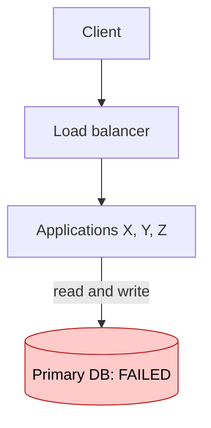
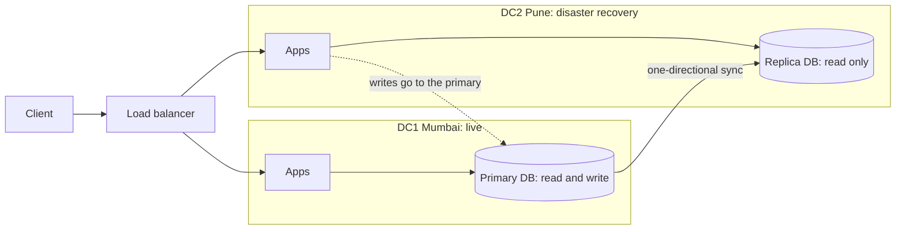
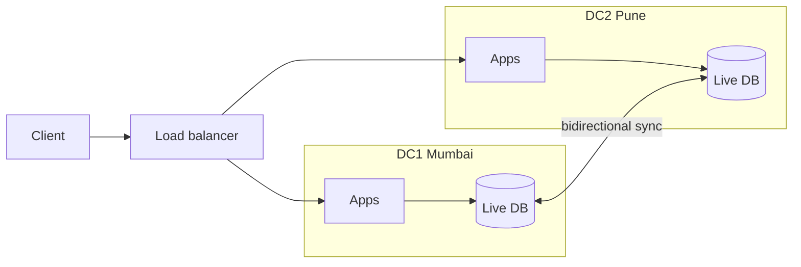

# Design High Availability Architecture (HLD #15 – Lecture 52)

<!-- nav -->
⬅ [14 Idempotent POST API](14_Idempotent_POST_API_Notes.md) · [Index](00_HLD_Index.md) · [16 Distributed Messaging Queue](16_Distributed_Messaging_Queue_Notes.md) ➡
<!-- nav -->

Source (handwritten, 6 pages): https://drive.google.com/file/d/1k7OUopYnC2fpEHDLw-zbFDdyNvoba4mo/view?usp=drive_link

---

## 1. The question can be asked in many forms
- Design **Data Resiliency** architecture. *(think "5 9's" – five nines)*
- Design architecture to achieve **99.999 % availability.**
- Design to **avoid a SINGLE POINT OF FAILURE.** ✔
- **Active-Passive vs Active-Active** architecture.

**Resiliency** = *the capability to come out of a failure.*

**Question:** what issue is there – why are all these goals **not achieved with a single node**, and how can we do it?

<!-- isw:15-0 -->
**In simple words**

The same question can be asked in different ways: design a **data-resiliency** architecture (think "five nines"), design for **99.999 % availability**, design to **avoid a single point of failure**, or explain **active-passive vs active-active.** The notes define **resiliency as the capability to come out of a failure.** The question to answer is: why are these goals **not achieved with a single node**, and how can we achieve them?
<!-- /isw:15-0 -->


---

## 2. Single node

<!-- diagram:15-0 -->
**Diagram – A single database is a single point of failure**


<!-- /diagram:15-0 -->


```
 Client (mobile / PC)
      │
 Load Balancer
      │
 Application X | Application Y | Application Z  (multiple instances of each)
      │  Read ✗ / Write ✗
   Primary DB   ← FAILURE
```
- If the **DB goes down** (failure happens) – what happens now?
- **Answer: the whole application is down.** The DB is a single point of failure.

<!-- isw:15-1 -->
**In simple words**

The picture shows a client (mobile / PC), a **load balancer**, several applications (X, Y, Z) and **one primary DB.** If the **DB goes down** (the failure), reads and writes both fail, and the notes' answer is: **the whole application is down.** The single DB is the single point of failure.
<!-- /isw:15-1 -->


---

## 3. Multi-node – two types
**① Active-Passive** · **② Active-Active**

### ① Active-Passive

<!-- diagram:15-1 -->
**Diagram – Active-passive: one live primary, one replica**


<!-- /diagram:15-1 -->


- **Every company has at least two data centres** (e.g. **DC1 – Mumbai**, **DC2 – Pune**).
- Flow: Client → Load Balancer → DC1 apps (and DC2 apps).
  - **Write (POST)** and **Read (GET)** requests go to apps in DC1; apps in DC2 only **read**.
  - The **Primary DB** (also called **Live DB / Read-Write DB**) lives in DC1; DC2 has a **Replica** DB.
  - **Sync-up is one-directional** (Primary → Replica).
  - Any **write request from DC2's apps is routed to the primary** in DC1.
  - **DR = Disaster Recovery data centre** (DC2).
- In an active-passive architecture, **out of two data centres – or even many more than two – only one can be the primary / live / read-write DB.** The others are treated as **replicas.**

**Problem:** resources are **not utilized well** – **DB2 is free, why can't we use it?**
1. **Reason:** **Oracle / MySQL / PostgreSQL are not multi-master** – they can **write into only one primary DB.** So whenever any **write (POST)** request comes → it goes to the **Live DB.**

**How is it data-resilient / how does it avoid the single point of failure?**
- If the **primary DB goes down**, we can easily **shift from primary DB to the replica – make the replica the primary.**
- **Note:** if the main DB is down, we **route the traffic of that data centre to the disaster recovery data centre and change it into the primary (read-write) DB.**

**Disadvantages**
1. **Latency add-on** – e.g. DC1 (Mumbai, primary) takes 1 s to process a request; once DB fails and traffic is rerouted to DC2 (Pune, DR, now primary) the cross-data-centre hop adds latency (DC2 ≈ 2 s).
2. If DB failure happens, we must **route the traffic to the DR data centre** (a manual/automated failover step).

<!-- isw:15-3 -->
**In simple words**

- **Every company has at least two data centres**, for example **DC1 in Mumbai** and **DC2 in Pune.**
- The flow is client → load balancer → the apps in DC1 (and DC2). **Write (POST) and read (GET) requests go to the apps in DC1; the apps in DC2 only read.**
- The **primary DB** (also called the **live DB / read-write DB**) is in DC1, and DC2 has a **replica** DB. **The sync is one-directional** (primary → replica). A **write request from DC2's apps is routed to the primary** in DC1. **DR = Disaster Recovery data centre** (DC2).
- In active-passive, **out of two data centres (or even more) only one can be the primary / live / read-write DB; the others are replicas.**

**Problem:** the resources are **not used well**, since DB2 is free. **Reason:** **Oracle, MySQL and PostgreSQL are not multi-master**; they can **write into only one primary DB**, so every write (POST) goes to the live DB.

**How it avoids the single point of failure:** if the **primary DB goes down, we can shift from the primary to the replica and make the replica the primary.** The traffic of that data centre is routed to the disaster-recovery data centre, which is changed into the primary (read-write) DB.

**Disadvantages:** (1) **Added latency,** for example DC1 (Mumbai, primary) takes 1 s for a request, and after a failure DC2 (Pune, now primary) takes about 2 s because of the extra hop between data centres. (2) When the DB fails, we must **route the traffic to the DR data centre.**
<!-- /isw:15-3 -->


### ② Active-Active

<!-- diagram:15-2 -->
**Diagram – Active-active: both data centres read and write**


<!-- /diagram:15-2 -->


- **Cassandra (or other NoSQL) supports multi-master.**
- Diagram: Client → Load Balancer → **DC1 (Mumbai)** and **DC2 (Pune)**; each DC has its own app microservices and its own **Primary / Live DB**; **Sync-up is bidirectional**; **read or write** can go to either DC.

**Advantages**
- **DBs (data centres) are fully utilized** very well.
- Can **handle more traffic**, because **both DBs accept read/write.**
- Any update in DC1 goes to DC2, and any update in DC2 goes to DC1.

**Disadvantages (conflicts)**
- A change can happen **on the same row at the same time** in both data centres; as they replicate to each other, **there will be a conflict.**
- A **write** happens on DC1 and a **read** on DC2 **simultaneously, before the sync-up happens** → the read sees stale data.
- **A whole lot of things go into synchronization – there are lots of difficulties in managing conflicts.**

<!-- isw:15-2 -->
**In simple words**

With more than one node there are two types: **① Active-Passive** and **② Active-Active.**
<!-- /isw:15-2 -->

<!-- isw:15-4 -->
**In simple words**

- **Cassandra (or another NoSQL DB) supports multi-master.**
- Both data centres, **DC1 (Mumbai) and DC2 (Pune),** have their own microservices and their own **primary / live DB.** The **sync is bidirectional**, and a **read or write can go to either data centre.**

**Advantages:** **the DBs (data centres) are fully used**, more traffic can be handled **because both DBs accept reads and writes**, and every update in DC1 goes to DC2 and every update in DC2 goes to DC1.

**Disadvantages (conflicts):** the **same row can be changed at the same time in both data centres**, and when they replicate to each other **there will be a conflict.** Also a **write on DC1 and a read on DC2 at the same moment, before the sync, gives stale data.** The notes sum it up: **a whole lot of things go into the synchronisation, and managing conflicts is difficult.**
<!-- /isw:15-4 -->


---

## 4. Comparison
| | Active-Passive | Active-Active |
|---|---|---|
| Writes | only to **one primary** (live) DB | to **any** DC (multi-master) |
| Replication | **one-directional** (primary → replica) | **bidirectional** |
| Resource use | replica/DR idle → poor utilization | all DBs fully used, more traffic handled |
| Failover | promote replica / route traffic to DR DC | already serving – no promotion needed |
| Typical DBs | Oracle, MySQL, PostgreSQL (not multi-master) | Cassandra / other NoSQL (multi-master) |
| Main drawback | latency add-on + failover step | **write conflicts**, complex synchronization, stale reads |

<!-- isw:15-5 -->
**In simple words**

The table puts the two side by side: in **active-passive** writes go to **one primary only**, replication is **one-directional**, the replica is idle (poor use), failover means promoting the replica, it fits **Oracle / MySQL / PostgreSQL**, and the main drawback is **added latency plus the failover step.** In **active-active** writes go to **any data centre**, replication is **bidirectional**, all DBs are used, no promotion is needed, it needs **Cassandra or another multi-master NoSQL DB**, and the main drawback is **write conflicts, complex synchronisation and stale reads.**
<!-- /isw:15-5 -->


---

## Quick revision
- Single node (esp. the DB) = single point of failure → whole app down.
- Remove SPOF with **multiple nodes / data centres**; goal e.g. **99.999 % (five nines)**.
- **Active-Passive:** one live primary + replica(s) (DR); failover = promote replica.
- **Active-Active:** every DC read/write, bi-directional sync; needs multi-master DB; must handle **conflicts**.
- Related: [CAP Theorem](02_CAP_Theorem_Notes.md), [Distributed Transactions](20_Distributed_Transactions_Notes.md).

---

<!-- nav -->
⬅ [14 Idempotent POST API](14_Idempotent_POST_API_Notes.md) · [Index](00_HLD_Index.md) · [16 Distributed Messaging Queue](16_Distributed_Messaging_Queue_Notes.md) ➡
<!-- nav -->
