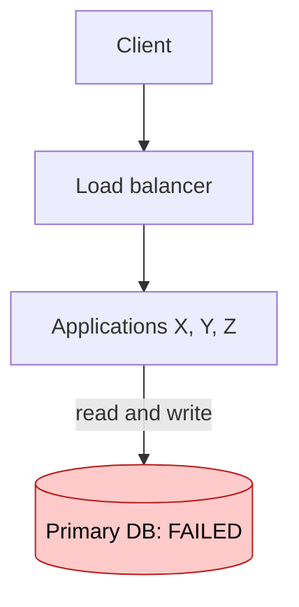
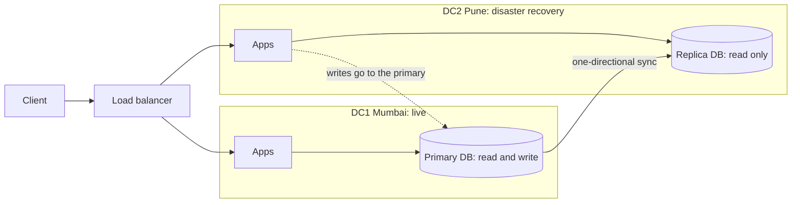
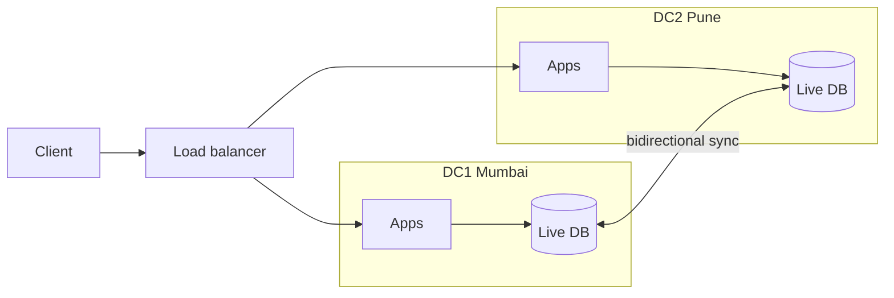

# Design High Availability Architecture (HLD #15 – Lecture 52)

<!-- nav -->
⬅ [14 Idempotent POST API](14_Idempotent_POST_API_Notes.md) · [Index](00_HLD_Index.md) · [16 Distributed Messaging Queue](16_Distributed_Messaging_Queue_Notes.md) ➡
<!-- nav -->

Source (handwritten, 6 pages): https://drive.google.com/file/d/1k7OUopYnC2fpEHDLw-zbFDdyNvoba4mo/view?usp=drive_link

---

<!-- simple-explanation -->
## In simple words – high availability architecture

### What is being asked?
Interviewers phrase this in different ways, but they all mean the same: **"Design the system so it keeps working even when something breaks."**
- *High availability* – e.g. **99.999 % uptime ("five nines")**, which allows only about 5 minutes of downtime per year.
- *Resiliency* – the ability to recover from a failure.
- *No single point of failure (SPOF)* – no one component whose failure takes everything down.

### Why a single node isn't enough
Imagine a load balancer, several application servers, and **one** primary database. You've made the app servers redundant, but if the database fails, **every read and write fails and the whole application is down**. The database is the single point of failure. The fix is to have **more than one database, in more than one place** (data centre).

### Option 1 – Active-Passive
- A company runs at least two data centres, say **DC1 in Mumbai** and **DC2 in Pune**.
- The **primary (live) database** that accepts reads *and writes* sits in DC1. DC2 holds a **replica** that just copies the primary. Copying goes one way only: primary → replica.
- Apps in DC2 can read from their local replica, but any **write** must travel to the primary in DC1.
- DC2 is also called the **DR (Disaster Recovery)** site.
- **If the primary fails**, you promote the replica to be the new primary and route traffic to DC2. No data is lost, and the SPOF is gone.

Why only one primary? Databases like **Oracle, MySQL and PostgreSQL are not multi-master**: they allow writes on only one node.

**Downsides**
- **Wasted resources** – the replica sits mostly idle.
- **Extra latency** after failover, because traffic now crosses to a farther data centre.
- Failover is a step someone (or something) must trigger.

### Option 2 – Active-Active
- Both data centres have a live database that accepts **reads and writes**, and they **synchronise both ways**. This needs a **multi-master** database such as **Cassandra** (NoSQL).
- Advantages: every database is fully used, you can handle **more traffic**, and if one data centre dies the other is already serving, so there is no promotion step.

**Downsides: conflicts**
- Two users may change **the same row at the same time** in different data centres. When the data syncs, which value wins?
- A write on DC1 and a read on DC2 at nearly the same moment may return **stale data** because the sync hasn't arrived yet.
- Handling these conflicts and keeping the data in sync is hard.

### Quick comparison
| | Active-Passive | Active-Active |
|---|---|---|
| Who accepts writes | only the primary | every data centre |
| Copy direction | one way | both ways |
| Idle resources | yes (replica) | no |
| Main problem | latency and failover step | write conflicts, stale reads |

(This ties back to the [CAP theorem](02_CAP_Theorem_Notes.md): active-active leans towards availability and has to settle consistency later.)
<!-- simple-explanation -->


## 1. The question can be asked in many forms
- Design **Data Resiliency** architecture. *(think "5 9's" – five nines)*
- Design architecture to achieve **99.999 % availability.**
- Design to **avoid a SINGLE POINT OF FAILURE.** ✔
- **Active-Passive vs Active-Active** architecture.

**Resiliency** = *the capability to come out of a failure.*

**Question:** what issue is there – why are all these goals **not achieved with a single node**, and how can we do it?

---

## 2. Single node

<!-- diagram:15-0 -->
**Diagram – A single database is a single point of failure**


<!-- /diagram:15-0 -->


```
 Client (mobile / PC)
      │
 Load Balancer
      │
 Application X | Application Y | Application Z  (multiple instances of each)
      │  Read ✗ / Write ✗
   Primary DB   ← FAILURE
```
- If the **DB goes down** (failure happens) – what happens now?
- **Answer: the whole application is down.** The DB is a single point of failure.

---

## 3. Multi-node – two types
**① Active-Passive** · **② Active-Active**

### ① Active-Passive

<!-- diagram:15-1 -->
**Diagram – Active-passive: one live primary, one replica**


<!-- /diagram:15-1 -->


- **Every company has at least two data centres** (e.g. **DC1 – Mumbai**, **DC2 – Pune**).
- Flow: Client → Load Balancer → DC1 apps (and DC2 apps).
  - **Write (POST)** and **Read (GET)** requests go to apps in DC1; apps in DC2 only **read**.
  - The **Primary DB** (also called **Live DB / Read-Write DB**) lives in DC1; DC2 has a **Replica** DB.
  - **Sync-up is one-directional** (Primary → Replica).
  - Any **write request from DC2's apps is routed to the primary** in DC1.
  - **DR = Disaster Recovery data centre** (DC2).
- In an active-passive architecture, **out of two data centres – or even many more than two – only one can be the primary / live / read-write DB.** The others are treated as **replicas.**

**Problem:** resources are **not utilized well** – **DB2 is free, why can't we use it?**
1. **Reason:** **Oracle / MySQL / PostgreSQL are not multi-master** – they can **write into only one primary DB.** So whenever any **write (POST)** request comes → it goes to the **Live DB.**

**How is it data-resilient / how does it avoid the single point of failure?**
- If the **primary DB goes down**, we can easily **shift from primary DB to the replica – make the replica the primary.**
- **Note:** if the main DB is down, we **route the traffic of that data centre to the disaster recovery data centre and change it into the primary (read-write) DB.**

**Disadvantages**
1. **Latency add-on** – e.g. DC1 (Mumbai, primary) takes 1 s to process a request; once DB fails and traffic is rerouted to DC2 (Pune, DR, now primary) the cross-data-centre hop adds latency (DC2 ≈ 2 s).
2. If DB failure happens, we must **route the traffic to the DR data centre** (a manual/automated failover step).

### ② Active-Active

<!-- diagram:15-2 -->
**Diagram – Active-active: both data centres read and write**


<!-- /diagram:15-2 -->


- **Cassandra (or other NoSQL) supports multi-master.**
- Diagram: Client → Load Balancer → **DC1 (Mumbai)** and **DC2 (Pune)**; each DC has its own app microservices and its own **Primary / Live DB**; **Sync-up is bidirectional**; **read or write** can go to either DC.

**Advantages**
- **DBs (data centres) are fully utilized** very well.
- Can **handle more traffic**, because **both DBs accept read/write.**
- Any update in DC1 goes to DC2, and any update in DC2 goes to DC1.

**Disadvantages (conflicts)**
- A change can happen **on the same row at the same time** in both data centres; as they replicate to each other, **there will be a conflict.**
- A **write** happens on DC1 and a **read** on DC2 **simultaneously, before the sync-up happens** → the read sees stale data.
- **A whole lot of things go into synchronization – there are lots of difficulties in managing conflicts.**

---

## 4. Comparison
| | Active-Passive | Active-Active |
|---|---|---|
| Writes | only to **one primary** (live) DB | to **any** DC (multi-master) |
| Replication | **one-directional** (primary → replica) | **bidirectional** |
| Resource use | replica/DR idle → poor utilization | all DBs fully used, more traffic handled |
| Failover | promote replica / route traffic to DR DC | already serving – no promotion needed |
| Typical DBs | Oracle, MySQL, PostgreSQL (not multi-master) | Cassandra / other NoSQL (multi-master) |
| Main drawback | latency add-on + failover step | **write conflicts**, complex synchronization, stale reads |

---

## Quick revision
- Single node (esp. the DB) = single point of failure → whole app down.
- Remove SPOF with **multiple nodes / data centres**; goal e.g. **99.999 % (five nines)**.
- **Active-Passive:** one live primary + replica(s) (DR); failover = promote replica.
- **Active-Active:** every DC read/write, bi-directional sync; needs multi-master DB; must handle **conflicts**.
- Related: [CAP Theorem](02_CAP_Theorem_Notes.md), [Distributed Transactions](20_Distributed_Transactions_Notes.md).

---

<!-- nav -->
⬅ [14 Idempotent POST API](14_Idempotent_POST_API_Notes.md) · [Index](00_HLD_Index.md) · [16 Distributed Messaging Queue](16_Distributed_Messaging_Queue_Notes.md) ➡
<!-- nav -->
