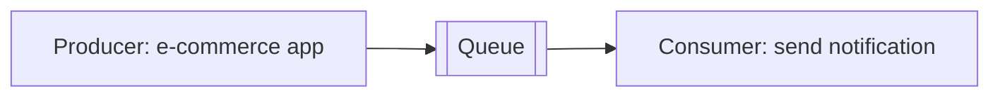
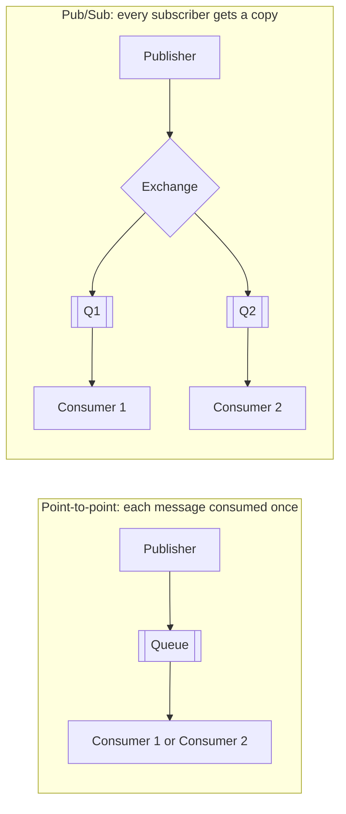
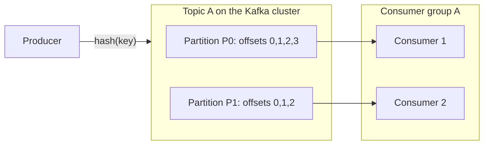
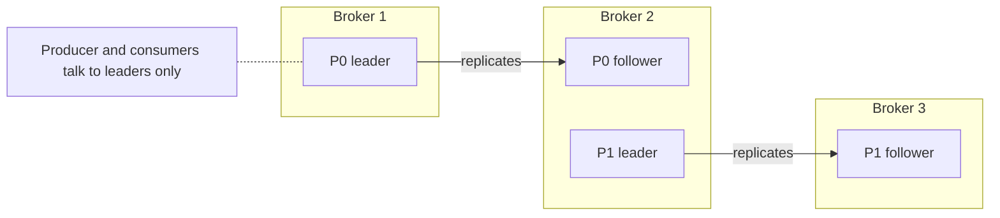
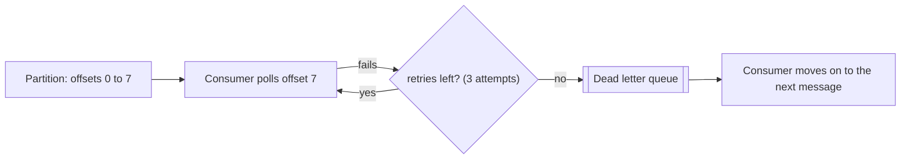
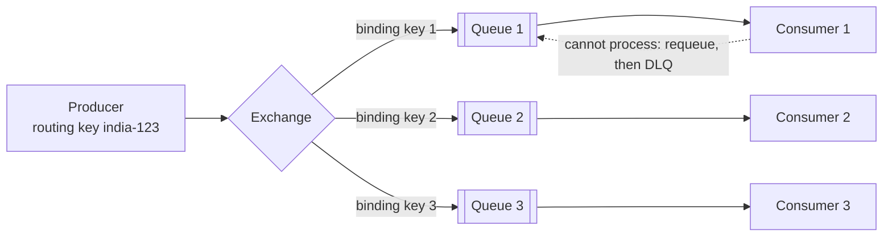

# Distributed Messaging Queue (HLD #16 – Lecture 53)

<!-- nav -->
⬅ [15 High Availability Architecture](15_High_Availability_Architecture_Notes.md) · [Index](00_HLD_Index.md) · [17 Proxy vs Reverse Proxy](17_Proxy_vs_Reverse_Proxy_Notes.md) ➡
<!-- nav -->

Source (handwritten, 10 pages): https://drive.google.com/file/d/1kfnXbRlobCeK-U9kT56nyXI-4VY9EBAo/view?usp=drive_link

## Questions this note answers
1. What is a messaging queue? Why is it needed & its advantages?
2. What is Point-to-Point (P2P) and Pub/Sub messaging?
3. How does a messaging queue work? – **Kafka** and **RabbitMQ**
4. What happens when the queue size limit is reached? → **we add a different broker.**
5. What happens to messages when the queue goes down? → **we make a follower the leader (replication).**
6. What happens when a consumer goes down? → **another consumer takes over.**
7. What happens when a consumer is not able to process a message?
8. How does retry work? Different ways to retry?
9. How does a distributed messaging queue work?
10. What is a Dead Letter Queue?

---

## 1. Messaging queue & why it's needed

<!-- diagram:16-0 -->
**Diagram – Producer, queue, consumer**

<!-- /diagram:16-0 -->

**Messaging queue:** a **producer** produces a message; the message goes into a particular **queue**; a **consumer** reads the messages.
`Producer → [ queue ] → Consumer`

### Use case 1 – Asynchronous nature
E-commerce app (producer): the user clicks **Buy** → we must send a notification/mail – **but the user shouldn't have to actually wait for that notification.** The producer drops a message on the async queue; the **"Send notification" consumer** processes it (if the consumer is down, the message stays in the queue).

**Advantages**
1. **Latency improves** (the user isn't blocked).
2. **Retry capabilities.**
3. **Pace matching** – E-commerce produces 10 msg/s, Inventory management 20 msg/s and App XYZ 30 msg/s, but the notification service can handle only **15 msg/s**. All three put messages into one queue and the consumer **consumes them at its own pace.**
4. **Smoothing bursts** – e.g. cab GPS: every cab sends its car ID + current location every 10 s; the consumer application builds a **dashboard** of car locations from the queue and processes at its own rate.

<!-- isw:16-0 -->
**In simple words**

A **messaging queue** works like this: a **producer** produces a message, the message goes into a particular **queue**, and a **consumer** reads the messages (`Producer → queue → Consumer`).
<!-- /isw:16-0 -->

<!-- isw:16-1 -->
**In simple words**

In an e-commerce app (the producer), when the user clicks **Buy** a notification or mail must be sent, **but the user should not have to wait for it.** The producer puts a message on the async queue and the **"send notification" consumer** processes it (if that consumer is down, the message stays in the queue).

The advantages listed: (1) **latency improves,** because the user is not blocked; (2) **retry capability;** (3) **pace matching:** E-commerce produces 10 messages/s, Inventory management 20/s and another app 30/s, but the notification service can handle only **15/s**; all three put messages in one queue and the consumer **takes them at its own pace;** (4) **smoothing bursts:** for example every cab sends its car ID and location every 10 s and the consumer builds a **dashboard** from the queue at its own rate.
<!-- /isw:16-1 -->

## 2. Point-to-Point (P2P) vs Pub/Sub

<!-- diagram:16-1 -->
**Diagram – Point-to-point versus publish/subscribe**

<!-- /diagram:16-1 -->

- **P2P:** publisher → queue → **only one consumer** processes each message. A message is **consumed/processed only once** – by either Consumer 1 or Consumer 2, **but only once.**
- **Pub/Sub:** publisher → **exchange (with logic)** → **multiple queues (Q1, Q2)** → each consumer. Whenever a message comes in, based on the logic the exchange **puts/broadcasts the message to all the queues**, and **both consumers consume and process the message.**

<!-- isw:16-2 -->
**In simple words**

- **Point-to-point:** publisher → queue → **only one consumer processes each message.** A message is **consumed once**, by either consumer 1 or consumer 2, **but only once.**
- **Pub/Sub:** publisher → **exchange (with logic)** → **several queues (Q1, Q2)** → their consumers. When a message comes in, the exchange **puts or broadcasts it to all the queues**, and **both consumers consume and process it.**
<!-- /isw:16-2 -->

---

## 3. How a messaging queue works – ① Kafka

### Components

<!-- diagram:16-2 -->
**Diagram – Kafka: topic, partitions and consumer group**

<!-- /diagram:16-2 -->

1. **Producer** – sends messages.
2. **Consumer** – **reads from a partition.**
3. **Consumer Group** – each consumer is part of a consumer group.
4. **Topic** – like a category/channel where data is stored and organised (data is stored on partitions only).
5. **Partition** – a small part of a topic; helps in **distributing and processing data efficiently**; partitions can have different lengths.
6. **Offset** – the position of a message inside a partition (like an index in a queue; each partition has its own offsets 0,1,2,…).
7. **Broker** – a **Kafka server**; the producer talks to the broker.
8. **Cluster** – **a group of brokers** (each running on a different machine/node).
9. **ZooKeeper** – helps the brokers **interact with each other** and keeps internal metadata (e.g. which partition of Topic 1 lives on which broker).

**Rule:** inside one consumer group, **one partition is consumed by only one consumer** – e.g. Topic A has partitions P0 and P1; if Consumer 1 uses P0, Consumer 2 takes P1, but Consumer 2 can't also take P0. If P0 must be read by another consumer, that consumer must be in a **different consumer group.**

<!-- isw:16-3 -->
**In simple words**

Kafka's parts, as listed in the notes: **producer** (sends messages), **consumer** (**reads from a partition**), **consumer group** (each consumer is part of one), **topic** (a category or channel where data is stored and organised; data is kept on partitions only), **partition** (a small part of a topic that helps distribute and process data efficiently; partitions can have different lengths), **offset** (the position of a message inside a partition, like an index: 0, 1, 2, …, and each partition has its own), **broker** (a **Kafka server**; the producer talks to it), **cluster** (**a group of brokers**, each on a different machine) and **ZooKeeper** (helps the brokers interact and keeps metadata, for example which partition of Topic 1 lives on which broker).

**The rule:** inside one consumer group, **one partition is consumed by only one consumer.** Example: Topic A has partitions P0 and P1; if consumer 1 uses P0, consumer 2 takes P1, but consumer 2 cannot also take P0. If P0 must be read by another consumer, that consumer must be in a **different consumer group.**
<!-- /isw:16-3 -->

### How a message flows
- **Message has:** **Key** (string/id, optional), **Value** (actual message), **Partition** (empty unless specified), **Topic** (topic name).
- The producer sends `key: 123456…` → **hash(key) → partition** (e.g. P1). Messages with the same key always land in the same partition.
- Consumer 1 (Consumer Group A) reads Topic A / Partition P0 and has a **committed offset = 3** (kept in Kafka/ZooKeeper per consumer-group+topic+partition) – **the offset tells how far the consumer has read**, so after a crash it resumes from there.

<!-- isw:16-4 -->
**In simple words**

A message has a **key** (optional), a **value** (the actual message), a **partition** (empty unless specified) and a **topic** (name). The producer sends a message with a key and **`hash(key)` decides the partition** (for example P1), so messages with the same key always land in the same partition. A consumer in a group has a **committed offset** (for example 3) stored per consumer-group, topic and partition; **it tells how far the consumer has read**, so after a crash it continues from there.
<!-- /isw:16-4 -->

### Cluster, leader & followers (replication)

<!-- diagram:16-3 -->
**Diagram – Leader and follower replicas across brokers**

<!-- /diagram:16-3 -->

- Broker 1 has Topic 1 / partition P0 and Broker 2 has Topic 1 / partition P1 – **partitions can reside on different Kafka servers.**
- **What if a partition goes down – what happens to its messages?** → that's why we keep a **replica.**
- The partition that is **not a replica is the Leader**; **replicas are Followers.** (e.g. P0 leader on Broker 1 replicated to Broker 2; P1 leader on Broker 2 replicated to Broker 3.)
- **All reads/writes happen through the Leader.** **Whenever the leader goes down, a replica takes over and becomes the leader.**
- A **follower always follows the leader** – any new message that comes in, it takes and adds to its own copy, so it keeps syncing itself from the leader.

<!-- isw:16-5 -->
**In simple words**

Partitions can live on **different Kafka servers** (Broker 1 has P0 of Topic 1, Broker 2 has P1). *What if a partition goes down and its messages are lost?* That is why a **replica** is kept. The partition that is **not a replica is the leader; replicas are followers** (for example P0's leader on Broker 1 is replicated on Broker 2; P1's leader on Broker 2 is replicated on Broker 3). **All reads and writes go through the leader**, and **when the leader goes down a replica takes over and becomes the leader.** A **follower always follows the leader:** every new message is added to its own copy, so it keeps syncing from the leader.
<!-- /isw:16-5 -->

### 7. What happens when a consumer can't process a message?

<!-- diagram:16-4 -->
**Diagram – Retries and the dead letter queue**

<!-- /diagram:16-4 -->

Example: partition offsets 0…6 processed properly; **offset 7 = a buggy message** → the consumer polls it, fails to process.
- **Committed offset** stays at 6 (not moved to 7) so the message would be re-delivered.
- **Retry = 3** – every message is retried 3 times.
- After the retries are exhausted the message is moved to a **Failure / Dead Letter Queue (DLQ)** so the consumer can move on.

**RabbitMQ vs Kafka (delivery model):** **RabbitMQ = push-based approach**; **Kafka = pull-based approach** (consumers poll).

<!-- isw:16-6 -->
**In simple words**

Offsets 0 to 6 are processed fine; **offset 7 is a buggy message**, so the consumer polls it and fails. The **committed offset stays at 6** (it does not move to 7), so the message would be delivered again. **Retry = 3:** every message is retried 3 times. After the retries are used up, the message is moved to a **failure / Dead Letter Queue (DLQ)** so the consumer can move on. The notes add that **RabbitMQ is push-based and Kafka is pull-based** (consumers poll).
<!-- /isw:16-6 -->

---

## 4. RabbitMQ

<!-- diagram:16-5 -->
**Diagram – RabbitMQ: exchange routes by key**

<!-- /diagram:16-5 -->

`Producer → Exchange → (binding/routing key) → Queue 1 / Queue 2 / Queue 3 → Consumer 1 / 2 / 3`
- Producer sends a message with a **routing key** (e.g. `india-123`); the exchange routes it to the queue(s) whose **binding key** matches (Q1 ↔ routing key 1 / `*123`, Q2 ↔ key 2, Q3 ↔ key 3). There can be multiple exchanges.

### Different types of exchange
1. **Fan-out exchange** – pushes the message **to all the queues associated with this exchange.**
2. **Direct exchange** – **exact match** between **message (routing) key and binding key.**
3. **Topic exchange** – can use **wildcards** (e.g. binding `*123` matches routing key `india-123`).

<!-- isw:16-8 -->
**In simple words**

1. **Fan-out exchange** – pushes the message **to all the queues** attached to the exchange.
2. **Direct exchange** – an **exact match** between the **message (routing) key and the binding key.**
3. **Topic exchange** – can use **wildcards** (for example the binding `*123` matches the routing key `india-123`).
<!-- /isw:16-8 -->

### Failure handling in RabbitMQ
If Consumer 1 reads a message but **can't process it**, the message is **re-queued to the back of the queue** (MSG1 requeue) and retried again; after repeated failures it goes to the **Dead Letter Queue.**

<!-- isw:16-7 -->
**In simple words**

The flow is **Producer → Exchange → (binding / routing key) → Queue 1 / 2 / 3 → Consumer 1 / 2 / 3.** The producer sends a message with a **routing key** (for example `india-123`), and the exchange routes it to the queue or queues whose **binding key** matches (Q1 ↔ key 1 or `*123`, Q2 ↔ key 2, Q3 ↔ key 3). There can be several exchanges.
<!-- /isw:16-7 -->

<!-- isw:16-9 -->
**In simple words**

If consumer 1 reads a message but **cannot process it,** the message is **re-queued to the back of the queue** (MSG1 requeue) and tried again; after repeated failures it goes to the **Dead Letter Queue.**
<!-- /isw:16-9 -->

---

## Quick revision
- Queues give **async processing, retry, pace-matching, decoupling**.
- **P2P** = each message consumed once; **Pub/Sub** = broadcast to all subscribed queues.
- **Kafka:** topic → partitions (ordered, offsets) → consumer groups (1 partition ↔ 1 consumer per group); hash(key) → partition; **leader/follower replication** for fault tolerance; **committed offset** = progress; **pull-based**.
- **RabbitMQ:** producer → exchange (**fan-out / direct / topic**) → queues → consumers; **push-based**; failed messages requeued then **DLQ**.
- Scale by **adding brokers/partitions**; queue/broker failure → **follower promoted**; consumer failure → **another consumer in the group takes over**.
- Related: [Scale from 0 to Million](05_Scale_from_Zero_to_Million_Users_Notes.md), [Retry Pattern](38_Retry_Pattern_Notes.md).

---

<!-- nav -->
⬅ [15 High Availability Architecture](15_High_Availability_Architecture_Notes.md) · [Index](00_HLD_Index.md) · [17 Proxy vs Reverse Proxy](17_Proxy_vs_Reverse_Proxy_Notes.md) ➡
<!-- nav -->
