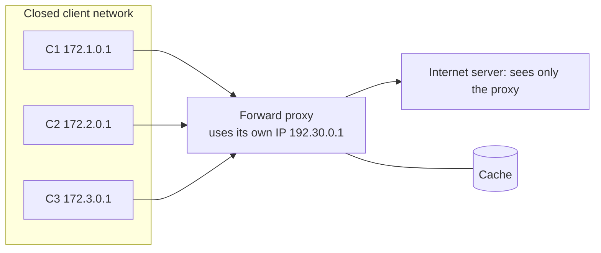
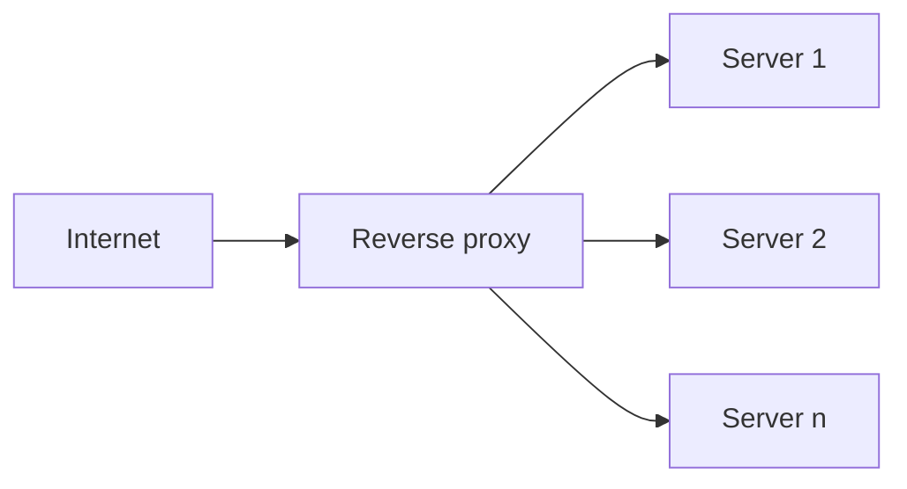
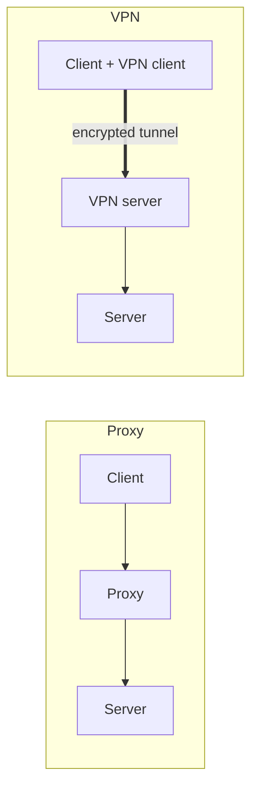
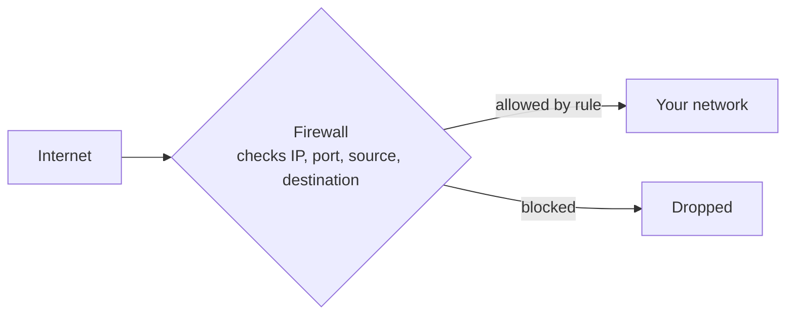

# Proxy vs Reverse Proxy – and how a proxy differs from VPN, Load Balancer, Firewall (HLD #17 – Lecture 54)

<!-- nav -->
⬅ [16 Distributed Messaging Queue](16_Distributed_Messaging_Queue_Notes.md) · [Index](00_HLD_Index.md) · [18 Load Balancer and Algorithms](18_Load_Balancer_and_Algorithms_Notes.md) ➡
<!-- nav -->

Source (handwritten, 6 pages): https://drive.google.com/file/d/18wyJRj2g11NE1Ll1c6GJSiqnhwSao01U/view?usp=drive_link

**Topics covered:** What is a proxy server · its types (Forward proxy, Reverse proxy) · Proxy vs VPN · Proxy vs Load Balancer · Proxy vs Firewall.

---

## 1. What is a Proxy Server?
**Analogy:** a child wants chocolate from the **shop** – instead of going directly, the **mom (proxy)** goes to the shop on the child's behalf and brings it back.

**Technical:** `Client 1 / Client 2 ⇄ Proxy Server ⇄ Server`

> A **proxy server sits between client and server. It acts like an intermediary** between the client and the server. Requests **pass through the proxy – there is no direct interaction** between client and server.

<!-- isw:17-0 -->
**In simple words**

The notes use an analogy: a child wants chocolate from the **shop**, but instead of going directly the **mom (the proxy)** goes to the shop on the child's behalf and brings it back. Technically: `Client 1 / Client 2 ⇄ Proxy server ⇄ Server`. **A proxy server sits between client and server and acts as an intermediary.** The requests **pass through the proxy and there is no direct interaction** between the client and the server.
<!-- /isw:17-0 -->


---

## 2. Types of proxy
They **differ in the direction of communication**: **Forward** and **Reverse**.

### ① Forward proxy (the "simple proxy")

<!-- diagram:17-0 -->
**Diagram – Forward proxy: hides the clients**


<!-- /diagram:17-0 -->


- Sits in front of a **group of clients in a closed network** (clients C1 `172.1.01`, C2 `172.2.01`, C3 `172.3.01`) and connects them to the Internet.
- **What does a forward proxy do?** It **hides the client networks** – the outside server **doesn't know the internal client.**
- **How?** Say client 1 (IP `172.1.01`) makes a request (e.g. `google.com`). The proxy forwards it using **its own IP address** (e.g. `192.30.1`) – "*the proxy is making a request on behalf of C1*". The server only sees the proxy's IP when it gets the request.

**Advantages**
1. **Anonymity for the internal network** – the IP address and location of the clients are **hidden from the outside world**; no server can know where the request comes from.
2. **Grouping of requests** – a proxy can take care of multiple client requests. If several clients make the same `google.com` request, the proxy can **club/group them and send a single request** outside.
3. **Access restricted data or content** – if your country blocks certain content/websites (e.g. in India), with the help of a proxy you can **bypass** it: the request appears to come from a user in e.g. **UK / US**, so country-wise location restrictions don't apply.
4. **Brings security.**
5. **Caching** – the proxy can cache responses (the diagram shows a *Cache* attached to the proxy).

**Disadvantage:** it **works at the application level.**

<!-- isw:17-2 -->
**In simple words**

A forward proxy sits in front of **a group of clients in a closed network** (clients C1 `172.1.01`, C2 `172.2.01`, C3 `172.3.01`) and connects them to the Internet. **What it does: it hides the client networks**, so the outside server **does not know the internal client.** **How:** say client 1 (IP `172.1.01`) requests `google.com`. The proxy forwards the request using **its own IP address** (for example `192.30.1`), as if "the proxy is making a request on behalf of C1", so the server sees only the proxy's IP.

**Advantages:** (1) **anonymity for the internal network:** the clients' IP address and location are hidden from the outside world; (2) **grouping of requests:** if many clients make the same `google.com` request, the proxy can **club them and send a single request** outside; (3) **access restricted content:** if a country blocks some websites (the notes mention India), a proxy lets you **bypass** it, since the request appears to come from a user in, say, the UK or US; (4) **it brings security;** (5) **caching:** the proxy can cache responses (a cache is drawn next to it). **Disadvantage:** it **works at the application level.**
<!-- /isw:17-2 -->


### ② Reverse proxy

<!-- diagram:17-1 -->
**Diagram – Reverse proxy: hides the servers**


<!-- /diagram:17-1 -->


```
 Internet → [ Reverse Proxy ] → Server 1 / Server 2 / … / Server n
```
- A reverse proxy is **like a security guard for your backend servers.** Instead of users talking directly to your servers, they talk to the **reverse proxy, which then forwards the request to the appropriate server.**
- **Example:** a restaurant with a **waiter (reverse proxy)** – customers don't go directly to the **kitchen (backend servers)**; they order through the waiter, who talks to the kitchen and brings the food back.

**Advantages**
- **Security** – the outside world **isn't aware of the servers' IP addresses**; everyone only knows the **reverse proxy's address.**
- **In case of a DDoS attack** – the **attacker can only attack the reverse-proxy server.**
- **CDN is a reverse proxy:** local clients (Paris, US, India) go to their **local CDN** (CDN-Paris, CDN-US, CDN-India) which fetches from the origin server (e.g. in Singapore). An attacker can attack only a CDN, not the origin.
- Also capable of **caching**.
- **Latency** benefit (served from a nearby/cached location).
- **Load-balancer capability** – a reverse proxy can distribute requests across servers.

<!-- isw:17-1 -->
**In simple words**

The two types **differ in the direction of communication:** **forward** and **reverse.**
<!-- /isw:17-1 -->

<!-- isw:17-3 -->
**In simple words**

The picture is `Internet → [Reverse proxy] → Server 1 / Server 2 / … / Server n`. A reverse proxy is **like a security guard for your backend servers:** users talk to the **reverse proxy, which then forwards the request to the right server.** The notes' example is a restaurant: customers do not go directly to the **kitchen (backend servers)**; they order through the **waiter (reverse proxy)**, who talks to the kitchen and brings the food.

**Advantages:** **security** (the outside world does not know the servers' IP addresses, only the reverse proxy's); **in a DDoS attack the attacker can only attack the reverse-proxy server;** a **CDN is a reverse proxy** (local clients in Paris, US and India go to their **local CDN** (CDN-Paris, CDN-US, CDN-India), which fetches from the origin server, for example in Singapore, so an attacker can attack only a CDN, not the origin); it can do **caching;** it gives a **latency** benefit; and it has **load-balancer capability** (it can distribute requests across servers).
<!-- /isw:17-3 -->


---

## 3. Proxy vs VPN

<!-- diagram:17-2 -->
**Diagram – Proxy versus VPN path**


<!-- /diagram:17-2 -->


| | **Proxy** | **VPN** |
|---|---|---|
| Path | `Client → Proxy → Server` | `Client → VPN client (on the home computer) → encrypted VPN tunnel across the Internet → VPN server → Server` |
| What it gives | **Anonymity (IP address masking), caching, logging** | **Encryption of data** – data is encrypted at the client, travels through the tunnel, and is **decrypted at the VPN server** |

<!-- isw:17-4 -->
**In simple words**

With a **proxy** the path is `Client → Proxy → Server`, and it gives **anonymity (IP masking), caching and logging.** With a **VPN** the path is `Client → VPN client (on the home computer) → encrypted VPN tunnel across the Internet → VPN server → Server`, and it gives **encryption of data:** the data is encrypted at the client, travels through the tunnel and is **decrypted at the VPN server.**
<!-- /isw:17-4 -->


---

## 4. Proxy vs Load Balancer
- **A reverse proxy offers IP anonymity, caching, logging – and can act as a load balancer.**
- **A load balancer cannot be a proxy** (it only distributes traffic across Server 1 … Server n).

<!-- isw:17-5 -->
**In simple words**

**A reverse proxy offers IP anonymity, caching and logging, and it can also act as a load balancer.** The notes say **a load balancer cannot be a proxy**, because it only distributes the traffic across Server 1 … Server n.
<!-- /isw:17-5 -->


---

## 5. Proxy vs Firewall

<!-- diagram:17-3 -->
**Diagram – Firewall filters packets by rules**


<!-- /diagram:17-3 -->


- A **firewall** is like a wall with **holes that decide what data may pass** between the Internet and your network – it follows **rules**.
- It does **packet scanning** – looks at the packet **header: port number, IP address, source / destination** – and allows or blocks accordingly.

<!-- isw:17-6 -->
**In simple words**

A **firewall** is like a wall **with holes that decide what data may pass** between the Internet and your network, and it follows **rules.** It does **packet scanning:** it looks at the packet **header (port number, IP address, source and destination)** and allows or blocks the packet accordingly.
<!-- /isw:17-6 -->


---

## Quick revision
- **Forward proxy** = client-side intermediary → **hides clients** (anonymity, group requests, bypass geo-blocks, caching; works at application level).
- **Reverse proxy** = server-side intermediary → **hides servers** (security, DDoS shield, caching, load balancing, CDN = reverse proxy).
- **VPN** = encrypts all traffic via a tunnel; **proxy** = masks IP/caches/logs.
- **Reverse proxy can act as a load balancer; a load balancer can't act as a proxy.**
- **Firewall** = rule-based packet filtering on header info (ports, IPs).

---

<!-- nav -->
⬅ [16 Distributed Messaging Queue](16_Distributed_Messaging_Queue_Notes.md) · [Index](00_HLD_Index.md) · [18 Load Balancer and Algorithms](18_Load_Balancer_and_Algorithms_Notes.md) ➡
<!-- nav -->
