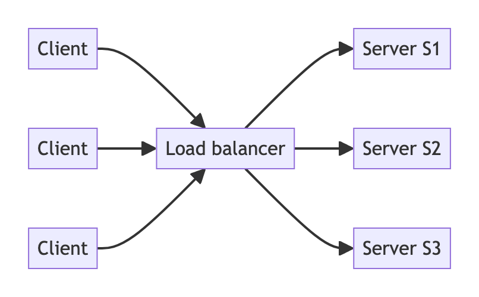
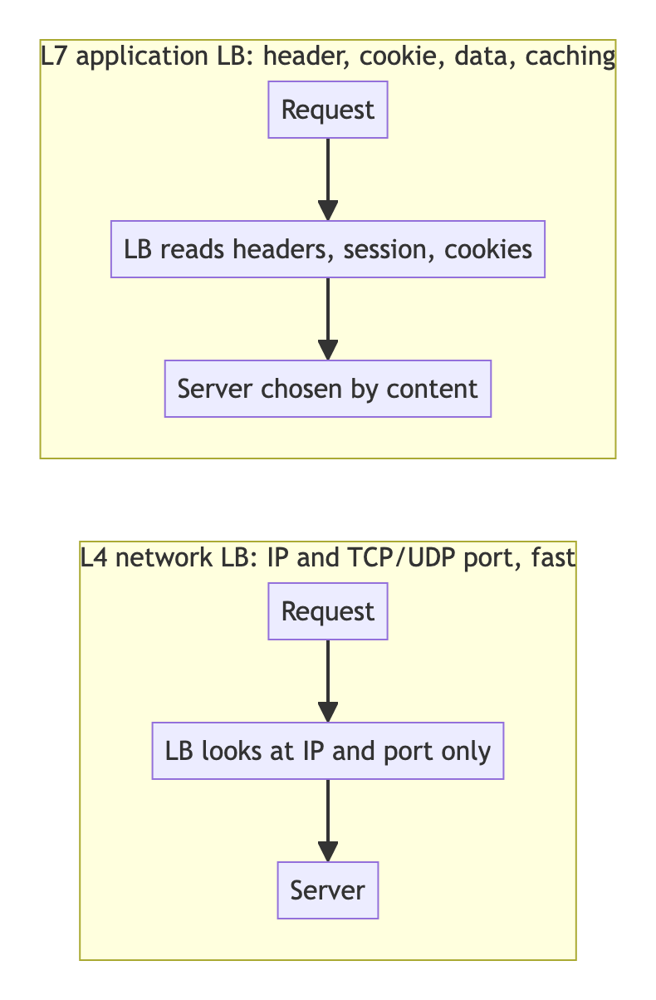
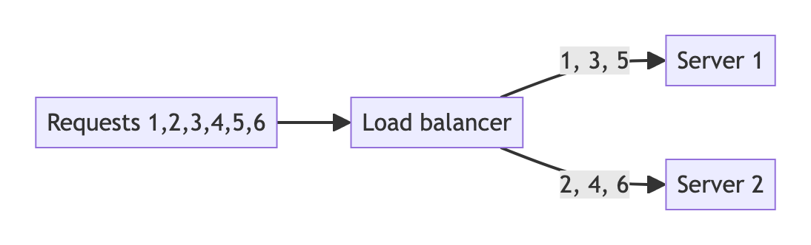
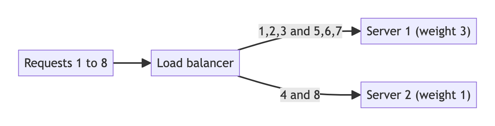
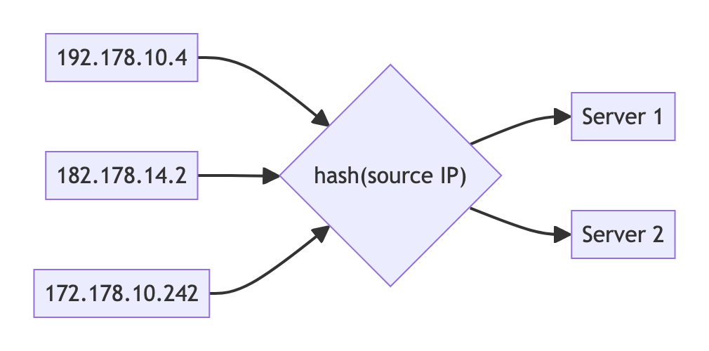
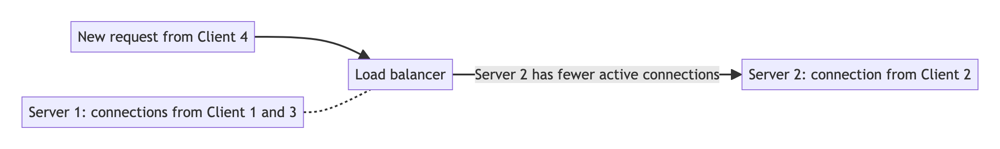
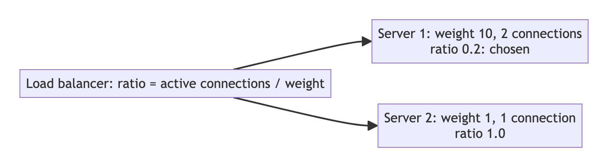
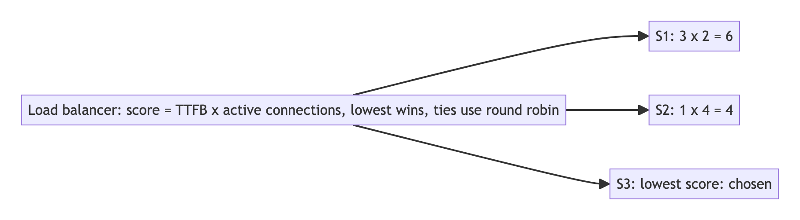

# Load Balancer & Different Algorithms (HLD #18 – Lecture 55)

<!-- nav -->
⬅ [17 Proxy vs Reverse Proxy](17_Proxy_vs_Reverse_Proxy_Notes.md) · [Index](00_HLD_Index.md) · [19 Distributed Cache and Caching Strategies](19_Distributed_Cache_and_Caching_Strategies_Notes.md) ➡
<!-- nav -->

Source (handwritten, 7 pages): https://drive.google.com/file/d/1dAg77qQ1t9mlHXc1VvO-dZXvaGWnvmaZ/view?usp=drive_link

---

## 1. Why a load balancer?

<!-- diagram:18-0 -->
**Diagram – Load balancer spreads the traffic**


<!-- /diagram:18-0 -->


Clients send requests; **not all requests should go to only one server** – one server must not get overloaded, so we **put a Load Balancer (LB)** between clients and servers (S1, S2, …).

> **Main purpose of a load balancer:** it can do logging and many other things, but the main purpose is to **distribute the traffic appropriately across all the servers so that no single server is overburdened.**

<!-- isw:18-0 -->
**In simple words**

Clients send requests, and **not all requests should go to only one server**, because one server must not be overloaded. So a **load balancer (LB)** is placed between the clients and the servers (S1, S2, …). The notes say it can do logging and other things, but its **main purpose is to distribute the traffic properly across all the servers so that no single server is overburdened.**
<!-- /isw:18-0 -->


## 2. Layers: L4 vs L7 (OSI model)

<!-- diagram:18-1 -->
**Diagram – L4 versus L7 load balancing**


<!-- /diagram:18-1 -->


- **Application layer = Layer 7 (L7) balancer** – can read **headers, session, data, response**.
- **Transport layer = Layer 4 (L4) balancer** – can see **TCP port** (UDP port, IP address, source and destination).

| | **Network LB (L4)** | **Application LB (L7)** |
|---|---|---|
| Decision based on | **TCP port / UDP port / IP address, source & destination** – decides only from this which server gets the traffic | **Header, session, cookies, data** |
| Extras | – | Can also do **caching**, because it **can read the response** |
| Speed | **Much faster** | **Much more advanced** |

<!-- isw:18-1 -->
**In simple words**

- The **application layer = Layer 7 (L7) balancer:** it can read **headers, session, data and the response.**
- The **transport layer = Layer 4 (L4) balancer:** it can see the **TCP port (also the UDP port, IP address, source and destination).**

In the table: the **network LB (L4)** decides **only from the TCP / UDP port and IP address, source and destination** which server gets the traffic, and it is **much faster.** The **application LB (L7)** decides from **headers, session, cookies and data**, can also do **caching because it can read the response**, and is **much more advanced.**
<!-- /isw:18-1 -->


## 3. Algorithms (for the network LB) – static vs dynamic
```
 Static algorithms                    Dynamic algorithms
  • Round Robin                        • Least Connection
  • Weighted Round Robin               • Weighted Least Connection
  • IP Hash                            • Least Response Time
```

<!-- isw:18-2 -->
**In simple words**

For the network LB the algorithms are **static** (Round Robin, Weighted Round Robin, IP Hash) or **dynamic** (Least Connection, Weighted Least Connection, Least Response Time).
<!-- /isw:18-2 -->


---

# STATIC LOAD BALANCING

## ① Round Robin

<!-- diagram:18-2 -->
**Diagram – Round robin**


<!-- /diagram:18-2 -->


Requests are handed to servers **in turn**: with 4 clients and 2 servers → requests 1, 3, 5, 7 → **Server 1**; 2, 4, 6, 8 → **Server 2**.

**Advantages**
- Very easy to implement.
- Equal load distribution to all servers.

**Disadvantages**
- One server with **high capacity** and another with **low** capacity are **treated the same.**
- Chance that the **low-capacity server will go down** because of request overload.

<!-- isw:18-3 -->
**In simple words**

Requests are handed to the servers **in turn:** with 4 clients and 2 servers, requests 1, 3, 5, 7 go to **Server 1** and 2, 4, 6, 8 go to **Server 2.** **Advantages:** very easy to implement; equal load distribution to all servers. **Disadvantages:** a server with **high capacity** and one with **low capacity** are **treated the same**, so the low-capacity server may go down because of request overload.
<!-- /isw:18-3 -->


## ② Weighted Round Robin

<!-- diagram:18-3 -->
**Diagram – Weighted round robin: server 1 weight 3, server 2 weight 1**


<!-- /diagram:18-3 -->


Each server has a **weight = its capacity** – e.g. **Server 1 weight = 3×**, **Server 2 weight = 1×** → for every 4 requests, Server 1 gets 3 (requests 1,2,3,5,6,7…) and Server 2 gets 1 (4, 8…).

**Advantages**
- **Low-capacity server is saved** from receiving a large number of requests.
- **Easy to implement** – weights are **static**, no dynamic computation.

**Disadvantages**
- If **requests have different processing times** (e.g. request 4 → 10 s, request 8 → 20 s while others take ~50 ms), the low-capacity server may get the heavy requests and **get overburdened.**

<!-- isw:18-4 -->
**In simple words**

Each server has a **weight, which is its capacity.** For example Server 1 weight 3 and Server 2 weight 1: out of every 4 requests Server 1 gets 3 and Server 2 gets 1. **Advantages:** the **low-capacity server is saved** from a large number of requests, and it is **easy** because the weights are **static.** **Disadvantage:** if requests have **different processing times** (for example request 4 takes 10 s and request 8 takes 20 s while others take about 50 ms), the low-capacity server may get the heavy requests and **become overburdened.**
<!-- /isw:18-4 -->


## ③ IP Hash

<!-- diagram:18-4 -->
**Diagram – IP hash: same client, same server**


<!-- /diagram:18-4 -->


The LB computes **Hash(source IP address)** and, using that value, **assigns the request to a server** (e.g. clients `192.178.10.4`, `182.178.14.2`, `172.178.10.242`, `152.198.10.14` → hash → server 1 or 2).

**Advantages**
- Good where the **same client needs to connect to the same server** (session stickiness).
- Easy to implement.

**Disadvantages**
- If client requests come **through a proxy**, **all clients appear with the same source IP** (e.g. `162.16.0.1`) → **one server gets overloaded.**
- **Cannot ensure equal distribution.**

<!-- isw:18-5 -->
**In simple words**

The LB computes **Hash(source IP address)** and uses that value to **assign the request to a server.** **Advantages:** it is good where the **same client must connect to the same server** (session stickiness) and it is easy to implement. **Disadvantages:** if requests come **through a proxy**, **all the clients appear with the same source IP,** so **one server gets overloaded;** and it **cannot ensure equal distribution.**
<!-- /isw:18-5 -->


---

# DYNAMIC LOAD BALANCING

## ① Least Connection

<!-- diagram:18-5 -->
**Diagram – Least connection**


<!-- /diagram:18-5 -->


The LB **checks which server has fewer active connections** and sends the new request there (Server 1 has active connections from Client 1 & 3; Server 2 from Client 2 → new request from Client 4 goes to Server 2).

**Advantages**
- **Dynamic** – it considers the **current load on each server**, so the chance of a server being overburdened is less **when every server has equal capacity.**

**Disadvantages**
- **TCP connections can be active but possibly carry no traffic** → purpose is defeated.
- **No difference between low-capacity and high-capacity servers** → the low-capacity server can get overburdened.

<!-- isw:18-6 -->
**In simple words**

The LB **checks which server has fewer active connections** and sends the new request there. In the example Server 1 has connections from Client 1 and 3 and Server 2 from Client 2, so the new request from Client 4 goes to Server 2. **Advantage:** it is **dynamic**; it looks at the **current load of each server**, so a server is less likely to be overburdened **when all servers have equal capacity.** **Disadvantages:** **TCP connections can be active but carry no traffic**, which defeats the purpose; and it makes **no difference between low-capacity and high-capacity servers.**
<!-- /isw:18-6 -->


## ② Weighted Least Connection

<!-- diagram:18-6 -->
**Diagram – Weighted least connection**


<!-- /diagram:18-6 -->


- **Calculate the ratio of number of active connections to the server's weight.**
- **The server with the minimum ratio gets the request.**
- Example: Server 1 weight = 10 with 2 active connections → ratio `2/10 = 0.2`; Server 2 weight = 1 with 1 active connection → ratio `1/1 = 1` → **Server 1 gets the request.**

<!-- isw:18-7 -->
**In simple words**

**Calculate the ratio of the number of active connections to the server's weight; the server with the minimum ratio gets the request.** Example: Server 1 has weight 10 and 2 active connections, ratio `2/10 = 0.2`; Server 2 has weight 1 and 1 active connection, ratio `1/1 = 1`. So **Server 1 gets the request.**
<!-- /isw:18-7 -->


## ③ Least Response Time

<!-- diagram:18-7 -->
**Diagram – Least response time**


<!-- /diagram:18-7 -->


- Uses **TTFB (Time To First Byte)** = the **time interval between sending a request and receiving the first byte of the response from the server.**
- **Picks the server which has fewer active connections and the least TTFB**; **if there is a clash, follow round robin.**
- Example: S1 → TTFB 3 × 2 active connections = **6**; S2 → TTFB 1 × 4 active connections = **4**; S3 → TTFB 2 × (0–1 active connection) = **2**/lowest → choose the smallest score.
  *(the S3 figures are partly illegible in the scan)*

<!-- isw:18-8 -->
**In simple words**

This uses **TTFB (Time To First Byte): the time between sending a request and receiving the first byte of the response.** It **picks the server with fewer active connections and the least TTFB**, and **if there is a tie it follows round robin.** In the example the score is TTFB × active connections: S1 = 3 × 2 = 6, S2 = 1 × 4 = 4, and S3 has the lowest score (its figures are partly illegible in the scan); the smallest score is chosen.
<!-- /isw:18-8 -->


---

## Quick revision
| Algorithm | Type | Key idea | Weakness |
|---|---|---|---|
| Round Robin | static | take turns | ignores capacity |
| Weighted RR | static | more requests to bigger servers (static weights) | ignores differing request cost |
| IP Hash | static | hash(client IP) → server (sticky) | proxies share one IP → imbalance |
| Least Connection | dynamic | fewest active connections | idle-but-open connections; ignores capacity |
| Weighted Least Connection | dynamic | min(active connections ÷ weight) | – |
| Least Response Time | dynamic | lowest TTFB (× active connections) | needs measurement; ties → round robin |

- **L4** LB = fast, routes on IP/port. **L7** LB = smart, routes on headers/cookies/data and can cache.
- Client-side LB in Spring: see [Client Side Load Balancer](35_Client_Side_Load_Balancer_Notes.md).

---

<!-- nav -->
⬅ [17 Proxy vs Reverse Proxy](17_Proxy_vs_Reverse_Proxy_Notes.md) · [Index](00_HLD_Index.md) · [19 Distributed Cache and Caching Strategies](19_Distributed_Cache_and_Caching_Strategies_Notes.md) ➡
<!-- nav -->
