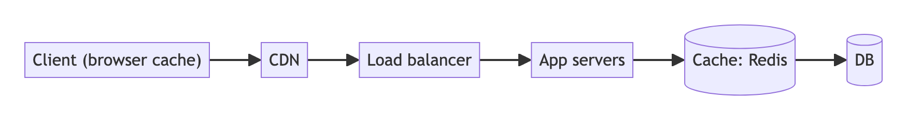
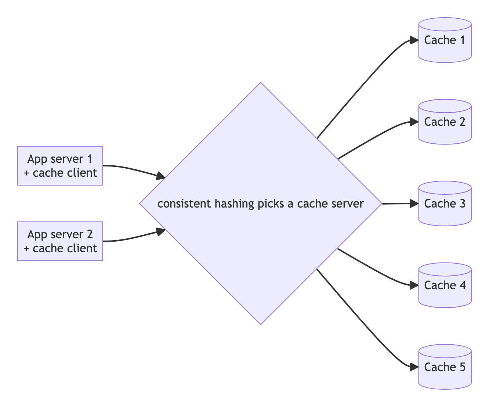
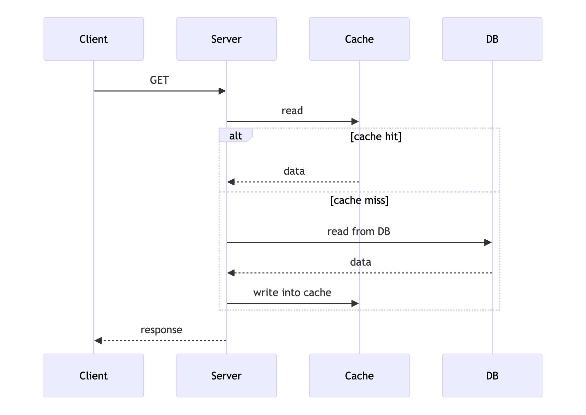
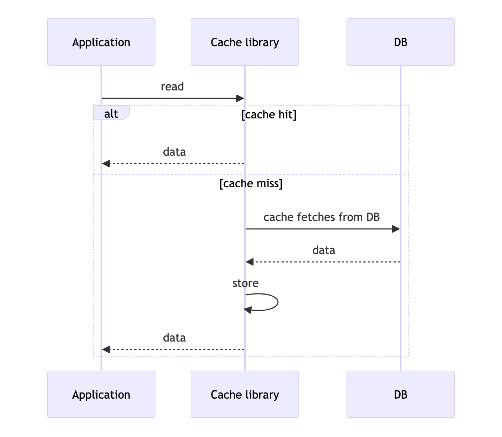
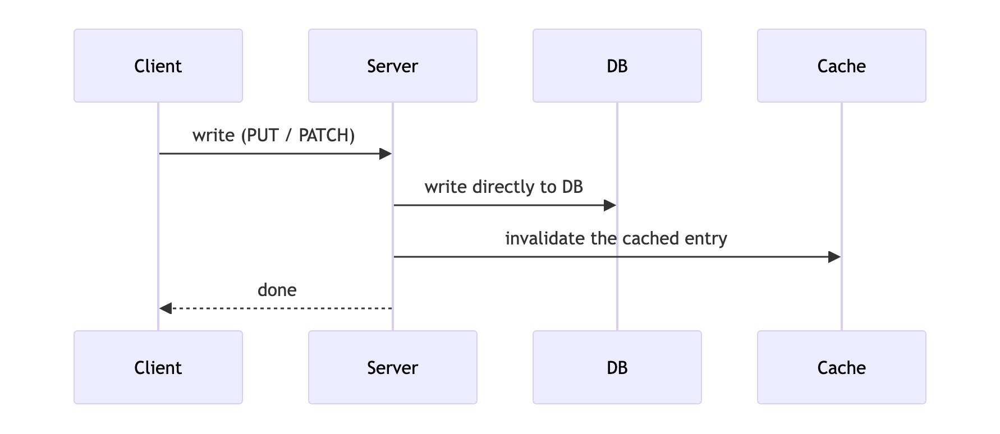
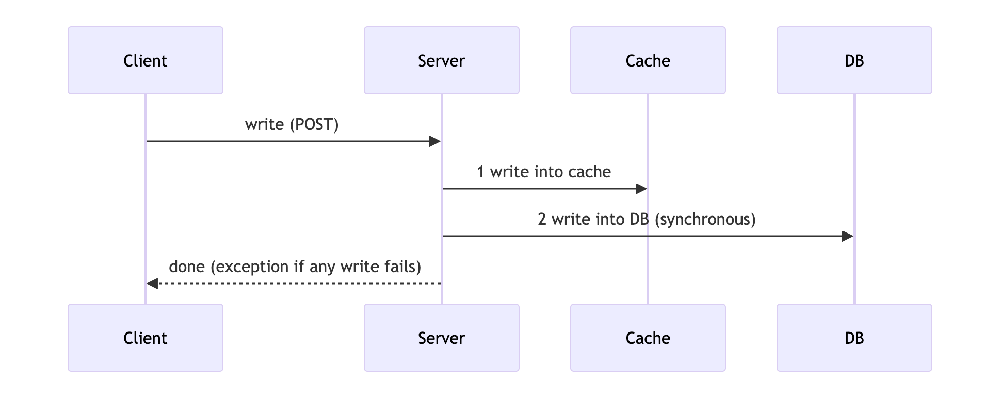
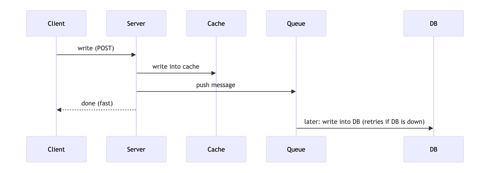

# Distributed Cache and Caching Strategies (HLD #19 – Lecture 56)

<!-- nav -->
⬅ [18 Load Balancer and Algorithms](18_Load_Balancer_and_Algorithms_Notes.md) · [Index](00_HLD_Index.md) · [20 Distributed Transactions](20_Distributed_Transactions_Notes.md) ➡
<!-- nav -->

Sources:
- Handwritten PDF (9 pages): https://drive.google.com/file/d/1C7f5kvsWQ45ECA3sR0jgpym1cy96CgR0/view?usp=drive_link
- Typed Zoho note (this link is dead: Zoho says "there's no note here", so the note may have been removed): https://notebook.zohopublic.in/public/notes/u3i1s6d12db6764b94cff9ad7f4ddef5b5348

## Agenda (as listed on page 1)
- What is caching? · What is distributed caching and how is it done?
- Caching strategies: **Cache-aside, Read-through, Write-around, Write-through, Write-back**
- Cache eviction policies: **LRU, FIFO, LFU, etc.** *(listed in the agenda; the handwritten PDF ends after Write-back – eviction policies are not written out in these 9 pages)*

---

## 1. What is caching?

<!-- diagram:19-0 -->
**Diagram – Caching in the request path**


<!-- /diagram:19-0 -->


- **A technique to store frequently used data in a fast-access memory rather than accessing data every time from slow-access memory.**
- Makes the system **very fast**, **reduces latency**, and also helps to achieve **fault tolerance**.

**Caching exists at different layers of a system:**
- **Client-side caching** (browser caching)
- **CDN** (stores static data)
- **Load balancer**
- **Server-side application caching** (like **Redis**, etc.)

Basic picture: `Client → LB → App servers → Cache (Redis) → DB`.

<!-- isw:19-0 -->
**In simple words**

Caching is **a technique to store frequently used data in fast-access memory instead of reading it from slow-access memory every time.** It makes the system **very fast**, **reduces latency** and also helps to achieve **fault tolerance.** Caching exists at different layers: **client-side (browser) caching, CDN (static data), the load balancer, and server-side application caching (like Redis).** The basic picture is `Client → LB → App servers → Cache (Redis) → DB`.
<!-- /isw:19-0 -->


---

## 2. What is distributed caching?

<!-- diagram:19-1 -->
**Diagram – Distributed cache pool with a cache client**


<!-- /diagram:19-1 -->


**Single cache service problem:** all app servers (1, 2, 3) hit one cache service – **limited space/resources**.
Limitations: ① **scalability**, ② **single point of failure.**

**Distributed caching** to the rescue:
```
 App Server ── Cache Client ──► Cache Pool: Cache1 | Cache2 | Cache3 | Cache4 | Cache5
```
- Each **app server has its own cache client**, and using that client it gets **one of the cache servers** where it stores or reads the data.
- **How is one of the servers allotted? – Consistent Hashing technique** (cache servers CS1…CS5 placed on a hash ring; a key is stored on the next server clockwise; "App Server 1 → put"). See [Consistent Hashing](06_Consistent_Hashing_Notes.md).

<!-- isw:19-1 -->
**In simple words**

With a **single cache service** all app servers (1, 2, 3) use one cache with **limited space and resources**, which brings two limitations: **scalability** and a **single point of failure.** **Distributed caching** is the answer: each **app server has its own cache client**, and using that client it picks **one of the cache servers** (Cache1 … Cache5) to store or read data. **How is the server chosen? With the consistent hashing technique** (cache servers CS1 … CS5 are placed on a hash ring and a key is stored on the next server clockwise). See the [Consistent Hashing](06_Consistent_Hashing_Notes.md) note.
<!-- /isw:19-1 -->


---

## 3. Caching strategies

### ① Cache-Aside (lazy loading)

<!-- diagram:19-2 -->
**Diagram – Cache-aside**


<!-- /diagram:19-2 -->


Flow (`Client → Server → Cache → DB`):
1. Client sends **read request (GET)** to the server.
2. Server **reads from cache**.
3. **Cache hit** → data returned to client. **Cache miss** → **fetch data from DB**, **write into cache**, then send response.

**Pros**
- Good for **heavy-read applications.**
- **Even if the cache is down, the request won't fail** – it fetches from DB.
- **The cache document structure can differ** from the data in the DB.

**Cons**
- For **new data, the first read is always a cache miss** (resolve by **pre-heating** the cache).
- If the cache is not handled properly **during write operations**, there is a chance of **inconsistency between cache and DB** (e.g. cache holds a stale value of id 10 while the DB has the latest value after an update).

<!-- isw:19-2 -->
**In simple words**

**Flow:** (1) the client sends a **read (GET)** to the server; (2) the server **reads from the cache;** (3) on a **cache hit** the data is returned to the client, on a **cache miss** the server **fetches the data from the DB, writes it into the cache** and then responds.

**Pros:** good for **heavy-read** applications; **even if the cache is down the request does not fail** (it fetches from the DB); **the cache document structure can differ** from the data in the DB. **Cons:** for **new data the first read is always a cache miss** (solved by **pre-heating** the cache); if the cache is not handled properly **during write operations,** there can be an **inconsistency between the cache and the DB** (for example the cache holds a stale value for id 10 while the DB has the updated value).
<!-- /isw:19-2 -->


### ② Read-Through

<!-- diagram:19-3 -->
**Diagram – Read-through**


<!-- /diagram:19-3 -->


- Application first checks the cache.
- **Cache hit** → return data.
- **Cache miss** → **the cache library itself fetches the data from the DB, stores it back in the cache and returns it to the application.**

**Pros**
- Good for **heavy-read applications.**
- **Logic of fetching from the DB and updating the cache is separated from the application.**

**Cons**
- For new data, **first read is always a cache miss** (pre-heat the cache).
- If caching is not used properly during writes → **inconsistency between cache and DB.**
- **Cache document structure should be the same as the DB table.**

<!-- isw:19-3 -->
**In simple words**

The application first checks the cache. On a **hit** it returns the data. On a **miss, the cache library itself fetches the data from the DB, stores it in the cache and returns it to the application.**

**Pros:** good for heavy-read applications; **the logic of fetching from the DB and updating the cache is separated from the application.** **Cons:** the first read of new data is always a miss (pre-heat the cache); if caching is not used properly during writes there is an inconsistency between the cache and the DB; and **the cache document structure must be the same as the DB table.**
<!-- /isw:19-3 -->


### ③ Write-Around

<!-- diagram:19-4 -->
**Diagram – Write-around**


<!-- /diagram:19-4 -->


- **Directly writes data into the DB; doesn't touch the cache.**
- It does **not update the cache data**; it **invalidates the cached entry (marks it dirty).**
- Flow: Client → **write (PUT / PATCH)** → Server → **directly write to DB** → **invalidate the data in cache.**

**Pros**
- Good for **heavy-read applications.**
- **Resolves the inconsistency problem between cache and DB.**

**Cons**
- For **new data read there will always be a cache miss** (pre-heat the cache).
- **If the DB is down, the write operation fails.**

<!-- isw:19-4 -->
**In simple words**

It **writes directly into the DB and does not touch the cache.** It does not update the cached data; it **invalidates the cached entry (marks it dirty).** Flow: client → **write (PUT / PATCH)** → server → **write directly to the DB** → **invalidate the data in the cache.**

**Pros:** good for heavy-read applications; it **solves the inconsistency problem between the cache and the DB.** **Cons:** the first read of new data is always a miss (pre-heat the cache); **if the DB is down, the write fails.**
<!-- /isw:19-4 -->


### ④ Write-Through

<!-- diagram:19-5 -->
**Diagram – Write-through**


<!-- /diagram:19-5 -->


- **First writes data into the cache, then synchronously writes data into the DB.**
- Flow: Client → write request (**POST**) → Server → first write into cache → then write into DB.
- **If any of the insertions fails, throw an exception.**

**Pros**
- **Cache and DB always remain consistent.**
- **Cache hit chance increases a lot.**

**Cons**
- **Alone it's not useful – it increases latency** (that's why it's always used together with **Read-through or Cache-aside**).
- **2-phase commit needs to be supported with this** to maintain the transactional property.
- **If the DB is down, the write fails** – *it's still not fully fault tolerant.*

<!-- isw:19-5 -->
**In simple words**

It **first writes the data into the cache and then synchronously writes it into the DB.** Flow: client → write request (**POST**) → server → write into the cache first → then into the DB. **If any of the writes fails, an exception is thrown.**

**Pros:** the **cache and the DB always stay consistent**, and the **cache hit chance increases a lot.** **Cons:** **alone it is not useful, since it increases latency** (so it is always used together with **read-through or cache-aside**); **2-phase commit has to be supported** to keep the transaction property; and **if the DB is down the write fails,** so it is still not fully fault tolerant.
<!-- /isw:19-5 -->


### ⑤ Write-Back (Write-Behind)

<!-- diagram:19-6 -->
**Diagram – Write-back**


<!-- /diagram:19-6 -->


- **First writes data into the cache, then asynchronously writes data into the DB.**
- Flow: Client → write (POST) → Server → first write into cache → **push the message to a Queue** → (later) **write into DB**.
- Example: if the DB is down, the **cache (turn-around/TTL ≈ 24 h)** keeps the data and the **queue holds the writes for e.g. 2 h**; **when the DB comes back the queue writes into the DB** → **brings fault tolerance.**

**Pros**
- **Good for write-heavy applications.**
- **Improves write latency** because writing into the DB happens asynchronously.
- **Cache hit chance increases a lot.**
- **Gives much better performance when used with Read-through cache.**

**Cons**
- **If data is removed from the cache (TTL expiry) and the DB write still hasn't happened, there's a chance of data loss/issue** (e.g. TTL = 3 h but the DB has been down for 5 h). **Handled by keeping the cache TTL a little higher, e.g. 2 days.**

<!-- isw:19-6 -->
**In simple words**

It **first writes the data into the cache and then writes it into the DB asynchronously.** Flow: client → write (POST) → server → write into the cache first → **push a message to a queue** → later **write into the DB.** The notes' example: if the DB is down, the **cache (turn-around / TTL about 24 h)** keeps the data and the **queue holds the writes for, say, 2 h; when the DB comes back the queue writes into it,** which **brings fault tolerance.**

**Pros:** **good for write-heavy applications;** it **improves write latency** because the DB write is asynchronous; the **cache hit chance increases a lot;** and it gives **much better performance when used with a read-through cache.** **Cons:** **if the data is removed from the cache (TTL expiry) before the DB write has happened, data can be lost** (for example TTL 3 h but the DB has been down for 5 h). This is **handled by keeping the cache TTL a little higher, for example 2 days.**
<!-- /isw:19-6 -->


---

## Quick revision
| Strategy | Read path | Write path | Best for | Watch out |
|---|---|---|---|---|
| **Cache-aside** | app checks cache, on miss loads DB + fills cache | app writes DB (+ must update/invalidate cache) | read-heavy; resilient if cache is down | cold start misses; stale cache |
| **Read-through** | cache library loads from DB on miss | – | read-heavy; app code simpler | cold start; schema must match DB |
| **Write-around** | – | write DB only, **invalidate cache** | read-heavy; no stale data | DB down ⇒ write fails; first read misses |
| **Write-through** | – | write cache **then** DB synchronously | consistency; high hit-rate | extra latency; needs 2PC; DB down ⇒ fail |
| **Write-back** | – | write cache, **async** to DB via queue | write-heavy, low write latency | data loss if cache evicts before DB write |

- Distributed cache = **cache pool + cache client + consistent hashing** (avoids SPOF & scales).
- Combine strategies: e.g. **Read-through + Write-back** for best performance.

---

<!-- nav -->
⬅ [18 Load Balancer and Algorithms](18_Load_Balancer_and_Algorithms_Notes.md) · [Index](00_HLD_Index.md) · [20 Distributed Transactions](20_Distributed_Transactions_Notes.md) ➡
<!-- nav -->
