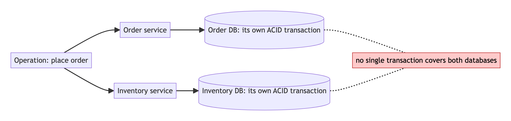
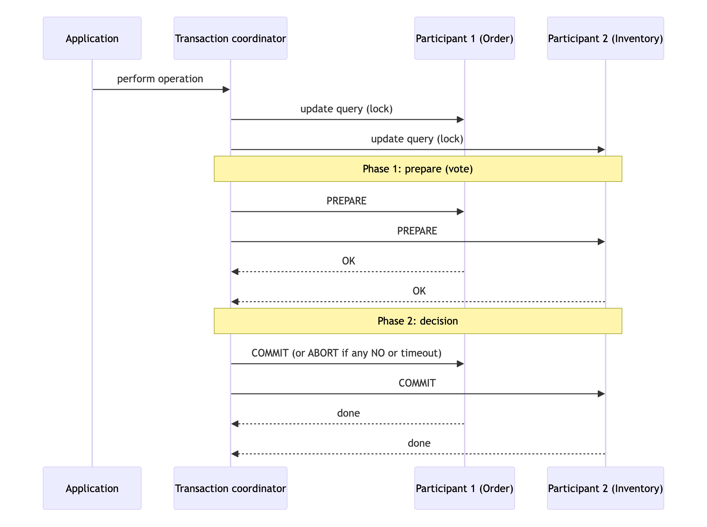
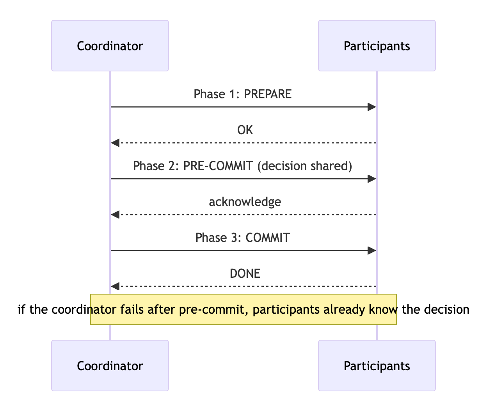
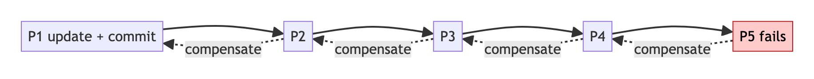

# Handle Distributed Transactions – Two-Phase Commit (2PC), Three-Phase Commit (3PC), SAGA Pattern (HLD #20 – Lecture 57)

<!-- nav -->
⬅ [19 Distributed Cache and Caching Strategies](19_Distributed_Cache_and_Caching_Strategies_Notes.md) · [Index](00_HLD_Index.md) · [21 Database Indexing](21_Database_Indexing_Notes.md) ➡
<!-- nav -->

Sources:
- Handwritten PDF (7 pages): https://drive.google.com/file/d/1kPHF4MMoqc2xFXNXaXHfqqrEDdeU0kLO/view?usp=drive_link
- Typed Zoho note (checked, same content as this note): https://notebook.zohopublic.in/public/notes/u3i1sc0949c83b482441887cc4eba8031560e

---

## 1. What is a transaction?
A **set of operations (a group of tasks) that must be performed against the DB.** It has **4 properties (ACID):**

| Property | Meaning | Example in the notes |
|---|---|---|
| **Atomicity** | **All operations in a single transaction succeed, or all fail.** | Txn: ① Debit A 100 Rs, ② Credit B 100 Rs – if step ② fails, step ① must not stay applied. |
| **Consistency** | DB is in a **consistent state before and after** the transaction. | A=100, B=50 (total 150) → after transfer A=0, B=150 (total still 150). |
| **Isolation** | **More than one transaction running concurrently appears to be serialized.** | Txn1: Debit A 100, Credit B 50; Txn2: Debit B 150, Credit C 150 – running together must behave as if one-after-another. |
| **Durability** | After a transaction **successfully completes, even if the DB fails the data must not be lost.** | – |

Local transaction pseudo-code:
```
Begin-Transaction
   - Withdraw money from 'A': Rs 100
   - Deposit money to  'B': Rs 100
   if all success: Do Commit
   else:           Do Rollback
Close-Transaction
```
(e.g. A: 100 → 0, B: 100 → 200.)

<!-- isw:20-0 -->
**In simple words**

A transaction is **a set of operations (a group of tasks) that must be performed against the DB.** It has four properties (**ACID**):
- **Atomicity:** all operations in the transaction succeed or all fail. Example: debit A 100 and credit B 100; if the credit fails, the debit must not stay applied.
- **Consistency:** the DB is in a consistent state before and after. Example: A = 100 and B = 50 (total 150) → after the transfer A = 0 and B = 150, still total 150.
- **Isolation:** transactions running together appear as if they ran one after another.
- **Durability:** after a successful transaction, the data must not be lost even if the DB fails.

A **local transaction** is written as: Begin → withdraw from A → deposit to B → if all succeed, **Commit**, else **Rollback** → Close.
<!-- /isw:20-0 -->


## 2. The problem in a distributed system

<!-- diagram:20-0 -->
**Diagram – ACID is local to each database**


<!-- /diagram:20-0 -->


```
Begin-Transaction
   - update Order DB
   - update Inventory DB
   if all success: Do Commit  else: Do Rollback
Close-Transaction
```
**Will this work?** – **No.** ACID is local to a DB: Order DB (count 100 → 101) has its own ACID transaction, Inventory DB (count 500) has its own; **a transaction is local to a particular database.**

> **How do we handle a distributed system where an operation involves multiple databases? How do we satisfy the transaction properties in a distributed system?**

### Ways to handle a transaction in a distributed system
| | Pattern | Remarks |
|---|---|---|
| ① | **2-Phase Commit** | **very popular**, **synchronous** |
| ② | **3-Phase Commit** | **not much used because of complexity**, **synchronous** |
| ③ | **Saga Pattern** | **still used very much**, **asynchronous** |

In the synchronous ones **the customer is waiting for the transaction to complete.**

<!-- isw:20-1 -->
**In simple words**

Suppose a transaction needs to **update the Order DB and the Inventory DB.** *Will one Begin / Commit around both work?* **No.** ACID is local to one database: the Order DB has its own ACID transaction and the Inventory DB has its own, and **a transaction is local to a particular database.** The question is how to satisfy the transaction properties when an operation involves several databases.
<!-- /isw:20-1 -->

<!-- isw:20-2 -->
**In simple words**

There are three ways: **2-Phase Commit** (very popular, **synchronous**), **3-Phase Commit** (not used much because of complexity, **synchronous**) and the **Saga pattern** (still used very much, **asynchronous**). In the synchronous ones **the customer is waiting for the transaction to complete.**
<!-- /isw:20-2 -->


---

## 3. Two-Phase Commit (2PC)

<!-- diagram:20-1 -->
**Diagram – Two-phase commit**


<!-- /diagram:20-1 -->


Two phases: **1. Voting / Prepare phase** and **2. Decision / Commit phase.**

**Actors:** Application · **Transaction Coordinator** (supports both participants) · **Participant 1** (Order microservice) · **Participant 2** (Inventory microservice).

**Flow**
1. Application → Coordinator: **perform the operation**; coordinator **starts the transaction.**
2. Coordinator sends the **update query** to both participants; each participant takes a **lock.**
3. **Phase 1 begins** – Coordinator writes a **"Send Prepare message" record to a lock file (permanent storage)** and sends **PREPARE** to both participants.
4. Each participant writes its own lock file and replies **OK** (or **NO** if it can't commit).
5. **Phase 2 begins** – coordinator updates its log ("Prepare COMMIT") and decides:
   - **all OK → COMMIT** to everyone;
   - **any NO / timeout → ABORT** to everyone.
6. Participants apply it and reply **OK Commit / Done**; coordinator **closes the transaction.**

### Interview question – what kind of issues can come?
**Failure points:** ① the **Transaction Coordinator can fail**, ② a **Participant can fail.** Message-loss cases:
1. **Prepare message is lost** → ⇒ **Abort the Txn** (coordinator times out waiting for the vote, then aborts).
2. **OK message is lost** → the **Transaction Coordinator waits some time; if the timeout is over, it aborts the Txn.**
3. **COMMIT / ABORT message is lost** → the participant said OK to Prepare and now hears nothing. **The participant cannot decide on its own** – it has to **wait and ask the coordinator what happened (COMMIT or ABORT)** because **the decision is held only by the coordinator.** (This is the **blocking** weakness of 2PC – participants stay locked while the coordinator is down.)

<!-- isw:20-3 -->
**In simple words**

There are two phases: **1. voting / prepare** and **2. decision / commit.** The actors are the application, a **transaction coordinator**, **participant 1** (Order microservice) and **participant 2** (Inventory microservice).

**Flow:** (1) the application asks the coordinator to perform the operation, and the coordinator **starts the transaction.** (2) The coordinator sends the **update query** to both participants, and each **takes a lock.** (3) **Phase 1:** the coordinator writes a "send prepare" record to a **lock file in permanent storage** and sends **PREPARE** to both. (4) Each participant writes its own lock file and replies **OK** (or **NO** if it cannot commit). (5) **Phase 2:** the coordinator updates its log and decides: **all OK → COMMIT** to everyone; **any NO or timeout → ABORT** to everyone. (6) The participants apply it and reply done; the coordinator **closes the transaction.**
<!-- /isw:20-3 -->

<!-- isw:20-4 -->
**In simple words**

Two things can fail: **the coordinator or a participant.** The message-loss cases in the notes:
1. **The prepare message is lost → abort the transaction** (the coordinator times out waiting for the vote and then aborts).
2. **The OK message is lost →** the coordinator waits; **if the timeout is over, it aborts the transaction.**
3. **The COMMIT / ABORT message is lost →** a participant had said OK to prepare and now hears nothing. **It cannot decide on its own;** it has to **wait and ask the coordinator what happened,** because **only the coordinator holds the decision.** This is the **blocking** weakness of 2PC: participants stay locked while the coordinator is down.
<!-- /isw:20-4 -->


---

## 4. Three-Phase Commit (3PC) – a **non-blocking** protocol

<!-- diagram:20-2 -->
**Diagram – Three-phase commit adds a pre-commit step**


<!-- /diagram:20-2 -->


Three phases: **1. Prepare phase** [same as 2PC] · **2. Pre-Commit phase** · **3. Commit phase.**

**Flow**
1. Application → Coordinator: perform the operation; **START TRANSACTION**; update queries sent to participants.
2. **Phase 1 begins:** PREPARE → participants reply **OK.**
3. **Phase 2 begins (Pre-Commit phase):** coordinator makes the decision and sends **Pre-Commit: Commit** – *"we are just sharing information about what the coordinator has taken"* – participants **Acknowledge.**
4. **Phase 3 begins:** **COMMIT** → participants reply **DONE**; **close transaction.**

Why it helps: because every participant **already knows the decision (from the pre-commit)** before the final commit, if the coordinator fails after the pre-commit message a participant can still proceed (the diagram shows the coordinator `C` crashing after sending *Prepare : Commit* to participant `P` – the participants hold the decision). **But it's more complex → rarely used.**

<!-- isw:20-5 -->
**In simple words**

It is a **non-blocking** protocol with three phases: **1. Prepare** (same as 2PC), **2. Pre-Commit** and **3. Commit.**

**Flow:** (1) the application asks the coordinator, which **starts the transaction** and sends the update queries. (2) **Phase 1:** PREPARE → the participants reply **OK.** (3) **Phase 2 (pre-commit):** the coordinator makes the decision and sends **Pre-Commit: Commit** (*"we are just sharing information about what the coordinator has decided"*), and the participants **acknowledge.** (4) **Phase 3:** **COMMIT** → the participants reply **DONE** and the transaction is closed.

**Why it helps:** every participant **already knows the decision from the pre-commit** before the final commit, so if the coordinator fails after the pre-commit message, a participant can still go on (the notes' diagram shows the coordinator crashing after sending "Prepare: Commit" to a participant). **But it is more complex, so it is rarely used.**
<!-- /isw:20-5 -->


---

## 5. SAGA pattern (asynchronous)

<!-- diagram:20-3 -->
**Diagram – SAGA: chain of local transactions and compensations**


<!-- /diagram:20-3 -->


- A chain of **local transactions** P1 → P2 → P3 → P4 → P5 → P6; each service performs its own **update + commit** in its own DB, then triggers the next one (e.g. by **publishing an event to a queue / message broker**).
- **It's kind of sequential in nature.**
- **Failure handling:** if a later step fails (e.g. **P5 fails**), the previous services run **compensating transactions – Rollback** in reverse order: P4 → P3 → P2 → P1 (each undoing its committed work).
- Communication is **asynchronous** (event published to a queue; "Msg fail" if the message can't be delivered must be handled too).

<!-- isw:20-6 -->
**In simple words**

A Saga is a chain of **local transactions** P1 → P2 → P3 → P4 → P5 → P6. Each service does **its own update and commit in its own DB** and then triggers the next one (for example by **publishing an event to a queue / message broker**). It is **sequential in nature.**

**Failure handling:** if a later step fails (say **P5 fails**), the earlier services run **compensating transactions (rollback) in reverse order:** P4 → P3 → P2 → P1, each undoing its committed work. The communication is **asynchronous** (an event is published to a queue; the case where the message cannot be delivered ("Msg fail") must also be handled).
<!-- /isw:20-6 -->


---

## Quick revision
- ACID is **local to one DB**; multi-DB operations need a **distributed-transaction protocol.**
- **2PC:** prepare (vote) → commit/abort; **synchronous, popular, but blocking** (participants wait for the coordinator; lost COMMIT/ABORT leaves them stuck).
- **3PC:** adds **pre-commit** to make it **non-blocking**; more complex, rarely used.
- **SAGA:** sequence of local transactions + **compensating rollbacks**; **asynchronous**, widely used in microservices; eventually consistent.
- Related: [Dual Write Problem](33_Dual_Write_Problem_Notes.md), [High Availability](15_High_Availability_Architecture_Notes.md).

---

<!-- nav -->
⬅ [19 Distributed Cache and Caching Strategies](19_Distributed_Cache_and_Caching_Strategies_Notes.md) · [Index](00_HLD_Index.md) · [21 Database Indexing](21_Database_Indexing_Notes.md) ➡
<!-- nav -->
