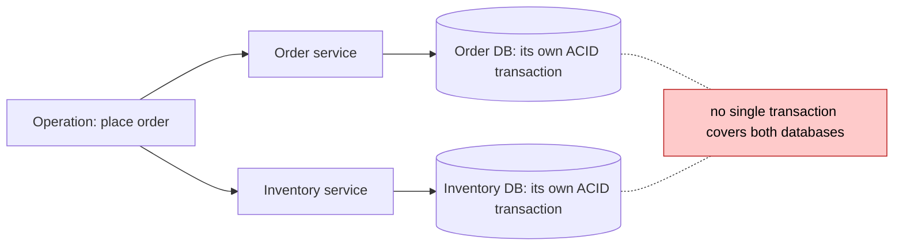
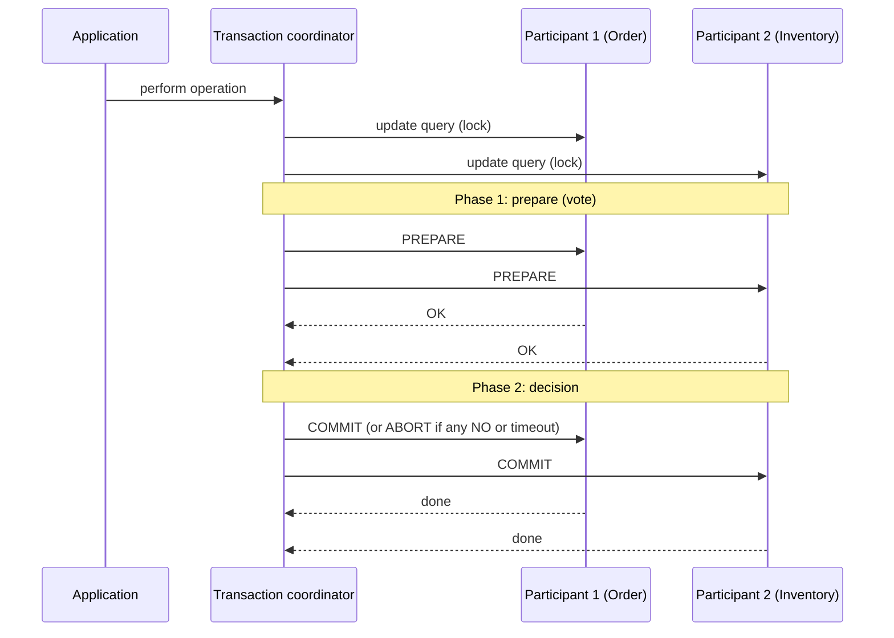
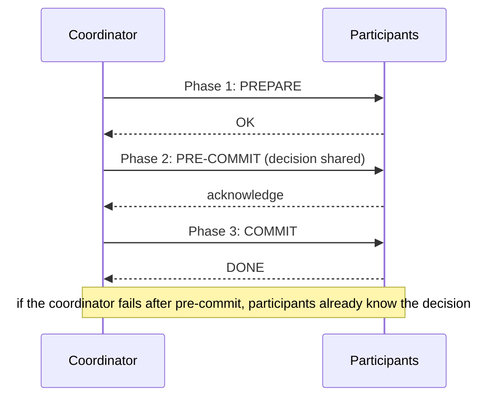
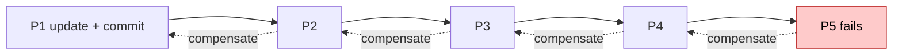

# Handle Distributed Transactions – Two-Phase Commit (2PC), Three-Phase Commit (3PC), SAGA Pattern (HLD #20 – Lecture 57)

<!-- nav -->
⬅ [19 Distributed Cache and Caching Strategies](19_Distributed_Cache_and_Caching_Strategies_Notes.md) · [Index](00_HLD_Index.md) · [24 OAuth 2.0](24_OAuth_2.0_Notes.md) ➡
<!-- nav -->

Sources:
- Handwritten PDF (7 pages): https://drive.google.com/file/d/1kPHF4MMoqc2xFXNXaXHfqqrEDdeU0kLO/view?usp=drive_link
- Typed Zoho note (JavaScript-rendered, not readable automatically): https://notebook.zohopublic.in/public/notes/u3i1sc0949c83b482441887cc4eba8031560e

---

<!-- simple-explanation -->
## In simple words – distributed transactions: 2PC, 3PC and SAGA

### What is a transaction?
A **transaction** groups several steps into one unit, e.g. "take ₹100 from A, give ₹100 to B". It follows **ACID**:
- **Atomicity** – all steps happen or none do. If crediting B fails, the debit from A is undone.
- **Consistency** – rules always hold. Total money stays the same before and after.
- **Isolation** – transactions running together behave as if they ran one after another.
- **Durability** – once committed, the result survives crashes.

A single database does this for you with `Begin → … → Commit / Rollback`.

### The problem in microservices
Placing an order might need to update the **Order database** *and* the **Inventory database**, which belong to different services. A normal transaction only works **inside one database**, so you can't just wrap both updates in one `Begin/Commit`. We need a way to make multiple databases agree. Three options:

| Pattern | Style | Used? |
|---|---|---|
| Two-Phase Commit (2PC) | synchronous (the user waits) | popular |
| Three-Phase Commit (3PC) | synchronous | rare, too complex |
| SAGA | asynchronous | very common in microservices |

### Two-Phase Commit (2PC)
A **coordinator** manages the **participants** (e.g. Order service and Inventory service).
- **Phase 1 – Prepare (voting):** the coordinator asks everyone "can you commit?". Each participant locks its data, gets ready, and answers **OK** or **NO**.
- **Phase 2 – Commit/Abort (decision):** if everybody said OK, the coordinator sends **COMMIT**. If anyone said NO or timed out, it sends **ABORT**. Everyone obeys and confirms.

What can go wrong?
- **Prepare message lost / OK message lost:** the coordinator waits, times out, and **aborts**. Safe.
- **COMMIT/ABORT message lost, or the coordinator crashes:** a participant that voted OK is **stuck**. It can't commit or abort by itself because only the coordinator knows the decision, so it keeps its locks and **waits**. This is the **blocking problem** of 2PC.

### Three-Phase Commit (3PC)
Adds an extra **Pre-Commit** step between prepare and commit. After the votes, the coordinator first tells everyone "I have decided to commit" and they acknowledge; only then does the actual **COMMIT** go out. Since every participant already knows the decision, they can finish even if the coordinator crashes, so it is **non-blocking**. The price is more messages and complexity, so it's rarely used.

### SAGA pattern
Instead of one big locked transaction, break the work into a **chain of small local transactions**, one per service: Service 1 commits in its own DB then triggers Service 2 (usually by publishing an event to a message broker), then Service 3, and so on.
- If a later step fails (say step 5), the earlier services run **compensating transactions** to undo their work in reverse order (4 → 3 → 2 → 1). For example "cancel the order" compensates "create the order".
- It is **asynchronous** and doesn't hold locks across services, so it scales well. The trade-off: data is only **eventually consistent**, and you must write the compensating logic.

### Quick guide
2PC = strong consistency, but slow and can block. 3PC = fewer blocking issues, complex. SAGA = scalable and flexible, eventually consistent. Related: [Dual Write Problem](33_Dual_Write_Problem_Notes.md), [High Availability](15_High_Availability_Architecture_Notes.md).
<!-- simple-explanation -->


## 1. What is a transaction?
A **set of operations (a group of tasks) that must be performed against the DB.** It has **4 properties (ACID):**

| Property | Meaning | Example in the notes |
|---|---|---|
| **Atomicity** | **All operations in a single transaction succeed, or all fail.** | Txn: ① Debit A 100 Rs, ② Credit B 100 Rs – if step ② fails, step ① must not stay applied. |
| **Consistency** | DB is in a **consistent state before and after** the transaction. | A=100, B=50 (total 150) → after transfer A=0, B=150 (total still 150). |
| **Isolation** | **More than one transaction running concurrently appears to be serialized.** | Txn1: Debit A 100, Credit B 50; Txn2: Debit B 150, Credit C 150 – running together must behave as if one-after-another. |
| **Durability** | After a transaction **successfully completes, even if the DB fails the data must not be lost.** | – |

Local transaction pseudo-code:
```
Begin-Transaction
   - Withdraw money from 'A': Rs 100
   - Deposit money to  'B': Rs 100
   if all success: Do Commit
   else:           Do Rollback
Close-Transaction
```
(e.g. A: 100 → 0, B: 100 → 200.)

## 2. The problem in a distributed system

<!-- diagram:20-0 -->
**Diagram – ACID is local to each database**


<!-- /diagram:20-0 -->


```
Begin-Transaction
   - update Order DB
   - update Inventory DB
   if all success: Do Commit  else: Do Rollback
Close-Transaction
```
**Will this work?** – **No.** ACID is local to a DB: Order DB (count 100 → 101) has its own ACID transaction, Inventory DB (count 500) has its own; **a transaction is local to a particular database.**

> **How do we handle a distributed system where an operation involves multiple databases? How do we satisfy the transaction properties in a distributed system?**

### Ways to handle a transaction in a distributed system
| | Pattern | Remarks |
|---|---|---|
| ① | **2-Phase Commit** | **very popular**, **synchronous** |
| ② | **3-Phase Commit** | **not much used because of complexity**, **synchronous** |
| ③ | **Saga Pattern** | **still used very much**, **asynchronous** |

In the synchronous ones **the customer is waiting for the transaction to complete.**

---

## 3. Two-Phase Commit (2PC)

<!-- diagram:20-1 -->
**Diagram – Two-phase commit**


<!-- /diagram:20-1 -->


Two phases: **1. Voting / Prepare phase** and **2. Decision / Commit phase.**

**Actors:** Application · **Transaction Coordinator** (supports both participants) · **Participant 1** (Order microservice) · **Participant 2** (Inventory microservice).

**Flow**
1. Application → Coordinator: **perform the operation**; coordinator **starts the transaction.**
2. Coordinator sends the **update query** to both participants; each participant takes a **lock.**
3. **Phase 1 begins** – Coordinator writes a **"Send Prepare message" record to a lock file (permanent storage)** and sends **PREPARE** to both participants.
4. Each participant writes its own lock file and replies **OK** (or **NO** if it can't commit).
5. **Phase 2 begins** – coordinator updates its log ("Prepare COMMIT") and decides:
   - **all OK → COMMIT** to everyone;
   - **any NO / timeout → ABORT** to everyone.
6. Participants apply it and reply **OK Commit / Done**; coordinator **closes the transaction.**

### Interview question – what kind of issues can come?
**Failure points:** ① the **Transaction Coordinator can fail**, ② a **Participant can fail.** Message-loss cases:
1. **Prepare message is lost** → ⇒ **Abort the Txn** (coordinator times out waiting for the vote, then aborts).
2. **OK message is lost** → the **Transaction Coordinator waits some time; if the timeout is over, it aborts the Txn.**
3. **COMMIT / ABORT message is lost** → the participant said OK to Prepare and now hears nothing. **The participant cannot decide on its own** – it has to **wait and ask the coordinator what happened (COMMIT or ABORT)** because **the decision is held only by the coordinator.** (This is the **blocking** weakness of 2PC – participants stay locked while the coordinator is down.)

---

## 4. Three-Phase Commit (3PC) – a **non-blocking** protocol

<!-- diagram:20-2 -->
**Diagram – Three-phase commit adds a pre-commit step**


<!-- /diagram:20-2 -->


Three phases: **1. Prepare phase** [same as 2PC] · **2. Pre-Commit phase** · **3. Commit phase.**

**Flow**
1. Application → Coordinator: perform the operation; **START TRANSACTION**; update queries sent to participants.
2. **Phase 1 begins:** PREPARE → participants reply **OK.**
3. **Phase 2 begins (Pre-Commit phase):** coordinator makes the decision and sends **Pre-Commit: Commit** – *"we are just sharing information about what the coordinator has taken"* – participants **Acknowledge.**
4. **Phase 3 begins:** **COMMIT** → participants reply **DONE**; **close transaction.**

Why it helps: because every participant **already knows the decision (from the pre-commit)** before the final commit, if the coordinator fails after the pre-commit message a participant can still proceed (the diagram shows the coordinator `C` crashing after sending *Prepare : Commit* to participant `P` – the participants hold the decision). **But it's more complex → rarely used.**

---

## 5. SAGA pattern (asynchronous)

<!-- diagram:20-3 -->
**Diagram – SAGA: chain of local transactions and compensations**


<!-- /diagram:20-3 -->


- A chain of **local transactions** P1 → P2 → P3 → P4 → P5 → P6; each service performs its own **update + commit** in its own DB, then triggers the next one (e.g. by **publishing an event to a queue / message broker**).
- **It's kind of sequential in nature.**
- **Failure handling:** if a later step fails (e.g. **P5 fails**), the previous services run **compensating transactions – Rollback** in reverse order: P4 → P3 → P2 → P1 (each undoing its committed work).
- Communication is **asynchronous** (event published to a queue; "Msg fail" if the message can't be delivered must be handled too).

---

## Quick revision
- ACID is **local to one DB**; multi-DB operations need a **distributed-transaction protocol.**
- **2PC:** prepare (vote) → commit/abort; **synchronous, popular, but blocking** (participants wait for the coordinator; lost COMMIT/ABORT leaves them stuck).
- **3PC:** adds **pre-commit** to make it **non-blocking**; more complex, rarely used.
- **SAGA:** sequence of local transactions + **compensating rollbacks**; **asynchronous**, widely used in microservices; eventually consistent.
- Related: [Dual Write Problem](33_Dual_Write_Problem_Notes.md), [High Availability](15_High_Availability_Architecture_Notes.md).

---

<!-- nav -->
⬅ [19 Distributed Cache and Caching Strategies](19_Distributed_Cache_and_Caching_Strategies_Notes.md) · [Index](00_HLD_Index.md) · [24 OAuth 2.0](24_OAuth_2.0_Notes.md) ➡
<!-- nav -->
