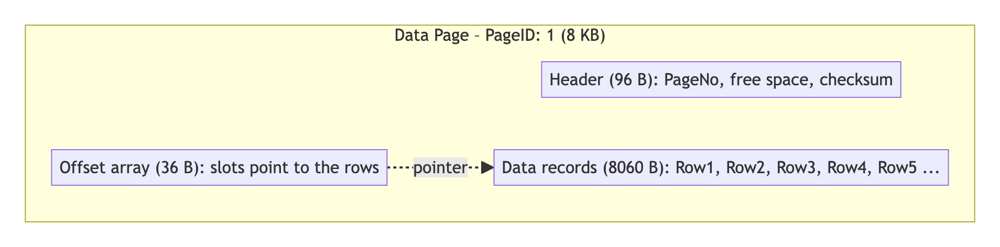
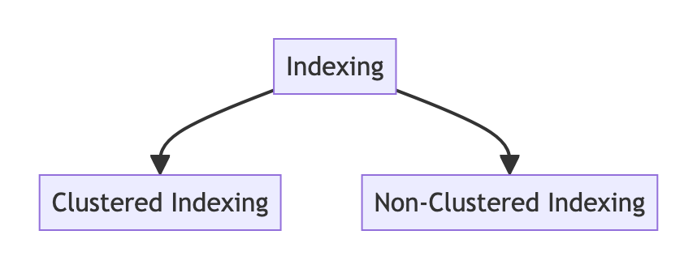
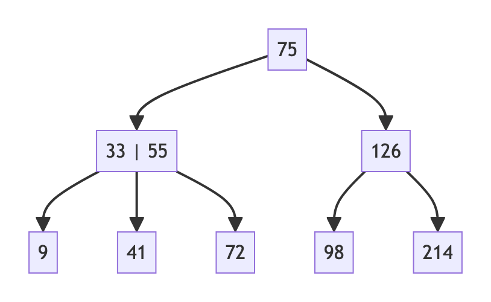
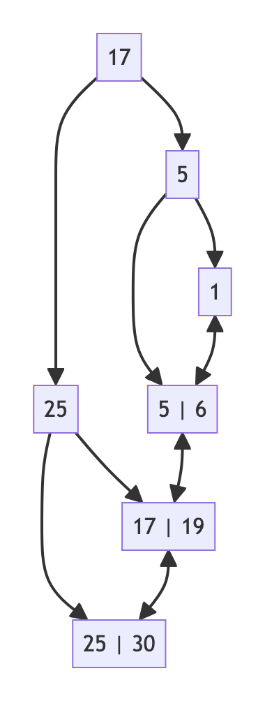
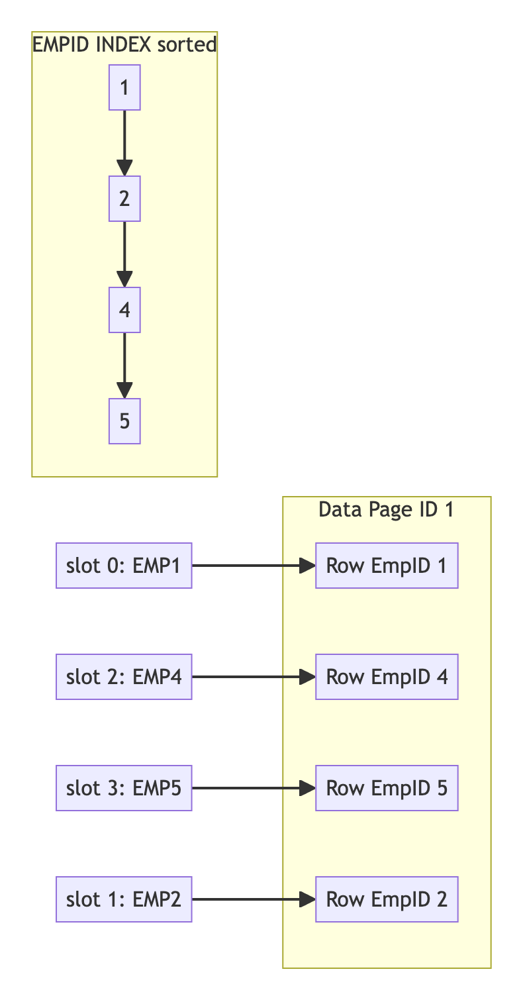

# Database Indexing – RDBMS (HLD #21)

<!-- nav -->
⬅ [20 Distributed Transactions](20_Distributed_Transactions_Notes.md) · [Index](00_HLD_Index.md) · [22 Concurrency Control](22_Concurrency_Control_Notes.md) ➡
<!-- nav -->

Source: Typed Zoho note – https://notebook.zohopublic.in/public/notes/74tdo7871dd86eb99414bb94d8737a8b73b84

Before seeing how indexing works, a few things need to be understood first:
1. How table data (rows) are actually stored?
2. What type of indexing is present?
3. The data structure used for indexing and how it works?

Then it combines all of them to see how the DBMS actually does the indexing.

## 1. How is table data actually stored?

A table like this (Emp ID, Name, Address with Row1…Row4) is **just a logical representation. The actual data is not stored this way.**

- The DBMS creates **Data Pages** (generally **8 KB**, but depends on the DB).
- Each data page can store **multiple table rows**.

**Example of a data page (8 KB = 8192 bytes):**

| Part | Size | What it holds |
|---|---|---|
| Header | 96 bytes | PageNo, free space, checksum etc. |
| Data records | 8060 bytes | the **actual data** is stored here |
| Offset | 36 bytes | an **array; each index of the array holds a pointer to the corresponding data in the data records** |

If one table row is, say, 64 bytes, then **one data page can hold about 125 rows**.

**In simple words:** the table you imagine as a grid is really cut into 8 KB pages. A page has a small header, a big area holding the rows, and a small array at the end whose entries point to where each row sits inside the page. The rows in the data area need not be in order, because the offset array is what remembers where each one is.

### Data page and data block

- The DBMS **creates and manages these data pages.** To store one table, it can create **many** data pages.
- The data pages ultimately get stored in a **Data Block in physical memory like disk.**

**What is a data block?**
- It is the **minimum amount of data that can be read/written by an I/O operation.**
- It is **managed by the underlying storage system like the disk.** Size can range from **4 KB to 32 KB (common size 8 KB).**
- Based on the data block size, it can hold **1 or many data pages.**

The **DBMS maintains the mapping of data page and data block**, for example:

| Data Page | Data Block |
|---|---|
| Data Page1 | Data Block 1 |
| Data Page2 | Data Block 1 |
| Data Page3 | Data Block 2 |
| Data Page4 | Data Block 2 |

**Remember:** the DBMS **controls data pages** (which row goes in which page, sequence of pages etc.) but has **no control over data blocks** (data blocks can be scattered over the disk).

**In simple words:** the DBMS decides what goes into each page, but the disk decides where the blocks holding those pages physically live.

## 2. What types of indexing are present in RDBMS?

Before understanding clustered and non-clustered indexing, first understand **what is indexing** and **what data structure it uses and how it works.**

### What is indexing?

- It is used to **increase the performance of database queries**, so that data can be **fetched faster.**
- **Without indexing, the DBMS has to iterate over each and every table row** to find the requested data, i.e. **O(N)**. If there are millions of rows, the query can take some time.

### Which data structure gives better time complexity than O(N)?

**B+ Tree** – it gives **O(log N)** time complexity for **insertion, searching and deletion.**

## 3. How does a B (Balanced) tree work?

- It **maintains sorted data.**
- **All leaves are at the same level.**
- An **M-order B tree** means each node can have **at most M children** and **M−1 keys** per node.

**Example:** store `9, 33, 75, 41, 98, 214, 126, 55, 72` in a **3-order B tree**. A node looks like `Pointer | Key1 | Pointer | Key2 | Pointer`, where the left pointer leads to values `< key1`, the middle one to values `>= key1 and < key2`, and the right one to values `>= key2`.

| Step | What happens |
|---|---|
| Insert 9, 33 | The single node holds `9 33`. |
| Insert 75 | The node would be `9 33 75` (too many keys for a 3-order tree), so it **splits**: `33` goes up, `9` is the left child and `75` the right child. |
| Insert 41 | Goes to the right child: `41 75`. |
| Insert 98 | Right child would be `41 75 98`, so it splits: `75` goes up. Root becomes `33 75` with children `9`, `41`, `98`. |
| Insert 214 | Goes next to 98: `98 214`. |
| Insert 126 | The last leaf would be `98 126 214`, so it splits and `126` goes up. That makes the root `33 75 126`, which is too big, so **it splits again**: `75` becomes the root, with `33` (children `9`, `41`) on the left and `126` (children `98`, `214`) on the right. |
| Insert 55 | Goes into the leaf with 41: `41 55`. |
| Insert 72 | That leaf would be `41 55 72`, so it splits: `55` goes up into the `33` node, giving `33 55`, with leaves `9`, `41`, `72`. |

Final tree:

**In simple words:** whenever a node gets more keys than allowed, the middle key moves up to the parent and the node splits in two. Because the splits push upward, all leaves always stay at the same depth, which is why searching stays fast.

## 4. B+ tree

- A **B+ tree is exactly the same as a B tree, with an additional feature: the leaf (child) nodes are also linked to each other.**
- **The DBMS uses a B+ tree to manage its data pages and the rows within the pages.**
- **Root node or intermediate node** hold the value used for **faster searching** of the data. It is possible that the value has been deleted from the DB, but it can still be used for sorting the tree.
- **Leaf nodes actually hold the indexed column value.**

**Example:** table `EmpID, EmpName` = (19,e1) (25,e2) (30,e3) (17,e4) (6,e5) (1,e6) (5,e7), with **EmpID as the indexed column**, stored in a **3-order B+ tree**:

1. Insert 19: the leaf `19` points to Data Page 1 (row `19, e1`).
2. Insert 25: the leaf `19 25`, both pointing to rows in Data Page 1.
3. Insert 30: leaf `19 25 30` is too big, so it splits: root `25`, leaves `19` and `25 30`; all point to rows in Data Page 1 (`19,e1`, `25,e2`, `30,e3`).
4. Insert 17: goes in with 19 (`17 19`); the page holds `17,e4 / 19,e1` in Data Page 1 and `25,e2 / 30,e3` in Data Page 2 (both pages are in Data Block 1).
5. Insert 6: it goes to the left leaf, which would be `6 17 19`, so it splits: root becomes `17 25` with leaves `6`, `17 19`, `25 30`.
6. Insert 1: leaf `1 6`.
7. Insert 5: the leaf would be `1 5 6`, so it splits and the root splits too. Final: root `17`; children `5` and `25`; leaves `1`, `5 6`, `17 19`, `25 30`, **all leaves linked to each other** (double arrows).

**In simple words:** the upper nodes are only signposts. The leaves hold the real indexed values and point to the rows in the data pages. Because the leaves are chained together, the DBMS can walk through a range of values in order without going back up the tree.

## 5. Clustered indexing

- **The order of rows inside the data pages matches the order of the index.**

**Example:** table `EMPID, NAME, ADDRESS` with rows in the order (1,A,City1) (4,C,City3) (5,D,City4) (2,B,City2). **Let's make EmpID the primary key.** When EmpID is marked as the primary key, **the DBMS creates an INDEX on it and sorts the EmpID data to facilitate faster search.** The EmpID index is sorted `1, 2, 4, 5`.

In the data page (Page ID 1) the rows are stored `EmpID 1, 4, 5, 2`, and the offset array (slots) is `EMP5 (3), EMP4 (2), EMP2 (1), EMP1 (0)`. The slot array is what provides the sorted order: slot 0 → EmpID 1, slot 1 → EmpID 2, slot 2 → EmpID 4, slot 3 → EmpID 5, even though the rows physically sit in a different order inside the page.

**So:**
- **There can be only 1 clustered index per table**, because the ordering of pages can be done based on **one** index only.
- If you have **not specified any clustered index manually**, the DBMS looks for the **PRIMARY KEY (which is UNIQUE and NOT NULL)** and uses it as the clustered key.
- If the table has **no primary key**, then internally it **creates a hidden column** which is used as the clustered index. (This column just increases sequentially, so it is guaranteed to be unique and not null.)

**In simple words:** a clustered index means the table's rows themselves are kept in the order of that key, so it is "the table sorted by that column". A table can be sorted in only one way, so only one clustered index is possible.

Non-clustered indexing is not covered here.

---

<!-- nav -->
⬅ [20 Distributed Transactions](20_Distributed_Transactions_Notes.md) · [Index](00_HLD_Index.md) · [22 Concurrency Control](22_Concurrency_Control_Notes.md) ➡
<!-- nav -->
