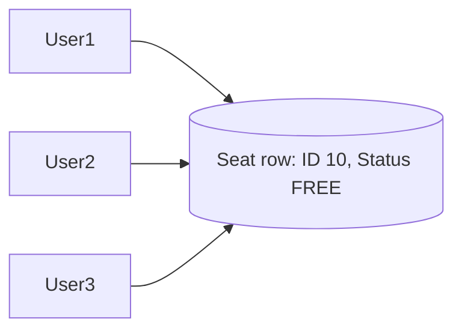
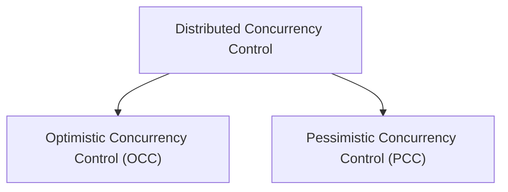
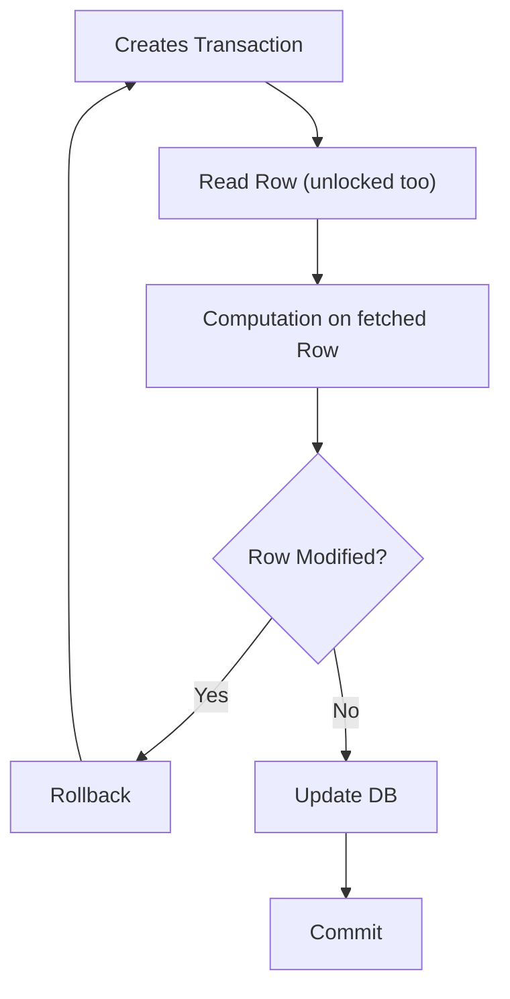
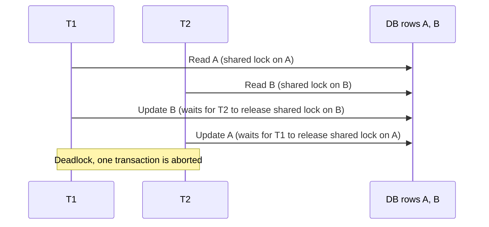

# Concurrency Control in Distributed Systems (HLD #22)

<!-- nav -->
⬅ [21 Database Indexing](21_Database_Indexing_Notes.md) · [Index](00_HLD_Index.md) · [23 Two Phase Locking 2PL](23_Two_Phase_Locking_2PL_Notes.md) ➡
<!-- nav -->

Source: Typed Zoho note – https://notebook.zohopublic.in/public/notes/u3i1s8441ef17edee467bb020cc6974b3d7f9

## 1. Scenario

**Many concurrent requests try to book the same movie theatre seat.**

Table: `ID = 10, Status = FREE`. Users 1, 2 and 3 all try to book that seat. The logic for each request is:

```
Read Seat Row with ID: 10
If Free:
    Logic to change the Status from Free to Booked
    Update the DB
```



**In simple words:** if all three read "FREE" at the same moment, all three will think the seat is theirs and all three will write "Booked". That is the concurrency problem to solve.

## 2. Solution 1 – `synchronized` for the critical section

```
synchronized ()
{
    Read Seat Row with ID: 10
    If Free:
        Logic to change the Status from Free to Booked;
        Update the DB;
}
```

The page asks: **"Will this solution work for a distributed system?"**

**In simple words:** `synchronized` allows one thread at a time, but only inside one application instance. In a distributed system there are many instances, so the question is whether it still protects the row. The page moves on to a second solution.

## 3. Solution 2 – Distributed concurrency control



Before learning this, the page says we **MUST** know three important things first:
1. What is the usage of **Transaction**?
2. What is **DB locking**?
3. What are the **isolation levels** present?

### 3.1 Usage of a transaction

- A transaction helps to achieve **INTEGRITY**, which means it helps us avoid **INCONSISTENCY** in our database.
- Example: debit the money from A and credit the money to B.

```
BEGIN_TRANSACTION:
    - Debit the Money from A
    - Credit the Money to B
    If all success:
        COMMIT;
    else:
        ROLLBACK;
END_TRANSACTION;
```

**In simple words:** the two steps must happen together or not at all. If either fails, everything is rolled back.

### 3.2 DB locking

DB locking helps us make sure that **no other transaction updates the locked rows.**

| Lock held \ Another lock requested | Another Shared Lock | Another Exclusive Lock |
|---|---|---|
| Have Shared Lock | Yes | NO |
| Have Exclusive Lock | NO | NO |

**In simple words:** many readers can share a row (shared locks). But if someone holds an exclusive lock, or wants one, nobody else can lock the row.

### 3.3 Isolation levels

| Isolation level | Dirty read possible | Non-repeatable read possible | Phantom read possible |
|---|---|---|---|
| Read Uncommitted | Yes | Yes | Yes |
| Read Committed | No | Yes | Yes |
| Repeatable Read | No | No | Yes |
| Serializable | No | No | No |

The page marks an arrow along this table: **Consistency high at the Serializable end, consistency low at the Read Uncommitted end.** (The arrow in the picture is drawn next to the table, with "Consistency High" at the top and "Consistency Low" at the bottom.)

**In simple words:** the further down the table, the more problems are prevented.

#### Dirty read

If Transaction A reads data that is being written by Transaction B and is **not yet committed**, and B then rolls back, whatever A read is a **dirty read.**

| Time | Transaction A | Transaction B | DB |
|---|---|---|---|
| T1 | BEGIN_TRANSACTION | BEGIN_TRANSACTION | ID 1, Status Free |
| T2 | Update Row ID:1, Status: Booked | | ID 1, Booked (not committed yet) |
| T3 | | Read Row ID:1 (got status as Booked) | ID 1, Booked (not committed yet) |
| T4 | Some issue faced here | Some computation | ID 1, Booked (not committed yet) |
| T5 | Rollback | Commit | ID 1, Status Free |

(The page's table is written with A doing the update and B doing the read, while its sentence above uses the roles the other way round. The idea is the same: one transaction reads another's uncommitted change, and that change is rolled back.)

#### Non-repeatable read

Transaction A **reads the same row several times and there is a chance that it reads a different value.**

| Time | Transaction A | DB |
|---|---|---|
| T1 | BEGIN_TRANSACTION | ID 1, Free |
| T2 | Read Row ID:1 (reads status Free) | ID 1, Free |
| T3 | | ID 1, Booked (some other transaction changed and committed) |
| T4 | Read Row ID:1 (reads status Booked) | ID 1, Booked |
| T5 | COMMIT | |

#### Phantom read

Transaction A **executes the same query several times and there is a chance that the rows returned are different.**

| Time | Transaction A | DB |
|---|---|---|
| T1 | BEGIN_TRANSACTION | ID 1 Free, ID 3 Booked |
| T2 | Read rows where ID>0 and ID<5 (reads 2 rows: ID 1 and ID 3) | ID 1 Free, ID 3 Booked |
| T3 | | another transaction inserted row ID 2 and committed: ID 1, ID 2, ID 3 |
| T4 | Read rows where ID>0 and ID<5 (reads 3 rows: ID 1, ID 2 and ID 3) | ID 1, ID 2, ID 3 |
| T5 | COMMIT | |

(The page writes "23rows" at T4, which is clearly a typo for 3 rows.)

**In simple words:**
- **Dirty read:** you read something that someone else has not committed.
- **Non-repeatable read:** the same row gives a different value when read twice.
- **Phantom read:** the same query gives a different set of rows when run twice.

### 3.4 Locking strategy per isolation level

| Isolation level | Locking strategy |
|---|---|
| Read Uncommitted | Read: no lock acquired. Write: no lock acquired. |
| Read Committed | Read: shared lock acquired and released as soon as the read is done. Write: exclusive lock acquired and kept till the end of the transaction. |
| Repeatable Read | Read: shared lock acquired and released only at the end of the transaction. Write: exclusive lock acquired and released only at the end of the transaction. |
| Serializable | Same as Repeatable Read locking strategy **plus range lock**, and locks are released only at the end of the transaction. |

How to use it:

```
SET TRANSACTION ISOLATION LEVEL REPEATABLE READ;
BEGIN_TRANSACTION;
    SELECT Query;
    Update Query;
    If Success:
        COMMIT TRANSACTION;
    else:
        ROLLBACK TRANSACTION;
END_TRANSACTION
```

The page then says: "Let's come back to the main solution of the problem *how to resolve the concurrency issue*".

## 4. OCC vs PCC

| | Optimistic Concurrency Control (OCC) | Pessimistic Concurrency Control (PCC) |
|---|---|---|
| Isolation level used | below REPEATABLE READ | REPEATABLE READ and SERIALIZABLE |
| Concurrency | much higher | less than optimistic |
| Deadlock | no chance of deadlock | possible; transactions stuck in a deadlock are forced to roll back |
| Downside | in case of conflict, there is the overhead of transaction rollback and retry logic | putting a long lock sometimes causes a timeout issue and a rollback needs to be done |

### 4.1 Optimistic Concurrency Control – example with a version column

| Time | Transaction A | Transaction B | DB |
|---|---|---|---|
| T1 | BEGIN_TRANSACTION | BEGIN_TRANSACTION | ID 1, Free, Version 1 |
| T2 | Read Row ID:1 (row version is 1) | Read Row ID:1 (row version is 1) | ID 1, Free, Version 1 |
| T3 | Select for Update (version validation happens) | | ID 1, Free, Version 1 (exclusive lock by Txn A) |
| T4 | Update Row ID:1, Status: Booked, Version: 2 | | ID 1, Booked, Version 2 (exclusive lock by Txn A) |
| T5 | COMMIT | | ID 1, Booked, Version 2 |
| T6 | | Select for Update (version validation happens) | ID 1, Booked, Version 2 (exclusive lock by Txn B) |
| T7 | | ROLLBACK | ID 1, Booked, Version 2 |

Flow of OCC:



**In simple words:** nobody locks the row while they read and think. Each row has a version number. When a transaction finally wants to write, it locks the row only briefly and checks that the version is still the one it read. A saw version 1 and updated it to version 2. When B arrives, the version is no longer 1, so B rolls back and has to retry from the start.

### 4.2 Pessimistic Concurrency Control

The page for PCC is a **handwritten whiteboard sketch** that is hard to read. What it shows:
- A heading "Pessimistic Concurrency Control (PCC)" and a note about **Serializable** (T1 then T2, or T2 then T1).
- A **use case** with two transactions: **T1: Read A, Update B** and **T2: Read B, Update A**, on a DB holding rows A and B, drawn with shared locks and exclusive locks.
- The word **"Deadlock"** circled: T1 holds a shared lock on A and wants to write B, while T2 holds a shared lock on B and wants to write A. Each is waiting for the other to release a shared lock, so one of them gets **aborted**.



**In simple words:** pessimistic control assumes conflicts will happen, so it locks the rows up front. That keeps data safe, but it can lead to deadlocks and long waits, which is why the table above lists those as its downsides.

---

<!-- nav -->
⬅ [21 Database Indexing](21_Database_Indexing_Notes.md) · [Index](00_HLD_Index.md) · [23 Two Phase Locking 2PL](23_Two_Phase_Locking_2PL_Notes.md) ➡
<!-- nav -->
