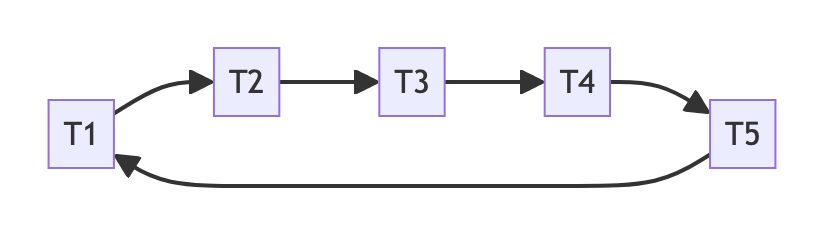

# Two-Phase Locking – 2PL (HLD #23)

<!-- nav -->
⬅ [22 Concurrency Control](22_Concurrency_Control_Notes.md) · [Index](00_HLD_Index.md) · [24 OAuth 2.0](24_OAuth_2.0_Notes.md) ➡
<!-- nav -->

Source: Typed Zoho note – https://notebook.zohopublic.in/public/notes/74tdoc7e4be4e091e4005916a9721b69ee7b3

Read [22 Concurrency Control](22_Concurrency_Control_Notes.md) before this note.

## 1. Basic Two Phase Locking

**Phase 1 – Growing phase**
- The transaction **requests the lock from the lock manager.**
- The lock manager **either grants or denies** the lock request (denied if another transaction has already placed a lock on it).

**Phase 2 – Shrinking phase**
- The transaction **cannot acquire any new locks.**
- The transaction is **only allowed to release the locks taken previously.**

If you plot the **number of locks (y) against time (x)**, the line **rises** during the growing phase to a peak, then **falls** during the shrinking phase.

**In simple words:** a transaction first only collects locks, then, after it releases its first lock, it may only let go of locks. It can never go back to collecting. That one rule is what the name "two-phase" means.

**Example (basic 2PL), X = exclusive lock:**

| Time | Transaction 1 | Transaction 2 |
|---|---|---|
| t0 | BEGIN TXN | |
| t1 | X(A) | |
| t2 | X(B) | |
| t3 | process some work | |
| t4 | Unlock (A) | BEGIN TXN |
| t5 | Unlock (B) | X(B) |
| t6 | COMMIT | X(A) |
| t7 | | COMMIT |

(commit will unlock A and B internally)

## 2. Two big issues of basic 2PL, and the way around them

### Issue 1 – Deadlock

| Time | Transaction 1 | Transaction 2 |
|---|---|---|
| t0 | BEGIN TXN | BEGIN TXN |
| t1 | X(A) | X(B) |
| t2 | X(B) (waiting for lock to be released on B) | X(A) (waiting for lock to be released on A) |
| t3 | | |

**OR** with lock conversion (S = shared lock):

| Time | Transaction 1 | Transaction 2 |
|---|---|---|
| t0 | BEGIN TXN | BEGIN TXN |
| t1 | S(A) | S(A) |
| t2 | X(A) (lock conversion only happens if Txn2's read lock is released) | X(A) (lock conversion only happens if Txn1's read lock is released) |
| t3 | | |

**In simple words:** each transaction holds something the other needs and waits for it, so neither can move.

### Deadlock prevention / handling strategies

**1. Timeout**
- If the scheduler finds that a transaction is waiting too long for a lock, it simply **assumes there might be a deadlock involving this transaction and aborts it.**
- The scheduler **can make a mistake** (what if TXN1 waits for a lock held by TXN2, which is just taking a long time to finish).

**2. Directed graph called Wait-for-Graph (WFG)**
- There is an **edge from node Ti to Tj** if **transaction Ti is waiting for transaction Tj to release some lock.**
- The scheduler **deletes the edge whenever a lock is released** by the transaction that was making another wait.
- The scheduler **looks for a cycle in the WFG** to identify a deadlock.

(Example: T1 → T2 → T3 → T4 → T5 → back to T1 is a **deadlock**.)

- When a deadlock is identified, a transaction is **chosen from the cycle in the WFG to be ABORTED (such transactions are called the victim).**
- The scheduler checks these things to pick the victim:
  - the amount of effort the transaction has put in till now,
  - the amount of effort required to finish it,
  - the **cost of aborting** it (cost generally means how many updates have already been done),
  - the number of cycles that contain the transaction.

**3. Conservative 2PL (also known as Static 2PL)**
- **Avoid deadlock by requiring each transaction to acquire all its locks at the start** of the transaction itself.
- Each transaction **pre-declares its read and write operations** to the scheduler.
- The scheduler **tries to set all the locks** needed by the transaction.
- If the scheduler **fails to acquire any lock, none of the locks is granted** and the transaction waits.

The graph: the lock count **jumps straight to its maximum at the start** (green flat line, no gradual growth) and then shrinks (red falling line).

**Cons of conservative 2PL:**
- Less concurrency.
- Extra overhead for the scheduler to know all the read and write operations of the transaction before it starts.

**4. Timestamp-based deadlock prevention**
- **Old timestamp of a transaction = high priority of the transaction.**

| Scheme | Rule |
|---|---|
| **Wait-Die** | The **old transaction waits for the new one.** If ts(T1) < ts(T2), T1 waits for T2 to complete, otherwise the transaction gets aborted. |
| **Wound-Wait** | The **old transaction "wounds" the new one and makes it abort.** If ts(T1) < ts(T2), T2 aborts and releases its lock, otherwise the transaction waits. |

Examples (ts(T1) < ts(T2), so **T1 has higher priority than T2**):

| Case | Wait-Die | Wound-Wait |
|---|---|---|
| T1 begins first; T2 begins and takes X(A); T1 then asks X(A) (older asks for a lock held by younger) | **T1 will wait** | **T2 will be aborted** |
| T1 begins first and takes X(A); T2 begins and asks X(A) (younger asks for a lock held by older) | **T2 will abort** | **T2 will wait** |

**In simple words:** the age of a transaction decides who gets to wait and who gets killed, so a circular wait can never form. In Wait-Die the old one is patient and the young one dies; in Wound-Wait the old one is aggressive and wounds the young one.

### Issue 2 – Cascading aborts

| Time | Transaction 1 | Transaction 2 |
|---|---|---|
| t0 | BEGIN TXN | BEGIN TXN |
| t1 | X(A) | |
| t2 | X(B) | |
| t3 | Update the value of A | |
| t4 | Unlock(A) | |
| t5 | | X(A) |
| t6 | | Some operation |
| t7 | ABORT | |
| t8 | | |
| t9 | | **This has to be ABORTED too, as it read the dirty value of A** |

**In simple words:** T1 released A early and then aborted. T2 had already used A's uncommitted value, so T2 must be undone too. One abort drags others down with it.

### Cascading-abort prevention strategy: Strong Strict 2PL (also known as Rigorous 2PL)
- The transaction is **not allowed to acquire or upgrade more locks after the growing phase.**
- **Release all the locks only at the end of the transaction.**

The graph: the locks grow, then stay flat until the end of the transaction, when **all locks are released at once** (vertical drop).

**Cons of Strict 2PL:**
- Less concurrency.
- Deadlock.

## 3. Worked example comparing the three variants

**T1:** send ₹10 from A to B. **T2:** sum of A balance + B balance. **Initial values: A = 100, B = 100.**

### Basic 2PL (deadlock and cascading-abort issues both present)

| Time | Transaction 1 | Transaction 2 |
|---|---|---|
| t0 | BEGIN TXN | BEGIN TXN |
| t1 | X(A) | |
| t2 | A = A−10 i.e. (100−10) | |
| t3 | Update A value | |
| t4 | Unlock(A) | |
| t5 | | S(A) |
| t6 | | Read value of A i.e. 90 |
| t7 | | Unlock(A) |
| t8 | | S(B) |
| t9 | | Read value of B i.e. 100 |
| t10 | | Unlock(B) |
| t11 | X(B) | COMMIT |
| t12 | B = B+10 | |
| t13 | Update B value | |
| t14 | Unlock(B) | |
| t15 | Commit | |

**Output of T2: A + B = 90 + 100 = 190** (wrong, the total should be 200).

### Conservative 2PL (cascading-abort issue present)

| Time | Transaction 1 | Transaction 2 |
|---|---|---|
| t0 | BEGIN TXN | BEGIN TXN |
| t1 | X(A) | |
| t2 | X(B) | |
| t3 | A = A−10 i.e. (100−10) | |
| t4 | B = B+10 i.e. (100+10) | |
| t5 | Update B value | |
| t6 | Unlock (A) | |
| t7 | | S(A) |
| t8 | | S(B) (waiting…) |
| t9 | | (waiting…) |
| t10 | Unlock (B) | S(B) (Success) |
| t11 | Commit | Read value of A and B |
| t12 | | Unlock (A) |
| t13 | | Unlock (B) |
| t14 | | Commit |

**Output of T2: A + B = 90 + 110 = 200** (correct).

### Strong Strict 2PL

| Time | Transaction 1 | Transaction 2 |
|---|---|---|
| t0 | BEGIN TXN | BEGIN TXN |
| t1 | X(A) | |
| t2 | A = A−10 i.e. (100−10) | S(A) (waiting…) |
| t3 | Update A value | (waiting…) |
| t4 | X(B), B = B+10 i.e. (100+10) | (waiting…) |
| t5 | Update B value | (waiting…) |
| t6 | Commit | (waiting…) |
| t7 | | S(A) (Success) |
| t8 | | Read A value |
| t9 | | S(B) |
| t10 | | Read B value |
| t11 | | Commit |

**Output of T2: A + B = 90 + 110 = 200** (correct).

**In simple words:** with basic 2PL, T2 slipped in between T1's two updates, saw A already reduced but B not yet increased, and printed 190. With the stricter versions, T2 either waits until T1 has finished both updates, so T2 always sees a consistent 200.

---

<!-- nav -->
⬅ [22 Concurrency Control](22_Concurrency_Control_Notes.md) · [Index](00_HLD_Index.md) · [24 OAuth 2.0](24_OAuth_2.0_Notes.md) ➡
<!-- nav -->
