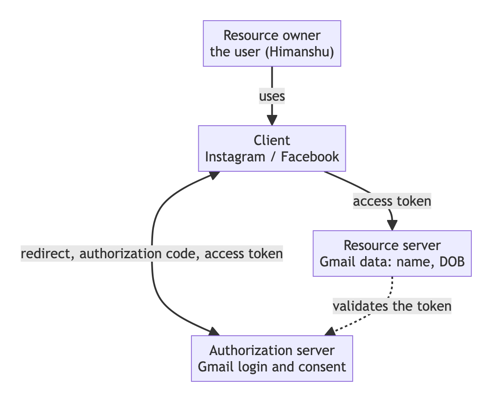
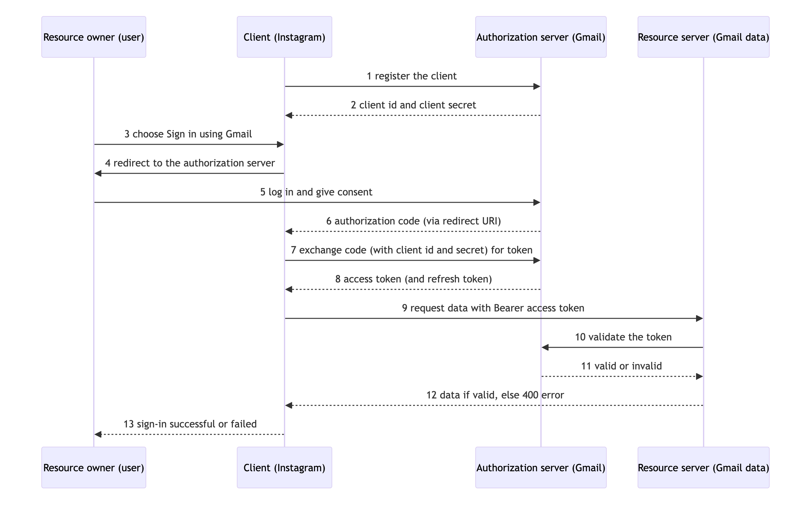
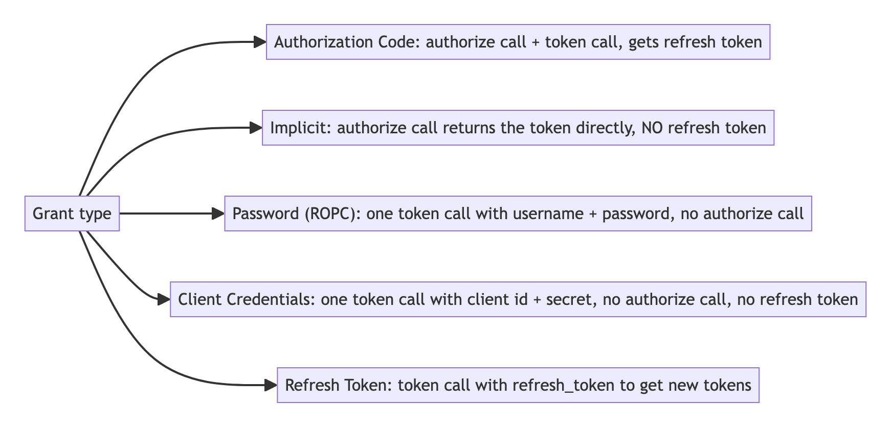

# OAuth 2.0 (HLD #24 – Lecture 61)

<!-- nav -->
⬅ [23 Two Phase Locking 2PL](23_Two_Phase_Locking_2PL_Notes.md) · [Index](00_HLD_Index.md) · [25 Symmetric and Asymmetric Encryption](25_Symmetric_and_Asymmetric_Encryption_Notes.md) ➡
<!-- nav -->

Sources:
- Handwritten PDF (4 pages): https://drive.google.com/file/d/1DTuw_AyH2ByBV8tldT4kha87MXLplXdi/view?usp=drive_link
- Typed Zoho note (read; the extra parts are in section 7): https://notebook.zohopublic.in/public/notes/bietv949cfd82a5804e0ea1d18400d3ff6fa3

---

## 1. What is OAuth 2.0?
- **OAuth stands for OPEN AUTHORIZATION.**
- It is an **Authorization framework**.
- It **enables secure third-party access to user-protected data.**

**Example – "Sign in with Gmail":** a user on *XYZ website* clicks **"I want to login" → "Sign in Gmail"** (alternatively "Sign in FB"). XYZ talks to the user's **Gmail account** (the user is **already logged in** to Gmail), and afterwards XYZ shows *"Welcome user"*.

<!-- isw:24-0 -->
**In simple words**

**OAuth stands for Open Authorization.** It is an **authorization framework** that **enables secure third-party access to user-protected data.**

The notes' example is **"Sign in with Gmail":** a user on the *XYZ website* clicks **"I want to login" → "Sign in Gmail"** (or "Sign in FB"). XYZ talks to the user's **Gmail account** (the user is **already logged in** to Gmail), and afterwards XYZ shows *"Welcome user"*.
<!-- /isw:24-0 -->


---

## 2. 4 important roles / actors

<!-- diagram:24-0 -->
**Diagram – The four roles in "Sign in with Gmail"**


<!-- /diagram:24-0 -->


| Role | Example in the notes |
|---|---|
| **Resource Owner** | the user (e.g. *Himanshu*) who owns the data |
| **Client** | the app that wants access (e.g. *Facebook / Instagram* – "Sign in with Gmail") |
| **Authorization Server** | the server that authenticates the owner and issues tokens (e.g. **Gmail authorization server** – "Authorization Resource") |
| **Resource Hosting Server** | the server holding the protected data (e.g. **Gmail resource server** – holds DOB, name, … of Himanshu) |

<!-- isw:24-1 -->
**In simple words**

There are four roles. The **Resource Owner** is the user who owns the data (for example Himanshu). The **Client** is the app that wants access (Facebook / Instagram with "Sign in with Gmail"). The **Authorization Server** authenticates the owner and issues tokens (the Gmail authorization server). The **Resource Hosting Server** holds the protected data (the Gmail resource server with Himanshu's DOB, name, and so on).
<!-- /isw:24-1 -->


---

## 3. Authorization Grant types
*(Mechanism used by clients to obtain an **Access Token**.)*
1. **Authorization Code Grant** ⭐⭐ *(most important part)*
2. **Implicit Grant**
3. **Resource Owner Password Credentials Grant**
4. **Client Credentials Grant**
5. **Refresh Token Grant** ⭐

<!-- isw:24-2 -->
**In simple words**

A grant type is the **mechanism a client uses to get an Access Token.** The notes list five: **1. Authorization Code Grant** (⭐⭐ the most important part), **2. Implicit Grant, 3. Resource Owner Password Credentials Grant, 4. Client Credentials Grant, 5. Refresh Token Grant** (⭐ important).
<!-- /isw:24-2 -->


---

## 4. End-to-end flow using Authorization Code Grant

<!-- diagram:24-1 -->
**Diagram – Authorization code flow**


<!-- /diagram:24-1 -->


Actors in the diagram: **Resource Owner** (user), **Client** (e.g. Instagram – "Sign in using Gmail"), **Gmail Authorization Server**, **Gmail Resource Server** (user is already logged in to Gmail).

1. **Registration** – client registers itself with the Authorization Server.
2. Authorization Server returns **Client ID & Secret**.
3. Resource Owner chooses **Sign in using Gmail** on the client.
4. Client **redirects the owner to the Authorization Server**.
5. **Owner authenticates and provides consent** (at the Authorization Server).
6. Authorization Server **provides an Authorization Code** (to the client, via the redirect URI).
7. Client **requests a token using the Authorization Code**.
8. *(page edge cut off in the scan)* Authorization Server returns the **access token** (and refresh token) to the client.
9. *(page edge cut off in the scan)* Client calls the **Resource Server** with the access token to get the owner's data.
10. Resource Server **validates the token** (with the Authorization Server).
11. Result: **valid or invalid**.
12. **If the token is valid → provides the details, else a 400 error is thrown.**
13. Client shows **sign-in successful or failure**.

> ⚠️ Steps 8–9 sit at the page boundary of the scan and are not fully visible; they are reconstructed from the standard flow (and consistent with steps 7 and 10).

<!-- isw:24-3 -->
**In simple words**

The actors are the **resource owner (user), the client (for example Instagram, "Sign in using Gmail"), the Gmail authorization server and the Gmail resource server** (the user is already logged in to Gmail). The steps:
1. **Registration:** the client registers itself with the authorization server.
2. The authorization server returns a **client ID and secret.**
3. The resource owner chooses **"Sign in using Gmail"** on the client.
4. The client **redirects the owner to the authorization server.**
5. The **owner authenticates and gives consent** at the authorization server.
6. The authorization server **provides an authorization code** (to the client, through the redirect URI).
7. The client **requests a token using the authorization code.**
8. The authorization server returns the **access token** (and a refresh token) to the client.
9. The client calls the **resource server** with the access token to get the owner's data.
10. The resource server **validates the token** (with the authorization server).
11. The result is **valid or invalid.**
12. **If the token is valid it provides the details, otherwise a 400 error is thrown.**
13. The client shows **sign-in successful or failure.**

*(Transcription caveat: steps 8 and 9 are at the cut edge of the scan, so they are reconstructed from the standard flow.)*
<!-- /isw:24-3 -->


---

## 5. API request and response

### 1) Registration process
**Request**
```
POST /register
body:
{
  "client_name":  {my app name},          // e.g. Instagram
  "redirect_uris": ["https://mysample.com/", "https://mywebsite.com/1"]   // 3 URI (callback URIs)
}
```
**Response**
```
{
  "client_name":   {my app name},
  "client_id":     {unique id assigned to client},
  "client_secret": {confidential info, known only to client and authorization server,
                    used for client authentication}
}
```

<!-- isw:24-4 -->
**In simple words**

To register, the client sends **`POST /register`** with a body containing the **`client_name`** (for example Instagram) and **`redirect_uris`** (the callback URIs). The response returns the **`client_name`**, a **`client_id`** (the unique ID given to the client) and a **`client_secret`** (**confidential information known only to the client and the authorization server, used for client authentication**).
<!-- /isw:24-4 -->


### 2) Fetch Authorization Code
**Request**
```
GET /authorize?
    response_type = code
  & client_id     = {id which the client gets during registration}
  & redirect_uri  = {callback URI like https://...}
  & scope         = scope1 scope2 scope3
  & state         = {some random value like sj11}
```
- `state` – a random value the client sends and then verifies on the callback (protects against CSRF).

<!-- isw:24-5 -->
**In simple words**

The client asks for the code with **`GET /authorize?response_type=code & client_id=… & redirect_uri=… & scope=scope1 scope2 scope3 & state=…`**, where `client_id` is the id received during registration, `redirect_uri` is the callback URI, `scope` lists what access is wanted, and **`state` is a random value** (like `sj11`) that the client sends and then verifies on the callback (it protects against CSRF).
<!-- /isw:24-5 -->


---

## 6. Tokens
- **Bearer:** a security mechanism – it means the **client should add the TOKEN in the `Authorization` header whenever it wants to access the protected resources** (`Authorization: Bearer <token>`).
- **Token value:** can be either a **JWT token or a plain string**.
- **Expiry time:** generally in **seconds**. After expiry the **Refresh token should be used to get new tokens.**

<!-- isw:24-6 -->
**In simple words**

- **Bearer:** a security mechanism meaning the **client must put the TOKEN in the `Authorization` header whenever it accesses protected resources** (`Authorization: Bearer <token>`).
- **Token value:** it can be a **JWT or a plain string.**
- **Expiry time:** generally in **seconds.** After expiry, **the refresh token should be used to get new tokens.**
<!-- /isw:24-6 -->


---

## 7. More from the Zoho note

The page says: *please follow the official documentation for exact API names and more details about request and response.*

### Query parameters of `GET /authorize`
| Parameter | Required? | Meaning |
|---|---|---|
| `response_type` | REQUIRED | Must be set to `"code"`. Specifies the desired response type from the authorization server. |
| `client_id` | REQUIRED | The id the client got during registration. |
| `redirect_uri` | OPTIONAL | If provided, it should match one of the URIs provided during registration. If not provided, one is picked from the list provided during registration. |
| `scope` | OPTIONAL | Space-separated list. If not provided, each authorization server uses its own default scope. Some servers also let you define a "default scope" during registration. |
| `state` | RECOMMENDED (not mandatory) | A unique random number sent to the authorization server, which echoes it back to the client. **Prevents CSRF attacks.** |

**Response (after the user authenticates and gives consent):** the browser is redirected to `https://mysamplewebsite.com/callback?code={authorization code}&state=sj111`.

**Good practice for the authorization code**
- It should be used **only once.**
- If a code is used more than once, the authorization server **denies the request and also makes all tokens based on that code INVALID.**
- Authorization codes should be **short lived (10 minutes recommended).**

### 3) Fetch token
**Request**
```
POST /token?
    grant_type    = authorization_code
  & code          = {authorization code here}
  & redirect_uri  = {callback URI like https://mysamplewebsite.com/callback}
  & client_id     = {id which the client got during registration}
  & client_secret = {secret which the client got during registration}
```
**Response**
```
{
  "access_token":  {access token value here},
  "token_type":    "Bearer",
  "expires_in":    3600,
  "refresh_token": {refresh token value here}
}
```

### 4) Generate a new token (using the refresh token)
**Request**
```
POST /token?
    grant_type    = refresh_token
  & refresh_token = {refresh token value here}
  & redirect_uri  = {callback URI}
  & client_id     = {id which the client got during registration}
  & client_secret = {secret which the client got during registration}
```
**Response:** a new `access_token`, `token_type: "Bearer"`, `expires_in: 3600` and a new `refresh_token`.

### The other grant types, with their calls

**Implicit grant**
```
GET /authorize?
    response_type = token
  & client_id     = {id from registration}
  & redirect_uri  = {callback URI}
  & scope         = scope1 scope2 scope3
  & state         = {random value like sj111}
```
Response: redirect to `https://mysamplewebsite.com/callback?access_token={...}&token_type=bearer&expires_in=3600`. **There is no REFRESH TOKEN in the implicit grant.**

**Resource Owner Password Credentials (ROPC) grant**
```
GET /token?
    grant_type    = password
  & client_id     = {id from registration}
  & client_secret = {secret from registration}
  & username      = owner username
  & password      = owner password
  & scope         = scope1 scope2 scope3
```
Response: `access_token`, `token_type = Bearer`, `expires_in = 3600`, `refresh_token`. **There is no separate authorization call in the ROPC grant**, and **username and password are not required when the refresh token is used.**

**Client Credentials grant**
```
GET /token?
    grant_type    = client_credentials
  & client_id     = {id from registration}
  & client_secret = {secret from registration}
  & scope         = scope1 scope2 scope3
```
Response: `access_token`, `token_type = Bearer`, `expires_in = 3600`. **No refresh token is required, and there is no authorization call either.**



**In simple words:** the Authorization Code flow has two steps (get a code, then swap it for a token). The implicit flow skips the swap and hands the token straight back (so there is no refresh token). The password flow sends the user's own username and password in one call. Client credentials is for app-to-app calls with no user at all. The refresh grant just trades an old refresh token for new tokens.

---

## Quick revision
- OAuth 2.0 = **authorization** framework for delegated, secure third-party access (no password sharing).
- Actors: **Resource Owner, Client, Authorization Server, Resource Server**.
- Grants: Authorization Code (most important), Implicit, Password Credentials, Client Credentials, Refresh Token.
- Auth-code flow: register → get client id/secret → user signs in & consents → **auth code** → exchange for **access token** → call resource server with `Bearer` token → server validates token.
- `state` = anti-CSRF random value; tokens expire → use **refresh token**.
- Related: [JWT Explained](26_JWT_Explained_Notes.md) (token format).

---

<!-- nav -->
⬅ [23 Two Phase Locking 2PL](23_Two_Phase_Locking_2PL_Notes.md) · [Index](00_HLD_Index.md) · [25 Symmetric and Asymmetric Encryption](25_Symmetric_and_Asymmetric_Encryption_Notes.md) ➡
<!-- nav -->
