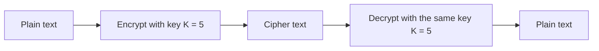
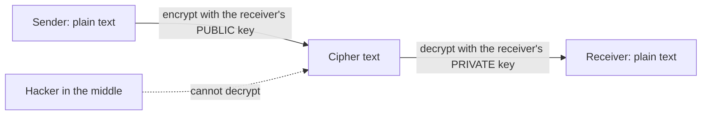
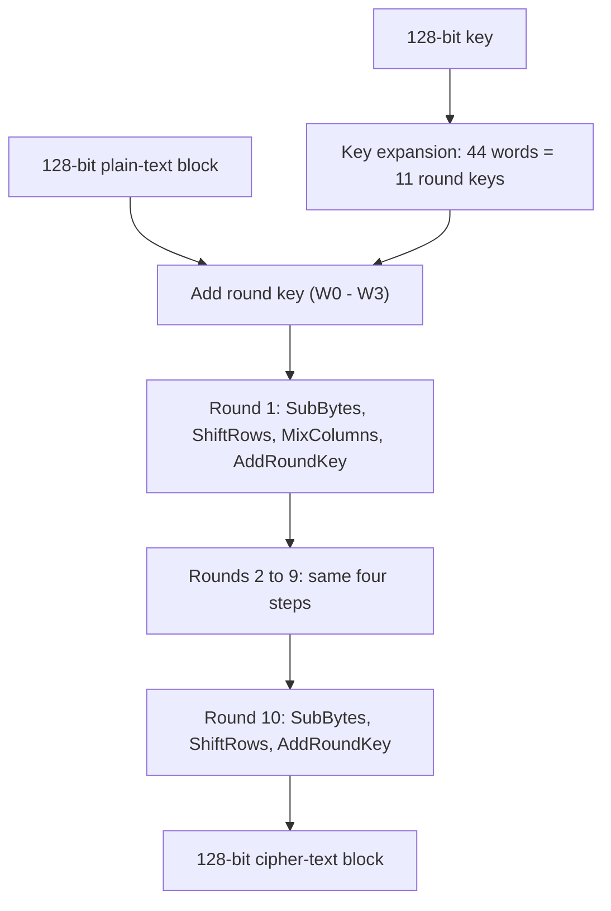
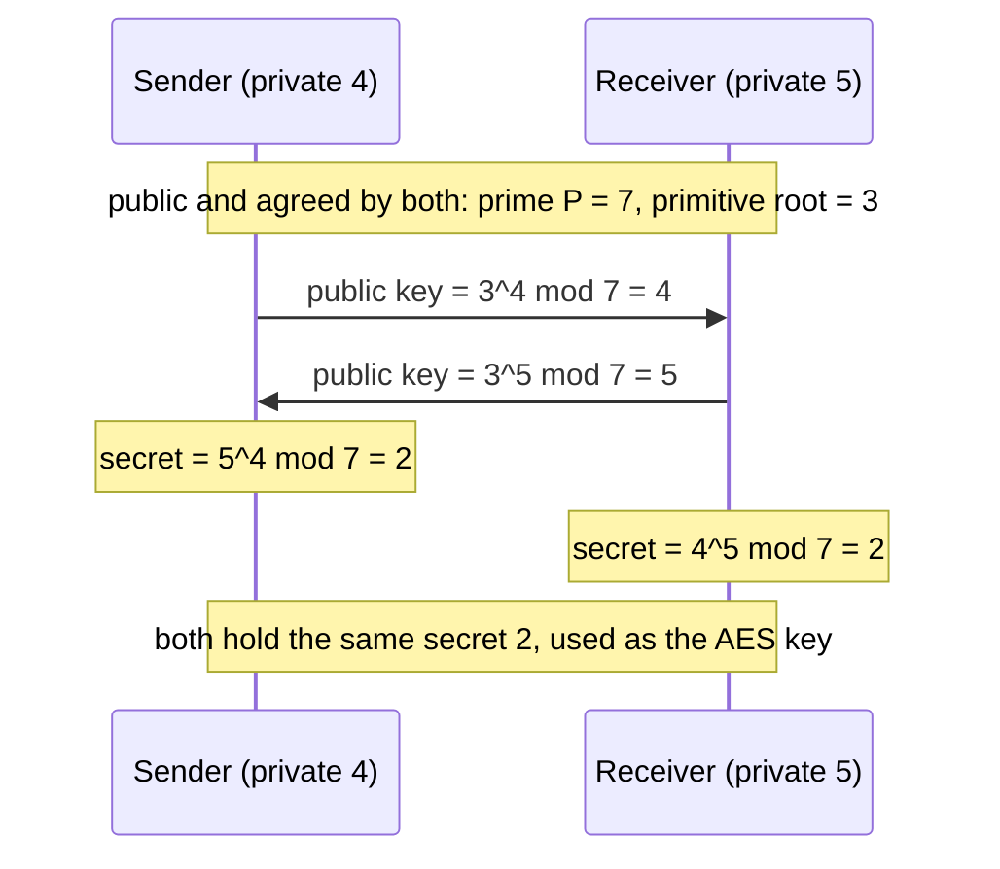
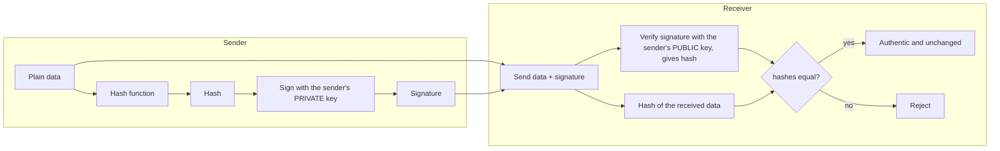

# Symmetric & Asymmetric Encryption – AES, Diffie-Hellman and Digital Signature (HLD #25 – Lecture 62)

<!-- nav -->
⬅ [24 OAuth 2.0](24_OAuth_2.0_Notes.md) · [Index](00_HLD_Index.md) · [26 JWT Explained](26_JWT_Explained_Notes.md) ➡
<!-- nav -->

Sources:
- Handwritten PDF (10 pages): https://drive.google.com/file/d/13oOxr-aZu0K3u7FqBS1ONOCNENjoWERm/view?usp=drive_link
- Typed Zoho note (JavaScript-rendered, not readable automatically): https://notebook.zohopublic.in/public/notes/bietvf603d76e50a04c989bb3522c763be0ee

*Context hints in the notes: chat application end-to-end encryption, HTTPS.*

---

<!-- simple-explanation -->
## In simple words – encryption, AES, Diffie-Hellman and digital signatures

### What is encryption?
Encryption scrambles readable data (**plain text**) into unreadable data (**cipher text**) using a **key**, a secret value that controls the scrambling. Only someone with the right key can turn it back (**decryption**). A toy example is the Caesar cipher: shift every letter by 2 (key = 2), so `A → C`. Real encryption is the same idea with much stronger maths.

There are two kinds: **symmetric** and **asymmetric**.

### Symmetric encryption – one shared key
The **same key** locks and unlocks the data, like a house key that both people hold.
- **DES** (old, 64-bit key) is **broken and should not be used**.
- **AES** is the standard today. Key sizes are 128, 192 or 256 bits (longer = safer but slightly slower), and it works on **128-bit blocks** of data.
- ✅ **Fast**, so it is ideal for large amounts of data (e.g. chat messages, file transfers).
- ❌ **Key distribution problem:** how do you safely send the key to the other person in the first place? And with many users you need to manage a separate key for each.

### Asymmetric encryption – a key pair
Each person has **two linked keys**: a **public key** (share with everyone) and a **private key** (keep secret). Whatever one key locks, only the other can unlock. To send someone a secret, you encrypt with **their public key**; only their **private key** can decrypt. Even a hacker in the middle can't read it.
- Algorithms: **RSA** (very common), DSA, **Diffie-Hellman**, ECC/ECDHE.
- ✅ No key-sharing problem; supports key exchange and digital signatures.
- ❌ **Slow and compute-heavy**, so not good for big data.

### How the real world combines them (e.g. HTTPS)
1. Use **asymmetric** methods (Diffie-Hellman / ECDHE) at the start to **agree on a secret key safely**.
2. Then use fast **symmetric AES** with that key for all the actual data.
You get the safety of one and the speed of the other.

### AES – a peek inside
- AES is a **block cipher**: it chops the data into 16-byte (128-bit) blocks and scrambles each block.
- Data sits in a **4 × 4 grid of bytes** (the "state"). The key is expanded into many **round keys** (a 128-bit key becomes 44 words = 11 round keys).
- Every round does four things: **SubBytes** (replace each byte using a lookup table), **ShiftRows** (shift the rows), **MixColumns** (mix the bytes in each column) and **AddRoundKey** (XOR with the round key).
- AES-128 does **10 rounds** (192-bit: 12, 256-bit: 14). Decryption does the reverse using the same key.

### Diffie-Hellman – agreeing on a secret in public
Goal: two people create a **shared secret** while talking over an open channel that a hacker is listening to. Small-number example:
1. Both publicly agree on a prime **P = 7** and a base **g = 3**.
2. Each picks a **private number**: sender **4**, receiver **5** (never shared).
3. Each computes a **public value** = `g^private mod P`: sender `3⁴ mod 7 = 4`, receiver `3⁵ mod 7 = 5`.
4. They **swap** public values (4 and 5). The hacker sees these too.
5. Each computes `(other's public)^(own private) mod P`: sender `5⁴ mod 7 = 2`, receiver `4⁵ mod 7 = 2`.
Both get **2**, the secret key, which was **never transmitted**. With huge real numbers, the hacker can't work backwards to the private numbers (the *discrete logarithm problem*).

### Digital signature – proof of who sent it and that it wasn't changed
Purpose: **authentication** (it really came from the sender) and **integrity** (nobody modified it).
- **Sender:** hash the message (a short fingerprint), then **encrypt the hash with the sender's private key** → that is the signature. Send message + signature.
- **Receiver:** decrypt the signature with the **sender's public key** to get the hash, and compute the hash of the received message themselves. If both hashes match → genuine and untampered. If not → reject.
Only the real sender has the private key, so only they could have made that signature.
<!-- simple-explanation -->

## 1. What is encryption?
- **A process of converting readable data into text that is difficult to understand** (the result is the **cipher** text).
- It uses a **cryptographic key** – *consider it a mathematical value which the encryption method uses to convert readable text into an unreadable format.*

Example (key = 2, a Caesar-style shift): `HIMANSHU` → *Encryption method (key 2)* → `FRQPHSW FRGLQJ`-style cipher text → *Decryption method (same key)* → `HIMANSHU`.

Encryption is of two types: **① Symmetric** and **② Asymmetric.**

---

## 2. Symmetric encryption

<!-- diagram:25-0 -->
**Diagram – Symmetric encryption: one shared key**

<!-- /diagram:25-0 -->

- **The same key is used for both encryption and decryption.**
  `Sender: PT → [EM, K=5] → Cipher text → Receiver: [DM, K=5] → PT`

**Algorithms**
- **DES (Data Encryption Standard) – NOT RECOMMENDED** *(in 2005 it was cracked because the key length is only 64 bits)*:
  1. Fixed key length: **64 bits** (56 effective)
  2. Processes data in **64-bit** blocks
  3. Performs **16 rounds** in its encryption process.
- **AES (Advanced Encryption Standard) – ⭐⭐ important:**
  1. Supports key lengths **128, 192 or 256 bits** *(bigger the bits, more security – but more computation, so slower)*.
  2. Processes data in **128-bit** blocks.
  3. **Number of rounds depends on key size:** **10 rounds – 128-bit key**, **12 rounds – 192-bit key**, **14 rounds – 256-bit key.**

**Advantages**
1. **Fast and less computation** compared to asymmetric.
2. **Good for encrypting bulk data** (like chat encryption).

**Disadvantages**
1. **Key distribution** – how to securely distribute the key between client and server?
2. As the **number of clients increases**, the server has to **manage that many symmetric keys** and their distribution too.

---

## 3. Asymmetric encryption

<!-- diagram:25-1 -->
**Diagram – Asymmetric encryption: public key locks, private key unlocks**

<!-- /diagram:25-1 -->

- Uses **2 different keys – a Public key and a Private key**:
  - **Public key is used by the Sender to Encrypt.**
  - **Private key is used by the Receiver to Decrypt.**
  (`PT → [EM, Key1] → CT → [DM, Key2] → PT`)
- **Algorithms:**
  1. **RSA** ⭐ (Rivest–Shamir–Adleman) – 2048-bit key lengths, more secure
  2. **DSA** (Digital Signature Algorithm)
  3. **Diffie-Hellman** ⭐⭐
  4. **ECC** (Elliptic Curve Cryptography) / **ECDHE** (Elliptic Curve Diffie-Hellman Ephemeral)

**Advantages**
1. **No security issue with key distribution** – each user has a **secret (private) key which they do not forward.**
2. Provides **key-exchange protocols** like **Diffie-Hellman, ECDHE** ⭐.
3. **Digital signature** can be created using asymmetric encryption – helps to **authenticate and provide integrity** too.
   (Diagram: sender encrypts with the server's **public key**; a hacker in the middle can't decrypt; the receiver/server decrypts with its **private key**.)

**Disadvantages**
1. **Computation-intensive** compared to symmetric encryption.
2. **Might not be suitable for encrypting bulk data** – it's a little slow compared to symmetric.
(The security rests on maths like `(prime number)^key`, e.g. 5^2048.)

> **In practice (HTTPS):** use **asymmetric / key-exchange (Diffie-Hellman, ECDHE) to agree on a secret key**, then use **symmetric (AES) for the bulk data.**

---

## 4. AES in detail (symmetric)
- **AES is a block cipher** – it processes the data in **blocks of 128 bits.**
  (e.g. `HIMANSHU` → bits → split into 128-bit blocks)

### Terminology
- Data and keys are arranged in a **4 × 4 array called the "state array"**: Byte 0–3 (column 1), Byte 4–7, Byte 8–11, Byte 12–15. **1 byte = 8 bits → 16 bytes = 128 bits.**
- A **set of 4 bytes (one column) is called a "Word".**
- A **set of 4 words is called a "Round Key".**

### Key expansion logic
- Key words **W0, W1, W2, W3** (the original 128-bit key).
- `W4 = function(W3) XOR W0`
- `W5 = W4 XOR W1`
- `W6 = W5 XOR W2`
- `W7 = W6 XOR W3`
- …and so on **till W43** (so the **128-bit key is expanded into 44 words** = 11 round keys). Every 4th word uses `function(previous word)` (rotate/substitute/round-constant), the others are plain XORs.

### Normal text → cipher text (AES-128 encryption flow)

<!-- diagram:25-2 -->
**Diagram – AES-128 encryption flow**

<!-- /diagram:25-2 -->

1. **Generate a 128-bit key** (random key-generation method).
2. Call **AES-128 Encrypt Algo (data, key)**.
3. **Key expansion process** (128-bit key → **44 words**).
4. **Run for each block of data:** take a **128-bit plain-text block**.
5. **Add Round Key** (W0 W1 W2 W3) – initial XOR.
6. **Round 1** (4 operations, uses W4 W5 W6 W7) → **Round 2** → … → **Round 10** (uses W40–W43).
7. Output: **128-bit cipher-text block.**

### Each round consists of 4 steps
1. **Substitute Bytes** (S-box substitution of each byte)
2. **Shift Rows**
3. **Mix Columns**
4. **Add Round Key** (XOR the state array with the round key's words: DB0⊕W0 … etc.)

### Cipher text → plain text (decryption)
Do the opposite: 128-bit cipher block → **Add Round Key** → Round 1 → … → Round 9 → Round 10 → **128-bit plain-text block** (using the same key).

---

## 5. Diffie-Hellman (key-exchange algorithm, asymmetric)

<!-- diagram:25-3 -->
**Diagram – Diffie-Hellman with the example numbers**

<!-- /diagram:25-3 -->

**Purpose:** a way to **share a secret key between SENDER and RECEIVER over an insecure network.**

**Step 1 – agree on public parameters.** Both decide **Prime number P = 7** and **Primitive root = 3** (visible to everyone, even a hacker).
- *How to find the primitive root:* powers of 3 mod 7 – `3^1=3, 3^2=2, 3^3=6, 3^4=4, 3^5=5, 3^6=1` – it generates all values 1–6, so 3 is a primitive root of 7 (`aⁱ ≡ x (mod p)`, φ(p) = 7 − 1 = 6).

**Step 2 – each side randomly generates a private key.** Sender's private = **4**, Receiver's private = **5**.

**Step 3 – calculate the public key:** `(Primitive root ^ Private) mod Prime`
- Sender: `3^4 mod 7 = 4` → public = 4
- Receiver: `3^5 mod 7 = 5` → public = 5

**Step 4 – exchange public keys:** sender gets 5, receiver gets 4. *(A hacker sees P=7, PR=3, public=5, public=4 – but not the private keys.)*

**Step 5 – calculate the shared secret key:** `(other's public ^ own private) mod Prime`
- Sender: `5^4 mod 7 = 2`
- Receiver: `4^5 mod 7 = 2`
→ **Both arrive at the same secret = 2**, which can now be used as the symmetric (AES) key.

**Why a hacker can't break it:** `(value) ^ (private key – very, very big) mod N = output` – the hacker can't compute the private key from the output (discrete-log problem).

---

## 6. How a Digital Signature works

<!-- diagram:25-4 -->
**Diagram – Digital signature: sign and verify**

<!-- /diagram:25-4 -->

A digital signature has **two purposes:** ① **Authentication** ② **Integrity of data** (data has not changed).

**Sender side**
1. Take the **plain data** (e.g. "Hello") → pass it through a **hash function** → fixed-size **hash** (e.g. `1001001001`).
2. Feed the hash and the **sender's private key** into the **Sign algorithm** → **Signature.**
3. Send **Signature + Plain data** together.

**Receiver side**
1. Take the received **Signature** and use the **sender's public key** in the **Verify algorithm** → recovers the **hash**.
2. **Compute the hash of the received plain data** with the same hash function.
3. **Compare (Is equal?) → YES/NO.** Equal ⇒ the data came from the sender (**authentication**) and wasn't changed (**integrity**).

---

## Quick revision
| | Symmetric | Asymmetric |
|---|---|---|
| Keys | one shared key | public + private key pair |
| Speed | fast, good for bulk | slow, compute-heavy |
| Algorithms | **AES** (128/192/256; 10/12/14 rounds), DES (obsolete) | **RSA**, DSA, **Diffie-Hellman**, ECC/ECDHE |
| Problem | secure **key distribution** | slower; not for bulk data |

- **Diffie-Hellman** = agree on a shared secret over an insecure channel (public: P, g; private: a, b; shared = gᵃᵇ mod P).
- **Digital signature** = hash(data) signed with the **private** key; verified with the **public** key → **authentication + integrity.**
- Real-world: **asymmetric/key-exchange for the handshake, symmetric AES for data.**
- Related: [JWT Explained](26_JWT_Explained_Notes.md), [OAuth 2.0](24_OAuth_2.0_Notes.md).

---

<!-- nav -->
⬅ [24 OAuth 2.0](24_OAuth_2.0_Notes.md) · [Index](00_HLD_Index.md) · [26 JWT Explained](26_JWT_Explained_Notes.md) ➡
<!-- nav -->
