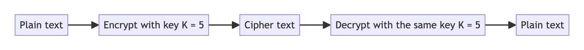
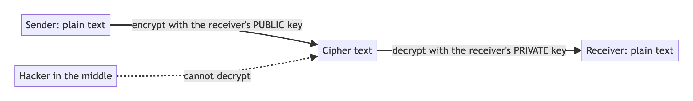
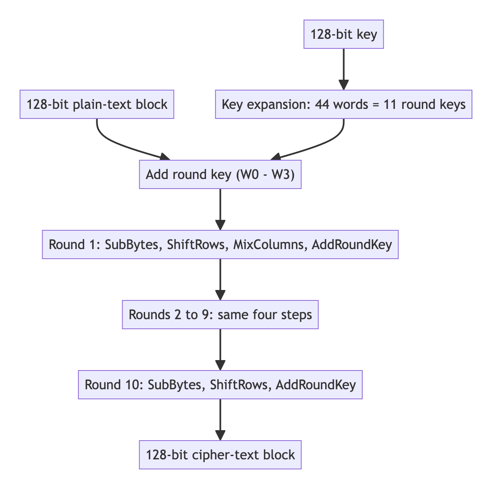
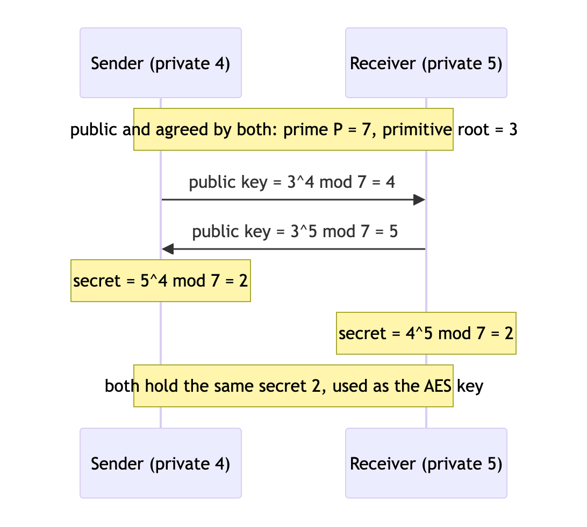
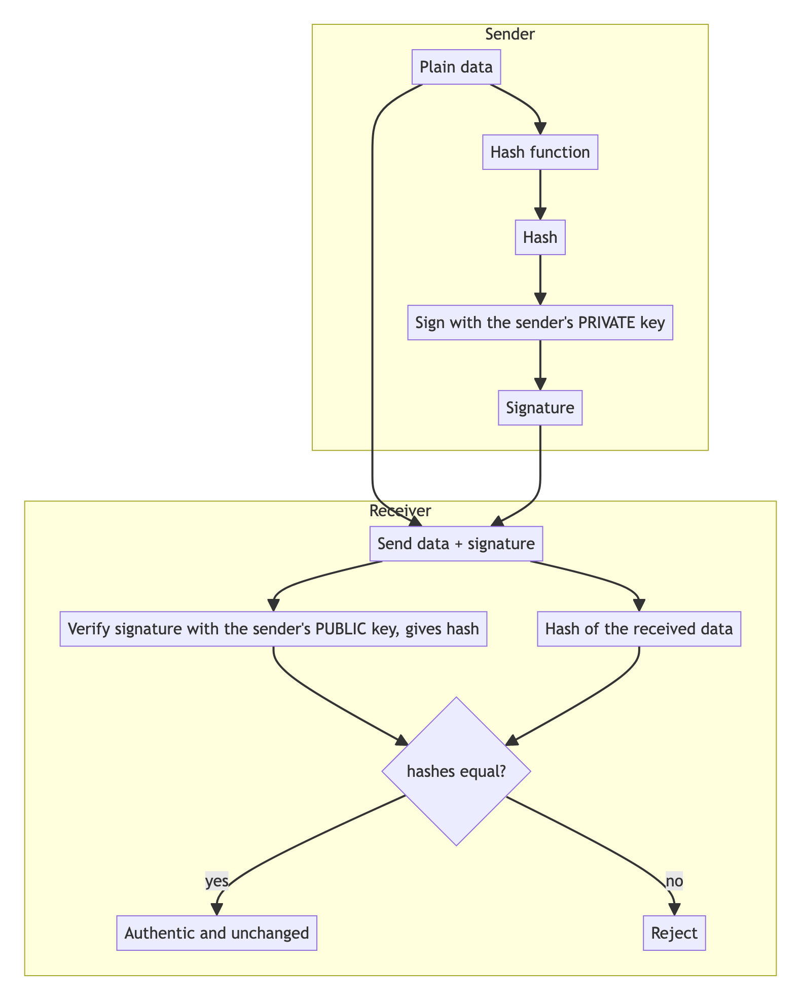

# Symmetric & Asymmetric Encryption – AES, Diffie-Hellman and Digital Signature (HLD #25 – Lecture 62)

<!-- nav -->
⬅ [24 OAuth 2.0](24_OAuth_2.0_Notes.md) · [Index](00_HLD_Index.md) · [26 JWT Explained](26_JWT_Explained_Notes.md) ➡
<!-- nav -->

Sources:
- Handwritten PDF (10 pages): https://drive.google.com/file/d/13oOxr-aZu0K3u7FqBS1ONOCNENjoWERm/view?usp=drive_link
- Typed Zoho note (checked, same content; the encryption example is taken from it): https://notebook.zohopublic.in/public/notes/bietvf603d76e50a04c989bb3522c763be0ee

*Context hints in the notes: chat application end-to-end encryption, HTTPS.*

---

## 1. What is encryption?
- **A process of converting readable data into text that is difficult to understand** (the result is the **cipher** text).
- It uses a **cryptographic key** – *consider it a mathematical value which the encryption method uses to convert readable text into an unreadable format.*

Example (the Zoho page labels it "Key: 2"): `CONCEPT CODING` → *Encryption method (key 2)* → `FRQFHSW FRGLQJ` → *Decryption method (same key)* → `CONCEPT CODING`. (Each letter has moved three places along the alphabet, C→F, O→R and so on, although the page writes the key as 2. The page's point is simply that the same key undoes the encryption.)

Encryption is of two types: **① Symmetric** and **② Asymmetric.**

<!-- isw:25-0 -->
**In simple words**

Encryption is **a process of converting readable data into text that is difficult to understand** (the result is the **cipher text**). It uses a **cryptographic key**, which the notes describe as *a mathematical value the encryption method uses to convert readable text into an unreadable format.* The example: `CONCEPT CODING` goes through the encryption method (key 2) and becomes `FRQFHSW FRGLQJ`, and the decryption method with the same key turns it back into `CONCEPT CODING`. Encryption is of two types: **symmetric** and **asymmetric.**
<!-- /isw:25-0 -->

---

## 2. Symmetric encryption

<!-- diagram:25-0 -->
**Diagram – Symmetric encryption: one shared key**

<!-- /diagram:25-0 -->

- **The same key is used for both encryption and decryption.**
  `Sender: PT → [EM, K=5] → Cipher text → Receiver: [DM, K=5] → PT`

**Algorithms**
- **DES (Data Encryption Standard) – NOT RECOMMENDED** *(in 2005 it was cracked because the key length is only 64 bits)*:
  1. Fixed key length: **64 bits** (56 effective)
  2. Processes data in **64-bit** blocks
  3. Performs **16 rounds** in its encryption process.
- **AES (Advanced Encryption Standard) – ⭐⭐ important:**
  1. Supports key lengths **128, 192 or 256 bits** *(bigger the bits, more security – but more computation, so slower)*.
  2. Processes data in **128-bit** blocks.
  3. **Number of rounds depends on key size:** **10 rounds – 128-bit key**, **12 rounds – 192-bit key**, **14 rounds – 256-bit key.**

**Advantages**
1. **Fast and less computation** compared to asymmetric.
2. **Good for encrypting bulk data** (like chat encryption).

**Disadvantages**
1. **Key distribution** – how to securely distribute the key between client and server?
2. As the **number of clients increases**, the server has to **manage that many symmetric keys** and their distribution too.

<!-- isw:25-1 -->
**In simple words**

In symmetric encryption **the same key is used for both encryption and decryption** (sender: plain text → encryption method with key 5 → cipher text → receiver: decryption method with key 5 → plain text).

**Algorithms:**
- **DES (Data Encryption Standard) – not recommended:** in 2005 it was cracked because its key is only **64 bits.** It has a fixed key length of 64 bits (56 effective), processes data in **64-bit blocks** and runs **16 rounds.**
- **AES (Advanced Encryption Standard) – ⭐⭐ important:** key lengths of **128, 192 or 256 bits** (a bigger key is more secure but needs more computation, so it is slower); it processes **128-bit blocks;** the **number of rounds depends on the key size: 10 rounds for a 128-bit key, 12 for 192, 14 for 256.**

**Advantages:** it is **fast and needs less computation** than asymmetric, and is **good for encrypting bulk data** (like chat). **Disadvantages:** **key distribution** (how to give the key safely to client and server), and as the **number of clients grows, the server must manage that many symmetric keys** and their distribution.
<!-- /isw:25-1 -->

---

## 3. Asymmetric encryption

<!-- diagram:25-1 -->
**Diagram – Asymmetric encryption: public key locks, private key unlocks**

<!-- /diagram:25-1 -->

- Uses **2 different keys – a Public key and a Private key**:
  - **Public key is used by the Sender to Encrypt.**
  - **Private key is used by the Receiver to Decrypt.**
  (`PT → [EM, Key1] → CT → [DM, Key2] → PT`)
- **Algorithms:**
  1. **RSA** ⭐ (Rivest–Shamir–Adleman) – 2048-bit key lengths, more secure
  2. **DSA** (Digital Signature Algorithm)
  3. **Diffie-Hellman** ⭐⭐
  4. **ECC** (Elliptic Curve Cryptography) / **ECDHE** (Elliptic Curve Diffie-Hellman Ephemeral)

**Advantages**
1. **No security issue with key distribution** – each user has a **secret (private) key which they do not forward.**
2. Provides **key-exchange protocols** like **Diffie-Hellman, ECDHE** ⭐.
3. **Digital signature** can be created using asymmetric encryption – helps to **authenticate and provide integrity** too.
   (Diagram: sender encrypts with the server's **public key**; a hacker in the middle can't decrypt; the receiver/server decrypts with its **private key**.)

**Disadvantages**
1. **Computation-intensive** compared to symmetric encryption.
2. **Might not be suitable for encrypting bulk data** – it's a little slow compared to symmetric.
(The security rests on maths like `(prime number)^key`, e.g. 5^2048.)

> **In practice (HTTPS):** use **asymmetric / key-exchange (Diffie-Hellman, ECDHE) to agree on a secret key**, then use **symmetric (AES) for the bulk data.**

<!-- isw:25-2 -->
**In simple words**

Asymmetric encryption uses **two different keys, a public key and a private key:** the **public key is used by the sender to encrypt, and the private key is used by the receiver to decrypt.** (In the sketch the sender encrypts with the server's **public key**; a hacker in the middle cannot decrypt; the server decrypts with its **private key.**)

**Algorithms:** **RSA** ⭐ (2048-bit key lengths, more secure), **DSA** (Digital Signature Algorithm), **Diffie-Hellman** ⭐⭐, and **ECC / ECDHE** (elliptic-curve).

**Advantages:** **no problem with key distribution,** because each user has a **secret (private) key that is never forwarded;** it provides **key-exchange protocols** like Diffie-Hellman and ECDHE ⭐; and a **digital signature** can be created with it, which helps to **authenticate and provide integrity.** **Disadvantages:** it is **computation-intensive** compared with symmetric, and **might not be suitable for bulk data** because it is a little slow. (Its security rests on maths like `(prime number)^key`, for example 5^2048.)

**In practice (HTTPS):** use **asymmetric / key-exchange (Diffie-Hellman, ECDHE) to agree on a secret key, then use symmetric (AES) for the bulk data.**
<!-- /isw:25-2 -->

---

## 4. AES in detail (symmetric)
- **AES is a block cipher** – it processes the data in **blocks of 128 bits.**
  (e.g. `HIMANSHU` → bits → split into 128-bit blocks)

### Terminology
- Data and keys are arranged in a **4 × 4 array called the "state array"**: Byte 0–3 (column 1), Byte 4–7, Byte 8–11, Byte 12–15. **1 byte = 8 bits → 16 bytes = 128 bits.**
- A **set of 4 bytes (one column) is called a "Word".**
- A **set of 4 words is called a "Round Key".**

<!-- isw:25-4 -->
**In simple words**

The data and keys are arranged in a **4 × 4 array called the "state array"** (Byte 0–3 in column 1, Byte 4–7 next, and so on); **1 byte = 8 bits, so 16 bytes = 128 bits.** A set of **4 bytes (one column) is called a "Word"**, and a set of **4 words is called a "Round Key".**
<!-- /isw:25-4 -->

### Key expansion logic
- Key words **W0, W1, W2, W3** (the original 128-bit key).
- `W4 = function(W3) XOR W0`
- `W5 = W4 XOR W1`
- `W6 = W5 XOR W2`
- `W7 = W6 XOR W3`
- …and so on **till W43** (so the **128-bit key is expanded into 44 words** = 11 round keys). Every 4th word uses `function(previous word)` (rotate/substitute/round-constant), the others are plain XORs.

<!-- isw:25-5 -->
**In simple words**

The original 128-bit key is the words **W0, W1, W2, W3.** The next words are built from the earlier ones: `W4 = function(W3) XOR W0`, `W5 = W4 XOR W1`, `W6 = W5 XOR W2`, `W7 = W6 XOR W3`, and so on **until W43**, so the **128-bit key is expanded into 44 words = 11 round keys.** Every 4th word uses `function(previous word)` (rotate / substitute / round constant); the others are plain XORs.
<!-- /isw:25-5 -->

### Normal text → cipher text (AES-128 encryption flow)

<!-- diagram:25-2 -->
**Diagram – AES-128 encryption flow**

<!-- /diagram:25-2 -->

1. **Generate a 128-bit key** (random key-generation method).
2. Call **AES-128 Encrypt Algo (data, key)**.
3. **Key expansion process** (128-bit key → **44 words**).
4. **Run for each block of data:** take a **128-bit plain-text block**.
5. **Add Round Key** (W0 W1 W2 W3) – initial XOR.
6. **Round 1** (4 operations, uses W4 W5 W6 W7) → **Round 2** → … → **Round 10** (uses W40–W43).
7. Output: **128-bit cipher-text block.**

<!-- isw:25-6 -->
**In simple words**

The steps: (1) **generate a 128-bit key;** (2) call the **AES-128 encrypt algorithm (data, key);** (3) **key expansion** (the 128-bit key becomes **44 words**); (4) **for each block of data,** take a **128-bit plain-text block;** (5) **Add Round Key** (W0 W1 W2 W3), the initial XOR; (6) **Round 1** (4 operations, using W4 W5 W6 W7), then Round 2, … up to **Round 10** (using W40–W43); (7) the output is a **128-bit cipher-text block.**
<!-- /isw:25-6 -->

### Each round consists of 4 steps
1. **Substitute Bytes** (S-box substitution of each byte)
2. **Shift Rows**
3. **Mix Columns**
4. **Add Round Key** (XOR the state array with the round key's words: DB0⊕W0 … etc.)

<!-- isw:25-7 -->
**In simple words**

Every round does four steps in this order: **1. Substitute Bytes** (an S-box substitution of each byte), **2. Shift Rows, 3. Mix Columns, 4. Add Round Key** (XOR the state array with the round key's words).
<!-- /isw:25-7 -->

### Cipher text → plain text (decryption)
Do the opposite: 128-bit cipher block → **Add Round Key** → Round 1 → … → Round 9 → Round 10 → **128-bit plain-text block** (using the same key).

<!-- isw:25-3 -->
**In simple words**

**AES is a block cipher:** it processes data in **blocks of 128 bits** (for example `HIMANSHU` is turned into bits and split into 128-bit blocks).
<!-- /isw:25-3 -->

<!-- isw:25-8 -->
**In simple words**

Decryption does **the opposite:** the 128-bit cipher block goes through Add Round Key, Round 1 … Round 10 and comes out as the **128-bit plain-text block,** using the **same key.**
<!-- /isw:25-8 -->

---

## 5. Diffie-Hellman (key-exchange algorithm, asymmetric)

<!-- diagram:25-3 -->
**Diagram – Diffie-Hellman with the example numbers**

<!-- /diagram:25-3 -->

**Purpose:** a way to **share a secret key between SENDER and RECEIVER over an insecure network.**

**Step 1 – agree on public parameters.** Both decide **Prime number P = 7** and **Primitive root = 3** (visible to everyone, even a hacker).
- *How to find the primitive root:* powers of 3 mod 7 – `3^1=3, 3^2=2, 3^3=6, 3^4=4, 3^5=5, 3^6=1` – it generates all values 1–6, so 3 is a primitive root of 7 (`aⁱ ≡ x (mod p)`, φ(p) = 7 − 1 = 6).

**Step 2 – each side randomly generates a private key.** Sender's private = **4**, Receiver's private = **5**.

**Step 3 – calculate the public key:** `(Primitive root ^ Private) mod Prime`
- Sender: `3^4 mod 7 = 4` → public = 4
- Receiver: `3^5 mod 7 = 5` → public = 5

**Step 4 – exchange public keys:** sender gets 5, receiver gets 4. *(A hacker sees P=7, PR=3, public=5, public=4 – but not the private keys.)*

**Step 5 – calculate the shared secret key:** `(other's public ^ own private) mod Prime`
- Sender: `5^4 mod 7 = 2`
- Receiver: `4^5 mod 7 = 2`
→ **Both arrive at the same secret = 2**, which can now be used as the symmetric (AES) key.

**Why a hacker can't break it:** `(value) ^ (private key – very, very big) mod N = output` – the hacker can't compute the private key from the output (discrete-log problem).

<!-- isw:25-9 -->
**In simple words**

**Purpose:** a way to **share a secret key between the SENDER and the RECEIVER over an insecure network.** The steps with the notes' numbers:
1. **Agree on public values:** **prime P = 7** and **primitive root = 3** (visible to everyone, even a hacker). *How to find the primitive root:* the powers of 3 mod 7 are 3, 2, 6, 4, 5, 1, which gives all the values 1–6, so 3 is a primitive root of 7.
2. **Each side randomly picks a private key:** sender = **4,** receiver = **5.**
3. **Calculate the public key = (primitive root ^ private) mod prime:** sender `3^4 mod 7 = 4`; receiver `3^5 mod 7 = 5.`
4. **Exchange the public keys:** the sender gets 5 and the receiver gets 4. (A hacker sees P = 7, root = 3 and the two public values, but not the private keys.)
5. **Calculate the shared secret = (other's public ^ own private) mod prime:** sender `5^4 mod 7 = 2`; receiver `4^5 mod 7 = 2.` **Both get the same secret 2,** which can now be used as the symmetric (AES) key.

**Why a hacker cannot break it:** it is `(value) ^ (private key, very very big) mod N = output`, and the hacker cannot compute the private key from the output.
<!-- /isw:25-9 -->

---

## 6. How a Digital Signature works

<!-- diagram:25-4 -->
**Diagram – Digital signature: sign and verify**

<!-- /diagram:25-4 -->

A digital signature has **two purposes:** ① **Authentication** ② **Integrity of data** (data has not changed).

**Sender side**
1. Take the **plain data** (e.g. "Hello") → pass it through a **hash function** → fixed-size **hash** (e.g. `1001001001`).
2. Feed the hash and the **sender's private key** into the **Sign algorithm** → **Signature.**
3. Send **Signature + Plain data** together.

**Receiver side**
1. Take the received **Signature** and use the **sender's public key** in the **Verify algorithm** → recovers the **hash**.
2. **Compute the hash of the received plain data** with the same hash function.
3. **Compare (Is equal?) → YES/NO.** Equal ⇒ the data came from the sender (**authentication**) and wasn't changed (**integrity**).

<!-- isw:25-10 -->
**In simple words**

A digital signature has **two purposes: (1) authentication and (2) integrity of the data** (the data has not changed).

**Sender side:** (1) take the **plain data** (for example "Hello") and pass it through a **hash function** to get a fixed-size **hash;** (2) give the hash and the **sender's private key** to the **Sign algorithm** to get the **signature;** (3) send the **signature and the plain data** together.

**Receiver side:** (1) take the received **signature** and use the **sender's public key** in the **Verify algorithm** to recover the **hash;** (2) **compute the hash of the received plain data** with the same hash function; (3) **compare: is it equal? YES / NO.** Equal means the data came from the sender (**authentication**) and was not changed (**integrity**).
<!-- /isw:25-10 -->

---

## Quick revision
| | Symmetric | Asymmetric |
|---|---|---|
| Keys | one shared key | public + private key pair |
| Speed | fast, good for bulk | slow, compute-heavy |
| Algorithms | **AES** (128/192/256; 10/12/14 rounds), DES (obsolete) | **RSA**, DSA, **Diffie-Hellman**, ECC/ECDHE |
| Problem | secure **key distribution** | slower; not for bulk data |

- **Diffie-Hellman** = agree on a shared secret over an insecure channel (public: P, g; private: a, b; shared = gᵃᵇ mod P).
- **Digital signature** = hash(data) signed with the **private** key; verified with the **public** key → **authentication + integrity.**
- Real-world: **asymmetric/key-exchange for the handshake, symmetric AES for data.**
- Related: [JWT Explained](26_JWT_Explained_Notes.md), [OAuth 2.0](24_OAuth_2.0_Notes.md).

---

<!-- nav -->
⬅ [24 OAuth 2.0](24_OAuth_2.0_Notes.md) · [Index](00_HLD_Index.md) · [26 JWT Explained](26_JWT_Explained_Notes.md) ➡
<!-- nav -->
