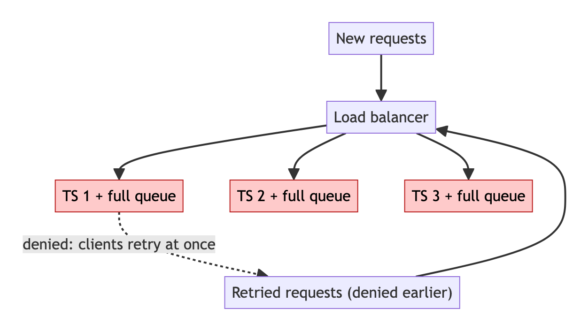
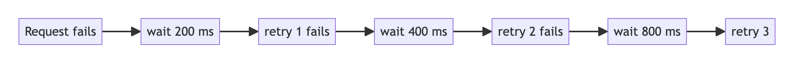
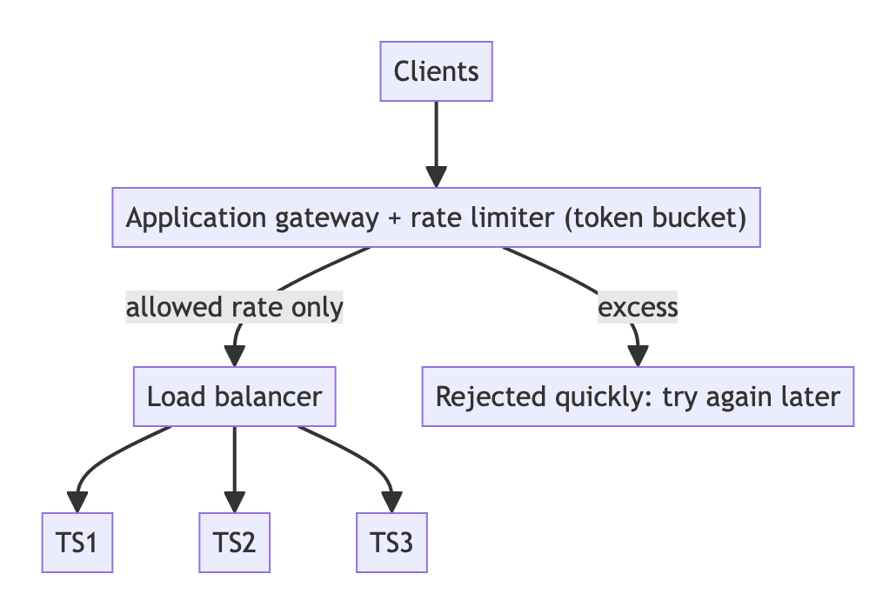

# Thundering Herd Problem (HLD #27 – Lecture 64)

<!-- nav -->
⬅ [26 JWT Explained](26_JWT_Explained_Notes.md) · [Index](00_HLD_Index.md) · [28 API Gateway Concepts](28_API_Gateway_Concepts_Notes.md) ➡
<!-- nav -->

Source (handwritten, 2 pages): https://drive.google.com/file/d/1s_rhkuSserKURoOTwolrnMGifGHd9oKI/view?usp=drive_link

---

## 1. Problem: "Why does a ticket-booking app go down during peak traffic?"

<!-- diagram:27-0 -->
**Diagram – Thundering herd at the 12:00 PM sale**


<!-- /diagram:27-0 -->


**Scenario:** the **12:00 PM sale has started** on a ticket-booking app.

Diagram in notes:
```
 new requests  + retried requests
          \   |   /
           [ Load Balancer ]      (annotated:  Min = 10, Max = 100)
            /     |     \
        TS 1     TS 2     TS 3        ← ticket-service instances,
        [queue]  [queue]  [queue]        each with its own request queue
```
- Every instance's **queue is also filled** and **all instance threads are busy**.
- When more requests come, **nothing can accept a new request**. What happens:
  1. **New requests get denied.**
  2. **Clients retry** – the denied requests come back again, on top of the new ones.
- So the load balancer is hit by *new requests **plus** retried requests*, all at the same moment → the surge feeds itself → the system **goes down**. This is the **Thundering Herd problem**: many clients retry at the same time, causing a surge of retry traffic.

<!-- isw:27-0 -->
**In simple words**

The scenario is a ticket-booking app when the **12:00 PM sale has started.** The load balancer (annotated Min = 10, Max = 100) sits in front of ticket-service instances TS 1, TS 2 and TS 3, each with its own request queue. **Every instance's queue is also filled and all its threads are busy,** so when more requests come, **nothing can accept a new request.** Then: (1) **new requests get denied;** (2) **clients retry:** the denied requests come back on top of the new ones.

So the load balancer is hit by *new requests **plus** retried requests,* all at the same moment, and the surge feeds itself until the system **goes down.** This is the **Thundering Herd problem:** many clients retry at the same time, causing a surge of retry traffic.
<!-- /isw:27-0 -->


---

## 2. Solutions

### ① Exponential Backoff

<!-- diagram:27-1 -->
**Diagram – Backoff spreads the retries over time**


<!-- /diagram:27-1 -->


Make each retry wait longer than the previous one:

`delay = Base × 2ⁿ`   where **n = number of failures (retry attempt)**

Example with Base = 100 ms:
- Retry 1 ⇒ 100 × 2¹ = **200 ms**
- Retry 2 ⇒ 100 × 2² = **400 ms**

<!-- isw:27-1 -->
**In simple words**

Make each retry wait **longer** than the previous one: **`delay = Base × 2ⁿ`, where n is the number of failures (the retry attempt).** With Base = 100 ms: retry 1 = 100 × 2¹ = **200 ms**, retry 2 = 100 × 2² = **400 ms.**
<!-- /isw:27-1 -->


### ② Exponential Backoff + Jitter
Exponential backoff alone still makes all clients retry at the same moments (same formula). **Bring some randomness**:

`delay = min( MaxWaitTime , Random(0, Base × 2ⁿ) )`

This **spreads the retries over time** so the herd doesn't arrive together.

<!-- isw:27-2 -->
**In simple words**

Exponential backoff alone still makes **all the clients retry at the same moments, because they all use the same formula.** So the notes **bring in some randomness:** `delay = min(MaxWaitTime, Random(0, Base × 2ⁿ))`. This **spreads the retries over time,** so the herd does not arrive together.
<!-- /isw:27-2 -->


### ③ Protect the entry with a Rate Limiter (Application / API Gateway)

<!-- diagram:27-2 -->
**Diagram – Rate limiter at the gateway**


<!-- /diagram:27-2 -->


```
 Application Gateway ─ [Rate Limiter]  (Token Bucket algo)
          │
     Load Balancer
      /    |    \
   TS1    TS2    TS3
```
Put an **API/application gateway with a rate limiter (Token Bucket algorithm)** in front of the load balancer so that only an allowed rate of requests reaches the services.

<!-- isw:27-3 -->
**In simple words**

Put an **API / application gateway with a rate limiter (Token Bucket algorithm) in front of the load balancer,** so that only an allowed rate of requests reaches the services.
<!-- /isw:27-3 -->


---

## Quick revision
- Thundering herd = **synchronised retries (+ new traffic) overwhelm an already-saturated system**.
- Fixes: **exponential backoff**, **backoff + jitter (randomised delay)**, **rate limiting at the gateway** (token bucket).
- Related notes: [Retry Pattern](38_Retry_Pattern_Notes.md), [Rate Limiter](12_36_Rate_Limiter_Notes.md), [API Gateway](40_41_API_Gateway_Part1_Part2_Notes.md).

---

<!-- nav -->
⬅ [26 JWT Explained](26_JWT_Explained_Notes.md) · [Index](00_HLD_Index.md) · [28 API Gateway Concepts](28_API_Gateway_Concepts_Notes.md) ➡
<!-- nav -->
