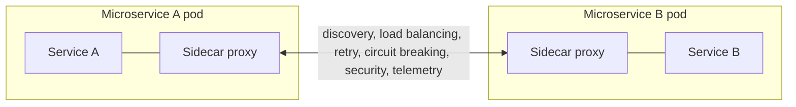
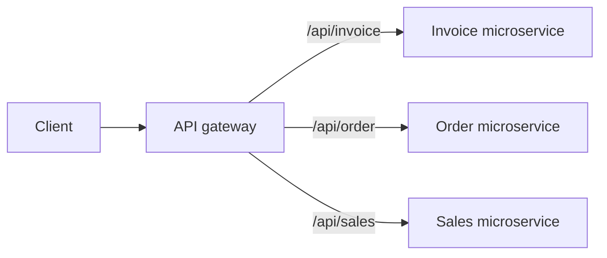
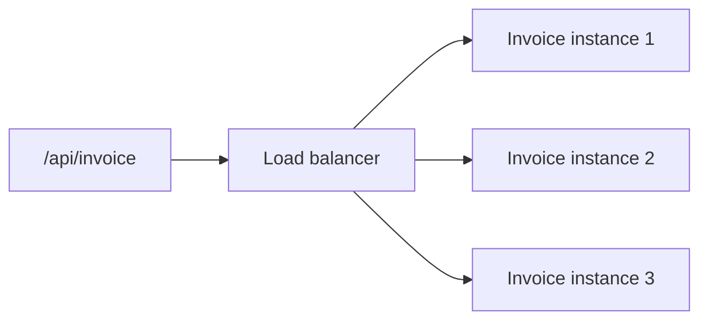
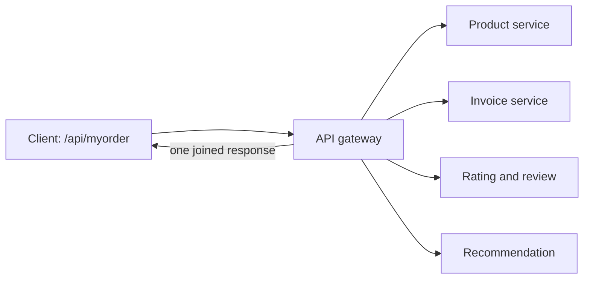
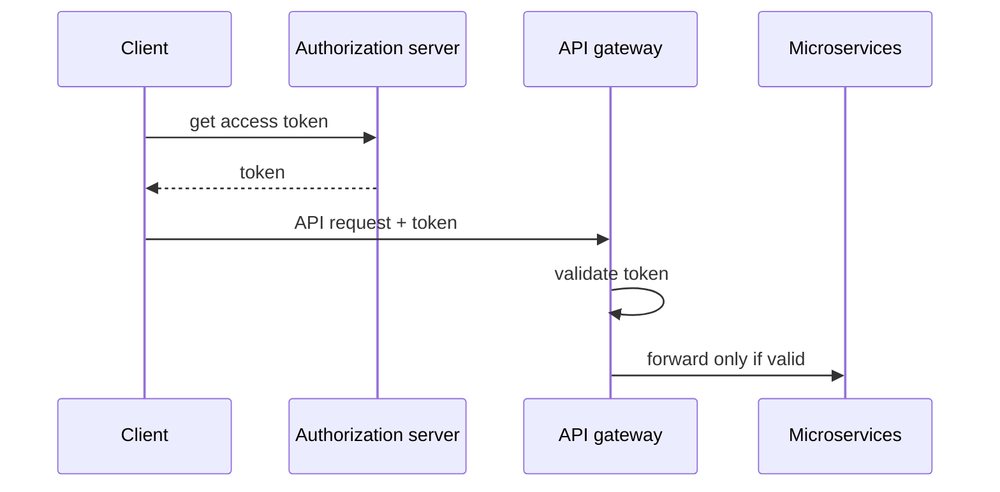
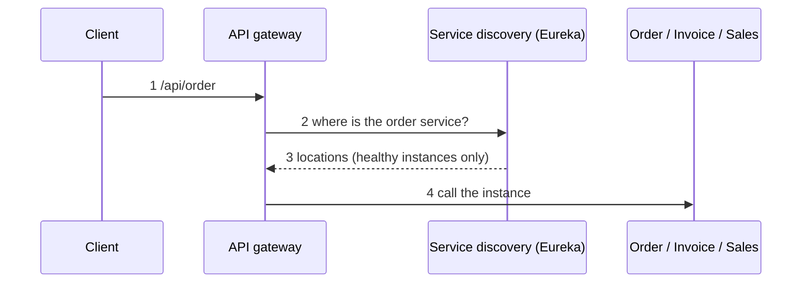
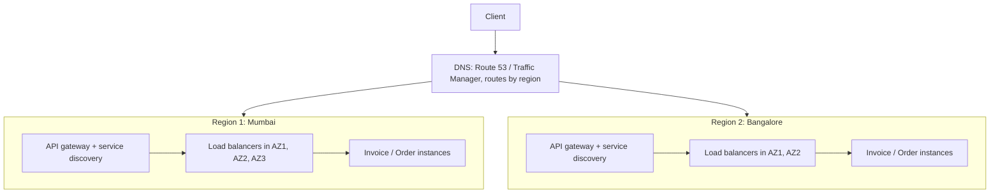
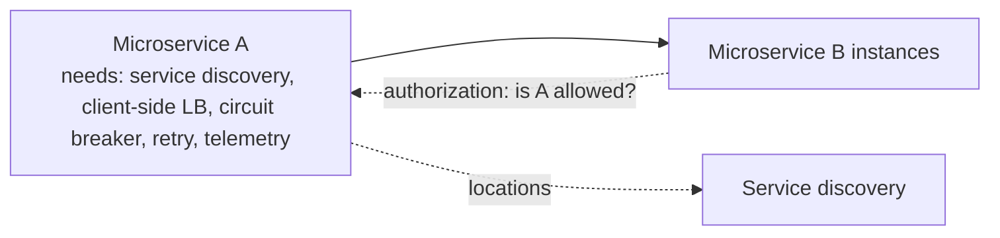

# API Gateway – Concepts (HLD #28 – Lecture 65) (+ lead-in to Service Mesh, HLD #29)

<!-- nav -->
⬅ [27 Thundering Herd](27_Thundering_Herd_Notes.md) · [Index](00_HLD_Index.md) · [32 Common Attacks](32_Common_Attacks_Notes.md) ➡
<!-- nav -->

Sources:
- Handwritten PDF (14 pages): https://drive.google.com/file/d/1eQxotRxC4q1c12uXn7IY4oLcuZgt-iBx/view?usp=drive_link
- Typed Zoho note (JavaScript-rendered, not readable automatically): https://notebook.zohopublic.in/public/notes/9wn9of886c95da92e4778b0d3bc23cb0b8106
- (Spring Cloud Gateway hands-on: [40_41_API_Gateway_Part1_Part2_Notes.md](40_41_API_Gateway_Part1_Part2_Notes.md))

## Questions this note answers
- If an API Gateway is a **single entry point, how does it handle millions of requests per second?**
- **How is an API Gateway different from a Load Balancer?** Does it come **before or after** the load balancer?

---

<!-- simple-explanation -->
## In simple words – API Gateway concepts

### What is an API Gateway?
In a microservices system there are many small services (Invoice, Order, Sales…). Clients shouldn't need to know where each one lives. An **API Gateway** is the **single front door**: the client sends every request to it, and the gateway looks at the **API path** and forwards the request to the right service (`/api/invoice` → Invoice service, `/api/order` → Order service).

### How is that different from a load balancer?
A **load balancer** spreads traffic across **several copies (instances) of the same service** based on health and load. It usually doesn't understand APIs, so it can't decide "this path goes to that service". The gateway routes **by API**; behind it, load balancers spread the load **across instances**. So the order is: **Client → API Gateway → Load Balancer → service instances**.

### What else does a gateway do?
1. **API composition** – a screen may need data from many services (product info, invoice, ratings, recommendations). Instead of the client calling each one, it calls one endpoint (`/api/myorder`) and the gateway calls the services, merges the answers and returns a single response – adapting to mobile vs PC. (Rarely used, but Netflix does it.)
2. **Authentication** – the client gets a token from the authorization server and sends it with each request; the gateway validates it and only forwards valid requests. This avoids repeating the check in every service.
3. **Rate limiting** – protects the backend from overload:
   - **Burst limit:** maximum concurrent requests; beyond it the gateway answers **HTTP 429 (Too Many Requests)**.
   - **Throttling:** temporarily blocks a client that sends too many requests.
   - **IP blocking** of abusive addresses.
   - **Queues:** hold requests that can't be processed right now, which helps against the [thundering herd](27_Thundering_Herd_Notes.md).
4. **Service discovery** – service instances come and go and change IP/port. The gateway asks a **service registry** (e.g. Eureka) where each service currently is. Services register themselves, and the registry health-checks them and drops dead ones.
5. Also: **request/response transformation, response caching, logging.**

### "A single entry point – how does it handle millions of requests?"
The "single" gateway is really **many gateway instances**:
- Run **many instances** (horizontal scaling), with load balancers in front.
- Spread them across **Availability Zones** (separate data centres in a region) and across **regions** (e.g. Mumbai, Bangalore).
- A **DNS service** such as AWS Route 53 or Azure Traffic Manager routes each user to the nearest healthy region's gateway.

### How do two microservices talk to each other?
When Service A calls Service B, A needs several capabilities:
1. **Service discovery** – find B's address (all instance addresses, or B's load balancer address).
2. **Load balancing** – if A has B's instance list, it needs a **client-side load balancer** to spread calls. If A calls B's load balancer instead, it costs an **extra network hop**.
3. **Authorization** – B must check that A is allowed to call it.
4. **Circuit breaker** – if B keeps failing (e.g. 10 failures in a minute), A should stop calling it for a while. See [Circuit Breaker](39_Circuit_Breaker_Notes.md).
5. **Retry** – retry on 5xx (server) errors, but not on 4xx (client mistakes). See [Retry Pattern](38_Retry_Pattern_Notes.md).
6. **Deployment strategies** – e.g. **canary:** send 10 % of traffic to the new version and 90 % to the old, then increase gradually; blue-green and red-black are similar ideas.
7. **Telemetry** – record latency, error rate and traffic per API for monitoring and debugging.

### The problem and the way out

<!-- diagram:28-7 -->
**Diagram – Service mesh: sidecar proxies take over the common work**

<!-- /diagram:28-7 -->

If every microservice embeds all seven things, the same code is **duplicated everywhere**. The better answer is a **service mesh**: a layer of small proxies running next to each service that handles discovery, load balancing, retries, circuit breaking, security and telemetry, so the services themselves stay simple. (The service mesh topic itself is only in the unreadable Zoho notes.)
<!-- simple-explanation -->

## 1. What is an API Gateway?

<!-- diagram:28-0 -->
**Diagram – API gateway routes by endpoint**

<!-- /diagram:28-0 -->

It **accepts the client's API request and routes it to the correct backend service based on the API endpoint.**
`Client → API GATEWAY → /api/invoice → Invoice MS · /api/order → Order MS · /api/sales → Sales MS`

### Isn't that what a load balancer does too?

<!-- diagram:28-1 -->
**Diagram – Load balancer: instances of one service only**

<!-- /diagram:28-1 -->

**No.** Generally a **load balancer simply distributes the traffic to the multiple instances of one microservice** based on factors like **health, traffic load**, etc. But **usually it has no capability to understand an API and then take the decision where to route it.**
(`/api/invoice → Load Balancer → Invoice MS instance 1 / 2 / 3`.)

---

## 2. Other capabilities of an API Gateway

### ① API Composition *(very rarely used – e.g. in Netflix)*

<!-- diagram:28-2 -->
**Diagram – API composition: one call, many services**

<!-- /diagram:28-2 -->

**Problem:** visiting the **"My Orders" page**:
- **Mobile client** → REST APIs: fetch product details, fetch invoice details.
- **PC client** → REST APIs: fetch product details, invoice details, **ratings & reviews, recommendations** (bigger screen, more data).
The client would have to call many APIs and merge.
**API Gateway makes the client's life easier through API composition:** the client calls **`/api/myorder`**; **based on the client type, the gateway calls multiple services (Product, Invoice, Rating & Review, Recommendation systems), joins the responses, and returns one response to the client.**

### ② Authentication (like the OAuth 2.0 flow)

<!-- diagram:28-3 -->
**Diagram – Authentication at the gateway**

<!-- /diagram:28-3 -->

1. Client gets an **access token** from the **Authorization Server.**
2. Client **passes the token with the API request** to the API Gateway.
3. Gateway validates the token.
4. **If the token is valid**, the request is forwarded to Invoice / Order / Sales microservices.

### ③ Rate limiting – rules you can set
- **Manage burst limit** – limit burst traffic: the **max number of concurrent requests the API Gateway can handle before it returns `429` (Too Many Requests)** (e.g. burst limit = 500).
- **API throttling** – limit the number of requests from an individual or an application by **temporarily blocking** requests once they cross the allowed request rate.
- **IP-based blocking.**
- **API queues** – **hold requests to an API which can't be processed immediately**; helps to handle the **thundering herd** issue. (See [Thundering Herd](27_Thundering_Herd_Notes.md).)

### ④ Service discovery

<!-- diagram:28-4 -->
**Diagram – Service discovery behind the gateway**

<!-- /diagram:28-4 -->

As microservices **scale up and down**, it's necessary to **know the location (IP address and port)** – service discovery keeps track.
- **Approach 1:** each microservice **registers or de-registers itself.**
- **Approach 2:** service discovery **health-checks all registered microservices and keeps only the active microservices' locations.**
- Flow: Client `/api/order` → API Gateway → (2) asks **Service Discovery (Eureka, Zuul…)** → (3) gets locations → (4) calls Order / Invoice / Sales microservice.

### Many other capabilities
- **Request/response transformation** · **Response caching** · **Logging**.

---

## 3. "If the API Gateway is a single entry point, how does it handle millions of requests per second?"

<!-- diagram:28-5 -->
**Diagram – Scaling the gateway across zones and regions**

<!-- /diagram:28-5 -->

Answer = **horizontal scaling + multi-AZ + multi-region + DNS routing:**
- `Client → API Gateway (many instances) → Load Balancer → N instances of Invoice MS / Order MS`, with **Service Discovery** next to the gateway.
- **Region** (e.g. **Mumbai**) contains **Availability Zones (AZ1, AZ2, AZ3)** = **dedicated data centres** in different areas (e.g. Bandra, Santacruz, Andheri). Region 2 (e.g. **Bangalore**) has its own AZ1, AZ2.
- Each **region** has its own **Service Discovery + API Gateway**, and in each **AZ** there are **Load Balancers → microservice instances** (Micro1 = Invoice, Micro2 = Order…).
- The **client reaches the system via DNS (Domain Name System)** – **AWS Route 53, Azure Traffic Manager** – which **routes the traffic based on region** to the right region's API Gateway.
So the "single" entry point is really a **fleet of gateways, replicated per AZ/region**, fronted by DNS-based routing.

**API Gateway vs Load Balancer ordering:** the API Gateway sits in front and routes by **API/path**; behind it, per-service **load balancers** (or client-side LB) spread traffic across **instances.**

---

## 4. How do two microservices communicate with each other?

<!-- diagram:28-6 -->
**Diagram – What Microservice A needs to call Microservice B**

<!-- /diagram:28-6 -->

Need: **Microservice A must communicate with Microservice B.** (Diagram: API Gateway + Service Discovery + Application Load Balancers in front of Microservice A and Microservice B instances; a **Service Mesh** is hinted as the better solution.)

### ① Service discovery capability
A wants to call B → it needs B's **location (IP address and port).** Service discovery functionality lets A **get the locations of B's different instances.**
- **Scenario 1:** service discovery returns **all Microservice-B instance locations** (`ins1: url:port, ins2, ins3`).
- **Scenario 2:** service discovery returns the **address of Microservice-B's application load balancer.**

### ② Load balancing capability
- **Scenario 1:** A got B's **instance locations** and now wants **load balancing to distribute the traffic equally** to B → needs **client-side load-balancer capability** *inside A* (config: `microserviceB.url = {instance-url}:{port-no}`).
- **Scenario 2:** A got **B's application load balancer address** and just invokes that → **extra network call (an extra hop), which might cause latency** (config: `microserviceB.url = {application-load-balancer-url}:{port-no}`).

### ③ Authorization / authentication
B must **validate: "does Microservice A have permission to invoke this API?"** → an **authorization** layer on B.

### ④ Circuit-breaker capability
M1 → M2: if M2 is failing (e.g. **fails 10 times in 1 min**), stop calling it → **Resilience4j circuit breaker** inside the caller (alongside client-side LB). (See [Circuit Breaker](39_Circuit_Breaker_Notes.md).)

### ⑤ Retry capability
MA → MB fails: **4xx = validation error → don't retry; 5xx → retry.** Retry module in the caller too. (See [Retry Pattern](38_Retry_Pattern_Notes.md).)

### ⑥ Deployment strategy
Different deployment strategies exist – **Canary, Red-Black, Blue-Green**, etc.
Example – **Canary:** initially **90 % traffic to the old manifest (Microservice 2 old) and 10 % to the new manifest**, then **gradually increase** the share of the new manifest.
**Generally the load balancer helps to control this – i.e. the client-side load balancer must also handle the different deployment strategies** (client-side LB + support for deployment strategy).

### ⑦ Telemetry capability
We need to **collect data that helps in analysis and monitoring of a component** – **latency, error rate, traffic**, etc. per API (`/api/user`, `/api/payment`) – these data **help in monitoring as well as debugging.**

### The problem
Now **every microservice** has to embed: client-side load balancer + deployment-strategy support + circuit breaker + retry + telemetry + authorization – **duplicated code in every service.**

> **Any better solution? → Service MESH.** (A sidecar-proxy layer takes over service discovery, load balancing, retries, circuit breaking, mTLS/authorization and telemetry – covered in HLD #29 *Service Mesh*, a Zoho-only note.)

---

## Quick revision
- **API Gateway** = single entry; routes by **API/path**, plus **composition, authentication, rate limiting (burst, throttling, IP block, queues → 429), service discovery, transformation, caching, logging.**
- **Load balancer** = spreads traffic across **instances of one service**; typically doesn't understand APIs. Gateway in front, LBs behind.
- Scale the gateway **horizontally, per AZ & region**, with **DNS (Route 53 / Traffic Manager)** routing by region.
- **Service-to-service** needs: discovery, client-side LB, authz, circuit breaker, retry, deployment strategies (canary / blue-green / red-black), telemetry → heavy per-service duplication → **Service Mesh.**

---

<!-- nav -->
⬅ [27 Thundering Herd](27_Thundering_Herd_Notes.md) · [Index](00_HLD_Index.md) · [32 Common Attacks](32_Common_Attacks_Notes.md) ➡
<!-- nav -->
