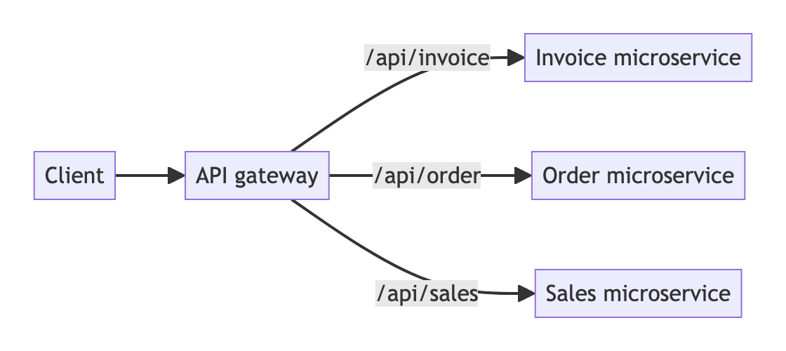
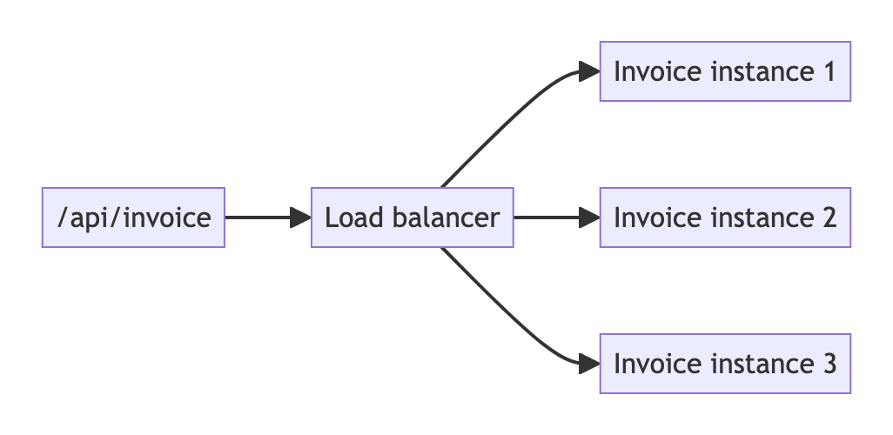
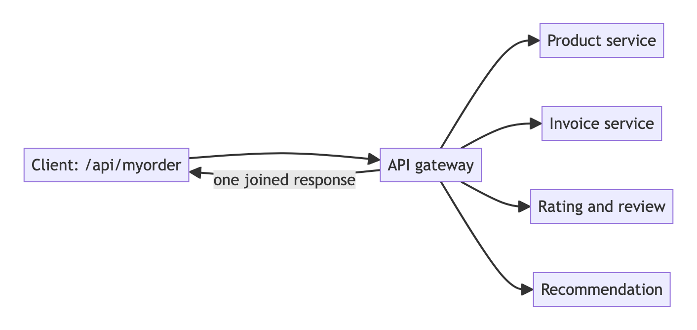
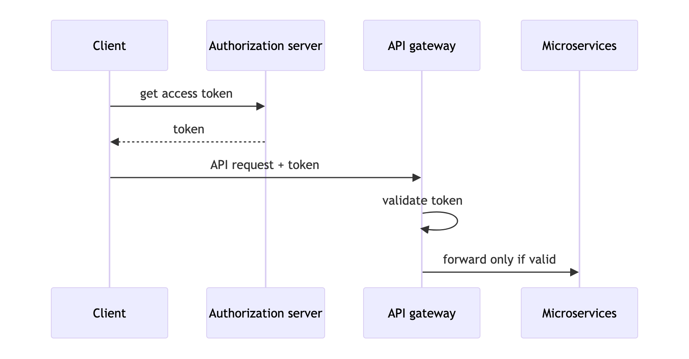
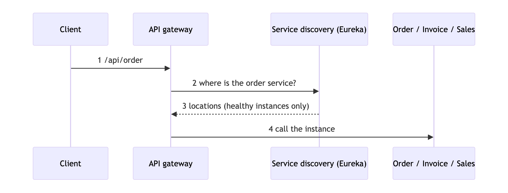
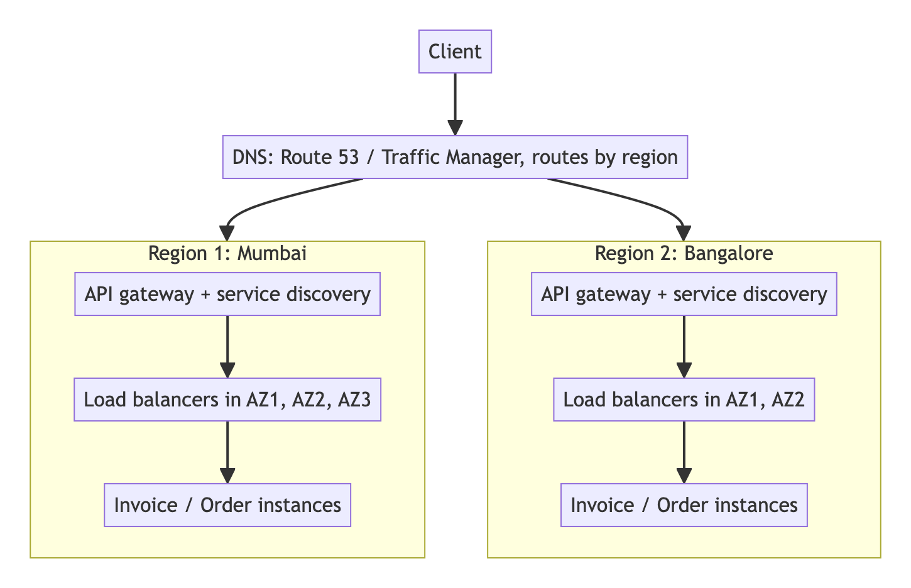
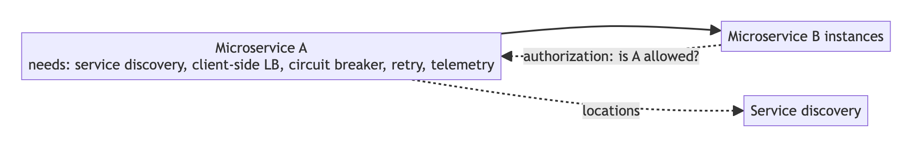

# API Gateway – Concepts (HLD #28 – Lecture 65) (+ lead-in to Service Mesh, HLD #29)

<!-- nav -->
⬅ [27 Thundering Herd](27_Thundering_Herd_Notes.md) · [Index](00_HLD_Index.md) · [29 Service Mesh](29_Service_Mesh_Notes.md) ➡
<!-- nav -->

Sources:
- Handwritten PDF (14 pages): https://drive.google.com/file/d/1eQxotRxC4q1c12uXn7IY4oLcuZgt-iBx/view?usp=drive_link
- Typed Zoho note (checked, same content as this note): https://notebook.zohopublic.in/public/notes/9wn9of886c95da92e4778b0d3bc23cb0b8106
- (Spring Cloud Gateway hands-on: [40_41_API_Gateway_Part1_Part2_Notes.md](40_41_API_Gateway_Part1_Part2_Notes.md))

## Questions this note answers
- If an API Gateway is a **single entry point, how does it handle millions of requests per second?**
- **How is an API Gateway different from a Load Balancer?** Does it come **before or after** the load balancer?

---

## 1. What is an API Gateway?

<!-- diagram:28-0 -->
**Diagram – API gateway routes by endpoint**

<!-- /diagram:28-0 -->

It **accepts the client's API request and routes it to the correct backend service based on the API endpoint.**
`Client → API GATEWAY → /api/invoice → Invoice MS · /api/order → Order MS · /api/sales → Sales MS`

### Isn't that what a load balancer does too?

<!-- diagram:28-1 -->
**Diagram – Load balancer: instances of one service only**

<!-- /diagram:28-1 -->

**No.** Generally a **load balancer simply distributes the traffic to the multiple instances of one microservice** based on factors like **health, traffic load**, etc. But **usually it has no capability to understand an API and then take the decision where to route it.**
(`/api/invoice → Load Balancer → Invoice MS instance 1 / 2 / 3`.)

<!-- isw:28-0 -->
**In simple words**

An API gateway **accepts the client's API request and routes it to the correct backend service based on the API endpoint:** `/api/invoice` goes to the Invoice microservice, `/api/order` to the Order microservice and `/api/sales` to the Sales microservice.
<!-- /isw:28-0 -->

<!-- isw:28-1 -->
**In simple words**

**No.** A load balancer generally **just distributes the traffic to the several instances of one microservice,** based on factors like **health and traffic load.** But it **usually has no capability to understand an API and then decide where to route it** (`/api/invoice` → load balancer → Invoice MS instance 1 / 2 / 3).
<!-- /isw:28-1 -->

---

## 2. Other capabilities of an API Gateway

### ① API Composition *(very rarely used – e.g. in Netflix)*

<!-- diagram:28-2 -->
**Diagram – API composition: one call, many services**

<!-- /diagram:28-2 -->

**Problem:** visiting the **"My Orders" page**:
- **Mobile client** → REST APIs: fetch product details, fetch invoice details.
- **PC client** → REST APIs: fetch product details, invoice details, **ratings & reviews, recommendations** (bigger screen, more data).
The client would have to call many APIs and merge.
**API Gateway makes the client's life easier through API composition:** the client calls **`/api/myorder`**; **based on the client type, the gateway calls multiple services (Product, Invoice, Rating & Review, Recommendation systems), joins the responses, and returns one response to the client.**

<!-- isw:28-3 -->
**In simple words**

The problem: the **"My Orders" page** on a **mobile client** calls REST APIs to fetch product details and invoice details, while on a **PC client** (bigger screen, more data) it also needs **ratings and reviews and recommendations.** The client would have to call many APIs and merge the results. With **API composition** the client calls just **`/api/myorder`;** **based on the client type, the gateway calls several services (Product, Invoice, Rating & Review, Recommendation), joins the responses and returns one response.**
<!-- /isw:28-3 -->

### ② Authentication (like the OAuth 2.0 flow)

<!-- diagram:28-3 -->
**Diagram – Authentication at the gateway**

<!-- /diagram:28-3 -->

1. Client gets an **access token** from the **Authorization Server.**
2. Client **passes the token with the API request** to the API Gateway.
3. Gateway validates the token.
4. **If the token is valid**, the request is forwarded to Invoice / Order / Sales microservices.

<!-- isw:28-4 -->
**In simple words**

(1) The client gets an **access token** from the **authorization server.** (2) The client **passes the token with the API request** to the API gateway. (3) The gateway validates the token. (4) **If the token is valid,** the request is forwarded to the Invoice / Order / Sales microservices.
<!-- /isw:28-4 -->

### ③ Rate limiting – rules you can set
- **Manage burst limit** – limit burst traffic: the **max number of concurrent requests the API Gateway can handle before it returns `429` (Too Many Requests)** (e.g. burst limit = 500).
- **API throttling** – limit the number of requests from an individual or an application by **temporarily blocking** requests once they cross the allowed request rate.
- **IP-based blocking.**
- **API queues** – **hold requests to an API which can't be processed immediately**; helps to handle the **thundering herd** issue. (See [Thundering Herd](27_Thundering_Herd_Notes.md).)

<!-- isw:28-5 -->
**In simple words**

The rules you can set: **manage burst limit** (the **maximum number of concurrent requests** the gateway can handle before it returns **`429` Too Many Requests;** for example burst limit = 500); **API throttling** (limit requests from one person or application by **temporarily blocking** them once they cross the allowed rate); **IP-based blocking;** and **API queues** (**hold requests that cannot be processed immediately,** which helps with the **thundering herd** issue; see the [Thundering Herd](27_Thundering_Herd_Notes.md) note).
<!-- /isw:28-5 -->

### ④ Service discovery

<!-- diagram:28-4 -->
**Diagram – Service discovery behind the gateway**

<!-- /diagram:28-4 -->

As microservices **scale up and down**, it's necessary to **know the location (IP address and port)** – service discovery keeps track.
- **Approach 1:** each microservice **registers or de-registers itself.**
- **Approach 2:** service discovery **health-checks all registered microservices and keeps only the active microservices' locations.**
- Flow: Client `/api/order` → API Gateway → (2) asks **Service Discovery (Eureka, Zuul…)** → (3) gets locations → (4) calls Order / Invoice / Sales microservice.

<!-- isw:28-6 -->
**In simple words**

As microservices **scale up and down, their location (IP address and port) must be known,** and service discovery keeps track. **Approach 1:** each microservice **registers or de-registers itself.** **Approach 2:** service discovery **health-checks all registered microservices and keeps only the locations of the active ones.** The flow: the client calls `/api/order` → the gateway → (2) asks **service discovery (Eureka, Zuul…)** → (3) gets the locations → (4) calls the Order / Invoice / Sales microservice.
<!-- /isw:28-6 -->

### Many other capabilities
- **Request/response transformation** · **Response caching** · **Logging**.

<!-- isw:28-2 -->
**In simple words**

The gateway has several more capabilities, listed below.
<!-- /isw:28-2 -->

<!-- isw:28-7 -->
**In simple words**

The notes also list **request / response transformation, response caching and logging.**
<!-- /isw:28-7 -->

---

## 3. "If the API Gateway is a single entry point, how does it handle millions of requests per second?"

<!-- diagram:28-5 -->
**Diagram – Scaling the gateway across zones and regions**

<!-- /diagram:28-5 -->

Answer = **horizontal scaling + multi-AZ + multi-region + DNS routing:**
- `Client → API Gateway (many instances) → Load Balancer → N instances of Invoice MS / Order MS`, with **Service Discovery** next to the gateway.
- **Region** (e.g. **Mumbai**) contains **Availability Zones (AZ1, AZ2, AZ3)** = **dedicated data centres** in different areas (e.g. Bandra, Santacruz, Andheri). Region 2 (e.g. **Bangalore**) has its own AZ1, AZ2.
- Each **region** has its own **Service Discovery + API Gateway**, and in each **AZ** there are **Load Balancers → microservice instances** (Micro1 = Invoice, Micro2 = Order…).
- The **client reaches the system via DNS (Domain Name System)** – **AWS Route 53, Azure Traffic Manager** – which **routes the traffic based on region** to the right region's API Gateway.
So the "single" entry point is really a **fleet of gateways, replicated per AZ/region**, fronted by DNS-based routing.

**API Gateway vs Load Balancer ordering:** the API Gateway sits in front and routes by **API/path**; behind it, per-service **load balancers** (or client-side LB) spread traffic across **instances.**

<!-- isw:28-8 -->
**In simple words**

The question is how a single entry point handles **millions of requests per second.** The answer is **horizontal scaling + multi-AZ + multi-region + DNS routing.** The picture is `Client → API Gateway (many instances) → Load Balancer → N instances of Invoice MS / Order MS`, with **service discovery** next to the gateway. A **region** (for example **Mumbai**) contains **Availability Zones (AZ1, AZ2, AZ3), dedicated data centres in different areas** (for example Bandra, Santacruz, Andheri), and a second region (**Bangalore**) has its own AZs. Each **region** has its own **service discovery and API gateway,** and each **AZ** has **load balancers → microservice instances.**

The **client reaches the system through DNS** (**AWS Route 53, Azure Traffic Manager**), which **routes the traffic by region** to the right region's gateway. So the "single" entry point is really a **fleet of gateways, replicated per AZ and region,** fronted by DNS routing. On the question of order: the **gateway sits in front and routes by API path; behind it, per-service load balancers (or a client-side LB) spread the traffic across the instances.**
<!-- /isw:28-8 -->

---

## 4. How do two microservices communicate with each other?

<!-- diagram:28-6 -->
**Diagram – What Microservice A needs to call Microservice B**

<!-- /diagram:28-6 -->

Need: **Microservice A must communicate with Microservice B.** (Diagram: API Gateway + Service Discovery + Application Load Balancers in front of Microservice A and Microservice B instances; a **Service Mesh** is hinted as the better solution.)

### ① Service discovery capability
A wants to call B → it needs B's **location (IP address and port).** Service discovery functionality lets A **get the locations of B's different instances.**
- **Scenario 1:** service discovery returns **all Microservice-B instance locations** (`ins1: url:port, ins2, ins3`).
- **Scenario 2:** service discovery returns the **address of Microservice-B's application load balancer.**

<!-- isw:28-10 -->
**In simple words**

A wants to call B, so it needs B's **location (IP address and port).** Service discovery lets A **get the locations of B's different instances.** **Scenario 1:** it returns **all the B instance locations** (`ins1: url:port, ins2, ins3`). **Scenario 2:** it returns the **address of B's application load balancer.**
<!-- /isw:28-10 -->

### ② Load balancing capability
- **Scenario 1:** A got B's **instance locations** and now wants **load balancing to distribute the traffic equally** to B → needs **client-side load-balancer capability** *inside A* (config: `microserviceB.url = {instance-url}:{port-no}`).
- **Scenario 2:** A got **B's application load balancer address** and just invokes that → **extra network call (an extra hop), which might cause latency** (config: `microserviceB.url = {application-load-balancer-url}:{port-no}`).

<!-- isw:28-11 -->
**In simple words**

**Scenario 1:** A got B's **instance locations** and wants to **distribute the traffic equally,** so it needs a **client-side load balancer capability inside A** (config: `microserviceB.url = {instance-url}:{port-no}`). **Scenario 2:** A got **B's application load balancer address** and just calls it, which is an **extra network call (an extra hop) that might cause latency** (config: `microserviceB.url = {application-load-balancer-url}:{port-no}`).
<!-- /isw:28-11 -->

### ③ Authorization / authentication
B must **validate: "does Microservice A have permission to invoke this API?"** → an **authorization** layer on B.

<!-- isw:28-12 -->
**In simple words**

B must **check: "does Microservice A have permission to call this API?"** So B needs an **authorization** layer.
<!-- /isw:28-12 -->

### ④ Circuit-breaker capability
M1 → M2: if M2 is failing (e.g. **fails 10 times in 1 min**), stop calling it → **Resilience4j circuit breaker** inside the caller (alongside client-side LB). (See [Circuit Breaker](39_Circuit_Breaker_Notes.md).)

<!-- isw:28-13 -->
**In simple words**

If M2 keeps failing (for example **fails 10 times in 1 minute**), M1 should **stop calling it.** The notes put a **Resilience4j circuit breaker** inside the caller, together with the client-side load balancer (see the [Circuit Breaker](39_Circuit_Breaker_Notes.md) note).
<!-- /isw:28-13 -->

### ⑤ Retry capability
MA → MB fails: **4xx = validation error → don't retry; 5xx → retry.** Retry module in the caller too. (See [Retry Pattern](38_Retry_Pattern_Notes.md).)

<!-- isw:28-14 -->
**In simple words**

When MA → MB fails: **4xx means a validation error, so do not retry; 5xx, retry.** A retry module is also needed in the caller (see the [Retry Pattern](38_Retry_Pattern_Notes.md) note).
<!-- /isw:28-14 -->

### ⑥ Deployment strategy
Different deployment strategies exist – **Canary, Red-Black, Blue-Green**, etc.
Example – **Canary:** initially **90 % traffic to the old manifest (Microservice 2 old) and 10 % to the new manifest**, then **gradually increase** the share of the new manifest.
**Generally the load balancer helps to control this – i.e. the client-side load balancer must also handle the different deployment strategies** (client-side LB + support for deployment strategy).

<!-- isw:28-15 -->
**In simple words**

There are different deployment strategies: **Canary, Red-Black, Blue-Green,** and so on. **Canary example:** initially **90 % of the traffic goes to the old manifest (Microservice 2 old) and 10 % to the new manifest,** then the share of the new one is **increased gradually.** **Generally the load balancer helps to control this,** which means the **client-side load balancer must also handle the different deployment strategies.**
<!-- /isw:28-15 -->

### ⑦ Telemetry capability
We need to **collect data that helps in analysis and monitoring of a component** – **latency, error rate, traffic**, etc. per API (`/api/user`, `/api/payment`) – these data **help in monitoring as well as debugging.**

<!-- isw:28-16 -->
**In simple words**

We need to **collect data that helps to analyse and monitor a component:** **latency, error rate, traffic** and so on, per API (`/api/user`, `/api/payment`). This data **helps in monitoring as well as debugging.**
<!-- /isw:28-16 -->

### The problem
Now **every microservice** has to embed: client-side load balancer + deployment-strategy support + circuit breaker + retry + telemetry + authorization – **duplicated code in every service.**

> **Any better solution? → Service MESH.** (A sidecar-proxy layer takes over service discovery, load balancing, retries, circuit breaking, mTLS/authorization and telemetry – covered in HLD #29 [Service Mesh](29_Service_Mesh_Notes.md).)

<!-- isw:28-9 -->
**In simple words**

The need: **Microservice A must communicate with Microservice B** (the picture has an API gateway, service discovery and application load balancers in front of the instances; a **service mesh** is hinted at as the better solution).
<!-- /isw:28-9 -->

<!-- isw:28-17 -->
**In simple words**

Now **every microservice** has to include a client-side load balancer, deployment-strategy support, circuit breaker, retry, telemetry and authorization, which means **duplicated code in every service.** The notes ask: *any better solution?* and answer: **Service Mesh** (covered in HLD #29: [Service Mesh](29_Service_Mesh_Notes.md)).
<!-- /isw:28-17 -->

---

## Quick revision
- **API Gateway** = single entry; routes by **API/path**, plus **composition, authentication, rate limiting (burst, throttling, IP block, queues → 429), service discovery, transformation, caching, logging.**
- **Load balancer** = spreads traffic across **instances of one service**; typically doesn't understand APIs. Gateway in front, LBs behind.
- Scale the gateway **horizontally, per AZ & region**, with **DNS (Route 53 / Traffic Manager)** routing by region.
- **Service-to-service** needs: discovery, client-side LB, authz, circuit breaker, retry, deployment strategies (canary / blue-green / red-black), telemetry → heavy per-service duplication → **Service Mesh.**

---

<!-- nav -->
⬅ [27 Thundering Herd](27_Thundering_Herd_Notes.md) · [Index](00_HLD_Index.md) · [29 Service Mesh](29_Service_Mesh_Notes.md) ➡
<!-- nav -->
