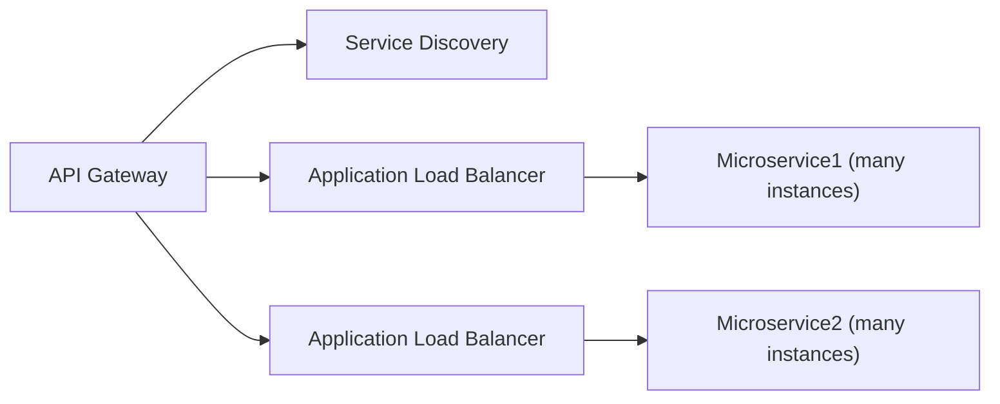
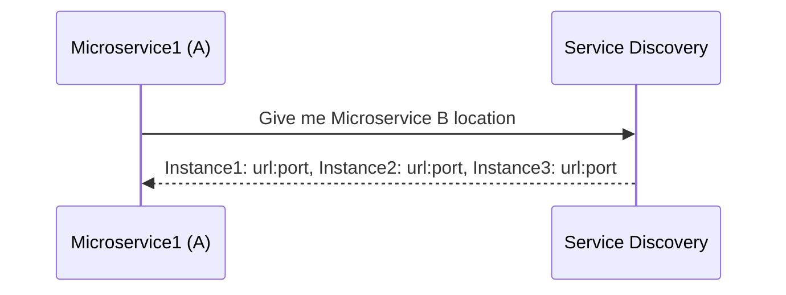
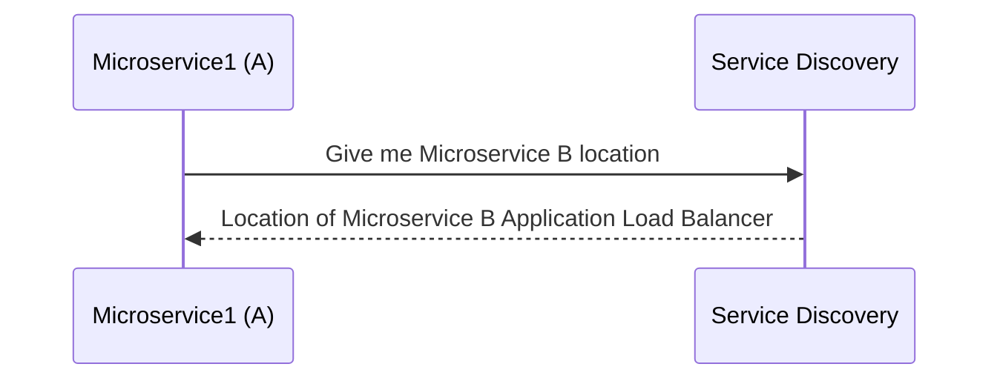
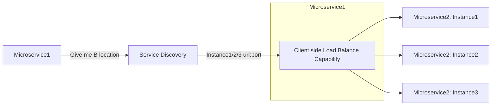
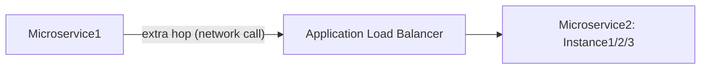
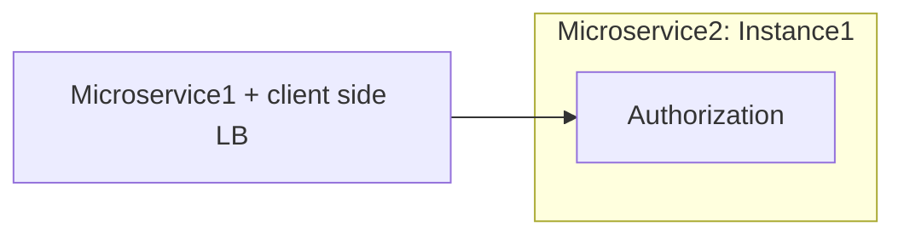
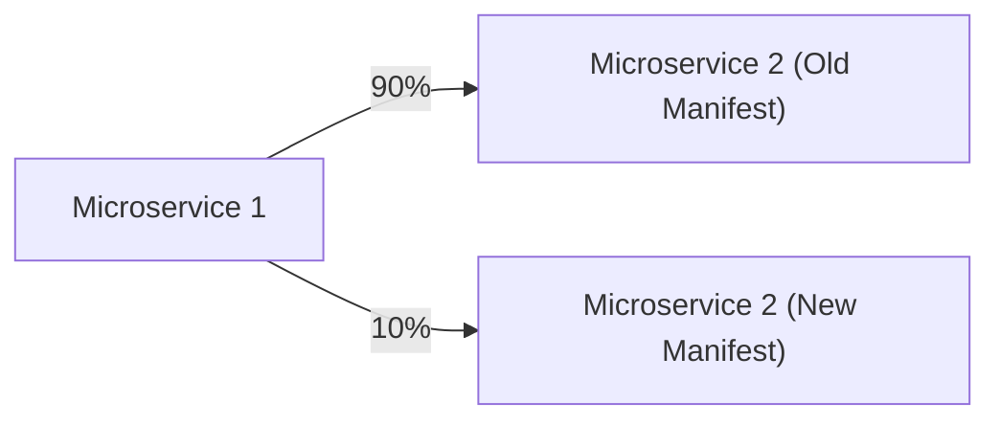
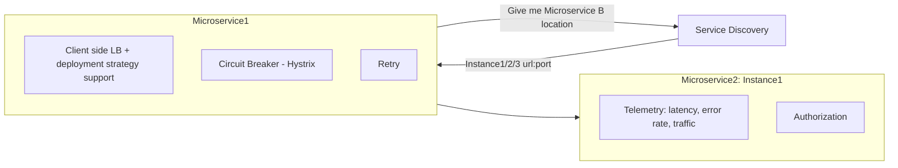
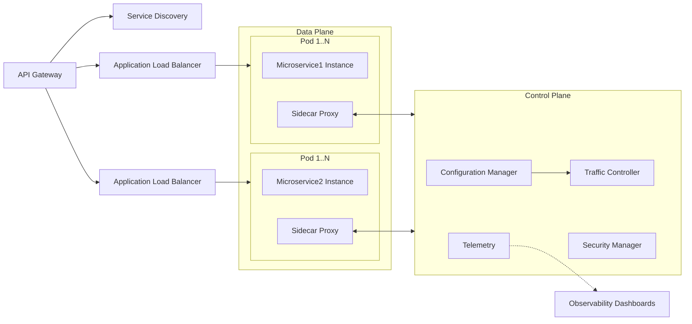

# Service Mesh (HLD #29)

<!-- nav -->
⬅ [28 API Gateway Concepts](28_API_Gateway_Concepts_Notes.md) · [Index](00_HLD_Index.md) · [30 DNS](30_DNS_Notes.md) ➡
<!-- nav -->

Source: Typed Zoho note – https://notebook.zohopublic.in/public/notes/9wn9od9ab6075a35b4258aadedbf53aca805e

## 1. The question: how do 2 microservices communicate with each other?

In the previous topic (API Gateway) the picture is: **Client → DNS** (like AWS Route 53, Azure Traffic Manager) → one **API Gateway per region**. Each region has availability zones (AZ1, AZ2); in each AZ every microservice (Microservice1, Microservice2) has its own **load balancer** in front of several instances. The API Gateway asks **Service Discovery** where to send the request.

In simple form the page redraws it as:

**In simple words:** the gateway handles traffic coming **from the client**. The follow-up question is the traffic **between services**: Microservice A wants to call Microservice B. What does A need for that? The page lists seven capabilities.

## 2. Capability 1 – Service Discovery

- Microservice A wants to talk to Microservice B, so it needs B's **location (IP address and port no)**.
- Service Discovery is needed so A can get the location of **B's different instances**.

**Scenario 1:** Service Discovery returns **all of Microservice B's instance locations**.

**Scenario 2:** Service Discovery returns the **address of Microservice B's application load balancer**.

**In simple words:** either the registry hands A the addresses of all the instances of B, or it hands over just the address of B's load balancer, and the load balancer then picks an instance.

## 3. Capability 2 – Load balancing

**Scenario 1:** A got the instance locations of B and now wants **load balancing capability to distribute the traffic equally** to B. Config looks like `microserviceB.url={instance-url}:{port-no}`. A needs a **client-side load balance capability** inside itself.

**Scenario 2:** A got **B's application load balancer address** and now needs to invoke that. Config looks like `microserviceB.url={application-load-balancer-url}:{port-no}`. **An extra network call is required, which might cause a latency issue** (the "extra hop" in the diagram).

**In simple words:** with scenario 1 the caller picks the instance itself (no extra hop but the caller must contain the balancing logic). With scenario 2 the caller calls a load balancer which then forwards the call: simpler for the caller but one more network hop, so more delay.

## 4. Capability 3 – Authorization

Microservice2's instance must **validate: does Microservice A have permission to invoke this API?**

**In simple words:** the called service checks who is calling it before it does the work.

## 5. Capability 4 – Circuit breaker

Microservice1 also needs a **circuit breaker (Hystrix)** next to the client-side load balancer, in front of the call to Microservice2.

**In simple words:** if the target keeps failing, the circuit breaker stops further calls instead of letting them pile up. (See [39 Circuit Breaker](39_Circuit_Breaker_Notes.md).)

## 6. Capability 5 – Retry

Microservice1 also gets a **Retry** capability (the green circular arrow in the diagram), sitting together with the circuit breaker.

**In simple words:** if a call fails, it can be tried again. (See [38 Retry Pattern](38_Retry_Pattern_Notes.md).)

## 7. Capability 6 – Deployment strategy

- There are different deployment strategies like **Canary, Red-Black, Blue-Green** etc.
- Example: in **Canary**, I want **90% of traffic on old and 10% on new** initially, and gradually increase the amount on the new manifest.

- Generally the **load balancer helps to control this**, which means **"the client-side load balancer also has to handle this different deployment strategy"**. So the box becomes *Client-side load balance capability + support for deployment strategy*.

## 8. Capability 7 – Telemetry

- It means we need to **collect data that helps in analysis and monitoring of a component.**
- Telemetry capability on Microservice2: **latency, error rate, traffic, etc.**
- This data **helps in monitoring as well as debugging.**

**Everything on one picture:** Microservice1 now carries client-side load balancing + deployment-strategy support, circuit breaker (Hystrix) and retry; Microservice2 carries telemetry and authorization; plus the Service Discovery lookup.

**In simple words:** every microservice would have to carry all this extra code (discovery, balancing, authorization, circuit breaking, retry, deployment strategy, telemetry), which is a lot of repeated work inside each service.

## 9. Any better solution? – SERVICE MESH

**Service Mesh (like Istio).**

- **Data plane:** the pods, each with the microservice instance **and a sidecar proxy** next to it.
- **Control plane:** **Configuration Manager, Traffic Controller, Security Manager, Telemetry**; telemetry feeds **Observability Dashboards**.
- The sidecar proxies talk to the control plane (two-way arrow).

**In Istio:**
- Sidecar proxy is known as **Envoy**
- Configuration Manager is known as **Galley**
- Traffic Controller is known as **Pilot**
- Security Manager is known as **Citadel**

**In simple words:** instead of coding all seven capabilities inside every microservice, a small **sidecar proxy** sits beside each instance and does them. The **control plane** tells all the sidecars what rules to follow (traffic, security, configuration) and collects telemetry for dashboards.

---

<!-- nav -->
⬅ [28 API Gateway Concepts](28_API_Gateway_Concepts_Notes.md) · [Index](00_HLD_Index.md) · [30 DNS](30_DNS_Notes.md) ➡
<!-- nav -->
