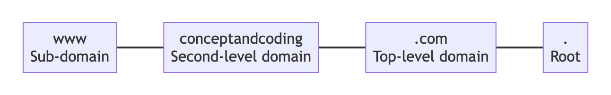
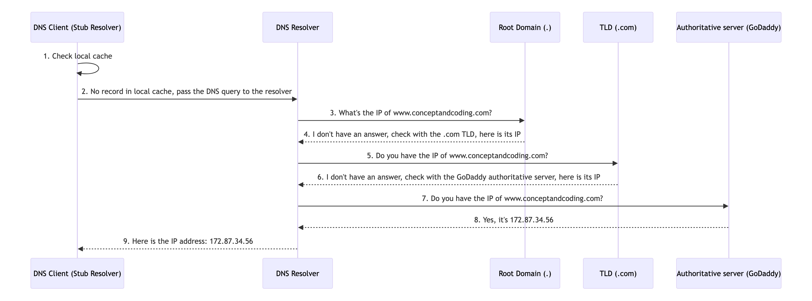
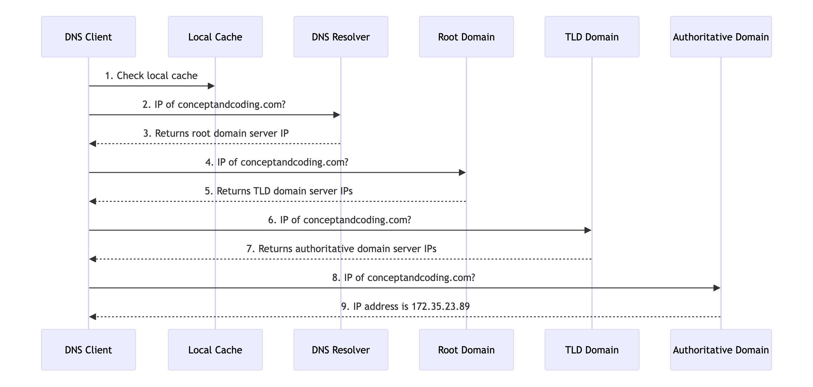
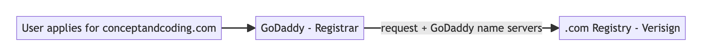
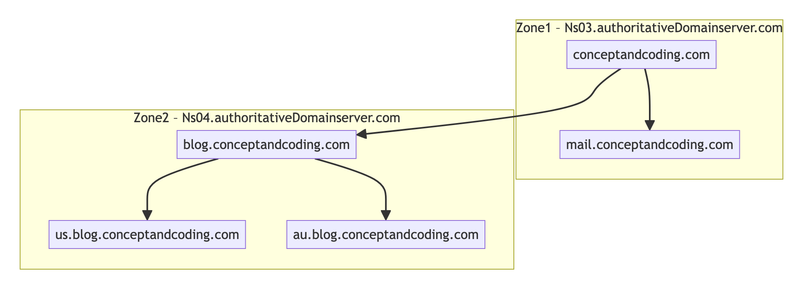

# DNS – Domain Name System (HLD #30)

<!-- nav -->
⬅ [29 Service Mesh](29_Service_Mesh_Notes.md) · [Index](00_HLD_Index.md) · [32 Common Attacks](32_Common_Attacks_Notes.md) ➡
<!-- nav -->

Source: Typed Zoho note – https://notebook.zohopublic.in/public/notes/9wn9oa7b313dd344b426288e0efca9f0eeaa6

## 1. What is an IP address?

- An IP address is a **unique numerical label** given to each server or device connected to the internet.
- In simple terms, it helps **one device locate another device** on the internet.

**In simple words:** every machine on the internet needs an address, just like every house needs one. The IP address (for example `172.87.34.56`) is that address, and it is what lets your device find the other device.

## 2. What is a domain name?

- A **human-readable / friendly address** used to identify a server or device on the internet, like `google.com`, `amazon.com`.

**In simple words:** people cannot remember numbers like `172.87.34.56`, so we use names instead.

## 3. DNS

- **DNS translates a domain name into an IP address.**

**In simple words:** DNS is the phone book of the internet. You give it a name, it gives you back the number to call.

## 4. But how? Two approaches

1. **Recursive**
2. **Iterative**

### Parts of a domain name



- `www.conceptandcoding.com.` is the **FQDN (Fully Qualified Domain Name)**.
- `conceptandcoding.com` is the **domain name**.
- `www` = sub-domain, `conceptandcoding` = second-level domain, `.com` = top-level domain (TLD), the final `.` = root.

**In simple words:** a name is read from right to left. The root is at the very top, then the TLD (`.com`), then the company name, then the sub-domain. The full name with every part is the FQDN.

## 5. Recursive approach

The browser wants to talk to `www.conceptandcoding.com`.



Points on the page:
- If we want to use Google's public DNS resolver, its IP is **8.8.8.8**.
- The **root domain** holds the DNS records for each top-level domain (there are **1000+ TLDs** and the number keeps changing).
- The **TLD** (`.edu`, `.com`, `.in`) maintains the DNS records for the **authoritative name servers**.
- **Authoritative domain servers** are things like Google DNS, Amazon DNS (like "AWS Route 53") and GoDaddy.

**In simple words:** in the recursive approach the client asks just **one** helper, the DNS resolver, and the resolver does all the running around (root → TLD → authoritative) and brings back the final answer. The client only sees step 2 and step 9.

## 6. Iterative approach



- The DNS resolver "looks in its cache; if not found, returns the address of the root domain".

**In simple words:** in the iterative approach the **client itself** visits each server in turn. Each server only says "I don't know, go ask this one" and hands over the next address, until the authoritative server finally gives the IP.

## 7. Checking the DNS cache

In a terminal, the list of DNS records cached by the DNS client can be seen with `ipconfig/displaydns`. The page shows a Windows example whose entries look like:

| Record Name | Record Type | Time To Live | Data Length | Section | Value |
|---|---|---|---|---|---|
| edged1.me.gvt1.com | 1 | 956 | 4 | Answer | A (Host) Record: 34.104.35.123 |
| c-ring-fallback.msedge.net | 5 | 37 | 8 | Answer | CNAME Record: c-9999.c-dc-msedge.net |
| c-9999.c-dc-msedge.net | 1 | 37 | 4 | Answer | A (Host) Record: 13.107.12.254 |
| crl3.digicert.com | 5 | 1777 | 8 | Answer | CNAME Record: crl.edge.digicert.com |

**In simple words:** type 1 is an A record (name → IP) and type 5 is a CNAME record (name → another name). Time To Live is how long the record may stay in the cache.

## 8. The 13 root servers

The root server list can be checked at **IANA (Internet Assigned Numbers Authority)**. Each DNS resolver holds this information.

| # | Root | Operated by | Record name |
|---|---|---|---|
| 1 | A-root | Verisign, Inc. | a.root-servers.net |
| 2 | B-root | U.S.C. Information Sciences Institute | b.root-servers.net |
| 3 | C-root | Cogent Communications | c.root-servers.net |
| 4 | D-root | University of Maryland | d.root-servers.net |
| 5 | E-root | NASA Ames Research Centre | e.root-servers.net |
| 6 | F-root | Internet Systems Consortium (ISC) | f.root-servers.net |
| 7 | G-root | U.S. Department of Defense (NIC) | g.root-servers.net |
| 8 | H-root | U.S. Army Research Lab | h.root-servers.net |
| 9 | I-root | Netnod | i.root-servers.net |
| 10 | J-root | Verisign, Inc. | j.root-servers.net |
| 11 | K-root | RIPE NCC | k.root-servers.net |
| 12 | L-root | ICANN | l.root-servers.net |
| 13 | M-root | WIDE Project | m.root-servers.net |

## 9. One DNS record has this main information

- **Record Name:** contains the domain name or sub-domain name.
- **CNAME record:** Canonical Name, used to **alias one domain to another (sub-domain only)**. Example: `www.conceptandcoding.com` and `blog.conceptandcoding.com` are aliases of `conceptandcoding.com`.
- **A (Host) record:** Address record, **maps a record name to an IP address.**

Example:

```
Record Name: @     Type: 1   A (Host): 194.45.32.21
Record Name: www   Type: 5   CNAME Record: conceptandcoding.com.
```

**In simple words:** `@` means the bare domain itself. It points straight to an IP (A record). `www` just says "I am another name for the bare domain" (CNAME), so it follows wherever the bare domain goes.

## 10. How does the TLD know `conceptandcoding.com` belongs to the GoDaddy authoritative server?

When a user applies for a domain like `conceptandcoding.com`:
1. **GoDaddy (the registrar)** communicates with the respective **TLD registry**.
2. The **.com registry (maintained by Verisign)** receives the request plus the **name servers of GoDaddy** that will be used to resolve requests for `conceptandcoding.com`.



**In simple words:** the registrar tells the .com registry "this domain is mine, and these are the name servers that answer for it". That is how the TLD later knows whom to point to.

## 11. What is a DNS zone?

- Think of it as a **separate area** that gives **more granular control**.
- It also helps **offload responsibility** from the single authoritative domain server.

Example names: `conceptandcoding.com`, `mail.conceptandcoding.com`, `blog.conceptandcoding.com`, `admin.conceptandcoding.com`, `cdn.image.media.conceptandcoding.com`, `systemdesign.resource.conceptandcoding.com`, etc.

- **If there is no zone,** only **one authoritative server** holds the DNS records (record name, IP address, TTL, etc.) and answers queries for **all** the sub-domains.
- **But we can distribute the load** by creating more authoritative domain servers, just as load is distributed between TLD servers `.com`, `.au`. Instead of putting load on one server, the traffic is distributed.



**In simple words:** a zone is a slice of the domain tree handled by its own name server. Here `conceptandcoding.com` and `mail` are looked after by one server (Zone1), while `blog` and its `us` / `au` children are looked after by another (Zone2), so one server is not overloaded.

---

<!-- nav -->
⬅ [29 Service Mesh](29_Service_Mesh_Notes.md) · [Index](00_HLD_Index.md) · [32 Common Attacks](32_Common_Attacks_Notes.md) ➡
<!-- nav -->
