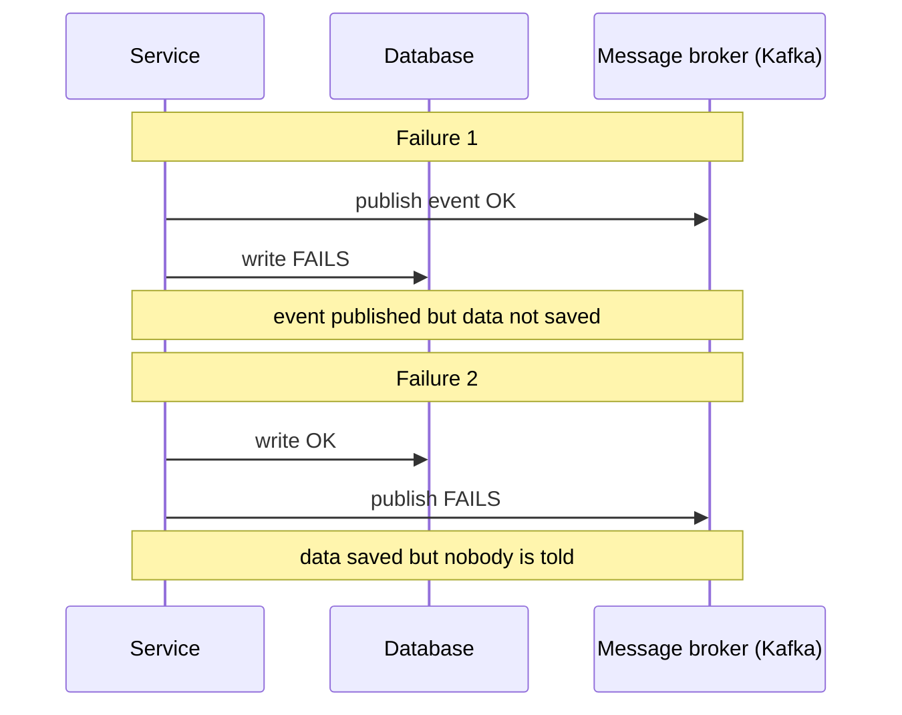
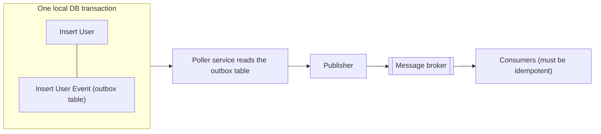
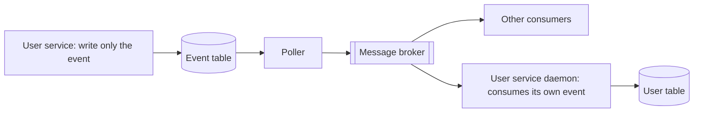

# Dual Write Problem – Designing Event-Driven Systems (HLD #33 – Lecture 70)

<!-- nav -->
⬅ [32 Common Attacks](32_Common_Attacks_Notes.md) · [Index](00_HLD_Index.md) · [34 Service Discovery](34_Service_Discovery_Notes.md) ➡
<!-- nav -->

Sources:
- Handwritten PDF (8 pages): https://drive.google.com/file/d/14wwKmtzMEgvctlQhiSrLU0gw9fhmMAGn/view?usp=drive_link
- OneNote (not readable automatically): https://1drv.ms/o/c/6b364628c29feb52/EpHzxZpvUj9ChPoZKABB6hYB3ThLz9J66-3csHIWs_G_ZA

---

## 1. The Dual Write Problem

<!-- diagram:33-0 -->
**Diagram – Two ways the dual write goes wrong**


<!-- /diagram:33-0 -->


It occurs **when a component needs to persist a change in two different systems** – e.g. **a DB and a message broker like Kafka.**

We must make sure **both are in a consistent state** – there should **never be a case where the DB write succeeds but event publishing fails, or vice-versa.**

Where it shows up: the **SAGA pattern** → *dual-write problem*. In a saga `SA → SB → SC`, each service has its own DB (e.g. SA's DB: "Invoice created") and must also publish an event to the next service through a queue.

Two failure sequences (service → DB / message broker):
1. Message to broker ✔, then DB write ✗ → event published but data not saved.
2. DB write ✔, then publish to broker ✗ → data saved but nobody is told.

<!-- isw:33-0 -->
**In simple words**

The dual-write problem occurs **when a component must persist a change in two different systems,** for example **a DB and a message broker like Kafka.** We must make sure **both are in a consistent state:** there must **never be a case where the DB write succeeds but the event publishing fails, or the other way round.**

It shows up in the **SAGA pattern:** in a saga `SA → SB → SC` each service has its own DB (for example SA's DB: "Invoice created") and must also publish an event to the next service through a queue. The two failure sequences are: (1) the message to the broker succeeds, then the DB write fails → the event is published but the data is not saved; (2) the DB write succeeds, then publishing to the broker fails → the data is saved but nobody is told.
<!-- /isw:33-0 -->


---

## 2. How to resolve it? First idea – 2PC (Two-Phase Commit)
- A **coordinator** sends a **Prepare** message to all participant services and waits for **Ack**.
- Once all Acks arrive it sends **Commit** and again waits for **Ack** – ensuring **all participant services properly committed the txn.**

### But – 2PC is **not a viable solution** for the dual-write problem. Why?
- Dual-write scenarios involve **heterogeneous systems (DB + message queue)**, and **some message queues / brokers do not support 2PC.**
- In a distributed system **2PC is slow (high latency)** because it provides **strong consistency by waiting for all participants to commit.**
- **If the 2PC coordinator crashes, participants may be stuck in an uncertain state till it recovers.**

<!-- isw:33-1 -->
**In simple words**

The first idea is **2PC (Two-Phase Commit):** a **coordinator** sends a **Prepare** message to all participant services and waits for an **Ack;** once all acks arrive it sends **Commit** and again waits for an **Ack,** which ensures **all participants committed properly.**
<!-- /isw:33-1 -->

<!-- isw:33-2 -->
**In simple words**

The notes say 2PC is **not a viable solution** here because: dual-write scenarios involve **different kinds of systems (a DB and a message queue), and some message queues / brokers do not support 2PC;** in a distributed system **2PC is slow (high latency)** because it gives strong consistency by waiting for all participants to commit; and **if the 2PC coordinator crashes, the participants may be stuck in an uncertain state until it recovers.**
<!-- /isw:33-2 -->


---

## 3. Answer: Event-Driven Architecture patterns
1. **Transactional Outbox Pattern**
2. **Listen-to-Yourself Pattern**
3. **Transactional Log Tailing Pattern** *(named in the notes; the PDF doesn't detail it)*

### ① Transactional Outbox Pattern

<!-- diagram:33-1 -->
**Diagram – Transactional outbox**


<!-- /diagram:33-1 -->


- Instead of writing to both the DB **and** publishing an event, **write the event into a separate table called the OUTBOX table** – **in the same local DB transaction** as the business data.
- **Later, a separate process (poller) reads the Outbox table and publishes the event to the message broker asynchronously.**

Example – User Service:
```
Begin Txn
   Insert User            ┐
   Insert User Event      ├─ 1 Txn  (User table + UserEvent table in the same DB)
Commit Txn                ┘
Poller Service ── get events from UserEvent table ──► Publisher ── publish ──► Message Broker
```
Table design options: **one common event table** (UE, OE, IE – user/order/inventory events together) **or separate tables per event type** (UE table, OE table).
- The **Outbox table is regularly cleaned up** once messages are successfully published.

**Challenges**
1. **Extra effort** to write the poller service.
2. **Delay** between writing an event and publishing it to the broker.
3. **A poller may publish the same event multiple times** to the broker → **idempotency must be handled.**
   - Producer sets **`enable.idempotence=true`**.
   - Kafka then **assigns a producer ID (PID) to each producer** when it starts.
   - Every message from the producer now carries a **monotonically increasing sequence number.**
   - If Kafka sees a duplicate **(producer id + sequence no.)**, it **discards the event automatically.**
4. **Multiple pollers can pick the same events and cause duplication.**
   - `enable.idempotence=true` **won't help here** because **different producers (pollers) get different PIDs.**
   - So **idempotency must be handled on the consumer side too** – e.g. **store the unique IDs of processed events in a cache.**
5. **Events might be published out of order** if different pollers pick events in parallel.
   - Kafka **only guarantees order if there is only 1 producer and 1 partition.**
   - With **multiple producers and multiple partitions, ordering is not guaranteed.**
   - If ordering is a must with multiple producers/partitions → **Kafka Streams** can be used (it re-orders).
   - *Ordering issue example:* events for one entity – **Creation, Updation, Deletion** – may reach the notification service as *Deleted → Updated → Created* if they land in different partitions. **Message key → hash % no. of partitions** decides the partition (same key ⇒ same partition). **1 publisher → 1 partition = order is maintained** (4,3,2,1,0 stays in order in P0); with **more partitions** (P0: 2,1,0 and P1: 5,4,3) the consumer may interleave them.
6. **What if the poller can't publish to the message broker?** The event must not be lost:
   1. **Retry with exponential backoff and jitter.**
   2. After the retries, **move to a Failed-event table**, or – depending on how the outbox table is used (if a **status column** is maintained) – keep it in the same table.
7. **Outbox table can grow** – clean it regularly:
   1. **After every message/event is published successfully**, or
   2. **A batch job.**

<!-- isw:33-4 -->
**In simple words**

Instead of writing to the DB **and** publishing an event, **write the event into a separate table called the OUTBOX table, in the same local DB transaction** as the business data. **Later, a separate process (the poller) reads the Outbox table and publishes the event to the message broker asynchronously.** The example (User service): Begin Txn → insert User, insert User Event (both in **one transaction** in the same DB) → Commit; the poller gets events from the UserEvent table and the publisher publishes them to the message broker. The table can be **one common event table** (user / order / inventory events together) **or separate tables per event type.** The **outbox table is cleaned regularly** once the messages are published.

**Challenges:**
1. **Extra effort** to write the poller service.
2. A **delay** between writing an event and publishing it.
3. **A poller may publish the same event several times** → **idempotency must be handled.** The producer sets **`enable.idempotence=true`;** Kafka then **assigns a producer ID (PID)** to each producer when it starts; every message carries a **monotonically increasing sequence number;** if Kafka sees a duplicate **(producer id + sequence no.)** it **discards the event automatically.**
4. **Several pollers can pick the same events and cause duplication.** `enable.idempotence=true` **does not help here** because **different producers (pollers) get different PIDs,** so **idempotency must also be handled on the consumer side** (for example **store the unique IDs of processed events in a cache**).
5. **Events might be published out of order** if different pollers pick events in parallel. Kafka **only guarantees order with 1 producer and 1 partition;** with several producers and partitions order is not guaranteed. If order is a must, **Kafka Streams** can be used (it re-orders). *Example:* an entity's events Creation, Updation, Deletion may reach the notification service as *Deleted → Updated → Created* if they land in different partitions. **`hash(message key) % number of partitions`** decides the partition (same key ⇒ same partition), and **1 publisher → 1 partition keeps the order.**
6. **If the poller cannot publish to the broker,** the event must not be lost: (1) **retry with exponential backoff and jitter;** (2) after the retries, **move it to a failed-events table** or, if a **status column** is kept, keep it in the same table.
7. **The outbox table can grow,** so clean it regularly: (1) **after every successfully published message,** or (2) with a **batch job.**
<!-- /isw:33-4 -->


### ② Listen-to-Yourself Pattern

<!-- diagram:33-2 -->
**Diagram – Listen-to-yourself**


<!-- /diagram:33-2 -->


- **A variation of the Transactional Outbox pattern.**
- The **application writes only the event** in the Outbox/event table (single write).
- The **poller fetches the event** from the table and **publishes it** to the message broker.
- **The application also listens to the same event** (via a consumer / "User Service daemon application") **and only now updates its own DB** (writes into the User table).

```
User Service ─ Begin Txn / Insert User Event / Commit Txn ─► DB (UserEvent table)
Poller ── get event ──► publish ──► Message Broker ──► Consumer
                                           └─► User Service Daemon application ── writes into DB (User table)
```

<!-- isw:33-5 -->
**In simple words**

This is **a variation of the Transactional Outbox pattern.** The **application writes only the event** in the outbox / event table (a **single write**). The **poller fetches the event** and **publishes** it to the message broker. **The application also listens to the same event** (through a consumer, the "User Service daemon application") **and only then updates its own DB** (writes into the User table).
<!-- /isw:33-5 -->


### ③ Transactional Log Tailing
Listed as the third pattern (read the DB's transaction log instead of polling a table); the PDF doesn't go into details.

<!-- isw:33-3 -->
**In simple words**

The answer is one of three patterns: **1. Transactional Outbox, 2. Listen-to-Yourself, 3. Transactional Log Tailing** (named in the notes; the PDF does not give details on the third).
<!-- /isw:33-3 -->

<!-- isw:33-6 -->
**In simple words**

It is listed as the third pattern (read the DB's transaction log instead of polling a table); the PDF does not go into details.
<!-- /isw:33-6 -->


---

## Quick revision
- **Dual write** = updating DB + broker separately → can end up inconsistent.
- **2PC isn't suitable** (brokers often don't support it, high latency, coordinator crash blocks).
- **Transactional Outbox:** write data + event in **one local DB txn**, a **poller** publishes later → **at-least-once**, so make producers/consumers **idempotent**; watch **ordering**, retries/failed-event table, and **cleanup**.
- **Listen-to-yourself:** write only the event, then consume your own event to update your DB.
- **Log tailing:** CDC from the DB transaction log.
- Related: [Distributed Transactions / SAGA](20_Distributed_Transactions_Notes.md), [Idempotent POST](14_Idempotent_POST_API_Notes.md).

---

<!-- nav -->
⬅ [32 Common Attacks](32_Common_Attacks_Notes.md) · [Index](00_HLD_Index.md) · [34 Service Discovery](34_Service_Discovery_Notes.md) ➡
<!-- nav -->
