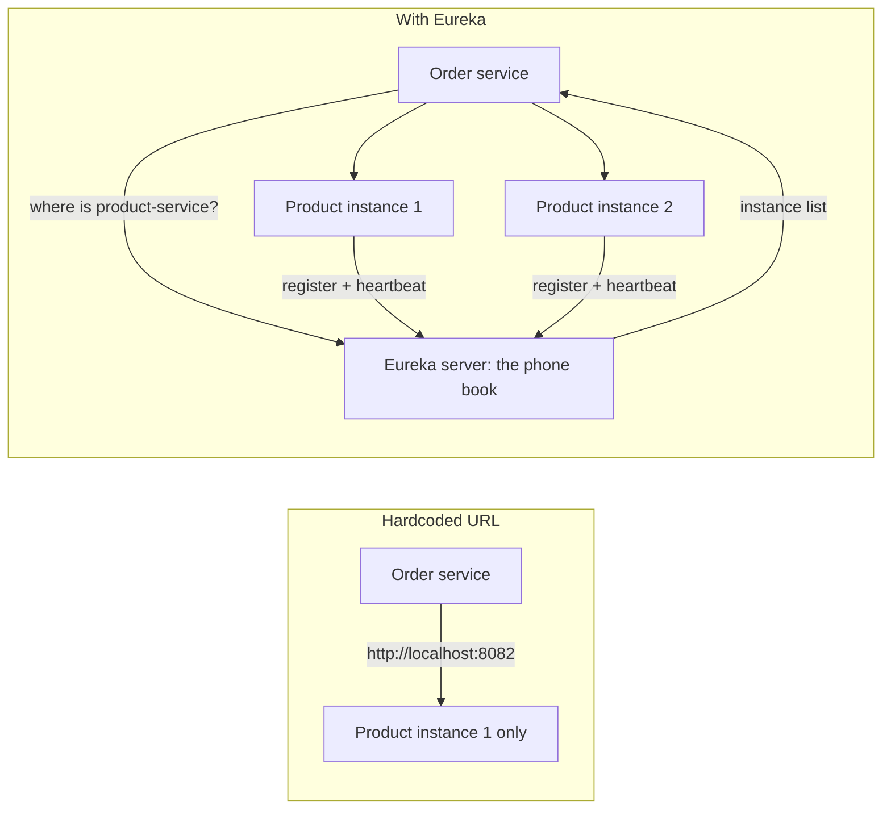
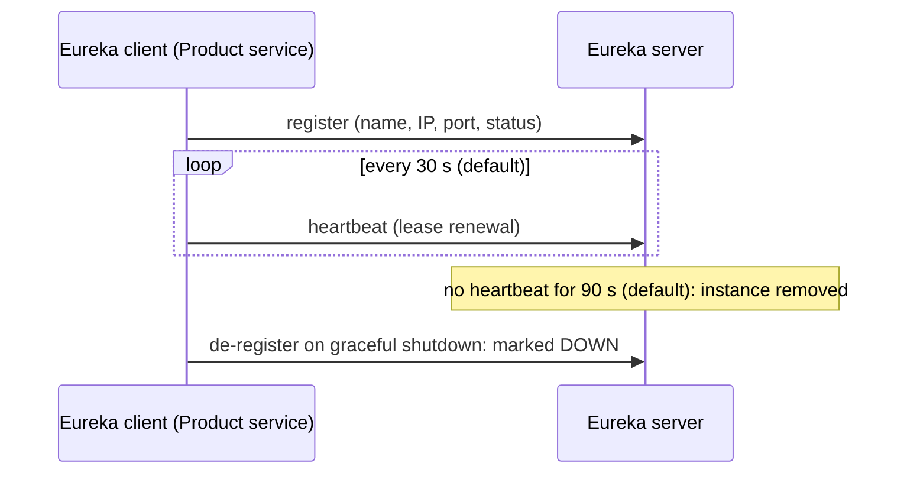
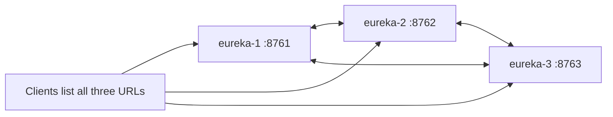
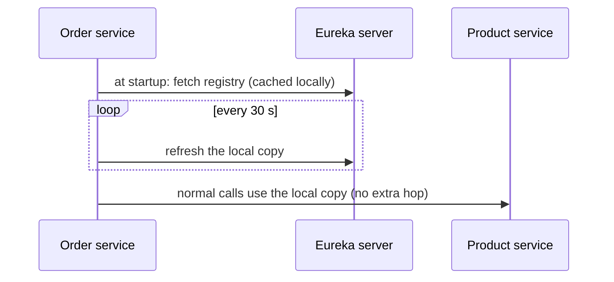

# Service Discovery (HLD #34 / Microservices #4)

<!-- nav -->
⬅ [33 Dual Write Problem](33_Dual_Write_Problem_Notes.md) · [Index](00_HLD_Index.md) · [35 Client Side Load Balancer](35_Client_Side_Load_Balancer_Notes.md) ➡
<!-- nav -->

Source: https://drive.google.com/file/d/11DAZgXFoArZ17xVLhkIxTYQtUYAJNnr-/view?usp=drive_link

---

<!-- simple-explanation -->
## In simple words – service discovery with Eureka

### The problem
In microservices, service instances are **created and destroyed all the time** (scaling up, scaling down, crashes, redeploys), and each one may get a different IP address and port. If the Order service has Product service's URL **hardcoded**, things break:
- **Single point of failure:** if that one instance dies, Order can't reach any other Product instance.
- **No load balancing:** one instance does all the work while others sit idle.
- **Tight coupling:** moving or changing Product means editing Order.
- **Painful testing:** dev, QA and production have different URLs, so config keeps changing.

### The solution: a service registry
Think of a **phone book**. Instead of remembering numbers, services look people up by name.
- **Eureka Server** is the phone book. It stores, for every registered service: its name, instance ID, IP, port and health status.
- **Eureka Client** (every microservice) **registers itself** when it starts and **looks up** other services by name.

### Setting it up (Spring Boot)
- **Server:** add `spring-cloud-starter-netflix-eureka-server`, put `@EnableEurekaServer` on the main class, and set `register-with-eureka=false` and `fetch-registry=false` (the server shouldn't register with itself). The dashboard appears at `http://localhost:8761`.
- **Client:** add `spring-cloud-starter-netflix-eureka-client`, give the app a `spring.application.name` (e.g. `product-service`) and point `eureka.client.service-url.defaultZone` at the server. It then shows up on the dashboard automatically.

### Calling another service
- **RestTemplate:** you ask `DiscoveryClient.getInstances("product-service")`, get a list, and must **choose an instance yourself** (so load balancing is your job).
- **FeignClient:** you just write `@FeignClient(name = "product-service")`. With `spring-cloud-starter-loadbalancer` added, the framework finds the instances and **balances the load for you**, with no URL needed.

### Questions an engineer would naturally ask
**1. How does Eureka know a service is up or down?**
- *Graceful shutdown:* the client sends a **de-registration** message and is marked DOWN.
- *Crash or network loss:* clients send **heartbeats** (every 30 s by default). If the server hears none for a while (90 s by default), it removes the instance. Settings: `lease-renewal-interval-in-seconds` (how often the client sends) and `lease-expiration-duration-in-seconds` (how long the server waits). If you set the expiry shorter than the renewal interval (as in the demo), the server removes a perfectly healthy client, which is a good way to see how it works.
- *Self-preservation mode:* by default, if too many heartbeats are missed the server **stops removing** instances, assuming a network problem rather than mass failure. You can turn it off for testing.

**2. Where is the data stored?** Only **in memory**, in a map keyed by `appName/instanceId` whose value holds the instance details (IP, port, status, last-renewed time, lease duration…).

**3. What if the Eureka server dies?** A single server is a **single point of failure**. In production, run a **cluster of 3 nodes**. Each node is also a client of the others, so they replicate the registry between themselves. Clients list all three URLs, so if one is down they use another.

**4. Doesn't every call need an extra hop to Eureka?** No. At startup a client **downloads the registry and caches it locally** and refreshes it periodically (default every 30 s via `registry-fetch-interval-seconds`). Calls use the local copy, so there's no extra hop.

**5. What if the cache is stale and points to a dead instance?** It can happen. It's a **trade-off**: you accept slightly stale data in return for speed and fewer calls. (That is where retries and circuit breakers help.)
<!-- simple-explanation -->


## 1. Why Service Discovery?

<!-- diagram:34-0 -->
**Diagram – Hardcoded URL versus service discovery**


<!-- /diagram:34-0 -->


In microservices, service/component **instances are created and deleted dynamically**. You **cannot hardcode the URL** of an instance – it is not scalable or feasible.

Example: *Order service* hardcodes the URL of *Product service*. This is fine only while Product service has a single instance. With multiple instances (or an instance being removed):

| Problem | Explanation |
|---|---|
| **Single point of failure** | If the hardcoded instance dies, Order service cannot reach any other instance. |
| **No load balancing** | Only one Product instance is overburdened; the others sit idle. |
| **Tight coupling** | Order service can't change/move Product service without being updated. |
| **Difficult testing** | Prod / QA / dev use different URLs → frequent config changes, error-prone. |

**Solution: Service Discovery (e.g. Netflix Eureka).**

- **Eureka Server** – acts like a **phone book**. Holds info of all registered clients: service name, instance id, IP, port, health status, etc.
- **Eureka Client** – **registers itself** with the server and **discovers** instances of other services via the server.

---

## 2. Setting up Eureka Server

Generate project via Spring Initializr (start.spring.io).

**1. pom.xml**
```xml
<dependency>
  <groupId>org.springframework.cloud</groupId>
  <artifactId>spring-cloud-starter-netflix-eureka-server</artifactId>
</dependency>
```
Version is resolved by dependency management:
```xml
<dependencyManagement>
  <dependencies>
    <dependency>
      <groupId>org.springframework.cloud</groupId>
      <artifactId>spring-cloud-dependencies</artifactId>
      <version>2023.0.1</version>
      <type>pom</type>
      <scope>import</scope>
    </dependency>
  </dependencies>
</dependencyManagement>
```

**2. Enable Eureka Server**
```java
@SpringBootApplication
/* Tells Spring Boot to create the beans needed for Eureka Server:
   EurekaController, Dashboard etc. */
@EnableEurekaServer
public class EurekaServerApplication {
    public static void main(String[] args) {
        SpringApplication.run(EurekaServerApplication.class, args);
    }
}
```

**3. application.properties**
```properties
spring.application.name=eureka-server
server.port=8761
# Since it's a server, don't register itself and don't fetch instance details
eureka.client.register-with-eureka=false
eureka.client.fetch-registry=false
```
Start the server → dashboard at **http://localhost:8761**.

---

## 3. Setting up Eureka Client (Product Service)

**1. pom.xml**
```xml
<dependency>
  <groupId>org.springframework.cloud</groupId>
  <artifactId>spring-cloud-starter-netflix-eureka-client</artifactId>
</dependency>
```
(Same `spring-cloud-dependencies` 2023.0.1 dependencyManagement block as above.)

**2. application.properties**
```properties
server.port=8082
spring.application.name=product-service

# path of the Eureka Server
eureka.client.service-url.defaultZone=http://localhost:8761/eureka

# defaults are true, so these can be skipped
eureka.client.register-with-eureka=true
eureka.client.fetch-registry=true
```
Start Product Service and see it on the dashboard. Order Service is registered the same way.

---

## 4. Invoking Product Service from Order Service

### Using RestTemplate

**Without Service Discovery** (hardcoded URL)
```java
public void callProductAPI(String id) {
    RestTemplate restTemplate = new RestTemplate();
    String response = restTemplate.getForObject(
        "http://localhost:8082/products/" + id, String.class);
    System.out.println("Response from Product api call is: " + response);
}
```

**With Service Discovery**
```java
import org.springframework.cloud.client.ServiceInstance;
import org.springframework.cloud.client.discovery.DiscoveryClient;

@Autowired DiscoveryClient discoveryClient;

public void callProductAPI(String id) {
    RestTemplate restTemplate = new RestTemplate();
    List<ServiceInstance> instances = discoveryClient.getInstances("product-service");
    URI uri = instances.get(0).getUri();
    String response = restTemplate.getForObject(uri + "/products/" + id, String.class);
    System.out.println("Response from Product api call is: " + response);
}
```
➡ With RestTemplate, **load balancing logic (choosing an instance) must be handled by you.**

### Using FeignClient
➡ With FeignClient, **load balancing is handled automatically by the framework.** Add the load balancer dependency apart from eureka-client:
```xml
<dependency>
  <groupId>org.springframework.cloud</groupId>
  <artifactId>spring-cloud-starter-loadbalancer</artifactId>
</dependency>
```
Earlier (no discovery):
```java
@FeignClient(name = "product-service", url = "${feign.client.product-service.url}")
public interface ProductClient {
    @GetMapping("/products/{id}")
    String getProductById(@PathVariable("id") String id);
}
```
With Service Discovery:
```java
@FeignClient(name = "product-service")
public interface ProductClient {
    @GetMapping("/products/{id}")
    String getProductById(@PathVariable("id") String id);
}
```

---

## 5. Curious-engineer questions

**Service Registration doubts**
1. How does Eureka Server know whether a client is UP or DOWN?
2. Where and how is the data stored?
3. What if Eureka Server itself goes down? Is it a single point of failure?

**Discovery doubts**
4. Latency – each call now needs 2 hops (Eureka Server, then the actual call)?
5. What if the local cache is stale? Can this lead to calling a dead instance?

### Q1. How does Eureka know a client is UP or DOWN?

<!-- diagram:34-1 -->
**Diagram – Registration, heartbeat and eviction**


<!-- /diagram:34-1 -->


**a) Client de-registration request** – on graceful shutdown, the Eureka client sends a de-registration request; the server marks the client **DOWN**. (Visible in both client and server logs.)

**b) Client heartbeat** – the client periodically sends a heartbeat to the server.
If the client dies without de-registering (e.g. network issue), the server waits for a heartbeat for a particular interval (decided at registration); if none arrives, **the server removes the instance itself**.

Client `application.properties`:
```properties
server.port=8082
spring.application.name=product-service
eureka.client.service-url.defaultZone=http://localhost:8761/eureka
eureka.client.register-with-eureka=true
eureka.client.fetch-registry=true

# every 60 seconds client sends heartbeat to server
eureka.instance.lease-renewal-interval-in-seconds=60
# server waits this long for a heartbeat, else removes me (kept < renewal interval for testing)
eureka.instance.lease-expiration-duration-in-seconds=5
```
- `lease-renewal-interval-in-seconds` – after this many seconds the client sends a new heartbeat. **Default 30 s.**
- `lease-expiration-duration-in-seconds` – how long the server waits for a heartbeat before removing the instance. **Default 90 s.**

Eureka Server `application.properties`:
```properties
spring.application.name=eureka-server
server.port=8761
eureka.client.register-with-eureka=false
eureka.client.fetch-registry=false

# by default the server does NOT remove clients even if heartbeats are missed (self-preservation).
# turn it OFF so the server can remove clients that miss heartbeats.
eureka.server.enable-self-preservation=false

# how frequently the eviction task runs
eureka.server.eviction-interval-timer-in-ms=6000
```
With the above test config: client sends a heartbeat after 60 s, but server waits only 5 s → server **removes the instance from the list even though the client is running and up.**

### Q2. How does Eureka store data?
**Only in memory**: `Map<String, Lease<InstanceInfo>>`
- Key: `appName/instanceId`, e.g. `PRODUCT-SERVICE/192.157.2.27:product-service:8082`
- Value: `InstanceInfo` object containing: instance id, app name, IP address, host name, port, status (UP/DOWN), last renewed timestamp, lease duration, etc.

### Q3. What if Eureka Server goes down?

<!-- diagram:34-2 -->
**Diagram – Three-node Eureka cluster**


<!-- /diagram:34-2 -->


Yes – a **single Eureka server is a single point of failure.** Usually a **3-node cluster** is used.

Example: eureka-1 (8761), eureka-2 (8762), eureka-3 (8763) on different machines/containers. **Each server is also a client** – they register themselves, fetch the registry and replicate changes.

Server 1:
```properties
spring.application.name=eureka-server
server.port=8761
eureka.instance.hostname=localhost
eureka.client.register-with-eureka=true
eureka.client.fetch-registry=true
eureka.client.service-url.defaultZone=http://localhost:8762/eureka/,http://localhost:8763/eureka/
```
Server 2: `server.port=8762`, `defaultZone=http://localhost:8761/eureka/,http://localhost:8763/eureka/`
Server 3: `server.port=8763`, `defaultZone=http://localhost:8761/eureka/,http://localhost:8762/eureka/`

Client:
```properties
eureka.client.service-url.defaultZone=http://eureka-1:8761/eureka,http://eureka-2:8762/eureka,http://eureka-3:8763/eureka
```
Now even if one server is down, client availability is not impacted.

### Q4. Latency – 2 hops per call?

<!-- diagram:34-3 -->
**Diagram – The client caches the registry locally**


<!-- /diagram:34-3 -->


Eureka Server is **not called for every request.** At startup the client (e.g. order-service) **fetches the registry** (`eureka.client.fetch-registry=true`) and **caches it locally**; future requests use the local copy to find the instance. Cache refresh is configurable:
```properties
# refresh local cache copy every 30 seconds
eureka.client.registry-fetch-interval-seconds=30
```

### Q5. Stale local cache → calling a dead instance?
Valid scenario – **it's a trade-off** (availability/performance vs. freshness).

---

## Quick revision
- Hardcoded URLs → SPOF, no LB, tight coupling, test pain → use **Service Discovery**.
- Eureka Server = registry (in-memory map); Eureka Client = registers + fetches registry + caches locally.
- Liveness via **de-registration** + **heartbeats** (defaults 30 s renew / 90 s expiry); self-preservation can be disabled.
- HA = **3-node Eureka cluster** where each node is also a client.
- RestTemplate → manual instance selection; FeignClient (+ spring-cloud-starter-loadbalancer) → automatic LB.
- Local registry cache trades freshness for fewer hops.

> Note: diagrams in the original PDF (architecture pictures, dashboard/log screenshots) are not reproduced here; all text and code is.

---

<!-- nav -->
⬅ [33 Dual Write Problem](33_Dual_Write_Problem_Notes.md) · [Index](00_HLD_Index.md) · [35 Client Side Load Balancer](35_Client_Side_Load_Balancer_Notes.md) ➡
<!-- nav -->
