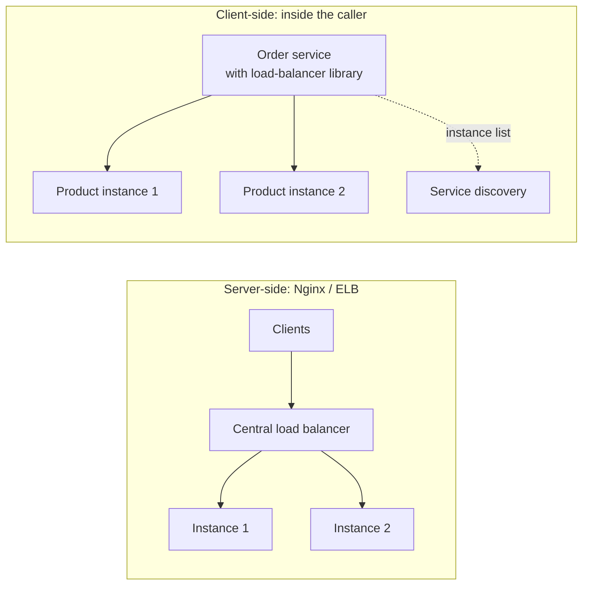
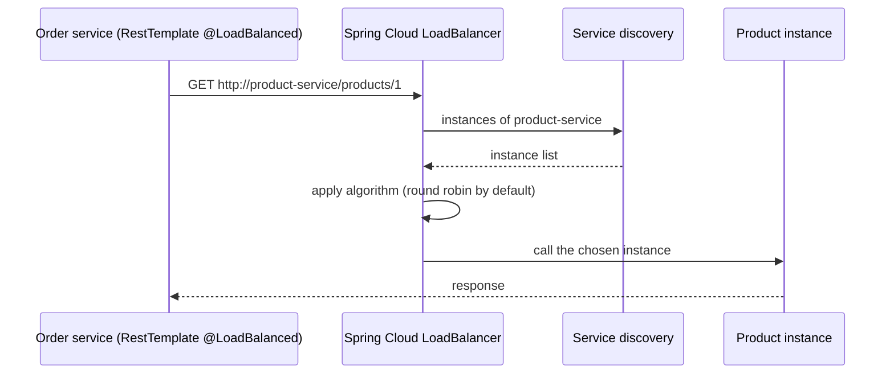
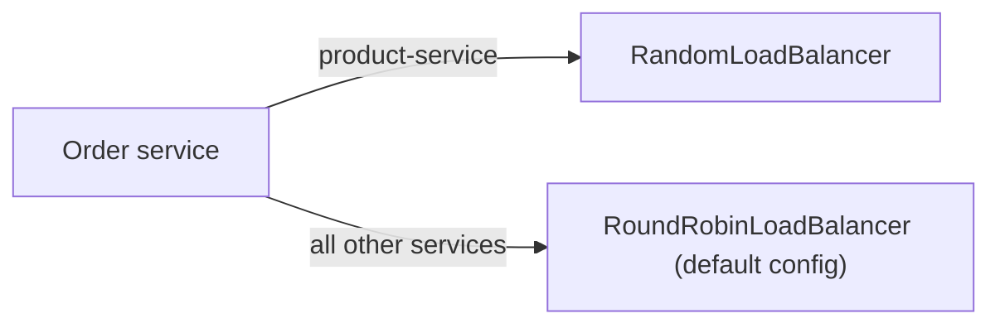

# Client Side Load Balancer (HLD #35 / Microservices #5)

<!-- nav -->
⬅ [34 Service Discovery](34_Service_Discovery_Notes.md) · [Index](00_HLD_Index.md) · [37 Bulkhead](37_Bulkhead_Notes.md) ➡
<!-- nav -->

Source: https://drive.google.com/file/d/1uERH11qv6xWBvwHc0BoOJlnn89IzWt95/view?usp=drive_link

**Pre-requisite:** Service Discovery (see [34_Service_Discovery_Notes.md](34_Service_Discovery_Notes.md)).

---

<!-- simple-explanation -->
## In simple words – client-side load balancing with Spring Cloud

### Two places to put a load balancer
A load balancer spreads requests over several instances so none is overloaded.
- **Server-side:** a separate component sitting between clients and servers (Nginx, AWS ELB). All callers send traffic to it.
- **Client-side:** the **caller itself** decides which instance to call. It gets the list of instances from service discovery (see [Service Discovery](34_Service_Discovery_Notes.md)) and runs the balancing logic locally. Examples: Spring Cloud LoadBalancer, Netflix Ribbon, Istio sidecars. This avoids an extra network hop.

### Before: choosing an instance by hand
With plain `RestTemplate`, you ask `DiscoveryClient` for the instances of `product-service` and then pick one yourself (the demo picks the first, so one instance gets all the traffic).

### With Spring Cloud LoadBalancer: almost no code
1. Add `spring-cloud-starter-loadbalancer`.
2. Put **`@LoadBalanced`** on the `RestTemplate` bean. Now the framework **intercepts each call**, asks service discovery for the instances, picks one using an algorithm, and sends the request to it.
3. In your code you simply use the **service name as the host**: `http://product-service/products/1`. No instance selection logic at all.

### Which algorithm is used?
- The default is **Round Robin** (take turns).
- Spring Cloud LoadBalancer offers only **two** built-in algorithms: **Round Robin** and **Random**.
- Every algorithm is attached to a **service ID** (the client's name, like `product-service`), which means that you can choose a different algorithm per target service.
- For others (weighted, least-connection…) write your own or use a service mesh such as Istio.

### Choosing Random for one service
Put `@LoadBalancerClient(name = "product-service", configuration = LoadBalancerProductClientConfig.class)` on the application class. In that config class, define a bean returning `new RandomLoadBalancer(...)` for `"product-service"`. The `ServiceInstanceListSupplier` is the helper that calls service discovery to fetch the instance list. This special config is read **at runtime** when a call to that service name happens (not just at startup).

### Random for one service, Round Robin for the rest
Use **`@LoadBalancerClients`** with a `defaultConfiguration` (Round Robin for everyone) plus specific `@LoadBalancerClient` entries (Random for product-service). Put **`@ConditionalOnMissingBean`** on the global config so that product-service doesn't end up with *two* load balancer beans (its own and the default). The default config reads the service ID at runtime, so it works for any service.

### Writing your own algorithm
Implement `ReactorServiceInstanceLoadBalancer` and its `choose(...)` method: get the list of instances from the supplier, apply your logic (the demo picks the first one) and return it in a `DefaultResponse`, or an `EmptyResponse` if no instance exists. Then return your class from the config bean instead of `RandomLoadBalancer`.

### With FeignClient
Feign already balances the load automatically, so **nothing changes**: the same `@LoadBalancerClient` configuration works for overriding the algorithm.
<!-- simple-explanation -->


## 1. Load Balancer basics

<!-- diagram:35-0 -->
**Diagram – Server-side versus client-side load balancer**


<!-- /diagram:35-0 -->


- Distributes traffic to multiple instances of a server.
- Prevents a single server from being overloaded with huge traffic.

### Types
| Type | Description | Examples |
|---|---|---|
| **Server-side** | Centralized load balancer; like a separate microservice | Nginx, ELB (Elastic Load Balancer) |
| **Client-side** | Load-balancing capability lives inside the client (caller), or it uses a library to decide | Spring Cloud LoadBalancer, Netflix Ribbon, Istio with Sidecar |

---

## 2. Before: RestTemplate with manual selection

After Service Discovery is set up, with RestTemplate we fetch the list of instances using the `DiscoveryClient` and **manually choose** an instance.

```java
@RestController
@RequestMapping("/orders")
public class OrderController {

    @Autowired DiscoveryClient discoveryClient;
    @Autowired RestTemplate restTemplate;

    @GetMapping("/{id}")
    public void callProductAPI(@PathVariable String id) {
        List<ServiceInstance> instances = discoveryClient.getInstances("product-service");
        URI uri = instances.get(0).getUri();
        String response = restTemplate.getForObject(uri + "/products/" + id, String.class);
        System.out.println("Response from Product api call is: " + response);
    }
}

@Configuration
public class Config {
    @Bean
    public RestTemplate restTemplateObj() { return new RestTemplate(); }
}
```

---

## 3. With Spring Cloud LoadBalancer

<!-- diagram:35-1 -->
**Diagram – What @LoadBalanced does on a call**


<!-- /diagram:35-1 -->


**1. Dependency**
```xml
<dependency>
  <groupId>org.springframework.cloud</groupId>
  <artifactId>spring-cloud-starter-loadbalancer</artifactId>
</dependency>
```

**2. Controller – no manual instance selection**
```java
@RestController
@RequestMapping("/orders")
public class OrderController {

    @Autowired RestTemplate restTemplate;

    @Value("${product.service.baseurl}")
    String productBaseURL;

    @GetMapping("/{id}")
    public void callProductAPI(@PathVariable String id) {
        String response = restTemplate.getForObject(productBaseURL + "/products/" + id, String.class);
        System.out.println("Response from Product api call is: " + response);
    }
}

@Configuration
public class Config {
    @Bean
    /* With this annotation, the framework starts intercepting the request,
       calls Service Discovery, gets instances & applies the load balancing algorithm. */
    @LoadBalanced
    public RestTemplate restTemplateObj() { return new RestTemplate(); }
}
```

**3. application.properties**
```properties
server.port=8081
spring.application.name=order-service
eureka.client.service-url.defaultZone=http://localhost:8761/eureka
product.service.baseurl=http://product-service
```

---

## 4. Algorithms & how they are attached

- Each load balancing algorithm is **attached to a ServiceId** – the client name, e.g. `"product-service"`.
- **Default:** `RoundRobinLoadBalancer`.
- If you don't want the default, you must define **which algorithm for which client (serviceId)**.
- Spring Cloud LoadBalancer supports **only 2 algorithms: RoundRobin and Random.**
- For others (Weighted, Least Connection, …) either write a **custom implementation** or switch to a **service mesh like Istio with sidecar**.

---

## 5. Changing the algorithm for one service (Random for product-service)

Controller / Config / properties stay the same as in section 3. Add `@LoadBalancerClient` on the application class:

```java
@SpringBootApplication
@EnableFeignClients
@LoadBalancerClient(
    name = "product-service",
    configuration = LoadBalancerProductClientConfig.class
)
public class OrderserviceApplication {
    public static void main(String[] args) {
        SpringApplication.run(OrderserviceApplication.class, args);
    }
}
```
> A normal config class is invoked generally only at application startup. **This `@LoadBalancerClient` config is invoked at runtime too**, when `http://product-service/xyz` ("product-service") is used.

```java
@Configuration
public class LoadBalancerProductClientConfig {
    @Bean
    public ReactorLoadBalancer<ServiceInstance> productClientLoadBalancer(
            LoadBalancerClientFactory factory) {
        return new RandomLoadBalancer(
            factory.getLazyProvider("product-service", ServiceInstanceListSupplier.class),
            "product-service");
    }
}
```
- `ServiceInstanceListSupplier` is the one that **invokes Service Discovery and asks for the instances** of `"product-service"`.
- `new RandomLoadBalancer(ServiceInstanceListSupplier, serviceId)` – we pass the serviceId because the algorithm is mapped to **that service ID only**. So only for `product-service` is `RandomLoadBalancer` used.

---

## 6. Algorithm A for product-service, Algorithm B for all others

<!-- diagram:35-2 -->
**Diagram – Per-service algorithm and a default**


<!-- /diagram:35-2 -->


```java
@SpringBootApplication
@EnableFeignClients
/* First the child client's config is loaded, then the default one. */
@LoadBalancerClients(
    defaultConfiguration = LoadBalancerGlobalConfig.class,
    value = {
        @LoadBalancerClient(
            name = "product-service",
            configuration = LoadBalancerProductClientConfig.class
        )
    }
)
public class OrderserviceApplication {
    public static void main(String[] args) {
        SpringApplication.run(OrderserviceApplication.class, args);
    }
}
```
- The `@LoadBalancerClients` config is loaded **at runtime for each service ID**, so `environment.getProperty(LoadBalancerClientFactory.PROPERTY_NAME)` is **resolved at runtime**.
- `@ConditionalOnMissingBean` is required on the Global config class because, for `product-service`, **two `ReactorLoadBalancer` beans should not be created** (one from `LoadBalancerProductClientConfig`, another from `LoadBalancerGlobalConfig`).
- Result: **product-service → Random**, **all other services → RoundRobin**.

```java
@Configuration
@ConditionalOnMissingBean(ReactorLoadBalancer.class)
public class LoadBalancerGlobalConfig {
    @Bean
    public ReactorLoadBalancer<ServiceInstance> randomLoadBalancer(
            LoadBalancerClientFactory factory, Environment environment) {
        String serviceId = environment.getProperty(LoadBalancerClientFactory.PROPERTY_NAME);
        return new RoundRobinLoadBalancer(
            factory.getLazyProvider(serviceId, ServiceInstanceListSupplier.class),
            serviceId);
    }
}

@Configuration
public class LoadBalancerProductClientConfig {
    @Bean
    public ReactorLoadBalancer<ServiceInstance> productClientLoadBalancer(
            LoadBalancerClientFactory factory) {
        return new RandomLoadBalancer(
            factory.getLazyProvider("product-service", ServiceInstanceListSupplier.class),
            "product-service");
    }
}
```

---

## 7. Custom load balancer

```java
public class MyCustomLoadBalancer implements ReactorServiceInstanceLoadBalancer {

    private final ObjectProvider<ServiceInstanceListSupplier> serviceInstanceSuppliers;
    private final String serviceId;

    public MyCustomLoadBalancer(
            ObjectProvider<ServiceInstanceListSupplier> serviceInstanceSuppliers,
            String serviceId) {
        this.serviceInstanceSuppliers = serviceInstanceSuppliers;
        this.serviceId = serviceId;
    }

    @Override
    public Mono<Response<ServiceInstance>> choose(Request request) {
        return serviceInstanceSuppliers
            .getIfAvailable()
            .get()
            .next()
            .map(instances -> {
                if (instances == null || instances.isEmpty()) {
                    return new EmptyResponse();
                }
                // Custom load balancing algorithm (demo: pick first instance)
                return new DefaultResponse(instances.get(0));
            });
    }
}
```
Plug it in:
```java
@Configuration
public class LoadBalancerProductClientConfig {
    @Bean
    public ReactorLoadBalancer<ServiceInstance> productClientLoadBalancer(
            LoadBalancerClientFactory factory) {
        return new MyCustomLoadBalancer(
            factory.getLazyProvider("product-service", ServiceInstanceListSupplier.class),
            "product-service");
    }
}
```

---

## 8. With FeignClient

Load balancing is already automatic (seen in Service Discovery). **Everything is the same as with RestTemplate – no change.**

```java
@RestController
@RequestMapping("/orders")
public class OrderController {
    @Autowired ProductClient productClient;

    @GetMapping("/{id}")
    public void callProductAPI(@PathVariable String id) {
        String response = productClient.getProductById(id);
        System.out.println("Response from Product api call is: " + response);
    }
}
```
Algorithm override uses the same pieces:
```java
@SpringBootApplication
@EnableFeignClients
@LoadBalancerClient(name = "product-service", configuration = LoadBalancerProductClientConfig.class)
public class OrderserviceApplication { ... }

@Configuration
public class LoadBalancerProductClientConfig {
    @Bean
    public ReactorLoadBalancer<ServiceInstance> productClientLoadBalancer(LoadBalancerClientFactory factory) {
        return new RandomLoadBalancer(
            factory.getLazyProvider("product-service", ServiceInstanceListSupplier.class),
            "product-service");
    }
}
```

---

## Quick revision
- Server-side LB = separate component (Nginx/ELB). Client-side LB = inside the caller (Spring Cloud LoadBalancer, Ribbon, Istio sidecar).
- `@LoadBalanced` on `RestTemplate` → framework intercepts, asks discovery, applies algorithm; use `http://<serviceId>` as base URL.
- Default algorithm = **RoundRobin**; built-in options = **RoundRobin, Random** only.
- Per-service algorithm: `@LoadBalancerClient(name, configuration)`; global default + overrides: `@LoadBalancerClients(defaultConfiguration, value)` with `@ConditionalOnMissingBean` on the global config.
- Weighted / least-connection → custom `ReactorServiceInstanceLoadBalancer` or Istio.
- FeignClient needs no code change.

> Note: diagrams from the original PDF are not reproduced; all text and code is.

---

<!-- nav -->
⬅ [34 Service Discovery](34_Service_Discovery_Notes.md) · [Index](00_HLD_Index.md) · [37 Bulkhead](37_Bulkhead_Notes.md) ➡
<!-- nav -->
