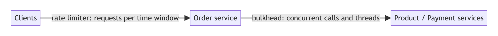
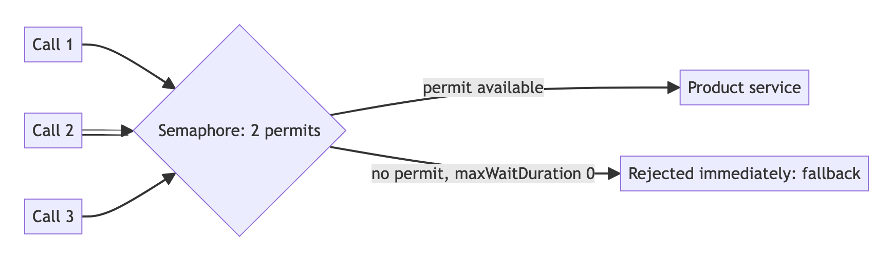
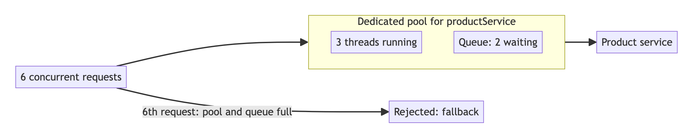

# Bulkhead (+ Time Limiter) – Fault-Tolerant Microservice Part-2 (HLD #37 / Microservices #7)

<!-- nav -->
⬅ [35 Client Side Load Balancer](35_Client_Side_Load_Balancer_Notes.md) · [Index](00_HLD_Index.md) · [38 Retry Pattern](38_Retry_Pattern_Notes.md) ➡
<!-- nav -->

Source: https://drive.google.com/file/d/1CSXu3bNRsvwhsvIr2EdTkbyP7fUHQMt7/view?usp=drive_link

Resilience4j provides these mechanisms to build fault-tolerant microservices: **Rate Limiter** (covered in Part-1), **Bulkhead**, **Circuit Breaker**, **Time Limiter**, **Retry**.

---

## 1. Rate Limiter vs Bulkhead

<!-- diagram:37-0 -->
**Diagram – Rate limiter protects from clients, bulkhead from downstream**


<!-- /diagram:37-0 -->


| | Rate Limiter | Bulkhead |
|---|---|---|
| Protects | **our application from our clients** | **our application from our downstream services** |
| How | limits **how many requests we accept within a time window** | controls **how many concurrent requests can go to a downstream service** / how many threads we allocate to it |
| Concurrency | **never talks about concurrency** | exactly about concurrency |

- Rate limiter example (app = "Order"): limit is 4 requests in 5 s → requests at 1st, 2nd, 3rd, 4th second pass; request at the 5th second is rejected ("Too many requests, request limit is 4 in 5 sec").
- Bulkhead use-case 1: *Product* is a small, light-weight service that can handle only **3 concurrent requests** → solved by **Semaphore Bulkhead**.
- Bulkhead use-case 2: Order Service has 2 APIs:
  - API 1 → downstream call to **Product** service (~100 ms, fast)
  - API 2 → downstream call to **Payment** service (~5 s, slow)
  - Sudden spike on API 2 (calls need not be concurrent). Because Payment is slow, it **holds/blocks the thread for ~5 s**, so **all threads of Order service can get blocked by Payment alone**.
  - Now even the fast endpoint (API 1) becomes **unavailable** since no threads are left.
  - Solved by **Thread Pool Bulkhead**.

<!-- isw:37-0 -->
**In simple words**

The comparison table says: the **rate limiter protects our application from our clients,** by limiting **how many requests we accept within a time window,** and it **never talks about concurrency.** The **bulkhead protects our application from our downstream services,** by controlling **how many concurrent requests can go to a downstream service** (or how many threads we allocate to it); it is exactly about concurrency.

Examples: **rate limiter** (app = Order): the limit is 4 requests in 5 s; requests at the 1st, 2nd, 3rd and 4th second pass, and the request at the 5th second is rejected ("Too many requests, request limit is 4 in 5 sec"). **Bulkhead use-case 1:** *Product* is a small, light service that can handle only **3 concurrent requests,** which is solved by the **Semaphore Bulkhead.** **Use-case 2:** the Order service has two APIs: API 1 calls **Product** (about 100 ms, fast) and API 2 calls **Payment** (about 5 s, slow). A sudden spike hits API 2 (the calls need not be concurrent). Because Payment is slow it **holds the thread for about 5 s,** so **all of Order's threads can get blocked by Payment alone,** and even the fast API 1 becomes **unavailable** as no thread is left. This is solved by the **Thread Pool Bulkhead.**
<!-- /isw:37-0 -->


---

## 2. Semaphore Bulkhead

<!-- diagram:37-1 -->
**Diagram – Semaphore bulkhead: maxConcurrentCalls = 2**


<!-- /diagram:37-1 -->


- Limits the **number of concurrent calls using a counter** (a Semaphore lock).
- If the limit is reached, further calls are **rejected immediately or blocked for a specific wait time**.
- (Semaphores are explained in the Multithreading topic of the Java notes.)

**pom.xml**
```xml
<dependency>
  <groupId>io.github.resilience4j</groupId>
  <artifactId>resilience4j-spring-boot3</artifactId>
  <version>2.1.0</version>
</dependency>
```

**Controller / Feign client**
```java
@RestController
@RequestMapping("/orders")
public class OrderController {
    @Autowired OrderService orderService;

    @GetMapping("/{id}")
    public void callProductAPI(@PathVariable String id) {
        orderService.invokeProductAPI(id);
    }
}

@FeignClient(name = "product-service")
public interface ProductClient {
    @GetMapping(value = "/products/{id}")
    String getProductById(@PathVariable("id") String id);
}
```

**Service**
```java
@Component
public class OrderService {
    @Autowired ProductClient productClient;

    @Bulkhead(
        name = "productService",
        type = Bulkhead.Type.SEMAPHORE,
        fallbackMethod = "productFallback"
    )
    public void invokeProductAPI(String id) {
        String response = productClient.getProductById(id);
        System.out.println("Response from Product api call is: " + response);
    }

    public void productFallback(String id, Throwable t) {
        System.out.println("too many concurrent request, pls try again later");
        // throw exception here and handle it gracefully
    }
}
```

**application.properties**
```properties
server.port=8081
spring.application.name=order-service
eureka.client.service-url.defaultZone=http://localhost:8761/eureka

# only 2 concurrent calls allowed and
# for further req, if there is no thread available, request will fail immediately
resilience4j.bulkhead.instances.productService.maxConcurrentCalls=2
resilience4j.bulkhead.instances.productService.maxWaitDuration=0
```

**`maxWaitDuration` format:** `<number><time-unit>`; units: `ms` milliseconds, `s` seconds, `m` minutes, `h` hours, `d` days (not typical but valid).
```properties
resilience4j.bulkhead.instances.productService.maxWaitDuration=0      # Reject immediately
resilience4j.bulkhead.instances.productService.maxWaitDuration=300ms  # Wait 300 milliseconds
resilience4j.bulkhead.instances.productService.maxWaitDuration=2s     # Wait 2 seconds
resilience4j.bulkhead.instances.productService.maxWaitDuration=1m     # Wait 1 minute
```

<!-- isw:37-1 -->
**In simple words**

It limits the **number of concurrent calls using a counter** (a Semaphore lock). If the limit is reached, further calls are **rejected immediately or blocked for a specific wait time.** The service method gets `@Bulkhead(name = "productService", type = Bulkhead.Type.SEMAPHORE, fallbackMethod = "productFallback")`, and the properties are **`maxConcurrentCalls=2`** (only 2 concurrent calls allowed) and **`maxWaitDuration=0`** (for further requests, if no thread is available, the request fails immediately). The `maxWaitDuration` format is `<number><unit>`: `0` rejects immediately, `300ms` waits 300 milliseconds, `2s` waits 2 seconds, `1m` waits 1 minute (units ms, s, m, h, d).
<!-- /isw:37-1 -->


---

## 3. Thread Pool Bulkhead

<!-- diagram:37-2 -->
**Diagram – Thread-pool bulkhead: 3 threads + queue of 2**


<!-- /diagram:37-2 -->


- Assign a **dedicated thread pool for each downstream service**; **only that pool** is used to call the downstream.
- (Thread pools / ThreadPoolExecutor are covered in the Java Multithreading notes.)

```java
@Component
public class OrderService {
    @Autowired ProductClient productClient;

    /*
     • The AOP proxy intercepts your method call.
     • It submits your method to the Bulkhead's thread pool (configured via application.properties):
         CompletableFuture.supplyAsync(() -> {
             return ourMethodLogic();   // The whole method body runs here
         }, bulkheadThreadPoolExecutor);
     • It returns a CompletableFuture to the caller for async response.
     • Inside your method, CompletableFuture.completedFuture(...) just wraps the result
       in a completed future — it does NOT run anything in a thread pool.
    */
    @Bulkhead(
        name = "productService",
        type = Bulkhead.Type.THREADPOOL,
        fallbackMethod = "productFallback"
    )
    public CompletableFuture<String> invokeProductAPI(String id) {
        return CompletableFuture.completedFuture(productClient.getProductById(id));
    }

    public CompletableFuture<String> productFallback(String id, Throwable t) {
        // even though it's async, we need to properly handle the exception
        // else our client will get 500 response with BulkheadFullException
        return CompletableFuture.completedFuture("Product Service is busy");
    }
}
```

**application.properties**
```properties
server.port=8081
spring.application.name=order-service
eureka.client.service-url.defaultZone=http://localhost:8761/eureka

# max 3 threads in the pool and that's the max pool size too.
# if all 3 threads are busy, max 2 more requests will be put into queue
# from 6th request onwards, it will start rejecting the requests.
resilience4j.thread-pool-bulkhead.instances.productService.coreThreadPoolSize=3
resilience4j.thread-pool-bulkhead.instances.productService.maxThreadPoolSize=3
resilience4j.thread-pool-bulkhead.instances.productService.queueCapacity=2
```
A thread pool for `productService` is created with these settings.

**Testing the output:** add `System.out.println("Thread name is:" + Thread.currentThread().getName());` and a "Product Service is busy" print in the fallback. With max pool size = 3 and queue size = 2, invoking the API **6 times** → first 5 are accepted (3 running + 2 queued), the 6th is rejected → fallback runs.

| | Semaphore Bulkhead | Thread Pool Bulkhead |
|---|---|---|
| Mechanism | counter / semaphore limiting concurrent calls | dedicated thread pool (+ queue) per downstream |
| Runs on | caller's thread | bulkhead's own threads |
| Return type | normal | `CompletableFuture<T>` |
| Config prefix | `resilience4j.bulkhead` (`maxConcurrentCalls`, `maxWaitDuration`) | `resilience4j.thread-pool-bulkhead` (`coreThreadPoolSize`, `maxThreadPoolSize`, `queueCapacity`) |
| Solves | downstream can only handle N concurrent requests | slow downstream hogging all our threads |

<!-- isw:37-2 -->
**In simple words**

Here you **assign a dedicated thread pool for each downstream service,** and **only that pool** is used to call the downstream. The method returns a `CompletableFuture`; the comments in the notes explain that the AOP proxy **submits the method to the bulkhead's thread pool** and returns a `CompletableFuture` to the caller, and that `CompletableFuture.completedFuture(...)` inside only wraps the result and does not itself run anything in a pool. The fallback must also handle the exception (else the client gets a 500 with `BulkheadFullException`).

The properties: **`coreThreadPoolSize=3`, `maxThreadPoolSize=3`, `queueCapacity=2`:** a maximum of 3 threads; **if all 3 are busy, a maximum of 2 more requests are put into the queue;** **from the 6th request onwards it starts rejecting.** In the test, invoking the API 6 times accepts the first 5 (3 running + 2 queued) and the 6th is rejected, so the fallback runs.

The notes' comparison: the semaphore uses a **counter** on the **caller's thread** with normal return types and the `resilience4j.bulkhead` properties; the thread pool uses a **dedicated pool (+ queue)** per downstream with **`CompletableFuture<T>`** and the `resilience4j.thread-pool-bulkhead` properties. The semaphore **solves** "a downstream can only handle N concurrent requests"; the thread pool solves "a slow downstream hogging all our threads".
<!-- /isw:37-2 -->


---

## 4. Time Limiter

- Prevents an **async call from hanging indefinitely**.
- In Resilience4j, Time Limiter is **non-blocking** – it's mainly designed for **asynchronous operations that return a reactive type** like `Mono`, `Flux`.
- So far we covered blocking calls (RestTemplate, RestClient, FeignClient), and for those we already control timeouts directly. Feign example:
```properties
# request and connection timeout applicable to only Product-service FeignClient
feign.client.config.product-service.connectTimeout=3000
feign.client.config.product-service.readTimeout=5000
```
- Time Limiter has the same context but for **reactive calls** – to be covered when starting Spring WebFlux (reactive programming).

<!-- isw:37-3 -->
**In simple words**

The Time Limiter **prevents an async call from hanging indefinitely.** In Resilience4j it is **non-blocking** and mainly designed for **asynchronous operations that return a reactive type** like `Mono` and `Flux`. The calls covered so far (RestTemplate, RestClient, FeignClient) are blocking, and for them we control timeouts directly, for example in Feign: `feign.client.config.product-service.connectTimeout=3000` and `readTimeout=5000`. The Time Limiter has the same context but for **reactive calls,** to be covered when Spring WebFlux starts.
<!-- /isw:37-3 -->


---

## Quick revision
- **Rate Limiter** = protect from clients (requests/time). **Bulkhead** = protect from downstream (concurrency/threads).
- **Semaphore bulkhead**: `maxConcurrentCalls`, `maxWaitDuration` (0 = fail fast).
- **Thread-pool bulkhead**: dedicated pool + queue per service, returns `CompletableFuture`; with core=max=3, queue=2 → 6th concurrent request rejected.
- Always provide a **fallback** (else `BulkheadFullException` → HTTP 500).
- **TimeLimiter** = for async/reactive; blocking clients use their own connect/read timeouts.

---

<!-- nav -->
⬅ [35 Client Side Load Balancer](35_Client_Side_Load_Balancer_Notes.md) · [Index](00_HLD_Index.md) · [38 Retry Pattern](38_Retry_Pattern_Notes.md) ➡
<!-- nav -->
