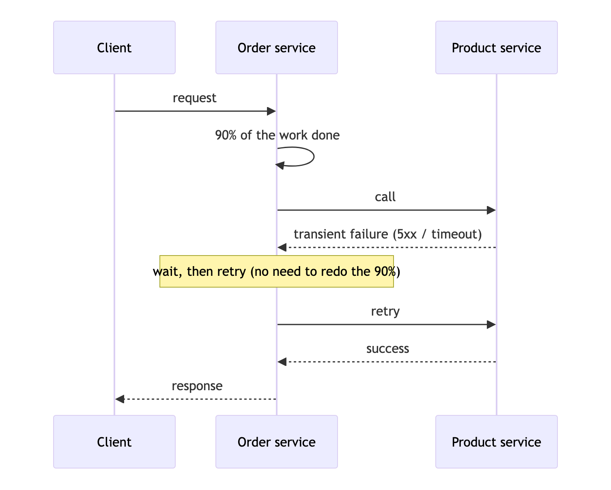
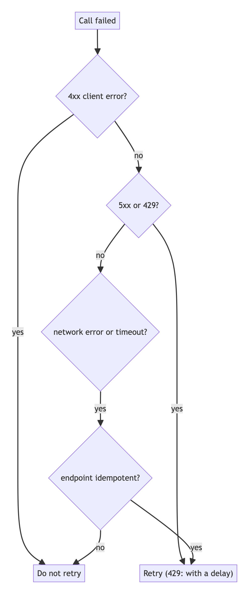
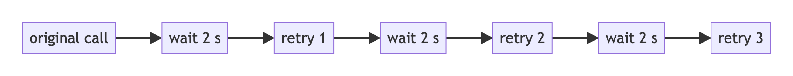
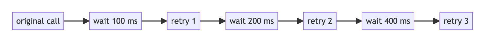
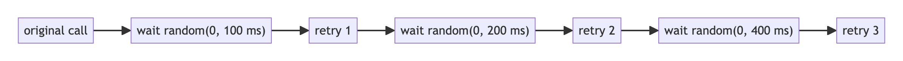

# Retry Pattern (HLD #38)

<!-- nav -->
⬅ [37 Bulkhead](37_Bulkhead_Notes.md) · [Index](00_HLD_Index.md) · [39 Circuit Breaker](39_Circuit_Breaker_Notes.md) ➡
<!-- nav -->

Source: https://drive.google.com/file/d/1F4e2EwjCfi11-q7RdujOqiPgt7oCbO7B/view?usp=drive_link

---

## 1. Why Retry?

<!-- diagram:38-0 -->
**Retry only the failed downstream call**


<!-- /diagram:38-0 -->


In a distributed system, a call to a downstream service might fail because of **transient issues** – short, temporary problems like network glitches or timeouts. **Retrying the same request after a short delay can succeed.**

**"Why should *we* retry? Why can't the client just call our API again?"**
Each call does a lot of heavy processing that is **not free** (memory, time, resources). Say 90 % of the API work is done and then a transient issue hits during the downstream call:
- Throwing away that 90 % and redoing it all on a fresh API call wastes cost.
- Retrying only the failed downstream call, if it succeeds, **saves cost and gives a better user experience.**

Two questions: **When to retry?** and **How to retry?**

<!-- isw:38-0 -->
**In simple words**

In a distributed system a call to a downstream service can fail because of **transient issues:** short, temporary problems like network glitches or timeouts, and **retrying the same request after a short delay can succeed.**

*"Why should we retry? Why can't the client just call our API again?"* Each call does a lot of heavy processing that is **not free** (memory, time, resources). Say 90 % of the API's work is done and then a transient issue hits during the downstream call: throwing away that 90 % and redoing it all on a fresh API call wastes cost, whereas retrying only the failed downstream call, if it succeeds, **saves cost and gives a better user experience.** Two questions follow: **when to retry?** and **how to retry?**
<!-- /isw:38-0 -->


---

## 2. When to retry?

- **Do NOT retry on permanent failures** – e.g. **4xx** errors. They are validation / input errors; the same request will fail again.
- **Do NOT retry if the operation is non-idempotent.** Idempotency ensures that if a request is retried multiple times, **duplicate processing does not happen.**
  - Problem scenario: a timeout happens on an endpoint that is **not idempotent** – what if the user (or we) retry? Could create duplicates. (How to design idempotent APIs: see HLD #14 *Idempotent POST API*.)
- **Rule of thumb: retry on 5xx errors** – 5xx means a system issue and the request wasn't successful; could be transient and is pretty safe to retry.
- **Retry network errors and timeouts only if the endpoint ensures idempotency.**

### Retry decision table

<!-- diagram:38-1 -->
**Should I retry?**


<!-- /diagram:38-1 -->


| HTTP status / event | Meaning | Retry? |
|---|---|---|
| 200 OK | Success | No |
| 400 Bad Request | Client error (invalid input) | No |
| 401 Unauthorized | Authentication needed | No |
| 403 Forbidden | Access denied | No |
| 404 Not Found | Resource not found | No |
| 409 Conflict | (a state conflict) | No |
| 429 Too Many Requests | Rate limiting | **Yes (with delay)** |
| 500 Internal Server Error | Server issue | **Yes** |
| 502 Bad Gateway | Downstream service failure | **Yes** |
| 503 Service Unavailable | Service down/overloaded | **Yes** |
| Network error | Connection failure, timeout | **Yes (idempotent only)** |

<!-- isw:38-1 -->
**In simple words**

- **Do not retry permanent failures,** for example **4xx.** They are validation or input errors, and the same request will fail again.
- **Do not retry if the operation is not idempotent.** Idempotency ensures that if a request is retried several times, **duplicate processing does not happen.** The problem scenario: a timeout on an endpoint that is **not idempotent;** what if we retry? It could create duplicates (see HLD #14, [Idempotent POST API](14_Idempotent_POST_API_Notes.md)).
- **Rule of thumb: retry on 5xx.** 5xx means a system issue and the request was not successful; it could be transient and is pretty safe to retry.
- **Retry network errors and timeouts only if the endpoint ensures idempotency.**
<!-- /isw:38-1 -->

<!-- isw:38-2 -->
**In simple words**

The table: **200** success → no; **400** client error → no; **401** authentication needed → no; **403** access denied → no; **404** resource not found → no; **409** state conflict → no; **429** rate limiting → **yes, with a delay;** **500** server issue → **yes;** **502** downstream service failure → **yes;** **503** service down or overloaded → **yes;** **network error** (connection failure, timeout) → **yes, but only if idempotent.**
<!-- /isw:38-2 -->


---

## 3. How to retry? Types of retry

### 3.1 Fixed Interval

<!-- diagram:38-2 -->
**Fixed interval: 2 s every time**


<!-- /diagram:38-2 -->


Retry after a **constant delay**.
Example: total attempts = 4 (original + 3 retries), fixed delay 2 s → original call at t=2, 1st retry at 4, 2nd retry at 6, 3rd retry at 8.

- **Advantages:** very simple; easy to configure and debug.
- **Disadvantage:** high chance of a **retry storm (Thundering Herd problem)** – many clients retry at the same time → surge of retry traffic → the system spends resources on retries instead of new requests. (Thundering Herd is covered in HLD #27.)

**Code**
```java
@RestController
@RequestMapping("/orders")
public class OrderController {
    @Autowired OrderService orderService;
    @GetMapping("/{id}")
    public void callProductAPI(@PathVariable String id) { orderService.invokeProductAPI(id); }
}

@FeignClient(name = "product-service")
public interface ProductClient {
    @GetMapping(value = "/products/{id}")
    String getProductById(@PathVariable("id") String id);
}

@Component
public class OrderService {
    @Autowired ProductClient productClient;

    /* @Retry is applied on top of the method where ONLY the downstream invocation is present.
       Make sure the method contains only the code you want to retry.
       When all retries are exhausted, the fallback method is invoked. */
    @Retry(name = "productService", fallbackMethod = "productFallback")
    public void invokeProductAPI(String id) {
        String response = productClient.getProductById(id);
    }

    public void productFallback(String id, Throwable t) {
        System.out.println("Product Service is busy");
    }
}
```
```properties
server.port=8081
spring.application.name=order-service
eureka.client.service-url.defaultZone=http://localhost:8761/eureka

# fixed delay interval
resilience4j.retry.instances.productService.maxAttempts=3
resilience4j.retry.instances.productService.waitDuration=2s
```
**Testing:** stop the Product service so the failure happens at invocation; add a try/catch with a `System.out.println("not able to invoke Product")` and **rethrow** `e` (so retry triggers). **Output:** max attempts is 3 → **1 original call + 2 retry calls**.

**What AOP's proxy might do internally**
```java
public Retry fixedRetry() {
    RetryConfig config = RetryConfig.custom()
        .maxAttempts(4)
        /* IntervalFunction helps determine the delay between retries.
           Pre-defined functions:
            - IntervalFunction.of(long intervalMillis)                       // fixed delay
            - IntervalFunction.ofExponentialBackoff(long initialIntervalMillis,
                                   double multiplier, long maxIntervalMillis)
            etc. */
        .intervalFunction(IntervalFunction.of(2000))
        /* Retry will only happen for these exceptions or their subclasses. */
        .retryExceptions(IOException.class, ArithmeticException.class)
        .build();
    return Retry.of("fixedRetry", config);
}
```

<!-- isw:38-4 -->
**In simple words**

Retry after a **constant delay.** Example: total attempts = 4 (the original + 3 retries) with a fixed delay of 2 s: the original call at t = 2, the 1st retry at 4, the 2nd at 6 and the 3rd at 8. **Advantages:** very simple, easy to configure and debug. **Disadvantage:** a high chance of a **retry storm (thundering herd problem):** many clients retry at the same time, causing a surge of retry traffic, so the system spends its resources on retries instead of new requests (see [Thundering Herd](27_Thundering_Herd_Notes.md)).

**The code:** `@Retry(name = "productService", fallbackMethod = "productFallback")` goes **on the method where only the downstream invocation is present** (make sure the method contains only the code you want to retry); **when all retries are exhausted the fallback method is invoked.** The properties are `maxAttempts=3` and `waitDuration=2s`. To test, stop the Product service so the failure happens at invocation, and in a try / catch **rethrow the exception** so the retry triggers. **Output:** max attempts 3 gives **1 original call + 2 retry calls.** The "what the AOP proxy might do internally" snippet builds a `RetryConfig` (max attempts, an `IntervalFunction` such as `IntervalFunction.of(2000)` for a fixed delay or `ofExponentialBackoff(...)`, and `retryExceptions(...)`, the exceptions for which retry happens).
<!-- /isw:38-4 -->


### 3.2 Exponential Backoff

<!-- diagram:38-3 -->
**Exponential backoff: base x 2^n**


<!-- /diagram:38-3 -->


**Delay increases exponentially:** `delay = Base × 2^(no. of failed retry attempts)`

Example: total attempts = 4 (original + 3 retries), Base = 100 ms
- 1st retry: 100 × 2⁰ = **100 ms**
- 2nd retry: 100 × 2¹ = **200 ms**
- 3rd retry: 100 × 2² = **400 ms**

- **Advantages:** reduces load on downstream during an outage; helps avoid Thundering Herd **to some extent**.
- **Disadvantages:** if the outage is short, the user may wait longer than needed; **still some risk of Thundering Herd** because all clients use the same formula (`Base × 2^retry attempt`).

Code is all the same, only config changes:
```properties
# exponential backoff
resilience4j.retry.instances.productService.maxAttempts=4
resilience4j.retry.instances.productService.waitDuration=1s
resilience4j.retry.instances.productService.enableExponentialBackoff=true
resilience4j.retry.instances.productService.exponentialBackoffMultiplier=2
```
Framework class `Backoff.java`:
```java
try {
    /* Formula: initial wait time * (factor ^ no. of failed retry attempts)
       1st retry = 1000ms * (2^0) = 1000ms = 1sec delay
       2nd retry = 1000ms * (2^1) = 2000ms = 2sec delay
       3rd retry = 1000ms * (2^2) = 4000ms = 4sec delay */
    nextBackoff = firstBackoff.multipliedBy((long) Math.pow(factor, (context.iteration() - 1)));
    if (nextBackoff.compareTo(maxBackoffInterval) >= 0) {
        nextBackoff = maxBackoffInterval;
    }
}
```
**Output:** max attempts 4 → 1 original + 3 retries.

<!-- isw:38-5 -->
**In simple words**

The **delay grows exponentially:** `delay = Base × 2^(number of failed retry attempts)`. Example: total attempts = 4, Base = 100 ms: 1st retry 100 × 2⁰ = **100 ms,** 2nd 100 × 2¹ = **200 ms,** 3rd 100 × 2² = **400 ms.** **Advantages:** it reduces the load on the downstream during an outage and helps to avoid the thundering herd **to some extent.** **Disadvantages:** if the outage is short, the user may wait longer than needed; and there is **still some risk of a thundering herd** because all clients use the same formula.

The code is the same, only the config changes: `maxAttempts=4`, `waitDuration=1s`, `enableExponentialBackoff=true` and `exponentialBackoffMultiplier=2`. The framework class `Backoff.java` computes *initial wait × (factor ^ number of failed attempts)*: 1st retry 1000 × 2⁰ = 1 s, 2nd 2 s, 3rd 4 s. **Output:** max attempts 4 = 1 original + 3 retries.
<!-- /isw:38-5 -->


### 3.3 Exponential Backoff + Jitter

<!-- diagram:38-4 -->
**Backoff with jitter: random wait up to the limit**


<!-- /diagram:38-4 -->


Like exponential backoff but adds **jitter / randomness** to the delay to avoid retry storms.

`delay = random_between(0, min(maxDelay, baseDelay × 2^failed_retry_attempt))`

- **Advantages:** best for distributed systems – Thundering Herd probability becomes very low; **spreads retries over time**, reducing peak load.
- **Disadvantages:** not easy to debug; a little complex.

```java
public Retry exponentialJitterRetry() {
    RetryConfig config = RetryConfig.custom()
        .maxAttempts(6)
        .intervalFunction(
            /* Use the appropriate IntervalFunction method for the delay computation */
            IntervalFunction.ofExponentialRandomBackoff(
                /* initialIntervalMillis */ 2000,
                /* multiplier */ 2))
        .retryExceptions(Exception.class)
        .build();
    return Retry.of("exponentialBackOffRetry", config);
}
```
```properties
server.port=8081
spring.application.name=order-service
eureka.client.service-url.defaultZone=http://localhost:8761/eureka

# exponential backoff + jitter
resilience4j.retry.instances.productService.maxAttempts=4
resilience4j.retry.instances.productService.waitDuration=1s
resilience4j.retry.instances.productService.enableExponentialBackoff=true
resilience4j.retry.instances.productService.exponentialBackoffMultiplier=2
resilience4j.retry.instances.productService.enableRandomizedWait=true
```

<!-- isw:38-6 -->
**In simple words**

It is exponential backoff but with **jitter (randomness) added to the delay to avoid retry storms:** `delay = random_between(0, min(maxDelay, baseDelay × 2^failed_retry_attempt))`. **Advantages:** best for distributed systems; the thundering-herd probability becomes very low; it **spreads the retries over time,** reducing the peak load. **Disadvantages:** not easy to debug and a little complex. In code it uses `IntervalFunction.ofExponentialRandomBackoff(initialIntervalMillis, multiplier)`; in properties the same exponential settings plus **`enableRandomizedWait=true`.**
<!-- /isw:38-6 -->


### 3.4 Custom Retry
Define **your own retry delay strategy**.
- **Advantage:** full control and flexibility. **Disadvantage:** harder to maintain.

```java
@Configuration
public class Config {
    @Bean
    public Retry customRetry() {
        /* IntervalFunction defines the wait time between retries. */
        IntervalFunction fibonacciInterval = attempt -> {
            return 2000L; // return milliseconds as long
        };

        /* RetryConfig holds all configs: max attempts, which IntervalFunction to use, etc. */
        RetryConfig config = RetryConfig.custom()
            .maxAttempts(6)
            .intervalFunction(fibonacciInterval)
            .retryExceptions(Exception.class)
            .build();

        /* Create the Retry object from RetryConfig. Any name can be given. */
        return Retry.of("customRetry", config);
    }
}

@Component
public class OrderService {
    @Autowired ProductClient productClient;
    @Autowired Retry customRetry;

    public void invokeProductAPI(String id) {
        try {
            /* Need to manually wrap the call within Retry, as the @Retry annotation
               works only for retry types whose config can be given in application.properties. */
            customRetry.executeSupplier(() -> {
                System.out.println("calling product service at " + java.time.LocalTime.now());
                return productClient.getProductById(id);
            });
        } catch (Exception e) {
            System.out.println("all retries failed, this is fallback");
        }
    }
}
```

| Strategy | Delay | Pros | Cons |
|---|---|---|---|
| Fixed interval | constant | simple, easy to debug | retry storm / thundering herd |
| Exponential backoff | Base × 2^n | less load on downstream | slow for short outages; some herd risk |
| Exp. backoff + jitter | random(0, min(max, Base×2^n)) | best for distributed systems | harder to debug |
| Custom | your function | full control | harder to maintain |

<!-- isw:38-3 -->
**In simple words**

There are four ways to decide the wait between retries: fixed interval, exponential backoff, exponential backoff with jitter and a custom strategy.
<!-- /isw:38-3 -->

<!-- isw:38-7 -->
**In simple words**

You define **your own retry delay strategy.** **Advantage:** full control and flexibility. **Disadvantage:** harder to maintain. In the code a `Retry` bean is created from a `RetryConfig` with your own `IntervalFunction` (the example just returns 2000 ms) and you call `customRetry.executeSupplier(...)`. Note that you must **manually wrap the call within Retry,** because the **`@Retry` annotation works only for the retry types whose configuration can be given in `application.properties`.**

The summary table: **fixed interval** (constant delay; simple and easy to debug; retry storm), **exponential backoff** (Base × 2^n; less load on the downstream; slow for short outages and some herd risk), **exponential backoff + jitter** (random between 0 and min(max, Base × 2^n); best for distributed systems; harder to debug) and **custom** (your own function; full control; harder to maintain).
<!-- /isw:38-7 -->


---

## Quick revision
- Retry **transient** failures only: 5xx, 429 (with delay), network errors **if idempotent**; never 4xx or non-idempotent ops.
- `@Retry(name, fallbackMethod)` – annotate a method containing only the downstream call; method must **throw** to trigger retry; fallback after all attempts fail.
- `maxAttempts` includes the original call.
- Prefer **exponential backoff + jitter** in distributed systems to avoid thundering herd.
- Custom strategies need `Retry` bean + `executeSupplier(...)`.
- Order of patterns: RateLimiter → Bulkhead → TimeLimiter → CircuitBreaker → Retry.

---

<!-- nav -->
⬅ [37 Bulkhead](37_Bulkhead_Notes.md) · [Index](00_HLD_Index.md) · [39 Circuit Breaker](39_Circuit_Breaker_Notes.md) ➡
<!-- nav -->
