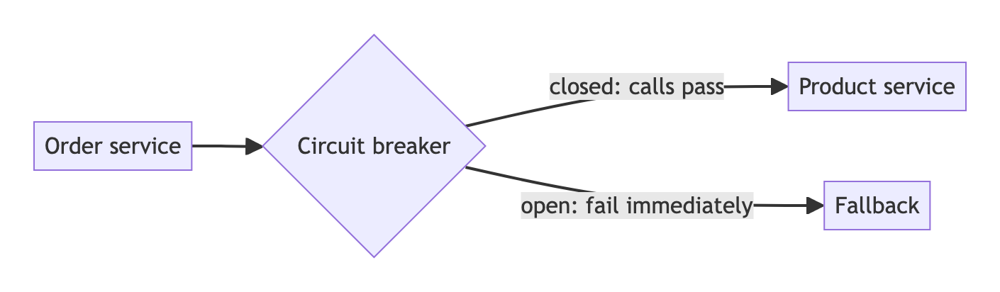
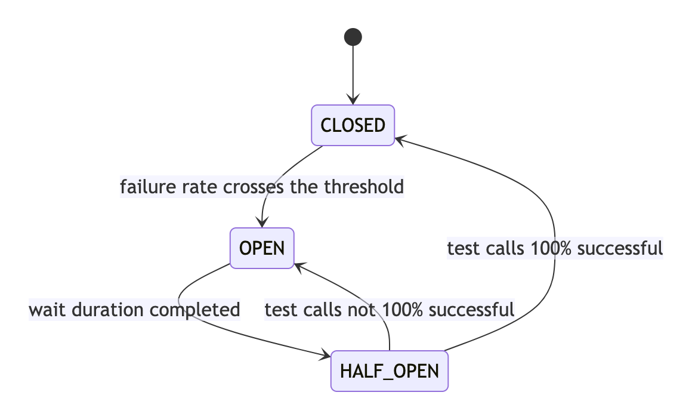
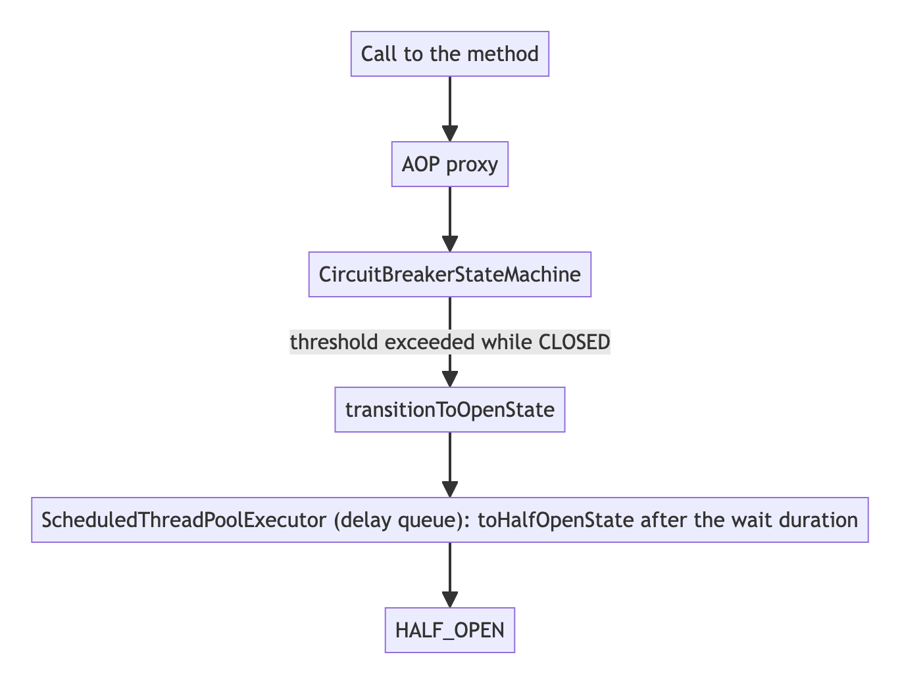

# Circuit Breaker – Fault-Tolerant Microservice Part-4 (HLD #39)

<!-- nav -->
⬅ [38 Retry Pattern](38_Retry_Pattern_Notes.md) · [Index](00_HLD_Index.md) · [40 & 41 API Gateway Part1 Part2](40_41_API_Gateway_Part1_Part2_Notes.md) ➡
<!-- nav -->

Source: https://drive.google.com/file/d/1ApUVMYBXzsEiW_tCL_ZpfX0IGKZQ2IZe/view?usp=drive_link

---

## 1. What & why

<!-- diagram:39-0 -->
**Diagram – Without and with a circuit breaker**


<!-- /diagram:39-0 -->


**Circuit Breaker prevents an application from making repeated calls to a downstream service that is likely to fail.**

Without it (e.g. Order → Product while Product is failing):
- It **unnecessarily adds load** to Product service, so Product may take **longer to recover**.
- Order service **wastes its own resources** (latency and thread blocking) making calls that are likely to fail.

Question: *how does Order service know when to stop calling Product and when to restart?* → **Circuit Breaker**.

Flow in the diagram: calls to Product fail → **failure threshold reached → stop future calls to Product** → calls are **blocked for some time and fail immediately** → afterwards **check if Product is healthy and allow further calls only if it is**.

<!-- isw:39-0 -->
**In simple words**

A circuit breaker **prevents an application from making repeated calls to a downstream service that is likely to fail.** Without it (for example Order → Product while Product is failing): it **unnecessarily adds load** to the Product service, so Product may take **longer to recover;** and the Order service **wastes its own resources** (latency and thread blocking) on calls that are likely to fail. The question: *how does the Order service know when to stop calling Product and when to restart?* The answer is the circuit breaker.

The flow in the picture: calls to Product fail → the **failure threshold is reached → future calls to Product are stopped** → calls are **blocked for some time and fail immediately** → afterwards it **checks whether Product is healthy and allows further calls only if it is.**
<!-- /isw:39-0 -->


---

## 2. States of Circuit Breaker

<!-- diagram:39-1 -->
**Diagram – Circuit breaker states**


<!-- /diagram:39-1 -->


```
 Initial ──► CLOSED ──(failure rate crosses threshold)──► OPEN
               ▲                                           │  │
               │                          after wait/timeout│  │ test calls' success
               │                                  completed │  │ rate not 100%
  test calls'  │                                           ▼  │
  success 100% └──────────────────────────────────── HALF-OPEN ┘
```
| State | Behaviour |
|---|---|
| **CLOSED** | Initial state. **All calls are allowed** to the downstream service. |
| **OPEN** | **No calls allowed** to downstream; they **fail immediately**. |
| **HALF-OPEN** | After the timeout period, allows only a **limited number of test calls** to downstream and **tracks their success rate**. |

Transitions:
- CLOSED → OPEN: failure limit crossed the threshold.
- OPEN → HALF-OPEN: after the timeout/wait period completes.
- HALF-OPEN → CLOSED: test calls' success rate is **100 %**.
- HALF-OPEN → OPEN: test calls' success rate is **not 100 %**.

<!-- isw:39-1 -->
**In simple words**

There are three states:
- **CLOSED** – the initial state. **All calls are allowed** to the downstream service.
- **OPEN** – **no calls are allowed** to the downstream; they **fail immediately.**
- **HALF-OPEN** – after the timeout period, it allows only a **limited number of test calls** to the downstream and **tracks their success rate.**

The transitions: **CLOSED → OPEN** when the failure limit crosses the threshold; **OPEN → HALF-OPEN** when the timeout / wait period is completed; **HALF-OPEN → CLOSED** when the test calls' success rate is **100 %;** **HALF-OPEN → OPEN** when the test calls' success rate is **not 100 %.**
<!-- /isw:39-1 -->


---

## 3. Implementation (Resilience4j)

**pom.xml**
```xml
<dependency>
  <groupId>io.github.resilience4j</groupId>
  <artifactId>resilience4j-spring-boot3</artifactId>
  <version>2.1.0</version>
</dependency>
```

**Controller / Feign**
```java
@RestController
@RequestMapping("/orders")
public class OrderController {
    @Autowired OrderService orderService;

    @GetMapping("/{id}")
    public void callProductAPI(@PathVariable String id) {
        orderService.invokeProductAPI(id);
    }
}

@FeignClient(name = "product-service")
public interface ProductClient {
    @GetMapping(value = "/products/{id}")
    String getProductById(@PathVariable("id") String id);
}
```

**Service**
```java
@Component
public class OrderService {
    @Autowired ProductClient productClient;

    /* Fallback method is invoked for each failure attempt. */
    @CircuitBreaker(name = "productService", fallbackMethod = "fallback")
    public void invokeProductAPI(String id) {
        productClient.getProductById(id);
    }

    public void fallback(Throwable ex) {
        System.out.println("not able to invoke product service");
    }
}
```

**application.properties**
```properties
server.port=8081
spring.application.name=order-service
eureka.client.service-url.defaultZone=http://localhost:8761/eureka

# product service - circuit breaker configurations
resilience4j.circuitbreaker.instances.productService.sliding-window-type=COUNT_BASED
resilience4j.circuitbreaker.instances.productService.sliding-window-size=10
resilience4j.circuitbreaker.instances.productService.minimum-number-of-calls=5
resilience4j.circuitbreaker.instances.productService.failure-rate-threshold=50
resilience4j.circuitbreaker.instances.productService.wait-duration-in-open-state=10s
resilience4j.circuitbreaker.instances.productService.permitted-number-of-calls-in-half-open-state=3
resilience4j.circuitbreaker.instances.productService.automatic-transition-from-open-to-half-open-enabled=true
```

### What each property means
| Property | Meaning |
|---|---|
| `sliding-window-type=COUNT_BASED`, `sliding-window-size=10` | Tracks the **last N (here 10) calls**. |
| `sliding-window-type=TIME_BASED`, `sliding-window-size=10s` | Tracks the calls made in the **last N seconds** (here 10 s). |
| `minimum-number-of-calls` | Minimum calls required in a window **before it starts evaluating the failure rate**. |
| `failure-rate-threshold` | Circuit moves to **OPEN** once this **% limit** is reached. |
| `wait-duration-in-open-state` | How long the circuit stays **OPEN** before moving to **HALF_OPEN** (automatically, if `automatic-transition-from-open-to-half-open-enabled=true`). |
| `permitted-number-of-calls-in-half-open-state` | Number of **test calls allowed in HALF_OPEN** to find out if downstream is healthy. |

<!-- isw:39-3 -->
**In simple words**

- **`sliding-window-type=COUNT_BASED`, `sliding-window-size=10`** – tracks the **last N calls (here 10).** With **`TIME_BASED`** and size `10s` it tracks the calls made in the **last N seconds (here 10 s).**
- **`minimum-number-of-calls`** – the minimum number of calls needed in a window **before it starts evaluating the failure rate.**
- **`failure-rate-threshold`** – the circuit moves to **OPEN** once this **percentage limit** is reached.
- **`wait-duration-in-open-state`** – how long the circuit stays **OPEN** before moving to **HALF_OPEN** (automatically, if `automatic-transition-from-open-to-half-open-enabled=true`).
- **`permitted-number-of-calls-in-half-open-state`** – the number of **test calls allowed in HALF_OPEN** to find out whether the downstream is healthy.
<!-- /isw:39-3 -->


### Which exceptions count as failure?
By default the Circuit Breaker records **all `RuntimeException`s and `Error`s as failures**. You can choose what to record or ignore:
```properties
resilience4j.circuitbreaker.instances.productService.record-exceptions=java.io.IOException,org.springframework.web.client.HttpServerErrorException
resilience4j.circuitbreaker.instances.productService.ignore-exceptions=java.lang.IllegalArgumentException
```

**Output observed:** once the max trial-call limit is reached in HALF_OPEN and success is not 100 %, the status changed **HALF_OPEN → OPEN**.

<!-- isw:39-2 -->
**In simple words**

The service method has **`@CircuitBreaker(name = "productService", fallbackMethod = "fallback")`,** and the notes say the **fallback method is invoked for each failed attempt.** The properties used are `sliding-window-type=COUNT_BASED`, `sliding-window-size=10`, `minimum-number-of-calls=5`, `failure-rate-threshold=50`, `wait-duration-in-open-state=10s`, `permitted-number-of-calls-in-half-open-state=3` and `automatic-transition-from-open-to-half-open-enabled=true`.

**Output observed:** once the maximum trial-call limit is reached in HALF_OPEN and the success is not 100 %, the status changed **HALF_OPEN → OPEN.**
<!-- /isw:39-2 -->

<!-- isw:39-4 -->
**In simple words**

By default the circuit breaker records **all `RuntimeException`s and `Error`s as failures.** You can choose what to record or ignore with `record-exceptions` (for example `java.io.IOException`) and `ignore-exceptions` (for example `java.lang.IllegalArgumentException`).
<!-- /isw:39-4 -->


---

## 4. How it works internally

<!-- diagram:39-2 -->
**Diagram – Inside the framework**


<!-- /diagram:39-2 -->


- AOP intercepts the call and passes it to **`CircuitBreakerStateMachine.java`**, which has the complete logic for changing from one state to another whenever there is a failure.
- Sample framework method:
```java
// Transitions to open state when thresholds have been exceeded.
private void checkIfThresholdsExceeded(Result result) {
    if (Result.hasExceededThresholds(result) && isClosed.compareAndSet(true, false)) {
        /* After every error, it checks if state needs to be changed.
           Here: if threshold limit reached and state is CLOSED, transit to OPEN.
           A similar method is present for the other states with their own transition logic. */
        publishCircuitThresholdsExceededEvent(result, circuitBreakerMetrics);
        transitionToOpenState();
    }
}
```
- **Q: after moving to OPEN, how does it automatically go to HALF_OPEN after e.g. 10 s?**
  **A: it uses a `ScheduledThreadPoolExecutor`.** `OpenState` in `CircuitBreakerStateMachine`:
```java
OpenState(final int attempts, final long waitDurationInMillis,
          final Instant retryAfterWaitDuration, CircuitBreakerMetrics circuitBreakerMetrics) {
    this.attempts = attempts;
    this.retryAfterWaitDuration = retryAfterWaitDuration;
    this.circuitBreakerMetrics = circuitBreakerMetrics;
    if (circuitBreakerConfig.isAutomaticTransitionFromOpenToHalfOpenEnabled()) {
        ScheduledExecutorService scheduledExecutorService = schedulerFactory.getScheduler();
        /* It passes the request to ScheduledThreadPoolExecutor.
           1st parameter: the Task, i.e. "toHalfOpenState" to transit OPEN → HALF_OPEN
           2nd parameter: the delay (like 10 or 20 or 30)
           3rd parameter: Time Unit (second / minutes / millisecond) */
        transitionToHalfOpenFuture = scheduledExecutorService
            .schedule(this::toHalfOpenState, waitDurationInMillis, TimeUnit.MILLISECONDS);
    } else {
        transitionToHalfOpenFuture = null;
    }
    isOpen = new AtomicBoolean(true);
}
```
- (`ScheduledThreadPoolExecutor` usage is covered in the Java notes.)
- Internally `ScheduledThreadPoolExecutor` uses the concept of a **DelayedQueue**:
  - Each available worker thread looks at the **head** of the Delayed Queue.
  - If the task's delay hasn't expired, the thread **waits (blocks)** for the remaining delay; once the delay is over, the OS wakes the thread.
  - One thread picks the task from the head and executes it; other threads move to the next task in the queue – if it's not yet ready they wait (block) again.

<!-- isw:39-5 -->
**In simple words**

**AOP intercepts the call and passes it to `CircuitBreakerStateMachine.java`,** which has the complete logic for changing from one state to another whenever there is a failure. In its method `checkIfThresholdsExceeded`, after every error it checks whether the state must change: **if the threshold limit is reached and the state is CLOSED, it moves to OPEN;** a similar method exists for the other states.

*The question in the notes: after moving to OPEN, how does it automatically go to HALF_OPEN after, say, 10 s?* **The answer: it uses a `ScheduledThreadPoolExecutor`.** In the `OpenState`, if automatic transition is enabled, it **schedules the task `toHalfOpenState` with the wait duration as the delay.** Internally the `ScheduledThreadPoolExecutor` uses a **DelayedQueue:** each available worker thread looks at the **head** of the queue; if the task's delay has not expired, the thread **waits (blocks)** for the remaining delay, and once the delay is over the OS wakes the thread; one thread picks the task from the head and executes it, while the other threads move to the next task in the queue and wait again if it is not ready.
<!-- /isw:39-5 -->


---

## Quick revision
- 3 states: **CLOSED → OPEN → HALF_OPEN → (CLOSED | OPEN)**.
- Key knobs: sliding-window type/size, `minimum-number-of-calls`, `failure-rate-threshold`, `wait-duration-in-open-state`, `permitted-number-of-calls-in-half-open-state`.
- Default failure = any `RuntimeException`/`Error`; customise via `record-exceptions` / `ignore-exceptions`.
- Fallback is invoked on **every** failed attempt (and when circuit is open).
- OPEN → HALF_OPEN automatic switch is scheduled with `ScheduledThreadPoolExecutor` (DelayedQueue).

---

<!-- nav -->
⬅ [38 Retry Pattern](38_Retry_Pattern_Notes.md) · [Index](00_HLD_Index.md) · [40 & 41 API Gateway Part1 Part2](40_41_API_Gateway_Part1_Part2_Notes.md) ➡
<!-- nav -->
