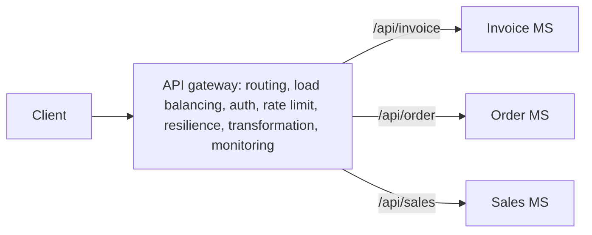
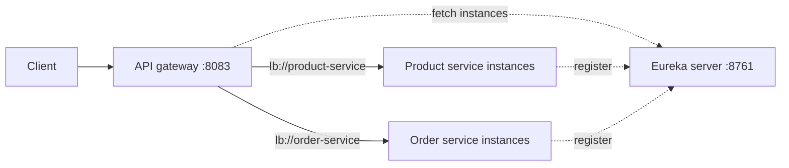
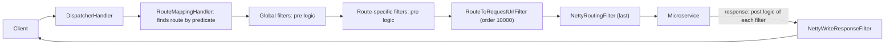
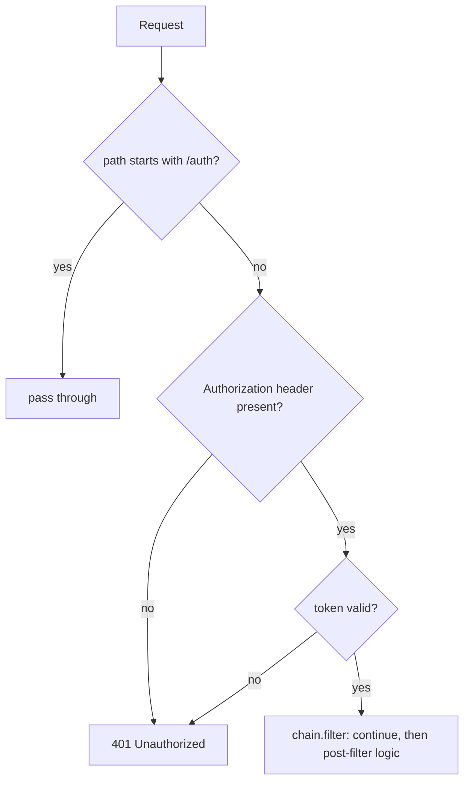

# API Gateway – Part 1 & Part 2 (HLD #40 and #41, Spring Cloud Gateway)

<!-- nav -->
⬅ [39 Circuit Breaker](39_Circuit_Breaker_Notes.md) · [Index](00_HLD_Index.md)
<!-- nav -->

Sources:
- Part 1: https://drive.google.com/file/d/1CbIz2ZgwcinR0y69Q7O-MRSgWgu-b-Ze/view?usp=drive_link
- Part 2: https://drive.google.com/file/d/14bbYUgLn3q5CXVKL90pMYb9TbAuu0GKd/view?usp=drive_link

(For the conceptual API Gateway handwritten note, see HLD #28.)

---

<!-- simple-explanation -->
## In simple words – building an API gateway with Spring Cloud Gateway

### What you are building
An **API gateway** is the single front door to all your microservices. Clients call only the gateway (`/products/...`, `/orders/...`) and the gateway forwards each request to the right service. Because it sees every request, it is the natural place for **routing, load balancing, authentication (JWT), rate limiting, retries/circuit breaking, request/response changes, and logging.** For the theory see [API Gateway Concepts](28_API_Gateway_Concepts_Notes.md).

### Part 1 – Routing
**Why route at the gateway?** If you split one microservice into two, or merge two, every client would need updating. With a gateway, only the **gateway's route table** changes; clients keep calling the same URLs.

A **route** has three main pieces:
- **`id`** – any unique name for the route.
- **`uri`** – where to send the request (e.g. `http://localhost:8082`).
- **`predicates`** – conditions that decide whether the route matches, such as `Path=/products/**` (any URL starting with `/products/`) or `Method=GET,POST`.

Example: requests to `/products/**` go to the product service on port 8082, and `/orders/**` to the order service on 8081. The gateway itself runs on 8083.

**Adding load balancing:** hardcoded URIs have the same problems as before (see [Service Discovery](34_Service_Discovery_Notes.md)). Register all services with Eureka, add the Eureka client dependency to the gateway, and change the URI to **`lb://product-service`**. The `lb://` prefix tells the gateway: *ask service discovery for the instances of `product-service`, then pick one using Spring Cloud LoadBalancer.*

### Part 2 – Filters
A **filter** can **look at and modify the request and the response** as they pass through the gateway. Think of a series of checkpoints.

| | Global filters | Route-specific filters |
|---|---|---|
| Apply to | **every** request | only requests matching a **particular route** |
| Typical use | logging, authentication | rate limiting, retry, circuit breaker, header changes |

**How a request travels:** Client → find the matching route (by predicate) → **pre-logic** of the global and route filters → forward to the microservice → the response comes back through the **post-logic** of those filters → Client. Each filter has a *pre* part (before the call is forwarded) and a *post* part (after the response returns).

**Ordering.** Every filter has an **order number; a smaller number runs earlier** (−1 before 0). Most global filters run before route filters, but two built-in global filters that actually *forward* the request (`RouteToRequestUrlFilter` and `NettyRoutingFilter`) are given a huge number so that they run **last**: they must send the request only after all the other filters have had their say. A global filter with no order defaults to the lowest priority; route filters take their position in the list (0, 1, 2…) as their order.

### Custom global filter – JWT authentication
You write a class implementing `GlobalFilter` and `Ordered`:
1. Let requests to `/auth/**` pass without a token (that's where users log in).
2. Read the `Authorization` header. If missing → reply **401 Unauthorized** and stop.
3. Extract the token (skip the `"Bearer "` prefix, 7 characters) and verify it. If invalid → 401.
4. Otherwise call `chain.filter(exchange)` to continue; code inside `.then(...)` runs afterwards as the post-filter.
Returning `-1` from `getOrder()` makes it run early. This way **every microservice is protected without writing any auth code** in them. See [JWT Explained](26_JWT_Explained_Notes.md).

### Built-in route-specific filters
`AddRequestHeader`, `AddResponseHeader`, `RemoveRequestHeader`, `RemoveResponseHeader`, `Retry`, `RequestRateLimiter` and `CircuitBreaker`. You switch them on in `application.properties` under the route using `filters[i].name` and `filters[i].args.*`. The name `AddRequestHeader` maps to a Java class `AddRequestHeaderGatewayFilterFactory`.

- **Header filters:** e.g. remove a private header like `Api-private-Key` before the request reaches the microservice, or add `X-Test-RequestHeader` for downstream use.
- **Retry filter:** `retries=4` and `methods=GET,DELETE` retry failed calls up to 4 times, only for those safe-to-repeat methods. (In the demo the product controller fails the first 3 calls on purpose; the gateway keeps retrying and the 4th succeeds.)
- **CircuitBreaker filter:** add the Resilience4j starter, name the breaker, set `fallbackUri=forward:/fallback`, and configure it as in [Circuit Breaker](39_Circuit_Breaker_Notes.md). When the product service is down and the failure threshold is crossed, the circuit opens and callers get the fallback message ("Service is temporarily unavailable…") from a `/fallback` controller instead of errors.
- **Custom route filter:** write a class named `<Name>GatewayFilterFactory` that extends `AbstractGatewayFilterFactory<Config>`. The `apply` method returns the filter logic: code before `chain.filter(exchange)` is the pre-logic, and code in `.then(...)` is the post-logic. Arguments from `application.properties` (like `country=India`) arrive in your config class.

### Summary
Routes decide **where** a request goes; filters decide **what happens on the way**. Put cross-cutting concerns (auth, limits, retries, breakers) in the gateway and your services stay simple.
<!-- simple-explanation -->


# PART 1

## 1. What is an API Gateway?

<!-- diagram:40_41-0 -->
**Diagram – Gateway as the single entry point**


<!-- /diagram:40_41-0 -->


A **single entry point to access all microservices** (Client → API Gateway → `/api/invoice` → Invoice MS, `/api/order` → Order MS, `/api/sales` → Sales MS …).

Benefits of this single entry point:
1. **Routing** – forward requests to the right microservices
2. **Load balancing**
3. **Authentication** (like JWT)
4. **Rate limiting**
5. **Resilience features** (Circuit breaker, Retry etc.)
6. **Request/Response transformation**
7. **Monitoring and logging** … etc.

## 2. Routing
If one microservice is split into 2 (or multiple microservices are merged), **all clients would need to update their routing logic**. With an API Gateway in the middle, **the change is needed only at one place – the Gateway**.

### Implementation
**Product service**
```java
@RestController
@RequestMapping("/products")
public class ProductController {
    @GetMapping("/{id}")
    public ResponseEntity<String> getProduct(@PathVariable String id) {
        return ResponseEntity.ok().body("fetch the product details with id:" + id);
    }
}
```
```properties
server.port=8082
spring.application.name=product-service
```
**Order service**
```java
@RestController
@RequestMapping("/orders")
public class OrderController {
    @GetMapping("/{id}")
    public ResponseEntity<String> getOrder(@PathVariable String id) {
        return ResponseEntity.ok().body("fetch the Order details with id:" + id);
    }
}
```
```properties
server.port=8081
spring.application.name=order-service
```
**Gateway app** – create a new application via Spring Initializr; `pom.xml` gets:
```xml
<dependency>
  <groupId>org.springframework.cloud</groupId>
  <artifactId>spring-cloud-starter-gateway</artifactId>
</dependency>
```
`application.properties`
```properties
spring.application.name=apigateway
server.port=8083

# Route: Forward /products/** to product-service
# id: just a unique name for this route
spring.cloud.gateway.routes[0].id=product-service
# uri: microservice host and port number
spring.cloud.gateway.routes[0].uri=http://localhost:8082
# predicates: pattern matching to decide the routing.
# apart from Path, we can also have a predicate on Method, like:
#   spring.cloud.gateway.routes[0].predicates[1]=Method=GET,POST
# meaning GET and POST requests to /products/** will match this route.
spring.cloud.gateway.routes[0].predicates[0]=Path=/products/**

# Route: Forward /orders/** to order-service
spring.cloud.gateway.routes[1].id=order-service
spring.cloud.gateway.routes[1].uri=http://localhost:8081
spring.cloud.gateway.routes[1].predicates[0]=Path=/orders/**
```
Start all 3 servers: Product, Order and API Gateway.

## 3. API Gateway + Load Balancer

<!-- diagram:40_41-1 -->
**Diagram – Gateway with Eureka and lb:// URIs**


<!-- /diagram:40_41-1 -->


(Prerequisites: *Service Discovery* and *Client Side Load Balancer* notes – HLD #34, #35.)

**Product service** – add `spring-cloud-starter-netflix-eureka-client`, and:
```properties
server.port=8082
spring.application.name=product-service
eureka.client.service-url.defaultZone=http://localhost:8761/eureka
```
(+ same controller as above)

**Order service** – same dependency; `server.port=8081`, `spring.application.name=order-service`, `eureka.client.service-url.defaultZone=http://localhost:8761/eureka` (+ same controller).

**Eureka Server** – dependency `spring-cloud-starter-netflix-eureka-server`:
```properties
spring.application.name=eureka-server
server.port=8761
# Since it's a server, we don't want it to register and also don't want to fetch the instance details
eureka.client.register-with-eureka=false
eureka.client.fetch-registry=false
```
```java
@SpringBootApplication
@EnableEurekaServer
public class EurekaServerApplication {
    public static void main(String[] args) { SpringApplication.run(EurekaServerApplication.class, args); }
}
```
**API Gateway** – `pom.xml`:
```xml
<dependency>
  <groupId>org.springframework.cloud</groupId>
  <artifactId>spring-cloud-starter-gateway</artifactId>
</dependency>
<dependency>
  <groupId>org.springframework.cloud</groupId>
  <artifactId>spring-cloud-starter-netflix-eureka-client</artifactId>
</dependency>
```
```properties
spring.application.name=apigateway
server.port=8083

# Route: Forward /products/** to product-service
spring.cloud.gateway.routes[0].id=product-service
# Replaced the hardcoded URI http://localhost:8082.
# Now internally it uses the Spring Cloud LoadBalancer framework to do load balancing:
#  - first fetches the instances from Service Discovery
#  - then performs the load balancing algorithm
spring.cloud.gateway.routes[0].uri=lb://product-service
spring.cloud.gateway.routes[0].predicates[0]=Path=/products/**

# Route: Forward /orders/** to order-service
spring.cloud.gateway.routes[1].id=order-service
spring.cloud.gateway.routes[1].uri=lb://order-service
spring.cloud.gateway.routes[1].predicates[0]=Path=/orders/**

# path of the Eureka Server to fetch the microservices host details
eureka.client.service-url.defaultZone=http://localhost:8761/eureka
```

---

# PART 2

(Recap of the benefits list above.) To apply **Authentication, Rate Limiting, Resilience** etc. in the API Gateway we must understand **FILTERS**.

## 4. Filters in API Gateway

<!-- diagram:40_41-2 -->
**Diagram – Request path through the gateway filters**


<!-- /diagram:40_41-2 -->


A filter can **intercept and modify the HTTP request and response** as they pass through the gateway.

| | Global Filters | Route-Specific Filters (GatewayFilters) |
|---|---|---|
| Scope | Apply to **every request** going through the Gateway | Apply to **specific requests matching a particular route**, not globally |
| Good examples | Logging, Authentication | Rate limiting, Resilience |

### Request flow (diagram)
`Client → DispatcherHandler → RouteMappingHandler (finds the route by predicate e.g. Path=/products/**) → Global Filters (pre-filter logic) → Route-Specific Filters (pre-filter logic → next filter in chain) → Global filter **RouteToRequestUrlFilter** → Global filter **NettyRoutingFilter** → Microservice`, then the response travels back through the **post-filter logic** of each filter and finally the global **NettyWriteResponseFilter** → Client.

### Ordering – "why are some Global filters after the Route-Specific filters?"
**Answer: ORDERING.** Every filter (Global or Route-Specific) is given an **ORDER**:
- **Minimum order value = high priority**; **maximum = low priority** (e.g. order −1 runs before order 0).
- Most Global filters have a lower value than Route-Specific filters, **but** some Global filters – **RouteToRequestUrlFilter** and **NettyRoutingFilter** – are intentionally given a high value so they **execute last**:
```java
// RouteToRequestUrlFilter
public static final int ROUTE_TO_URL_FILTER_ORDER = 10000;
// NettyRoutingFilter
public static final int ORDER = Ordered.LOWEST_PRECEDENCE;
```
**Defaults**
- Global filter with no Order defined → **`Ordered.LOWEST_PRECEDENCE`**.
- Route-specific filters: with e.g. 3 filters on a route, their **index (0, 1, 2) is used as the Order value**.

## 5. Custom Global Filter – JWT Authentication

<!-- diagram:40_41-3 -->
**Diagram – JWT global filter logic**


<!-- /diagram:40_41-3 -->


```java
@Component
public class JwtAuthGlobalFilter implements GlobalFilter, Ordered {

    @Override
    public Mono<Void> filter(ServerWebExchange exchange, GatewayFilterChain chain) {
        String uriPath = exchange.getRequest().getURI().getPath();

        // Skip JWT validation for auth endpoints
        if (uriPath.startsWith("/auth")) {
            return chain.filter(exchange);
        }

        // Extract Authorization header
        String authHeader = exchange.getRequest().getHeaders().getFirst(HttpHeaders.AUTHORIZATION);

        if (authHeader == null) {
            // if token is missing
            exchange.getResponse().setStatusCode(HttpStatus.UNAUTHORIZED);
            return exchange.getResponse().setComplete();
        }

        String token = authHeader.substring(7);
        try {
            // verify JWT token logic here.....
        } catch (Exception e) {
            exchange.getResponse().setStatusCode(HttpStatus.UNAUTHORIZED);
            return exchange.getResponse().setComplete();
        }

        // call next filter chain and also add post-filter logic
        return chain.filter(exchange).then(
            Mono.fromRunnable(() -> {
                // post filter logic here
            })
        );
    }

    @Override
    public int getOrder() {
        // lower value means higher priority
        return -1;
    }
}
```
(What JWT is and how to verify it → see HLD #26 and the Spring Boot JWT notes.)

## 6. Route-Specific Filters (pre-existing)
| Filter | Purpose |
|---|---|
| `AddRequestHeader` | add a header to the request |
| `AddResponseHeader` | add a header to the response |
| `RemoveRequestHeader` | remove a request header |
| `RemoveResponseHeader` | remove a response header |
| `Retry` | retry the request on failure (configurable) |
| `RequestRateLimiter` | apply rate limiting |
| `CircuitBreaker` | stop making repeated calls to a failed downstream |

**Remove a request header**
```properties
spring.application.name=apigateway
server.port=8083

spring.cloud.gateway.routes[0].id=product-service
spring.cloud.gateway.routes[0].uri=lb://product-service
spring.cloud.gateway.routes[0].predicates[0]=Path=/products/**

## FILTERS ##
# Remove a request header
spring.cloud.gateway.routes[0].filters[0].name=RemoveRequestHeader
spring.cloud.gateway.routes[0].filters[0].args.name=Api-private-Key

eureka.client.service-url.defaultZone=http://localhost:8761/eureka
```
**Multiple filters on one route**
```properties
## FILTERS ##
# Add a request header
spring.cloud.gateway.routes[0].filters[0].name=AddRequestHeader
spring.cloud.gateway.routes[0].filters[0].args.name=X-Test-RequestHeader
spring.cloud.gateway.routes[0].filters[0].args.value=ApiGatewayRequest

# Add a response header
spring.cloud.gateway.routes[0].filters[1].name=AddResponseHeader
spring.cloud.gateway.routes[0].filters[1].args.name=X-Test-ResponseHeader
spring.cloud.gateway.routes[0].filters[1].args.value=ApiGatewayResponse

# Remove a request header
spring.cloud.gateway.routes[0].filters[2].name=RemoveRequestHeader
spring.cloud.gateway.routes[0].filters[2].args.name=Api-private-Key
```
**Naming convention:** the filter `AddRequestHeader` maps to Java class `AddRequestHeaderGatewayFilterFactory.java`, whose config is:
```java
public static class NameValueConfig {
    protected String name;
    protected String value;
    ...
}
```

### Retry filter
```properties
## FILTERS ##
# retry on failure, max 4 attempts, on GET and DELETE requests only
spring.cloud.gateway.routes[0].filters[0].name=Retry
spring.cloud.gateway.routes[0].filters[0].args.retries=4
spring.cloud.gateway.routes[0].filters[0].args.methods=GET,DELETE
```
Class `RetryGatewayFilterFactory.java`, config:
```java
public static class RetryConfig {
    int retries;
    List<HttpStatus> statuses;
    List<HttpMethod> methods;
    ...
}
```
**Test controller** – purposefully fail the first 3 calls so you can verify the gateway retries; the 4th call passes:
```java
@RestController
@RequestMapping("/products")
public class ProductController {
    int counter = 0;

    @GetMapping("/{id}")
    public ResponseEntity<String> getProduct(@PathVariable String id) {
        counter++;
        if (counter <= 3) {
            return ResponseEntity.status(HttpStatus.INTERNAL_SERVER_ERROR).body("Fail");
        }
        return ResponseEntity.ok().body("fetch the product details on " + counter + " attempt");
    }
}
```

### CircuitBreaker filter
(See the Circuit Breaker notes, HLD #39.)

`pom.xml`
```xml
<dependency>
  <groupId>org.springframework.cloud</groupId><artifactId>spring-cloud-starter-gateway</artifactId>
</dependency>
<dependency>
  <groupId>org.springframework.cloud</groupId><artifactId>spring-cloud-starter-netflix-eureka-client</artifactId>
</dependency>
<dependency>
  <groupId>org.springframework.cloud</groupId>
  <artifactId>spring-cloud-starter-circuitbreaker-reactor-resilience4j</artifactId>
</dependency>
```
`application.properties`
```properties
spring.application.name=apigateway
server.port=8083

spring.cloud.gateway.routes[0].id=product-service
spring.cloud.gateway.routes[0].uri=lb://product-service
spring.cloud.gateway.routes[0].predicates[0]=Path=/products/**

## FILTERS ##
# Circuit Breaker (redirect to fallback endpoint if service fails)
spring.cloud.gateway.routes[0].filters[0].name=CircuitBreaker
spring.cloud.gateway.routes[0].filters[0].args.name=myCircuitBreakerName
spring.cloud.gateway.routes[0].filters[0].args.fallbackUri=forward:/fallback

# CircuitBreaker config
resilience4j.circuitbreaker.instances.myCircuitBreakerName.sliding-window-type=COUNT_BASED
resilience4j.circuitbreaker.instances.myCircuitBreakerName.sliding-window-size=10
resilience4j.circuitbreaker.instances.myCircuitBreakerName.minimum-number-of-calls=5
resilience4j.circuitbreaker.instances.myCircuitBreakerName.failure-rate-threshold=50
resilience4j.circuitbreaker.instances.myCircuitBreakerName.wait-duration-in-open-state=10s
resilience4j.circuitbreaker.instances.myCircuitBreakerName.permitted-number-of-calls-in-half-open-state=3
logging.level.io.github.resilience4j.circuitbreaker=DEBUG

eureka.client.service-url.defaultZone=http://localhost:8761/eureka
```
Fallback controller:
```java
@Controller
public class FallbackController {
    @GetMapping("/fallback")
    public ResponseEntity<String> fallback() {
        return ResponseEntity.ok("Service is temporarily unavailable, please try again later.");
    }
}
```
**Testing:** product microservice was **not started**; called more than 5 times → failure threshold crossed → circuit opened (visible in the DEBUG logs) and the fallback is returned.

### Custom Route-Specific filter
Config in `application.properties` (here as the 6th filter, index 5):
```properties
# Custom Route Specific filter testing
spring.cloud.gateway.routes[0].filters[5].name=CustomRoute
spring.cloud.gateway.routes[0].filters[5].args.country=India
```
Class (name must be `<FilterName>GatewayFilterFactory`):
```java
@Component
public class CustomRouteGatewayFilterFactory
        extends AbstractGatewayFilterFactory<CustomRouteGatewayFilterFactory.CustomConfig> {

    public CustomRouteGatewayFilterFactory() {
        super(CustomConfig.class);
    }

    @Override
    public GatewayFilter apply(CustomConfig config) {
        return (exchange, chain) -> {
            System.out.println("pre filter logic here, config value: " + config.getCountry());

            return chain.filter(exchange).then(Mono.fromRunnable(() -> {
                System.out.println("post filter logic here");
            }));
        };
    }

    public static class CustomConfig {
        private String country;
        public String getCountry() { return country; }
        public void setCountry(String country) { this.country = country; }
    }
}
```

---

## Quick revision
- Gateway = single entry: routing, LB, auth, rate limit, resilience, transformation, monitoring.
- Route = `id` + `uri` + `predicates` (Path, Method…) (+ `filters`); `lb://service-name` enables Eureka + load balancing.
- **Global filters** (all requests; e.g. JWT auth, logging) vs **route-specific filters** (per route; headers, Retry, RequestRateLimiter, CircuitBreaker).
- **Order**: lower number = runs earlier; `RouteToRequestUrlFilter` (10000) and `NettyRoutingFilter` (LOWEST_PRECEDENCE) intentionally run last.
- Filter factories are named `<Name>GatewayFilterFactory`; extend `AbstractGatewayFilterFactory<Config>` for custom ones.
- Pre-logic before `chain.filter(exchange)`, post-logic inside `.then(...)`.

---

<!-- nav -->
⬅ [39 Circuit Breaker](39_Circuit_Breaker_Notes.md) · [Index](00_HLD_Index.md)
<!-- nav -->
