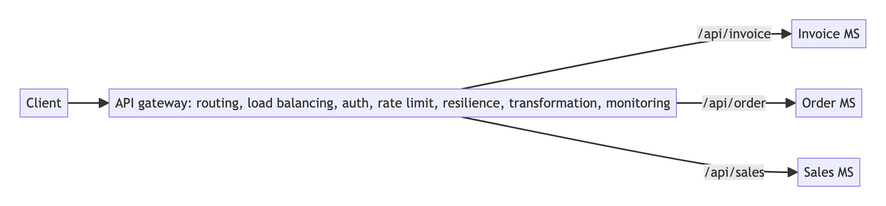
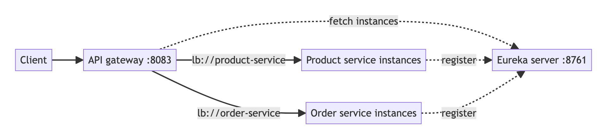
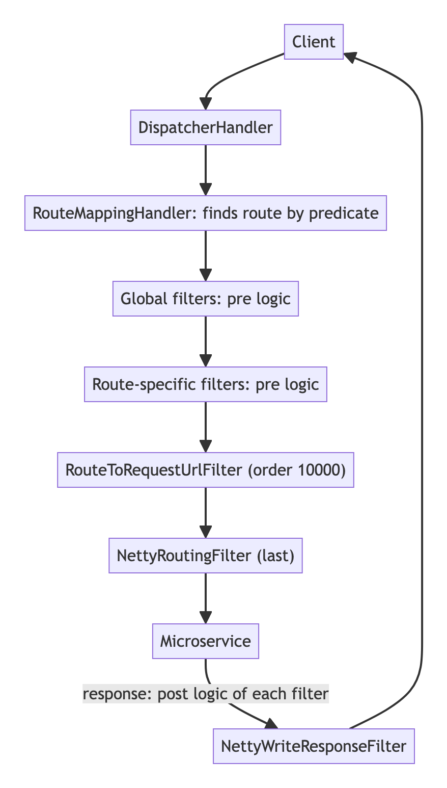
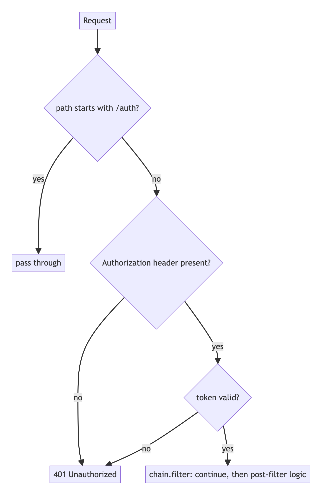

# API Gateway – Part 1 & Part 2 (HLD #40 and #41, Spring Cloud Gateway)

<!-- nav -->
⬅ [39 Circuit Breaker](39_Circuit_Breaker_Notes.md) · [Index](00_HLD_Index.md)
<!-- nav -->

Sources:
- Part 1: https://drive.google.com/file/d/1CbIz2ZgwcinR0y69Q7O-MRSgWgu-b-Ze/view?usp=drive_link
- Part 2: https://drive.google.com/file/d/14bbYUgLn3q5CXVKL90pMYb9TbAuu0GKd/view?usp=drive_link

(For the conceptual side of the API Gateway, see HLD #28.)

---

# PART 1

## 1. What is an API Gateway?

<!-- diagram:40_41-0 -->
**Gateway as the single entry point**


<!-- /diagram:40_41-0 -->


A **single entry point to access all microservices** (Client → API Gateway → `/api/invoice` → Invoice MS, `/api/order` → Order MS, `/api/sales` → Sales MS …).

Benefits of this single entry point:
1. **Routing** – forward requests to the right microservices
2. **Load balancing**
3. **Authentication** (like JWT)
4. **Rate limiting**
5. **Resilience features** (Circuit breaker, Retry etc.)
6. **Request/Response transformation**
7. **Monitoring and logging** … etc.

<!-- isw:40_41-0 -->
**In simple words**

An API gateway is **a single entry point to access all the microservices** (Client → API Gateway → `/api/invoice` → Invoice MS, `/api/order` → Order MS, `/api/sales` → Sales MS). The benefits listed: **1. routing** (forward requests to the right microservice), **2. load balancing, 3. authentication (like JWT), 4. rate limiting, 5. resilience features (circuit breaker, retry, …), 6. request / response transformation, 7. monitoring and logging.**
<!-- /isw:40_41-0 -->


## 2. Routing
If one microservice is split into 2 (or multiple microservices are merged), **all clients would need to update their routing logic**. With an API Gateway in the middle, **the change is needed only at one place – the Gateway**.

### Implementation
**Product service**
```java
@RestController
@RequestMapping("/products")
public class ProductController {
    @GetMapping("/{id}")
    public ResponseEntity<String> getProduct(@PathVariable String id) {
        return ResponseEntity.ok().body("fetch the product details with id:" + id);
    }
}
```
```properties
server.port=8082
spring.application.name=product-service
```
**Order service**
```java
@RestController
@RequestMapping("/orders")
public class OrderController {
    @GetMapping("/{id}")
    public ResponseEntity<String> getOrder(@PathVariable String id) {
        return ResponseEntity.ok().body("fetch the Order details with id:" + id);
    }
}
```
```properties
server.port=8081
spring.application.name=order-service
```
**Gateway app** – create a new application via Spring Initializr; `pom.xml` gets:
```xml
<dependency>
  <groupId>org.springframework.cloud</groupId>
  <artifactId>spring-cloud-starter-gateway</artifactId>
</dependency>
```
`application.properties`
```properties
spring.application.name=apigateway
server.port=8083

# Route: Forward /products/** to product-service
# id: just a unique name for this route
spring.cloud.gateway.routes[0].id=product-service
# uri: microservice host and port number
spring.cloud.gateway.routes[0].uri=http://localhost:8082
# predicates: pattern matching to decide the routing.
# apart from Path, we can also have a predicate on Method, like:
#   spring.cloud.gateway.routes[0].predicates[1]=Method=GET,POST
# meaning GET and POST requests to /products/** will match this route.
spring.cloud.gateway.routes[0].predicates[0]=Path=/products/**

# Route: Forward /orders/** to order-service
spring.cloud.gateway.routes[1].id=order-service
spring.cloud.gateway.routes[1].uri=http://localhost:8081
spring.cloud.gateway.routes[1].predicates[0]=Path=/orders/**
```
Start all 3 servers: Product, Order and API Gateway.

<!-- isw:40_41-1 -->
**In simple words**

If one microservice is split into two (or several are merged), **all the clients would have to update their routing logic.** With an API gateway in the middle, **the change is needed only in one place, the gateway.**
<!-- /isw:40_41-1 -->

<!-- isw:40_41-2 -->
**In simple words**

The Product service (port 8082, `/products/{id}`) and the Order service (port 8081, `/orders/{id}`) are simple controllers. The **gateway app** is a new application with the dependency **`spring-cloud-starter-gateway`,** running on port 8083. A route has three main parts: **`id`** (just a unique name for the route), **`uri`** (the microservice host and port) and **`predicates`** (pattern matching to decide the routing; apart from `Path=/products/**` there can also be a `Method=GET,POST` predicate, meaning GET and POST requests to that path match the route). In the example `/products/**` is forwarded to product-service and `/orders/**` to order-service. Start all three servers: Product, Order and the API gateway.
<!-- /isw:40_41-2 -->


## 3. API Gateway + Load Balancer

<!-- diagram:40_41-1 -->
**Gateway with Eureka and lb:// URIs**


<!-- /diagram:40_41-1 -->


(Prerequisites: *Service Discovery* and *Client Side Load Balancer* notes – HLD #34, #35.)

**Product service** – add `spring-cloud-starter-netflix-eureka-client`, and:
```properties
server.port=8082
spring.application.name=product-service
eureka.client.service-url.defaultZone=http://localhost:8761/eureka
```
(+ same controller as above)

**Order service** – same dependency; `server.port=8081`, `spring.application.name=order-service`, `eureka.client.service-url.defaultZone=http://localhost:8761/eureka` (+ same controller).

**Eureka Server** – dependency `spring-cloud-starter-netflix-eureka-server`:
```properties
spring.application.name=eureka-server
server.port=8761
# Since it's a server, we don't want it to register and also don't want to fetch the instance details
eureka.client.register-with-eureka=false
eureka.client.fetch-registry=false
```
```java
@SpringBootApplication
@EnableEurekaServer
public class EurekaServerApplication {
    public static void main(String[] args) { SpringApplication.run(EurekaServerApplication.class, args); }
}
```
**API Gateway** – `pom.xml`:
```xml
<dependency>
  <groupId>org.springframework.cloud</groupId>
  <artifactId>spring-cloud-starter-gateway</artifactId>
</dependency>
<dependency>
  <groupId>org.springframework.cloud</groupId>
  <artifactId>spring-cloud-starter-netflix-eureka-client</artifactId>
</dependency>
```
```properties
spring.application.name=apigateway
server.port=8083

# Route: Forward /products/** to product-service
spring.cloud.gateway.routes[0].id=product-service
# Replaced the hardcoded URI http://localhost:8082.
# Now internally it uses the Spring Cloud LoadBalancer framework to do load balancing:
#  - first fetches the instances from Service Discovery
#  - then performs the load balancing algorithm
spring.cloud.gateway.routes[0].uri=lb://product-service
spring.cloud.gateway.routes[0].predicates[0]=Path=/products/**

# Route: Forward /orders/** to order-service
spring.cloud.gateway.routes[1].id=order-service
spring.cloud.gateway.routes[1].uri=lb://order-service
spring.cloud.gateway.routes[1].predicates[0]=Path=/orders/**

# path of the Eureka Server to fetch the microservices host details
eureka.client.service-url.defaultZone=http://localhost:8761/eureka
```

<!-- isw:40_41-3 -->
**In simple words**

This part builds on *Service Discovery* and *Client Side Load Balancer* (HLD #34 and #35). The Product and Order services get the `spring-cloud-starter-netflix-eureka-client` dependency and register with the **Eureka server** (port 8761), and the gateway also gets the Eureka client. In the gateway's routes the **hardcoded URI is replaced by `lb://product-service`** (and `lb://order-service`). Internally, **it uses the Spring Cloud LoadBalancer framework, which first fetches the instances from service discovery and then applies the load-balancing algorithm.**
<!-- /isw:40_41-3 -->


---

# PART 2

(Recap of the benefits list above.) To apply **Authentication, Rate Limiting, Resilience** etc. in the API Gateway we must understand **FILTERS**.

## 4. Filters in API Gateway

<!-- diagram:40_41-2 -->
**Request path through the gateway filters**


<!-- /diagram:40_41-2 -->


A filter can **intercept and modify the HTTP request and response** as they pass through the gateway.

| | Global Filters | Route-Specific Filters (GatewayFilters) |
|---|---|---|
| Scope | Apply to **every request** going through the Gateway | Apply to **specific requests matching a particular route**, not globally |
| Good examples | Logging, Authentication | Rate limiting, Resilience |

### Request flow (diagram)
`Client → DispatcherHandler → RouteMappingHandler (finds the route by predicate e.g. Path=/products/**) → Global Filters (pre-filter logic) → Route-Specific Filters (pre-filter logic → next filter in chain) → Global filter **RouteToRequestUrlFilter** → Global filter **NettyRoutingFilter** → Microservice`, then the response travels back through the **post-filter logic** of each filter and finally the global **NettyWriteResponseFilter** → Client.

<!-- isw:40_41-5 -->
**In simple words**

The request flow: the client → `DispatcherHandler` → `RouteMappingHandler` (finds the route by predicate, for example `Path=/products/**`) → **global filters (pre-filter logic)** → **route-specific filters (pre-filter logic, then the next filter in the chain)** → global filter **`RouteToRequestUrlFilter`** → global filter **`NettyRoutingFilter`** → the microservice. Then the response travels back through the **post-filter logic** of each filter and finally the global **`NettyWriteResponseFilter`** → the client.
<!-- /isw:40_41-5 -->


### Ordering – "why are some Global filters after the Route-Specific filters?"
**Answer: ORDERING.** Every filter (Global or Route-Specific) is given an **ORDER**:
- **Minimum order value = high priority**; **maximum = low priority** (e.g. order −1 runs before order 0).
- Most Global filters have a lower value than Route-Specific filters, **but** some Global filters – **RouteToRequestUrlFilter** and **NettyRoutingFilter** – are intentionally given a high value so they **execute last**:
```java
// RouteToRequestUrlFilter
public static final int ROUTE_TO_URL_FILTER_ORDER = 10000;
// NettyRoutingFilter
public static final int ORDER = Ordered.LOWEST_PRECEDENCE;
```
**Defaults**
- Global filter with no Order defined → **`Ordered.LOWEST_PRECEDENCE`**.
- Route-specific filters: with e.g. 3 filters on a route, their **index (0, 1, 2) is used as the Order value**.

<!-- isw:40_41-4 -->
**In simple words**

To apply **authentication, rate limiting, resilience** and so on in the gateway, we must understand **filters.** A filter can **intercept and modify the HTTP request and the response** as they pass through the gateway. There are two kinds: **global filters** apply to **every request** going through the gateway (good examples: logging, authentication), and **route-specific filters (GatewayFilters)** apply **only to requests matching a particular route,** not globally (good examples: rate limiting, resilience).
<!-- /isw:40_41-4 -->

<!-- isw:40_41-6 -->
**In simple words**

The answer to "why are some global filters after the route-specific filters?" is **ORDERING.** Every filter (global or route-specific) is given an **ORDER:** the **minimum order value means high priority and the maximum means low priority** (for example order −1 runs before order 0). Most global filters have a lower value than route-specific filters, **but** two global filters, **`RouteToRequestUrlFilter` (`ROUTE_TO_URL_FILTER_ORDER = 10000`) and `NettyRoutingFilter` (`Ordered.LOWEST_PRECEDENCE`),** are intentionally given a high value so they **execute last.** **Defaults:** a global filter with no order defined gets **`Ordered.LOWEST_PRECEDENCE`;** for route-specific filters, with for example 3 filters on a route, their **index (0, 1, 2) is used as the order value.**
<!-- /isw:40_41-6 -->


## 5. Custom Global Filter – JWT Authentication

<!-- diagram:40_41-3 -->
**JWT global filter logic**


<!-- /diagram:40_41-3 -->


```java
@Component
public class JwtAuthGlobalFilter implements GlobalFilter, Ordered {

    @Override
    public Mono<Void> filter(ServerWebExchange exchange, GatewayFilterChain chain) {
        String uriPath = exchange.getRequest().getURI().getPath();

        // Skip JWT validation for auth endpoints
        if (uriPath.startsWith("/auth")) {
            return chain.filter(exchange);
        }

        // Extract Authorization header
        String authHeader = exchange.getRequest().getHeaders().getFirst(HttpHeaders.AUTHORIZATION);

        if (authHeader == null) {
            // if token is missing
            exchange.getResponse().setStatusCode(HttpStatus.UNAUTHORIZED);
            return exchange.getResponse().setComplete();
        }

        String token = authHeader.substring(7);
        try {
            // verify JWT token logic here.....
        } catch (Exception e) {
            exchange.getResponse().setStatusCode(HttpStatus.UNAUTHORIZED);
            return exchange.getResponse().setComplete();
        }

        // call next filter chain and also add post-filter logic
        return chain.filter(exchange).then(
            Mono.fromRunnable(() -> {
                // post filter logic here
            })
        );
    }

    @Override
    public int getOrder() {
        // lower value means higher priority
        return -1;
    }
}
```
(What JWT is and how to verify it → see HLD #26 and the Spring Boot JWT notes.)

<!-- isw:40_41-7 -->
**In simple words**

The `JwtAuthGlobalFilter` implements `GlobalFilter` and `Ordered` and works like this: (1) **skip the JWT validation for the auth endpoints** (paths starting with `/auth`); (2) **extract the Authorization header;** (3) **if the token is missing, set status 401 Unauthorized** and complete the response; (4) take the token (`authHeader.substring(7)`, after "Bearer ") and **verify it** (the verification logic goes here); if it fails, again **401;** (5) **call the next filter in the chain with `chain.filter(exchange)` and add the post-filter logic** inside `.then(...)`. `getOrder()` returns **−1** (a lower value means higher priority). What JWT is and how to verify it is in the [JWT note](26_JWT_Explained_Notes.md).
<!-- /isw:40_41-7 -->


## 6. Route-Specific Filters (pre-existing)
| Filter | Purpose |
|---|---|
| `AddRequestHeader` | add a header to the request |
| `AddResponseHeader` | add a header to the response |
| `RemoveRequestHeader` | remove a request header |
| `RemoveResponseHeader` | remove a response header |
| `Retry` | retry the request on failure (configurable) |
| `RequestRateLimiter` | apply rate limiting |
| `CircuitBreaker` | stop making repeated calls to a failed downstream |

**Remove a request header**
```properties
spring.application.name=apigateway
server.port=8083

spring.cloud.gateway.routes[0].id=product-service
spring.cloud.gateway.routes[0].uri=lb://product-service
spring.cloud.gateway.routes[0].predicates[0]=Path=/products/**

## FILTERS ##
# Remove a request header
spring.cloud.gateway.routes[0].filters[0].name=RemoveRequestHeader
spring.cloud.gateway.routes[0].filters[0].args.name=Api-private-Key

eureka.client.service-url.defaultZone=http://localhost:8761/eureka
```
**Multiple filters on one route**
```properties
## FILTERS ##
# Add a request header
spring.cloud.gateway.routes[0].filters[0].name=AddRequestHeader
spring.cloud.gateway.routes[0].filters[0].args.name=X-Test-RequestHeader
spring.cloud.gateway.routes[0].filters[0].args.value=ApiGatewayRequest

# Add a response header
spring.cloud.gateway.routes[0].filters[1].name=AddResponseHeader
spring.cloud.gateway.routes[0].filters[1].args.name=X-Test-ResponseHeader
spring.cloud.gateway.routes[0].filters[1].args.value=ApiGatewayResponse

# Remove a request header
spring.cloud.gateway.routes[0].filters[2].name=RemoveRequestHeader
spring.cloud.gateway.routes[0].filters[2].args.name=Api-private-Key
```
**Naming convention:** the filter `AddRequestHeader` maps to Java class `AddRequestHeaderGatewayFilterFactory.java`, whose config is:
```java
public static class NameValueConfig {
    protected String name;
    protected String value;
    ...
}
```

### Retry filter
```properties
## FILTERS ##
# retry on failure, max 4 attempts, on GET and DELETE requests only
spring.cloud.gateway.routes[0].filters[0].name=Retry
spring.cloud.gateway.routes[0].filters[0].args.retries=4
spring.cloud.gateway.routes[0].filters[0].args.methods=GET,DELETE
```
Class `RetryGatewayFilterFactory.java`, config:
```java
public static class RetryConfig {
    int retries;
    List<HttpStatus> statuses;
    List<HttpMethod> methods;
    ...
}
```
**Test controller** – purposefully fail the first 3 calls so you can verify the gateway retries; the 4th call passes:
```java
@RestController
@RequestMapping("/products")
public class ProductController {
    int counter = 0;

    @GetMapping("/{id}")
    public ResponseEntity<String> getProduct(@PathVariable String id) {
        counter++;
        if (counter <= 3) {
            return ResponseEntity.status(HttpStatus.INTERNAL_SERVER_ERROR).body("Fail");
        }
        return ResponseEntity.ok().body("fetch the product details on " + counter + " attempt");
    }
}
```

<!-- isw:40_41-9 -->
**In simple words**

`Retry` with `args.retries=4` and `args.methods=GET,DELETE` means **retry on failure, a maximum of 4 attempts, on GET and DELETE requests only.** The class is `RetryGatewayFilterFactory.java`, whose config holds `retries`, `statuses` and `methods`. For testing, the product controller **purposely fails the first 3 calls** (500 "Fail") so you can verify that the gateway retries; the **4th call passes.**
<!-- /isw:40_41-9 -->


### CircuitBreaker filter
(See the Circuit Breaker notes, HLD #39.)

`pom.xml`
```xml
<dependency>
  <groupId>org.springframework.cloud</groupId><artifactId>spring-cloud-starter-gateway</artifactId>
</dependency>
<dependency>
  <groupId>org.springframework.cloud</groupId><artifactId>spring-cloud-starter-netflix-eureka-client</artifactId>
</dependency>
<dependency>
  <groupId>org.springframework.cloud</groupId>
  <artifactId>spring-cloud-starter-circuitbreaker-reactor-resilience4j</artifactId>
</dependency>
```
`application.properties`
```properties
spring.application.name=apigateway
server.port=8083

spring.cloud.gateway.routes[0].id=product-service
spring.cloud.gateway.routes[0].uri=lb://product-service
spring.cloud.gateway.routes[0].predicates[0]=Path=/products/**

## FILTERS ##
# Circuit Breaker (redirect to fallback endpoint if service fails)
spring.cloud.gateway.routes[0].filters[0].name=CircuitBreaker
spring.cloud.gateway.routes[0].filters[0].args.name=myCircuitBreakerName
spring.cloud.gateway.routes[0].filters[0].args.fallbackUri=forward:/fallback

# CircuitBreaker config
resilience4j.circuitbreaker.instances.myCircuitBreakerName.sliding-window-type=COUNT_BASED
resilience4j.circuitbreaker.instances.myCircuitBreakerName.sliding-window-size=10
resilience4j.circuitbreaker.instances.myCircuitBreakerName.minimum-number-of-calls=5
resilience4j.circuitbreaker.instances.myCircuitBreakerName.failure-rate-threshold=50
resilience4j.circuitbreaker.instances.myCircuitBreakerName.wait-duration-in-open-state=10s
resilience4j.circuitbreaker.instances.myCircuitBreakerName.permitted-number-of-calls-in-half-open-state=3
logging.level.io.github.resilience4j.circuitbreaker=DEBUG

eureka.client.service-url.defaultZone=http://localhost:8761/eureka
```
Fallback controller:
```java
@Controller
public class FallbackController {
    @GetMapping("/fallback")
    public ResponseEntity<String> fallback() {
        return ResponseEntity.ok("Service is temporarily unavailable, please try again later.");
    }
}
```
**Testing:** product microservice was **not started**; called more than 5 times → failure threshold crossed → circuit opened (visible in the DEBUG logs) and the fallback is returned.

<!-- isw:40_41-10 -->
**In simple words**

(See the [Circuit Breaker](39_Circuit_Breaker_Notes.md) note.) You add the dependency `spring-cloud-starter-circuitbreaker-reactor-resilience4j`, and in the route's filters set **`CircuitBreaker`** with a name (`myCircuitBreakerName`) and **`fallbackUri=forward:/fallback`** (redirect to the fallback endpoint if the service fails), plus the usual `resilience4j.circuitbreaker.instances.myCircuitBreakerName.*` settings. A `FallbackController` with `GET /fallback` returns "Service is temporarily unavailable, please try again later." **Testing:** the product microservice was **not started;** after calling it more than 5 times the failure threshold was crossed, the circuit opened (visible in the DEBUG logs) and the fallback was returned.
<!-- /isw:40_41-10 -->


### Custom Route-Specific filter
Config in `application.properties` (here as the 6th filter, index 5):
```properties
# Custom Route Specific filter testing
spring.cloud.gateway.routes[0].filters[5].name=CustomRoute
spring.cloud.gateway.routes[0].filters[5].args.country=India
```
Class (name must be `<FilterName>GatewayFilterFactory`):
```java
@Component
public class CustomRouteGatewayFilterFactory
        extends AbstractGatewayFilterFactory<CustomRouteGatewayFilterFactory.CustomConfig> {

    public CustomRouteGatewayFilterFactory() {
        super(CustomConfig.class);
    }

    @Override
    public GatewayFilter apply(CustomConfig config) {
        return (exchange, chain) -> {
            System.out.println("pre filter logic here, config value: " + config.getCountry());

            return chain.filter(exchange).then(Mono.fromRunnable(() -> {
                System.out.println("post filter logic here");
            }));
        };
    }

    public static class CustomConfig {
        private String country;
        public String getCountry() { return country; }
        public void setCountry(String country) { this.country = country; }
    }
}
```

<!-- isw:40_41-8 -->
**In simple words**

The pre-existing route-specific filters are: **`AddRequestHeader`** (add a header to the request), **`AddResponseHeader`** (add a header to the response), **`RemoveRequestHeader`** (remove a request header), **`RemoveResponseHeader`**, **`Retry`** (retry the request on failure, configurable), **`RequestRateLimiter`** (apply rate limiting) and **`CircuitBreaker`** (stop making repeated calls to a failed downstream). They are switched on in `application.properties` under `filters[i].name` and `filters[i].args.*`.

Examples: **remove a request header** (`RemoveRequestHeader` with `args.name=Api-private-Key`); **several filters on one route** (add a request header `X-Test-RequestHeader`, add a response header `X-Test-ResponseHeader`, remove a request header). **Naming convention:** the filter `AddRequestHeader` maps to the Java class `AddRequestHeaderGatewayFilterFactory.java`, whose config class holds `name` and `value`.
<!-- /isw:40_41-8 -->

<!-- isw:40_41-11 -->
**In simple words**

A custom filter is configured in `application.properties` (here as the 6th filter, index 5): `filters[5].name=CustomRoute` and `filters[5].args.country=India`. The class must be named **`<FilterName>GatewayFilterFactory`** (so `CustomRouteGatewayFilterFactory`) and extend `AbstractGatewayFilterFactory<CustomConfig>`. Its `apply(config)` returns the filter: the code before `chain.filter(exchange)` is the **pre-filter logic** (it can read `config.getCountry()`), and the code inside `.then(Mono.fromRunnable(...))` is the **post-filter logic.**
<!-- /isw:40_41-11 -->


---

## Quick revision
- Gateway = single entry: routing, LB, auth, rate limit, resilience, transformation, monitoring.
- Route = `id` + `uri` + `predicates` (Path, Method…) (+ `filters`); `lb://service-name` enables Eureka + load balancing.
- **Global filters** (all requests; e.g. JWT auth, logging) vs **route-specific filters** (per route; headers, Retry, RequestRateLimiter, CircuitBreaker).
- **Order**: lower number = runs earlier; `RouteToRequestUrlFilter` (10000) and `NettyRoutingFilter` (LOWEST_PRECEDENCE) intentionally run last.
- Filter factories are named `<Name>GatewayFilterFactory`; extend `AbstractGatewayFilterFactory<Config>` for custom ones.
- Pre-logic before `chain.filter(exchange)`, post-logic inside `.then(...)`.

---

<!-- nav -->
⬅ [39 Circuit Breaker](39_Circuit_Breaker_Notes.md) · [Index](00_HLD_Index.md)
<!-- nav -->
