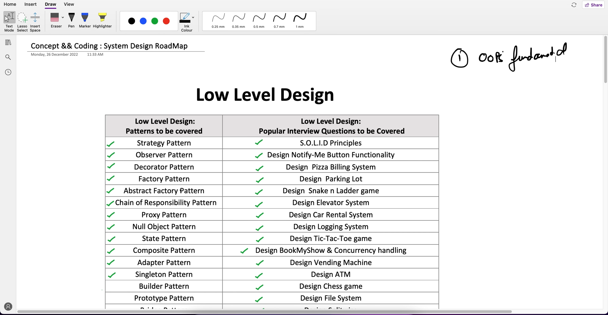
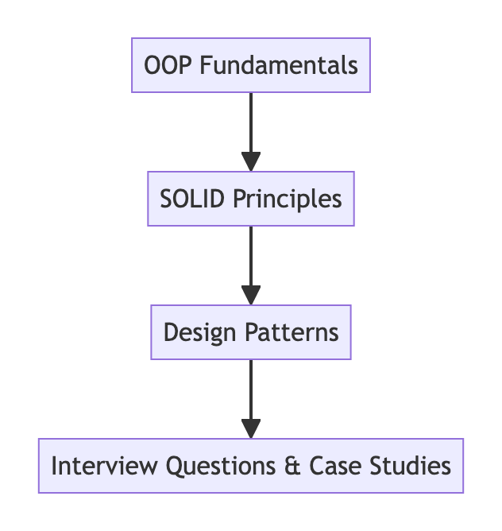
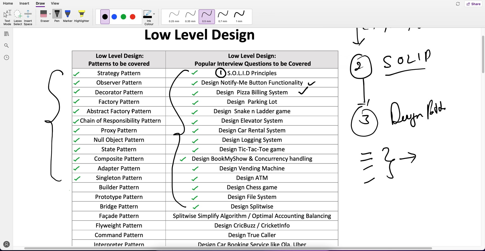
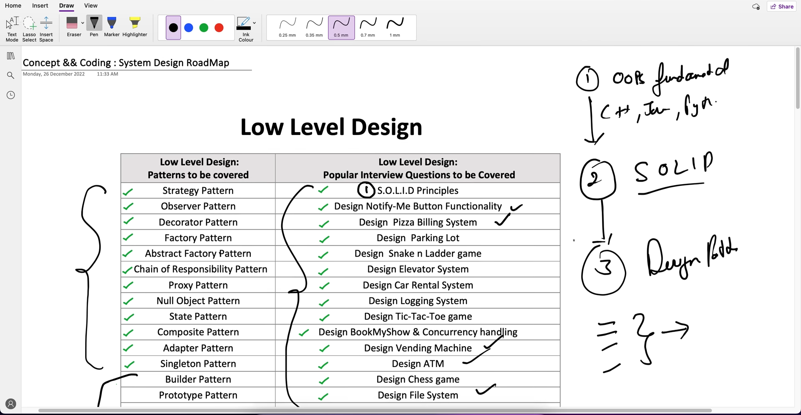
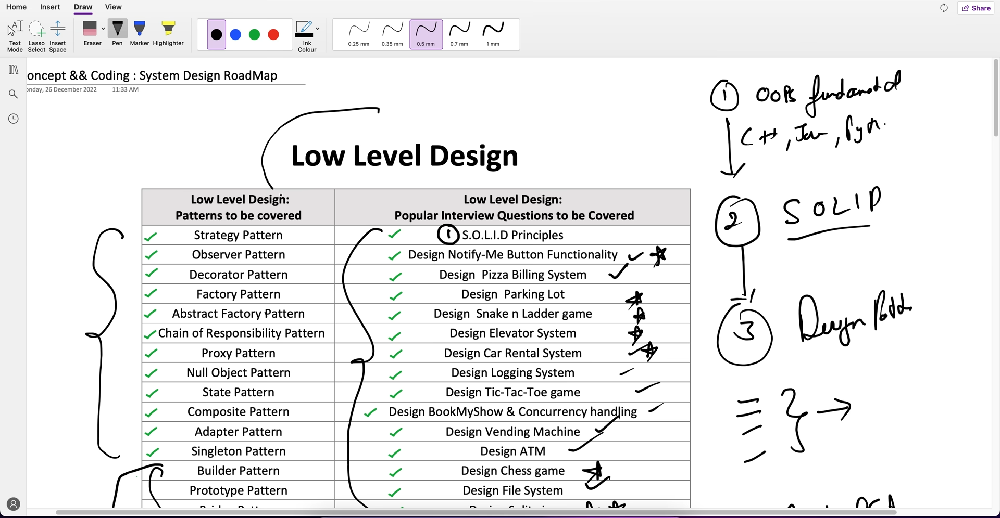
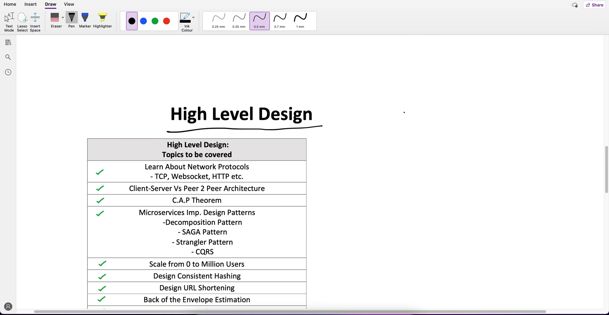
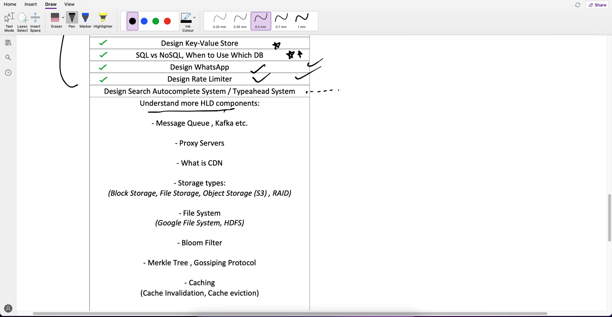

## Low Level Design Roadmap

- **Prerequisite**
    - OOPS fundamentals are required before starting Low Level Design
- **Language Agnostic**
    - LLD can be practiced using any Object-Oriented Programming (OOP) language such as C++, Java, or Python
- **Learning Progression**
    - **Step 1: OOP Fundamentals** (Prerequisite)
    - **Step 2: SOLID Principles**
        - These principles provide the foundational base for understanding OOP in a design context
    - **Step 3: Design Patterns**
        - Focus on learning key patterns first
        - The goal is to use these patterns to solve practical interview questions and case studies

[00:00:42](https://www.youtube.com/watch?v=rliSgjoOFTs&list=PL6W8uoQQ2c63W58rpNFDwdrBnq5G3EfT7&index=1&t=42s)

### Teaching Methodology and Interview Preparation

- **Pattern-Driven Problem Solving**
    - The approach is to cover essential design patterns first and then apply them to various questions
    - Problems are categorized into two types:
        - **Directly Solvable**: Questions that can be addressed using a specific pattern (e.g., Notify-Me button functionality)
        - **Pattern Combinations**: More complex questions that require using multiple patterns together
- **Interview-Based Questions**
    - The questions provided are not theoretical exercises but are actual questions asked during interviews
    - These questions are frequently used by major product companies

[00:01:59](https://www.youtube.com/watch?v=rliSgjoOFTs&list=PL6W8uoQQ2c63W58rpNFDwdrBnq5G3EfT7&index=1&t=119s)

| Patterns to be covered | Popular Interview Questions to Covered |
| --- | --- |
| Strategy Pattern | Design Notify-Me Button Functionality |
| Observer Pattern | Design Pizza Billing System |
| Decorator Pattern | Design Parking Lot |
| Factory Pattern | Design Snake n Ladder game |
| Abstract Factory Pattern | Design Elevator System |
| Chain of Responsibility Pattern | Design Car Rental System |
| Proxy Pattern | Design Logging System |
| Null Object Pattern | Design Tic-Tac-Toe game |
| State Pattern | Design BookMyShow & Concurrency handling |
| Composite Pattern | Design Vending Machine |
| Adapter Pattern | Design ATM |
| Singleton Pattern | Design Chess game |
| Builder Pattern | Design File System |
| Prototype Pattern | Design Splitwise |
| Bridge Pattern | Splitwise Simplify Algorithm / Optimal Accounting Balancing |
| Façade Pattern | Design CricBuzz / Cricketinfo |
| Flyweight Pattern | Design True Caller |
| Command Pattern | Design Car Booking Service like Ola, Uber |
| Interpreter Pattern |  |

### Upcoming Interview Questions

- The following list represents the sequence of questions to be covered in future sessions
- The curriculum is dynamic; if a student identifies a relevant question not listed, it can be added to the "bucket list"

[00:03:21](https://www.youtube.com/watch?v=rliSgjoOFTs&list=PL6W8uoQQ2c63W58rpNFDwdrBnq5G3EfT7&index=1&t=201s)

| Patterns to be covered | Popular Interview Questions to be Covered |
| --- | --- |
| Factory Pattern | Design Snake n Ladder game |
| Chain of Responsibility Pattern | Design Elevator System |
| Proxy Pattern | Design Car Rental System |
| Null Object Pattern | Design Logging System |
| State Pattern | Design Tic-Tac-Toe game |
| Composite Pattern | Design BookMyShow & Concurrency handling |
| Adapter Pattern | Design Vending Machine |
| Singleton Pattern | Design ATM |
| Builder Pattern | Design Chess game |
| Prototype Pattern | Design File System |
| Bridge Pattern | Design Splitwise |
| Façade Pattern | Splitwise Simplify Algorithm / Optimal Accounting Balancing |
| Flyweight Pattern | Design CricBuzz / Cricketinfo |
| Command Pattern | Design True Caller |
| Interpreter Pattern | Design Car Booking Service like Ola, Uber |
| Iterator Pattern | Design Online Hotel Booking System |
| Mediator Pattern | Design Library Management System |
| Memento Pattern | Design Traffic Light System |
| Template Method Pattern | Design Meeting Scheduler |
| Visitor Pattern | Design Online Voting System |
| - | Design Inventory Management System |
| - | Design Cache Mechanism |
| - | Design LinkedIn |
| - | Design Amazon |
| - | Design Airline Management System |
| - | Design Stock Exchange System |
| - | Design Learning Management System |
| - | Design a Calendar Application |
| - | Design (LLD) Payment System |
| - | Design (LLD) Chat based system |
| - | Design Food delivery app like Swiggy and Zomato |
| - | Design Community Discussion Platform |
| - | Design Restaurant Management System |
| - | Design Bowling Alley Machine |
| - | Design (LLD) Rate Limiter |

### LLD Learning Structure

- The sequencing of upcoming questions is flexible
    - Order may change based on priority
    - Frequent interview questions or specific student requests can be moved up in the schedule
- Unlike standard courses, LLD does not follow a rigid, chapter-based structure (e.g., Chapter 1, 2, 3)
    - This lack of a linear progression is why a pattern-based teaching methodology is used

### Low Level Design Roadmap Overview

[00:05:22](https://www.youtube.com/watch?v=rliSgjoOFTs&list=PL6W8uoQQ2c63W58rpNFDwdrBnq5G3EfT7&index=1&t=322s)

- **Low Level Design (LLD)**
    - Focuses on applying specific design patterns to solve problems
    - Includes OOP fundamentals, SOLID principles, and various design patterns (e.g., Strategy, Observer, Factory, Singleton)
    - Targets specific interview questions (e.g., Design Vending Machine, Design ATM, Design Chess game)
- **High Level Design (HLD)**
    - Focuses on large-scale system architecture
    - Topics include Network Protocols (TCP, WebSocket), Client-Server vs Peer-to-Peer, CAP Theorem, Microservices, and Scaling

### High Level Design (HLD) Learning Approach

- HLD differs from LLD because it requires foundational technical knowledge before tackling specific design problems
    - You cannot solve HLD interview questions without first understanding the underlying technologies
    - **[Example]** You must understand **Consistent Hashing** before you can design a system that utilizes it
- The roadmap structure reflects this dependency
    - Some questions can be addressed early in the curriculum
    - Larger, more complex questions are placed at the bottom of the roadmap because they require a broader set of prerequisite concepts

[00:05:54](https://www.youtube.com/watch?v=rliSgjoOFTs&list=PL6W8uoQQ2c63W58rpNFDwdrBnq5G3EfT7&index=1&t=354s)

### High Level Design Topics to be Covered

- **Network Protocols**
    - TCP, WebSocket, HTTP, etc.
- **Architectural Patterns**
    - Client-Server vs Peer-to-Peer Architecture
- **Core Concepts**
    - C.A.P Theorem
    - Microservices Important Design Patterns
        - Decomposition Pattern
        - SAGA Pattern
        - Strangler Pattern
        - CQRS
- **Scalability and Estimation**
    - Scale from 0 to Million Users
    - Back of the Envelope Estimation
- **Specific Design Problems**
    - Design Consistent Hashing
    - Design URL Shortening
    - Design Key-Value Store
    - SQL vs NoSQL (When to use which DB)
    - Design WhatsApp
    - Design Rate Limiter
    - Design Search Autocomplete System / Typeahead System

### HLD Implementation Insights

- **Emphasis on Critical Patterns**
    - **SAGA Pattern**: Highlighted as a must-know microservices pattern.
    - **Strangler Pattern**: Noted as being context-dependent (sometimes relevant, sometimes not).
- **The Role of Estimation**
    - **Back-of-the-envelope estimation** is a frequent interview requirement.
    - Focus on calculating specific resource needs, such as the number of servers or memory required for a system.
- **Sequential Learning Logic**
    - The curriculum is structured sequentially because certain topics serve as direct prerequisites for others (e.g., mastering **Consistent Hashing** is necessary before tackling the **Key-Value Store** design).

### Additional HLD Components to Master

- **Infrastructure & Messaging**
    - Message Queues (e.g., Kafka)
    - Proxy Servers
    - Content Delivery Networks (CDN)
- **Storage Types**
    - Block Storage
    - File Storage
    - Object Storage (e.g., S3)
    - RAID configurations
    - File Systems (e.g., Google File System, HDFS)
- **Optimization & Protocols**
    - Bloom Filters
    - Merkle Trees
    - Gossiping Protocols
    - Caching (including Cache Invalidation and Cache Eviction)

[00:08:15](https://www.youtube.com/watch?v=rliSgjoOFTs&list=PL6W8uoQQ2c63W58rpNFDwdrBnq5G3EfT7&index=1&t=495s)

### Database Scaling Strategies

- To solve complex design questions, one must understand how to scale databases through:
    - **Sharding**: Both horizontal and vertical
        - Partitioning
    - **Replication & Availability**
        - Mirroring
        - Leader Election
    - **Performance Optimization**
        - Indexing

### Future Content: Spring Boot Playlist

- A new playlist focused on Spring Boot is currently in development
    - Videos are being organized in a sequential learning order
    - Expected launch: February
- **[Note]** This new content is intended to complement interview preparation but will not replace or deviate from the existing HLD and LLD roadmap.

## Low Level Design (LLD) Roadmap

- **Learning Progression**
    - 1. **OOP Fundamentals**: Building a base in languages like C++, Java, or Python
    - 2. **SOLID Principles**: Applying core object-oriented design principles
    - 3. **Design Patterns**: Mastering the implementation of established patterns
- **LLD Mastery Components**
    - **Patterns to be covered**
        - Strategy Pattern
        - Observer Pattern
        - Decorator Pattern
        - Factory Pattern
        - Abstract Factory Pattern
        - Chain of Responsibility Pattern
        - Proxy Pattern
        - Null Object Pattern
        - State Pattern
        - Composite Pattern
        - Adapter Pattern
        - Singleton Pattern
        - Builder Pattern
        - Prototype Pattern
    - **Popular Interview Questions**
        - Notify-Me Button Functionality
        - Pizza Billing System
        - Parking Lot
        - Snake and Ladder game
        - Elevator System
        - Car Rental System
        - Logging System
        - Tic-Tac-Toe game
        - BookMyShow & Concurrency handling
        - Vending Machine
        - Chess game
        - File System