## Network Protocols

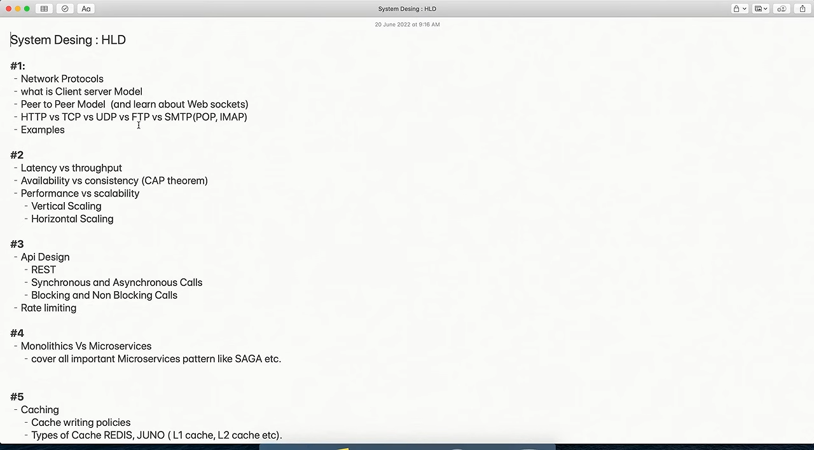
[00:00:11](https://www.youtube.com/watch?v=JwTiZ9ENquI&list=PL6W8uoQQ2c63W58rpNFDwdrBnq5G3EfT7&index=2&t=11s)

- Overview of the high-level design (HLD) topics to be covered:
    - Client-server model
    - Peer-to-peer (P2P) model
    - TCP vs UDP (including use cases)
    - WebSockets
    - WebRTC
- Practical design applications:
    - Designing WhatsApp (protocol selection)
    - Designing Google Meet (protocol selection)

### Definition and Purpose

- A network protocol defines the rules and regulations for communication between two systems
    - Without these rules, systems would not be able to understand each other
    - It acts as a common "language" that both systems must know to exchange information

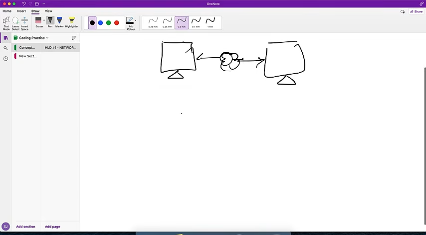
[00:01:17](https://www.youtube.com/watch?v=JwTiZ9ENquI&list=PL6W8uoQQ2c63W58rpNFDwdrBnq5G3EfT7&index=2&t=77s)

### Network Layers

- Communication is structured into different levels, specifically referring to the 7 layers of the network model

### Network Model Layers

- The network model consists of seven distinct layers:
    - Application layer
    - Presentation layer
    - Session layer
    - Transport layer
    - Network layer
    - Data link layer
    - Physical layer
- **[Focus Area]** For this study, only the following two layers will be covered:
    - Application layer
    - Transport layer

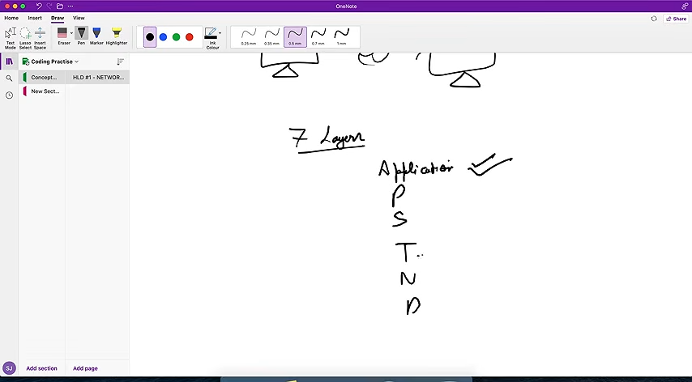
[00:01:42](https://www.youtube.com/watch?v=JwTiZ9ENquI&list=PL6W8uoQQ2c63W58rpNFDwdrBnq5G3EfT7&index=2&t=102s)

### Application Layer

- The Application layer is divided into two main protocol categories:
    - Client-Server protocols
    - Peer-to-Peer (P2P) protocols

### Application Layer Protocol Categories

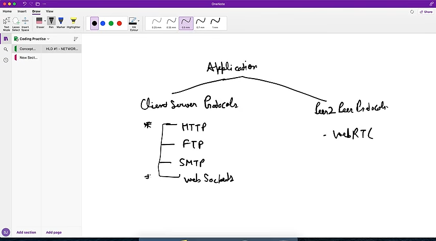
[00:02:38](https://www.youtube.com/watch?v=JwTiZ9ENquI&list=PL6W8uoQQ2c63W58rpNFDwdrBnq5G3EfT7&index=2&t=158s)

- **Client-Server Protocols**
    - HTTP
    - FTP
    - SMTP
    - WebSockets
- **Peer-to-Peer (P2P) Protocols**
    - WebRTC
- **[Key Focus Areas]** For high-level design (HLD), the most critical protocols to understand are:
    - HTTP
    - WebSockets
    - WebRTC

### Client-Server Model

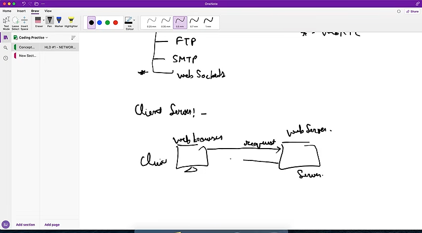
[00:03:32](https://www.youtube.com/watch?v=JwTiZ9ENquI&list=PL6W8uoQQ2c63W58rpNFDwdrBnq5G3EfT7&index=2&t=212s)

- The model consists of two primary entities:
    - **Client**: A system that initiates communication (e.g., a web browser)
    - **Server**: A system that runs the application and provides services
- **[Interaction Pattern]** It follows a request-response cycle:
    - The client sends a **request** to the server
    - The server sends a **response** back to the client
- Communication is initiated by the client, making it a one-way initiation process (client $\rightarrow$ server for the request)

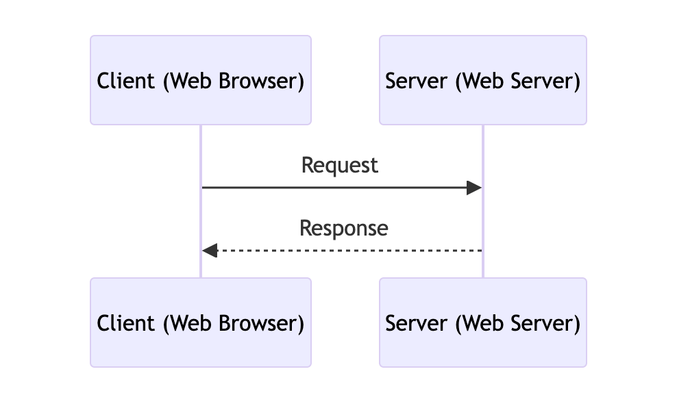

### WebSockets vs. Standard Client-Server Protocols

- While HTTP, FTP, and SMTP follow the standard request-response model, WebSockets differ in their communication flow
- **[Key Difference]** WebSockets enable **bi-directional communication**
    - The client can talk to the server
    - The server can also talk to the client

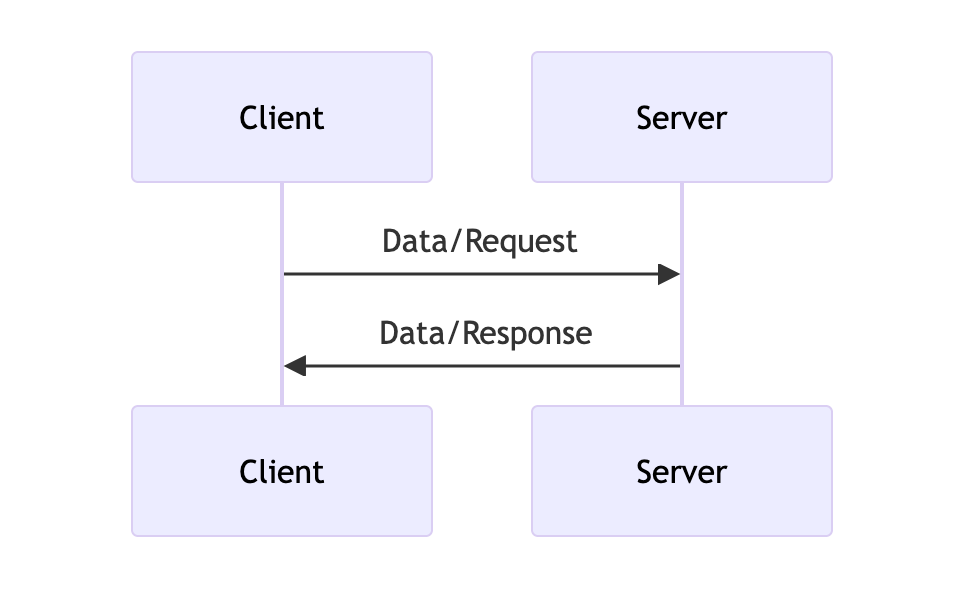

### Peer-to-Peer (P2P) Concept

- The speaker begins to differentiate between models by introducing multiple clients interacting with each other

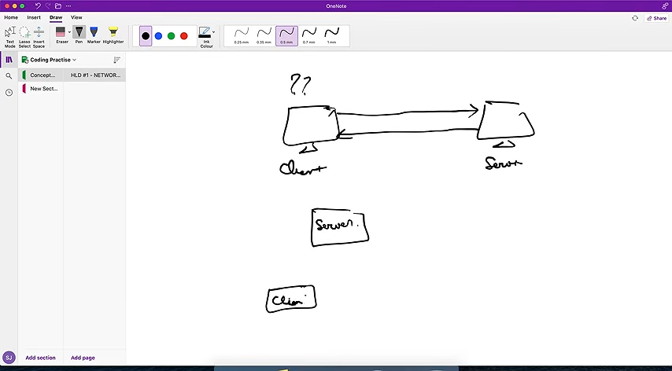
[00:04:25](https://www.youtube.com/watch?v=JwTiZ9ENquI&list=PL6W8uoQQ2c63W58rpNFDwdrBnq5G3EfT7&index=2&t=265s)

### WebSockets vs. Peer-to-Peer (P2P)

- **[Clarification]** Bi-directional communication does not necessarily mean a system is Peer-to-Peer
    - In a WebSocket setup, multiple clients can communicate with a central server
    - The server can send data to Client 1, and the server can send data to Client 2
    - Because the server is still the central hub facilitating the exchange, this remains a client-server model, not P2P

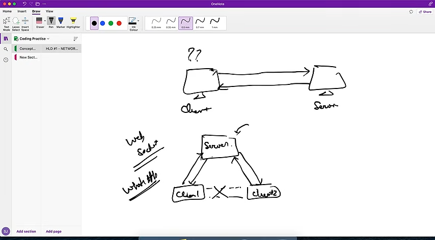
[00:05:01](https://www.youtube.com/watch?v=JwTiZ9ENquI&list=PL6W8uoQQ2c63W58rpNFDwdrBnq5G3EfT7&index=2&t=301s)

- **[Use Case] Messaging Applications**
    - Apps like WhatsApp or Telegram utilize WebSockets
    - WebSockets are chosen because they allow the server to push messages to the client efficiently in real-time

### Comparison of Client-Server Protocols

- **[HTTP] Hypertext Transfer Protocol**
    - It is connection-oriented
    - A single connection is used to access and navigate between web pages
- **[FTP] File Transfer Protocol**
    - It utilizes two distinct connections:
        - **Control Connection**: Used for managing the session/commands
        - **Data Connection**: Used for the actual transfer of files

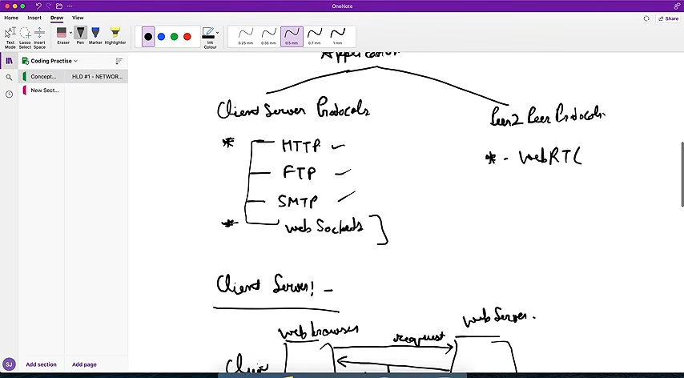
[00:05:18](https://www.youtube.com/watch?v=JwTiZ9ENquI&list=PL6W8uoQQ2c63W58rpNFDwdrBnq5G3EfT7&index=2&t=318s)

### Email Protocols

- **[SMTP] Simple Mail Transfer Protocol**
    - Used exclusively for **sending** emails
- **Email Access Protocols**
    - **[IMAP] Internet Message Access Protocol**
        - Used for accessing and reading emails
    - **[POP3] Post Office Protocol version 3**
        - Used for reading and downloading emails
        - **[Key Characteristic]** Once an email is downloaded via POP3, it is typically deleted from the server

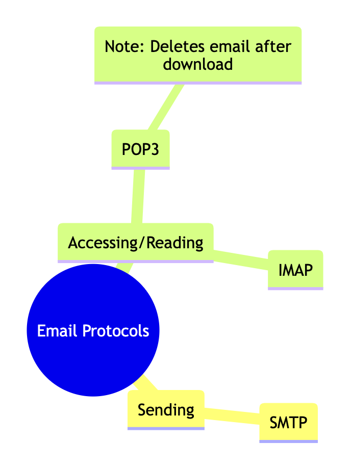

### Email Delivery Architecture

- **[Model Type]** Email follows a client-server architecture involving specialized agents
- **Message Transfer Agent (MTA)**
    - Acts as the primary system for moving mail between servers
    - Consists of an MTA Client and an MTA Server
- **User Agent (UA)**
    - The interface used by the end-user to send and receive messages

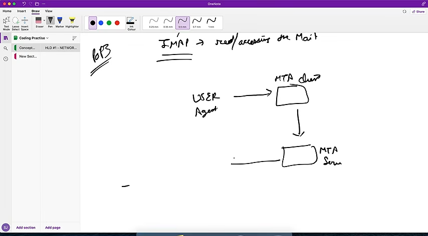
[00:07:12](https://www.youtube.com/watch?v=JwTiZ9ENquI&list=PL6W8uoQQ2c63W58rpNFDwdrBnq5G3EfT7&index=2&t=432s)

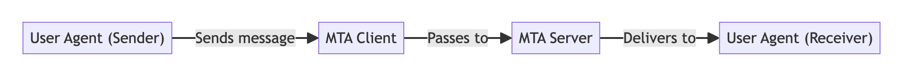

- **The Process Flow**
    - The User Agent sends a message to the MTA Client
    - The MTA Client communicates with the MTA Server
    - The MTA Server then passes the message to the recipient's User Agent

### Peer-to-Peer (P2P) Model

- In this model, the distinction between client and server is removed
    - Every node in the network can act as both a client and a server
    - This allows all participants to talk directly with each other
- **[Example Protocol]** WebRTC is a Peer-to-Peer protocol

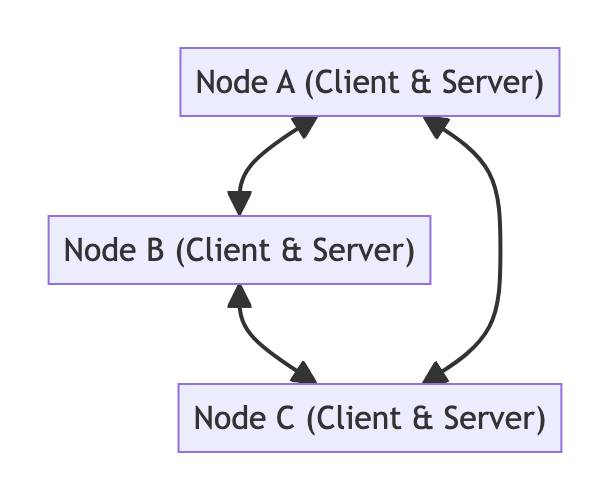

### Comparison of Network Models

| Feature | Client-Server | Peer-to-Peer (P2P) |
| --- | --- | --- |
| Roles | Fixed (one client, one server) | Fluid (nodes are both client and server) |
| Communication | Client requests, Server responds | All nodes can talk to each other |
| Example | HTTP, SMTP, WebSockets | WebRTC |

### Transport Layer Protocols

- The transport layer primarily utilizes two types of protocols:
    - **TCP/IP**
        - Maintains a virtual connection between systems
    - **UDP/IP**

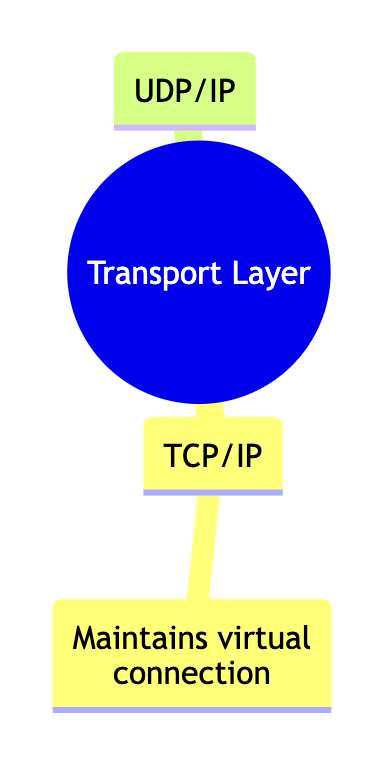

### TCP/IP Reliability Mechanisms

- **Data Packets and Sequencing**
    - Data is broken down into individual packets
    - These packets are assigned a sequence to ensure the correct ordering of data upon arrival
- **Acknowledgement System**
    - Every sent packet must be acknowledged by the receiver
    - **[Error Recovery]** If a packet (e.g., packet 2) is not acknowledged, the sender will transmit it again to ensure delivery

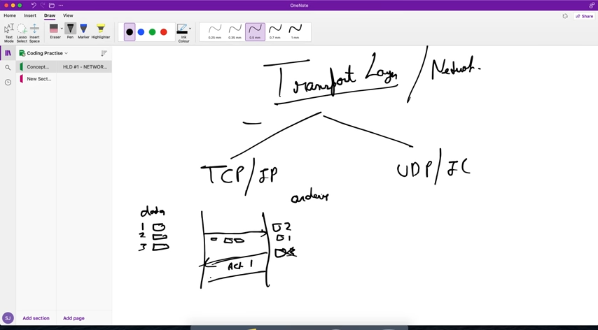
[00:09:32](https://www.youtube.com/watch?v=JwTiZ9ENquI&list=PL6W8uoQQ2c63W58rpNFDwdrBnq5G3EfT7&index=2&t=572s)

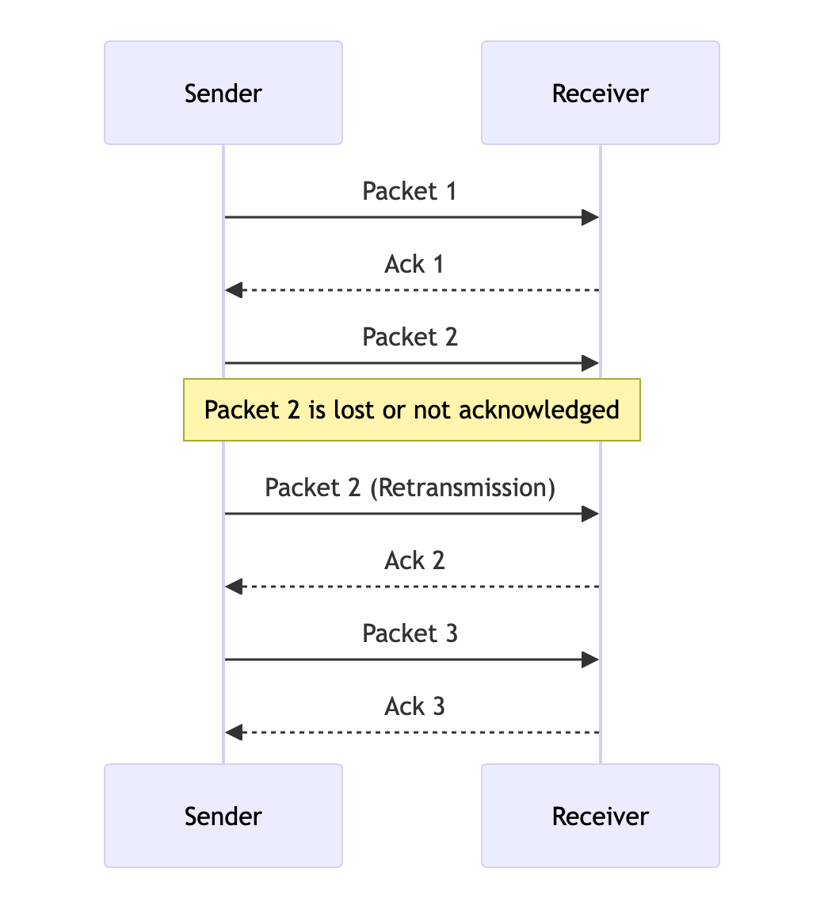

### UDP/IP Protocol

- Unlike TCP/IP, UDP/IP does not maintain a virtual connection
    - Data is divided into individual units called datagrams
    - These datagrams are sent in parallel across multiple virtual connections
- **[Consequence]** Because there is no established connection or sequencing mechanism, the original order of the packets may not be maintained upon arrival

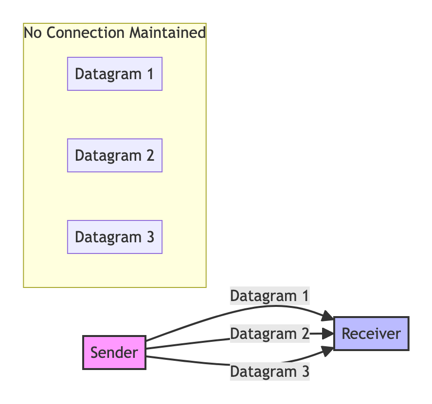

### UDP/IP Performance and Use Cases

- **[Why UDP is fast]** It avoids the overhead required by TCP/IP
    - No connection maintenance
    - No acknowledgement (ACK) requirement
    - No strict ordering of data
- **Best-effort mechanism**: UDP simply tries its best to transport the data without ensuring every bit arrives or in what order
- **Real-time applications**
    - Ideal for live streaming and video calling
    - **[Trade-off]** In these scenarios, it is better to lose a small packet (causing a momentary glitch) than to delay the entire stream waiting for a retransmission

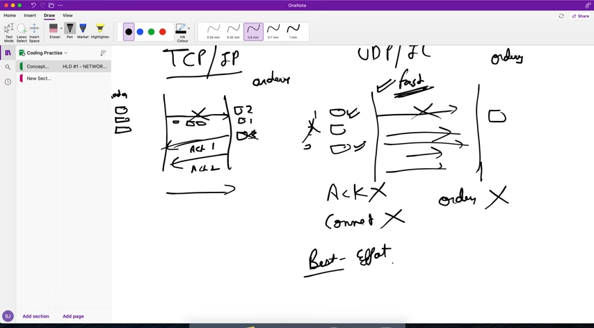
[00:10:53](https://www.youtube.com/watch?v=JwTiZ9ENquI&list=PL6W8uoQQ2c63W58rpNFDwdrBnq5G3EfT7&index=2&t=653s)

| Feature | TCP/IP | UDP/IP |
| --- | --- | --- |
| Speed | Slower (due to overhead) | Fast |
| Connection | Maintained | Not maintained |
| Ordering | Maintained | Not maintained |
| Acknowledgement | Required | Not required |

### Protocol Use Cases

- **WebRTC (Web Real-Time Communication)**
    - Uses UDP in its lower layers
    - **[Why?]** Because live streaming requires fast data access, and in these scenarios, losing a data packet is acceptable if it maintains speed
- **WebSockets**
    - Used when designing messaging applications
    - **[Why?]** Because they support two-way (bi-directional) communication

### WebSockets in Messaging Applications

- **[Why use WebSockets?]** Because they support two-way (bi-directional) communication
    - In a messaging app, if User 2 sends a message to User 1, the server must be able to push that message to Client 1
    - WebSockets allow the server to talk to the client just as easily as the client talks to the server

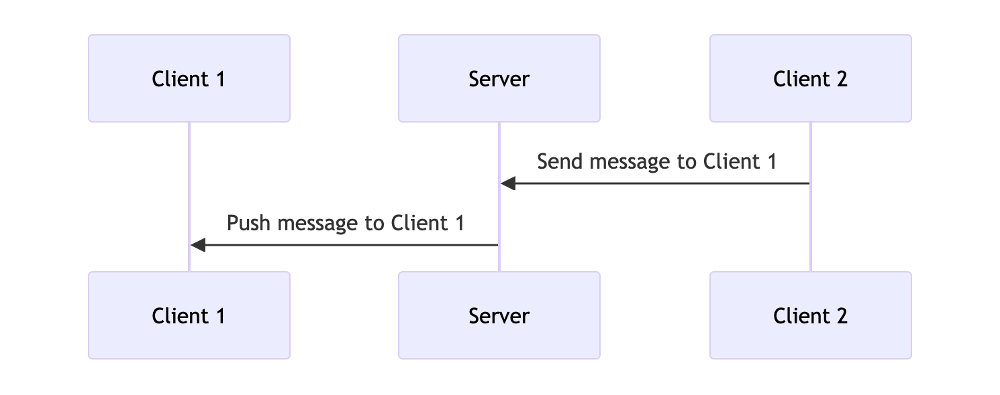

### Protocol Selection: HTTP vs. FTP

- The choice between protocols depends on the specific application requirements
- **[Security Note]** FTP is not encrypted, making it less suitable for certain use cases compared to protocols that offer better security

### Protocol Security: FTP vs. HTTPS

- **FTP (File Transfer Protocol)**
    - Not secure because the files being transferred are not encrypted
- **HTTPS (Hypertext Transfer Protocol Secure)**
    - Used as the secure alternative for file transfers because it provides encryption

### Summary of Protocol Use Cases

| Use Case | Recommended Protocol(s) |
| --- | --- |
| General Web Browsing | HTTP / HTTPS |
| Messaging Applications | WebSockets |
| Live Streaming / Video Calling | WebRTC / UDP |
| Reliable Data Transfer | TCP |

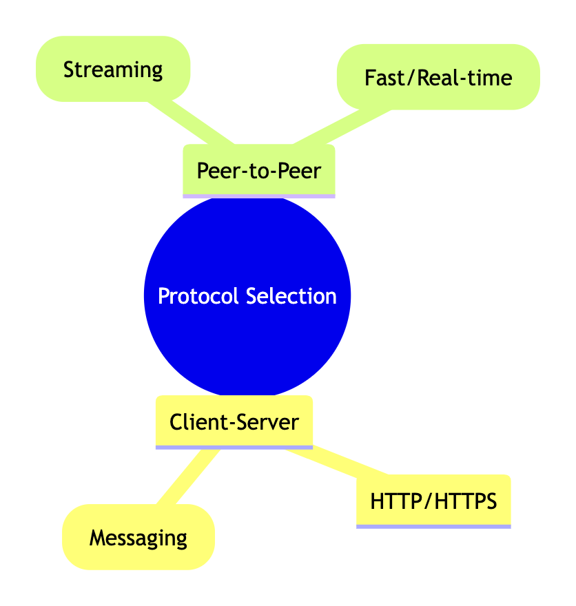