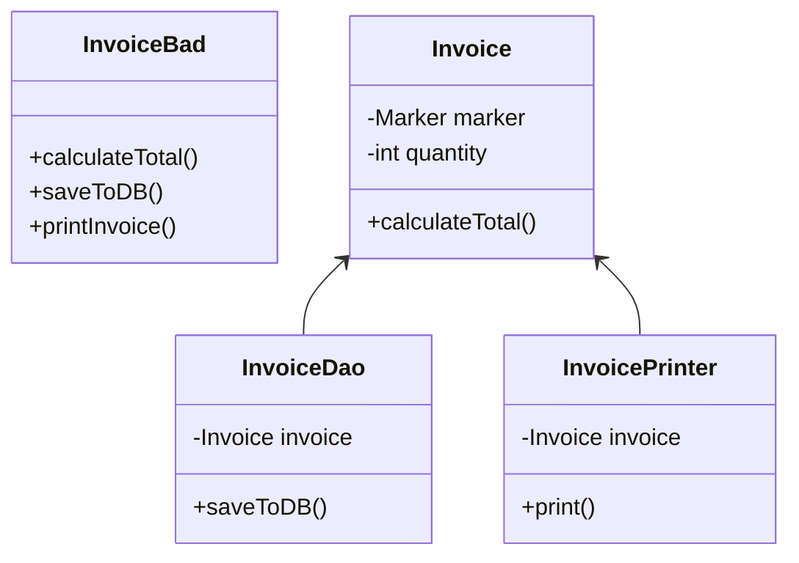
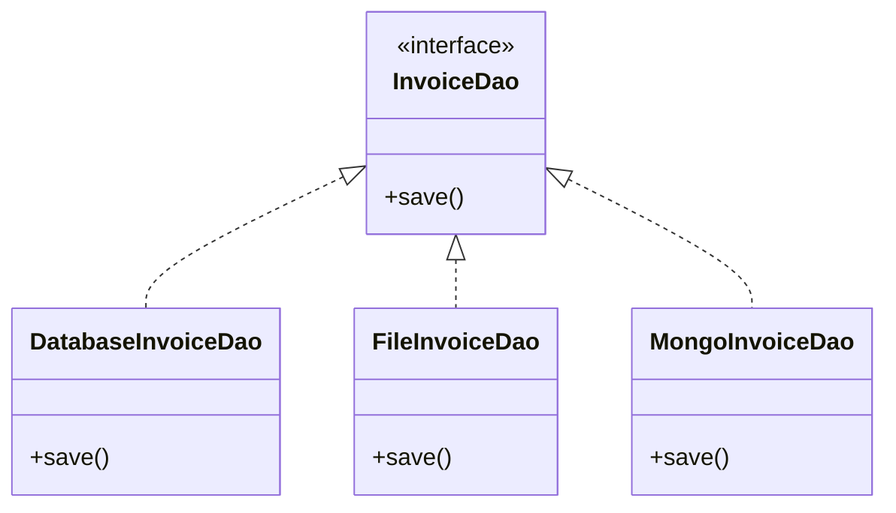
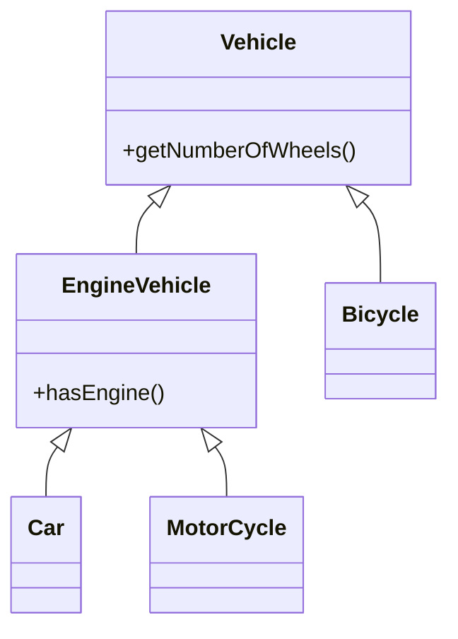
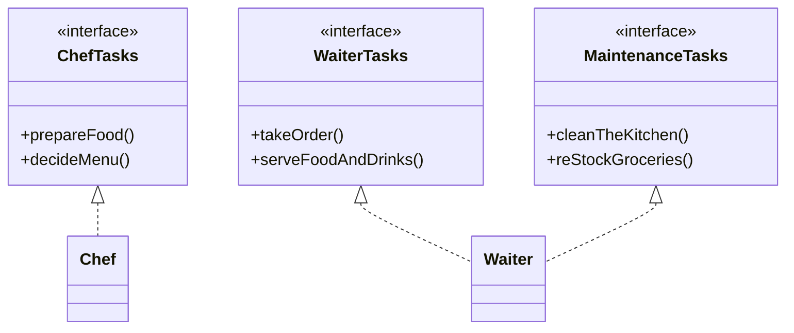
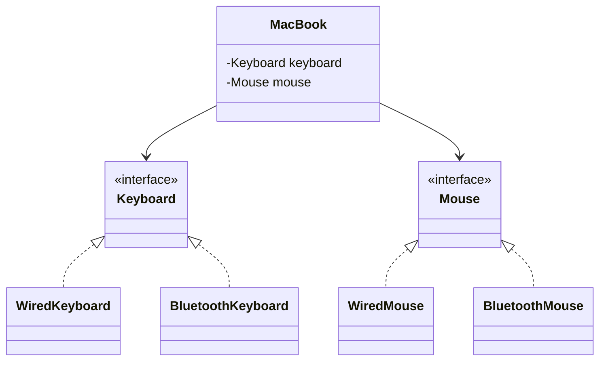

# SOLID Principles (LLD #1)

<!-- nav -->
[Index](00_LLD_Index.md) · [02 Strategy Pattern](02_Strategy_Pattern_Notes.md) ➡
<!-- nav -->

Sources: [SOLID PDFs (Drive folder)](https://drive.google.com/drive/folders/14Bigi6TB53HHjFJX8h5SjwZky4hJOO-W?usp=drive_link) · [Code on GitLab](https://gitlab.com/shrayansh8/lld-lowleveldesign/-/tree/main/src/main/java/com/conceptcoding/video1solid?ref_type=heads)

## In simple words
SOLID is a set of five habits that keep object-oriented code easy to change. Without them, every new feature means editing old, working classes, and each edit risks breaking something. With them, you add new classes and leave the old ones alone.

| Letter | Principle | One-line meaning |
|---|---|---|
| **S** | Single Responsibility | A class should have **one reason to change**. |
| **O** | Open / Closed | **Open for extension, closed for modification.** Add behaviour by adding code, not by editing code. |
| **L** | Liskov Substitution | A child class must be usable **anywhere its parent is used**, without surprises. |
| **I** | Interface Segregation | Prefer **small, focused interfaces**. Nobody should implement methods it doesn't need. |
| **D** | Dependency Inversion | Depend on **abstractions (interfaces)**, not on concrete classes. |

---

## S – Single Responsibility Principle (SRP)
**Idea:** if a class does several jobs, a change to one job can break the others.

**Violation.** `Invoice` calculates the total, saves to the database *and* prints. A change in tax rules, in the database or in the print format all force edits to the same class.

**Fix.** One class per job: `Invoice` (data and total), `InvoiceDao` (saving), `InvoicePrinter` (printing).

**Diagram – before and after**



*`InvoiceBad` stands for the original `Invoice` class that did three jobs.*

**Benefits:** easier to maintain and test (each class alone), and reusable (the same printer works for any invoice type). SRP doesn't mean "one method per class", only one *purpose*.

---

## O – Open / Closed Principle (OCP)
**Idea:** tested, deployed code should not be edited just to add a feature.

**Violation.** `InvoiceDao` has `saveToDB()`. Later `saveToFile()` is added to the same class. Next week someone wants `saveToMongoDB()`, and the class is edited again.

**Fix.** Make an interface `InvoiceDao { save() }` and one class per way of saving. A new storage type is a new class.

**Diagram – extension without modification**



*`MongoInvoiceDao` is the "new feature": added without touching the other classes.*

*Each storage option is its own class*

```java
public class DatabaseInvoiceDao implements InvoiceDao {
    Invoice invoice;

    public DatabaseInvoiceDao(Invoice invoice) {
        // set the invoice
        this.invoice = invoice;
    }

    @Override
    public void save() {
        // Save into the DB the invoice
        System.out.println("Saving to DB...");
    }
}
```

**Benefits:** less risk of breaking working code, less re-testing, and behaviour can be chosen at run time through polymorphism.

---

## L – Liskov Substitution Principle (LSP)
**Idea:** if code works with a `Vehicle`, it must also work with any subclass of `Vehicle`. A subclass must not break the promises of its parent.

**Violation.** `Vehicle` has `hasEngine()` and the subclasses `Car`, `MotorCycle` and `Bicycle` all extend it. `Bicycle` has no engine, so it has to return `false` or throw, and code that assumes "every vehicle has an engine" breaks. The same problem occurs with a `Bike` interface that forces every bike to have `turnOnEngine()`.

**Fix.** Split by capability: `Vehicle` holds what *all* vehicles share. `EngineVehicle` (with `hasEngine`) is a child for the vehicles that really have one. `Bicycle` extends only `Vehicle`.

**Diagram – before and after**



**Rule of thumb:** if a child needs to throw "not supported" for a parent method, the hierarchy is wrong.

---

## I – Interface Segregation Principle (ISP)
**Idea:** don't force a class to implement methods it will never use.

**Violation.** One fat interface `RestaurantEmployee` has `prepareFood`, `decideMenu`, `takeOrder`, `serveFoodAndDrinks` and `cleanTheKitchen`. A `Waiter` must implement `prepareFood` and `decideMenu` too, although it never cooks.

**Fix.** Split into small interfaces: `ChefTasks`, `WaiterTasks`, `MaintenanceTasks`. Each class implements only what it does.

**Diagram – small interfaces**



**Benefit:** classes stay small and focused, and a change to one interface affects only its users.

---

## D – Dependency Inversion Principle (DIP)
**Idea:** high-level code (the "what") should not depend on low-level details (the "how"). Both should depend on an interface.

**Violation.** `MacBook` takes a `WiredKeyboard` and a `WiredMouse` directly. To use Bluetooth devices you must rewrite `MacBook`.

**Fix.** Define `Keyboard` and `Mouse` interfaces. `MacBook` depends on those. `WiredKeyboard`, `BluetoothKeyboard` and the mouse classes implement them and are *passed in* (dependency injection).

**Diagram – depend on interfaces**



**Benefit:** you can swap implementations (also for tests) without touching the high-level class.

---

## How they work together
- **SRP** keeps classes small. **ISP** keeps interfaces small.
- **OCP** and **DIP** let you add behaviour by plugging in new classes behind an interface.
- **LSP** makes sure that plugging in a new subclass never breaks the code that uses it.
- Many design patterns in the next notes (Strategy, Decorator, Factory, Observer) are just these ideas put to work.

---

<!-- nav -->
[Index](00_LLD_Index.md) · [02 Strategy Pattern](02_Strategy_Pattern_Notes.md) ➡
<!-- nav -->
