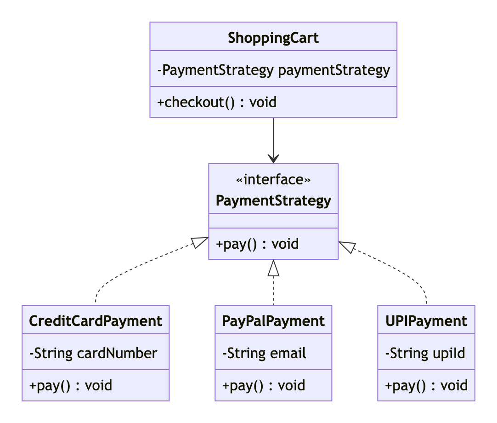
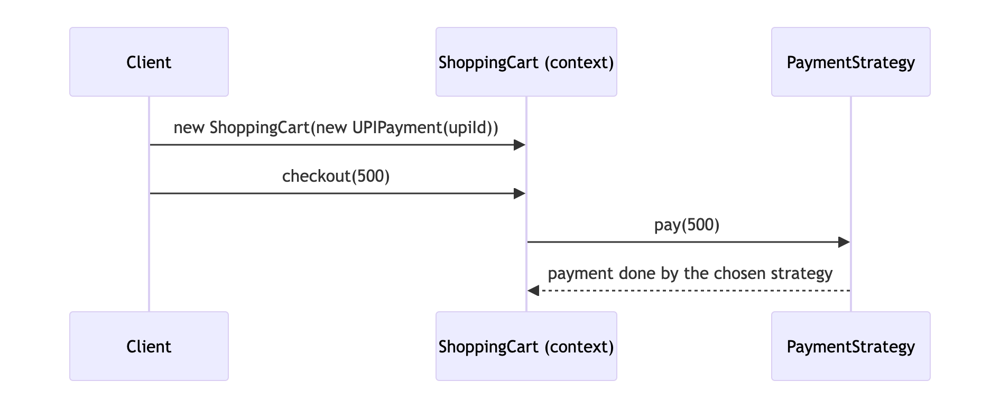
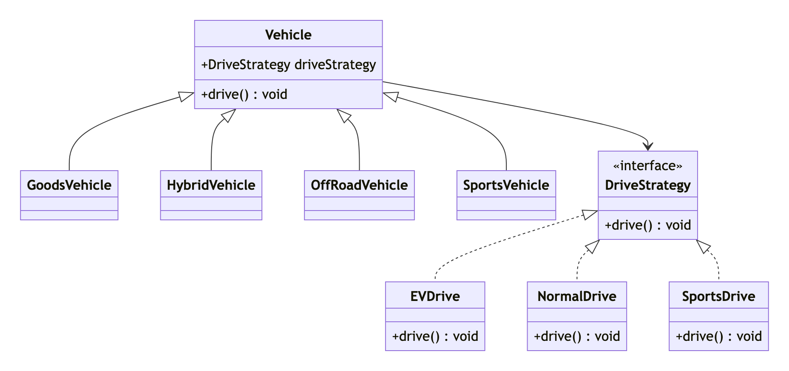

# Strategy Pattern (LLD #2)

<!-- nav -->
⬅ [01 SOLID Principles](01_SOLID_Principles_Notes.md) · [Index](00_LLD_Index.md) · [03 Observer Pattern](03_Observer_Pattern_Notes.md) ➡
<!-- nav -->

Sources: [Strategy PDF](https://drive.google.com/file/d/1smTeCvuc9aQwZS7gd-vxPs75wezuYAFp/view?usp=drive_link) · [Code on GitLab](https://gitlab.com/shrayansh8/lld-lowleveldesign/-/tree/main/src/main/java/com/conceptcoding/behavioralpatterns/strategy)

## In simple words
**Strategy** lets a class pick *how* it does a job from several interchangeable ways, **at run time**. Instead of a big `if / else` (or `switch`) that chooses the algorithm, you put each way into its own small class behind a common interface and hand the right one to the main class.

Think of Google Maps: the job is "go from A to B", and you choose the strategy: car, bike or walking.

## The problem it solves
A `PaymentProcessor` decides what to do with `if (type == "CARD") ... else if (type == "UPI") ...`. Adding a wallet means editing this class again (breaking the Open/Closed principle), and every payment type is tangled in one place.

## The solution
- **Strategy interface** – `PaymentStrategy` with one method, `pay(amount)`.
- **Concrete strategies** – `CreditCardPayment`, `UPIPayment`, `PayPalPayment`: each holds its own details and logic.
- **Context** – `ShoppingCart` holds *a* `PaymentStrategy` and just calls `pay()`. It doesn't know which one it has.

**Diagram – Payment example**



**Diagram – what happens at checkout**



*The context only knows the interface*

```java
public class ShoppingCart {
    private PaymentStrategy paymentStrategy;

    public void setPaymentStrategy(PaymentStrategy strategy) {
        this.paymentStrategy = strategy;
    }

    public void checkout(double amount) {
        System.out.print(this.paymentStrategy.getClass().getSimpleName() + ": ");
        paymentStrategy.pay(amount);
    }
}
```

## Second example: vehicle drive modes
`Vehicle` has a `DriveStrategy` (`NormalDrive`, `SportsDrive`, `EVDrive`). A `SportsVehicle` and an `OffRoadVehicle` just pass a different strategy. Before the pattern, each subclass repeated its own `drive()` code, and two subclasses with the same behaviour duplicated it.

**Diagram – Drive mode example**



## When to use
- One job can be done in several ways (payment, sorting, discount rules, routing, compression).
- You see a long `if/else` choosing an algorithm.
- You want to change the algorithm while the program runs, or to add new ones without editing old code.

## Pros and cons
- ✅ Follows Open/Closed: add a strategy without touching existing classes.
- ✅ Each algorithm is isolated, easy to test and reuse.
- ✅ Replaces conditionals with polymorphism.
- ❌ More classes.
- ❌ The caller must know which strategy to choose.

**Related:** Strategy picks behaviour *from outside*; **State** changes behaviour *by itself* as the object's state changes.

---

<!-- nav -->
⬅ [01 SOLID Principles](01_SOLID_Principles_Notes.md) · [Index](00_LLD_Index.md) · [03 Observer Pattern](03_Observer_Pattern_Notes.md) ➡
<!-- nav -->
